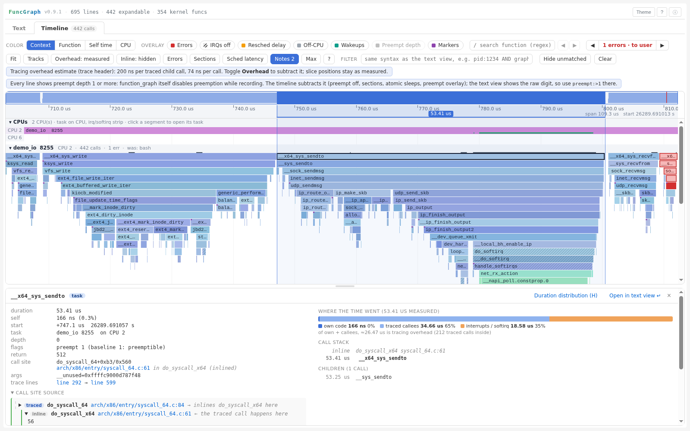
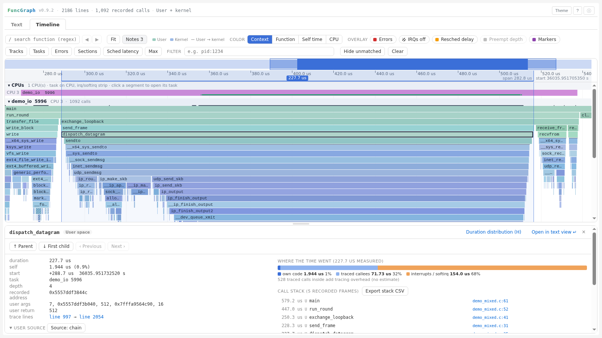

# FuncGraph - 专业 Linux ftrace 可视化工具

FuncGraph 支持可视化仅用户态、仅内核态和混合 uftrace 记录。混合报告在时间轴标记每处匹配的用户态 → 内核态分界。详见 [uftrace 构建与报告指南](docs/uftrace.cn.md)。

**raw 输入**：`funcgraph trace.dat --timeline --output trace.html` 支持带元数据的 trace-cmd 二进制容器，需要可选原生库和本机 C 编译器。支持压缩/stdin、纳秒时间戳和 `--raw-instance NAME`；不支持独立 `trace_pipe_raw` 裸页。文本模式不新增依赖。详见 [raw 使用与构建文档](docs/raw-input.cn.md)。

普通 CLI 输出仍是可离线打开的单文件。大报告可显式运行 `funcgraph TRACE --timeline --report-mode sidecar --output REPORT_DIRECTORY`，再用 `fgview REPORT_DIRECTORY` 打开：默认进入 Timeline，不下载或创建逐行 Text；Compare 独立加载。首次进入 Text 或跳转行号/锚点时，超过 4,096 条 Text 记录的报告按最多 4,096 条分块校验下载，提供进度、取消和重试。默认 renderer 的 Text HTML 资源缓存独立限制为 4 块 / 16 MiB 已校验字节；准备阶段仍在文档外累计**全部行后再挂载**，最终布局仍可能阻塞，完整 DOM 仍常驻。Timeline 统一过滤只加载索引，不创建 Text DOM；sidecar 源码正文按最多 64 条记录按需读取，使用独立的 8 块 / 16 MiB 资源缓存，单文件源码仍内嵌。这些缓存预算不是整个报告的内存上限。可用 `--report-mode auto --sidecar-threshold BYTES` 自动分流：只有完整 HTML 超过显式字节阈值才进入 sidecar，更小或相等时在同一独立目录内保留离线 `index.html`。没有默认阈值，也不自动启用 Text 窗口化，详见[查看器指南](docs/viewer.cn.md)。

新分块 sidecar Text 还会在浏览器支持时跳过离屏块的布局；过滤、折叠和导航仍使用完整 trace，选中/聚焦块及已展开源码保留正常布局。不支持的浏览器和打印使用完整布局。全部 DOM/模型记录仍常驻，这不是具有 DOM 上限的窗口化。

**实验性 Text 窗口化**：新生成的分块 sidecar 可显式启用真正的最多 160 行 DOM 窗口。在 Text 工具区选择 **Windowed Text**（会重载报告），或在 HTTP 报告 URL 后加 `?text=windowed`，再进入 Text。筛选、调用折叠、任务/耗时排序、跳行及源码展开仍以完整记录为准；**Copy** 复制所有可见 trace 记录，不限于已挂载行。**Full Text** 可恢复完整渲染，Expand/Collapse All 和整篇文档快捷键也会先切换完整模式，避免只处理当前窗口。完整元数据和 Timeline 仍常驻，**不代表总内存有上限，也没有新增自动阈值**。用法、限制及复现实测见[窗口化说明](docs/performance-text-window.md)。

窗口模式选择 **Order: by task** 后，即使原分组标题已淘汰，当前任务仍固定在工具栏下方；提示跟随视口而非选中行，横向滚动时保持可读，沿用现有主题配色。标题中的行数表示完整任务组，不是当前筛选命中数。

窗口重建复用预备的原始记录索引；无筛选时，折叠状态复用现有范围索引，使用临时的每行 1 字节掩码，避免逐行重查祖先链；有筛选时保留逐匹配记录的判断。任务/耗时 ordinal 数组仍最多另增每行 8 字节；全量处理仍可能阻塞，不改变默认开启策略。稀疏/密集折叠实测、内存成本和限制见[折叠范围优化](docs/performance-text-fold-visibility.md)及[前一阶段](docs/performance-text-geometry.md)。

窗口重建改为一次提交完整导航可见性，避免逐行重复查 Set/Map；私有状态缓存与每次临时输入各增加每行 1 字节。完整重排校验和已挂载行的折叠投影不变。热操作改善及冷读取等剩余阻塞见[导航批量更新实测](docs/performance-text-navigation-visibility.md)，不代表页面已无卡顿。

窗口冷耗时排序在超过 16,384 条记录时分批稳定排序，批间让出主线程，完整排列准备好前保留旧窗口；改变排列或离开 Text 会取消过期工作。小输入及非有限耗时保留原生排序，其他完整模型计算和 DOM 解析仍可能阻塞。用法、内存成本及实测见[协作式排序](docs/performance-text-cooperative-ranking.md)。

[](https://github.com/pengdonglin137/FuncGraph/actions/workflows/ci.yml)

[](https://pengdonglin137.github.io/FuncGraph/sample.html)


> **在线试用**：[首页](https://pengdonglin137.github.io/FuncGraph/) · [用户态 + 内核态](https://pengdonglin137.github.io/FuncGraph/sample_mixed.html) · [纯内核态](https://pengdonglin137.github.io/FuncGraph/sample.html)（在浏览器中直接打开，无需安装）。
>
> **详细使用指南**：[中文](docs/guide.cn.md) · [English](docs/guide.en.md)（采集选项、各视图字段与配色的含义、分析面板、对比、导出、常见问题）。设计文档：[docs/design.md](docs/design.md)。
>
> **按场景上手**：[离线复现、预设、对比与大报告](docs/examples.cn.md) · [三种模式的完整采集案例](docs/capture.cn.md) · [pigz + zlib 业务案例](docs/pigz.cn.md)（含编译选项、原始记录、源码配置、结果核对和产物说明）。

窗口模式还会复用未改变的完整导航/耗时排列，避免滚动反馈打断重建；
[7.2 万 / 37.2 万行交互实测与剩余瓶颈](docs/performance-text-rebuild.md)已记录。

## FuncGraph 是什么？

FuncGraph 将内核 `function_graph` 文本、trace-cmd raw 容器和 uftrace 用户态 / 混合记录转换为交互式、可过滤的 HTML 报告，适用于内核开发与应用到内核的调用分析：支持源码跳转、高速地址解析、参数/耗时过滤与键盘友好折叠。没有匹配的调试镜像也能先查看调用结构；源码与类型解析需要对应的调试信息。

## 速查（Cheat Sheet）

- 常用选项：`--fast`、`--filter`、`--func-links`、`--highlight-code` 🔧
- 过滤语法：`cpu:3 AND duration:>10 sort:desc` ⏱️
- 调用树过滤：`graph:funcname`（显示调用树）、`notrace:funcname`（隐藏调用树）🌲
- Latency 过滤：`irqs:d AND hirq:h`（仅限 latency 模式 trace）🔎
- 键盘：Tab 聚焦折叠图标；Enter 切换折叠；Esc 清除选择 ⌨️

## 主要特性

- 交互式 ftrace 可视化与折叠/展开
- 可点击源码链接（在线或本地），支持高亮选项
- 高性能地址解析（`fastfaddr2line.py`）
- **统一过滤器**：`field:value` 语法，支持 AND/OR/NOT 逻辑运算，字段按钮下拉选择
- **调用树过滤**：`graph:func` / `notrace:func` 显示/隐藏完整调用树（等效 ftrace 的 `set_graph_function` / `set_graph_notrace`）
- **Latency 字段支持**：解析 irqs-off、need-resched、hardirq/softirq、preempt-depth
- 键盘友好导航与可访问折叠控制
- **时间轴标签页**（`--timeline`）：按任务的时序火焰图，按上下文、关中断、调度延迟、off-CPU 和错误路径配色

## 示例

[sample.html](sample.html)（[在线打开](https://pengdonglin137.github.io/FuncGraph/sample.html)，3.0 MiB）是 [samples/sample_io.txt](samples/sample_io.txt) 的报告。采集的是一个进程（[samples/demo_io.c](samples/demo_io.c)）：读一个文件的 4 KB，写 4 KB 到另一个文件，通过 loopback 给自己发一个 UDP 包再收回来，最后在空队列上再调一次 `recvfrom`（返回 `-EAGAIN`）。只跟踪这四个系统调用，从入口函数（`__x64_sys_*`）开始，带参数、返回值、调用点和调度事件；打开文件、创建 socket 都在它们之前完成，不跟踪。这五次调用跨度为 132 us：共 739 行，485 次记录调用，无丢事件或截断调用。

可以看的地方：
- **时间轴**：`__x64_sys_sendto` 依次经过 `udp_sendmsg -> ip_output -> loopback_xmit`，接收端（`net_rx_action -> process_backlog -> udp_rcv`）在同一次调用末尾的软中断里执行（绿色）。总览截图选中 `sendto`（73.43 us）内部的 `process_backlog`（24.21 us）。
- **错误**：一条错误链，`udp_recvmsg -11 EAGAIN`，由 `__x64_sys_recvfrom` 返回到用户态。
- **文本视图**：每行带参数；展开一行可以看到调用点的源码和内联链（[samples/sample_text.png](samples/sample_text.png)）。

生成方法：

```bash
# 在目标机上（QEMU x86_64，内核 7.4.0-rc2），root 权限
gcc -O2 -static -o /tmp/demo_io samples/demo_io.c
dd if=/dev/urandom of=/tmp/demo_in.bin bs=4096 count=1
dd if=/dev/zero of=/tmp/demo_out.bin bs=4096 count=1
cat /tmp/demo_in.bin /tmp/demo_out.bin > /dev/null      # 预热 page cache
fgcapture.sh --args --sched --calibrate \
    -g __x64_sys_read,__x64_sys_write,__x64_sys_sendto,__x64_sys_recvfrom \
    -o sample_io.txt -- /tmp/demo_io

# 在主机上
python3 funcgraph.py --timeline --tail-calls --enable-fold --filter --func-links --highlight-code --fast \
    --vmlinux /vol_1t/Qemu/linux/x86_64/vmlinux --kernel-src /vol_1t/Qemu/linux \
    --source-rev 7475ea8b58616b33c04afb976cf0fbaad9dd63fb \
    --source-browser github --source-browser-rev v7.4-rc2 \
    --output sample.html samples/sample_io.txt

# 更新总览、Text 示例和指南截图（需要 Playwright + Chromium）
FG_CONFIG=/dev/null python3 samples/make_shots.py
FG_CONFIG=/dev/null python3 docs/img/make_shots.py
```

示例于 2026 年 11 月 10 日重新采集。trace、QEMU 运行内核与宿主构建信息均为 `7.4.0-rc2`、`#3`（`Tue Nov 10 21:07:54 CST 2026`）。宿主源码 `/vol_1t/Qemu/linux` 没有已跟踪文件的修改，其上述提交与 GitHub 上独立核实的上游 `v7.4-rc2` 标签指向一致。内嵌源码读取该固定本地提交，外部 GitHub 链接固定到该标签，而非会变化的 `master`。本次标定为每个被跟踪子调用 143 ns、每次调用自身 77 ns。旧 `sample_io_slow.txt` 保留为 7.2.0+ 历史采集，用于 Compare 演示，不作为受控的跨版本性能基准。

### 用户态 + 内核态混合示例

[](https://pengdonglin137.github.io/FuncGraph/sample_mixed.html)

本地打开 [sample_mixed.html](sample_mixed.html)，也可以点截图在线查看。在 **Timeline** 选中 `dispatch_datagram` 可看用户态参数、返回值和记录的函数地址；选中 `__x64_sys_sendto` 可看调用顶边细线和调用栈分界。Text 同一入口旁的 `K` 带下划线。这份 QEMU 上对 [`demo_mixed.c`](samples/demo_mixed.c) 的实际采集有 5 处匹配的跨态边界，采集和重建步骤见 [uftrace 指南](docs/uftrace.cn.md)。

样例还保留了真实的 14 条任务切换、28 条 waking 和 7 条 wakeup。补丁版 `fguftrace record -K ... --kernel-full-info` 独立启用这些内核事件，不受 perf 的 `--no-sched` 影响，详见[记录任务切换](docs/uftrace.cn.md#记录任务切换)。初始视野聚焦调用，概览条与 **Fit trace** / `0` / `Home` 覆盖全部调度上下文；**Tools → Navigate → Fit calls** 返回调用范围，不改变过滤或分析。CPU 调度边界不必与 `main` 重合，详见 [CPU 覆盖说明](docs/cpu-coverage.md)。

更新后的混合样例使用 `--auto-args`，25 次用户调用中有 16 次带可读参数、19 次带可读返回值，同时保留 25 个真实用户态调用点、内核入口位置及 465 个已解析的内核调用点（其中 282 个含内联链），内核链接固定到 Linux `v7.4-rc2`。分别选中两次 `receive_frame`，源码落在不同的调用行 `demo_mixed.c:47` 和 `demo_mixed.c:49`，不再都定位到函数入口。匹配的 BTF 不仅提供参数名，还裁剪参数个数、参数和返回值位宽及符号；例如 `__x64_sys_sendto` 只显示真实的一个 `pt_regs` 指针，原始寄存器槽和返回位模式仍可展开核对。该函数的调用栈入口仍是 `net/socket.c:2286`，**Call site source** 展示 `do_syscall_x64` 中的 `arch/x86/entry/syscall_64.c:61`。调用点地址（return PC − 1）、原始返回 PC 与被调函数入口地址分开保留，用户态源码和参数不会误用内核的链接或 BTF。

---

<!-- Installation & Usage continues below -->

## 安装与使用

### 需求

- Python 3.8+
- addr2line（来自 binutils）
- pyelftools（`--fast` 需要）
- 可选：Pygments（用于语法高亮）

### 安装发布包

从 GitHub Releases 下载 wheel，安装时可以一并启用可选依赖：

```bash
python3 -m pip install './funcgraph-<version>-py3-none-linux_x86_64.whl[all]'
fguftrace --version
fgreport -P trace.txt
```

将 `<version>` 替换为实际下载文件名中的版本；源码升版并不表示已经发布 GitHub Release。

Linux x86_64 / aarch64 的 wheel **内含带补丁的 uftrace 可执行程序和 libmcount 采集库**，
不是让用户另行下载；ARM64 请选择文件名中的 `linux_aarch64`。它们在 Ubuntu 22.04 上构建，
属于 Linux 平台包，不冒充 manylinux；需要兼容的 glibc 和系统库（Ubuntu 上为
`libelf1`、`libdw1`、`libtraceevent1`、`liblzma5`、`libstdc++6`）。
`py3-none-any` wheel 与源码包仍作为不含原生程序的 Python-only 回退版本。

安装后可使用 `funcgraph`、`fgreport`、`fguftrace`、`fgcapture`、`fastfaddr2line` 和 `fgcapture.sh`。
基础包不依赖第三方 Python 库，`[all]` 额外安装 pyelftools 和 Pygments。
推送与代码版本一致的 `vX.Y.Z` 标签，会自动测试、构建 wheel 和源码包，
并发布到 GitHub Release（不发布到 PyPI）。构建及发布步骤见
[中文发布操作清单](docs/releasing.cn.md)（含版本标签、自动打包、发布验证和故障处理）。

### 仅用户态与混合模式

`fguftrace` 默认调用安装包内的采集程序，并自动设置随包采集库的位置。
`funcgraph --uftrace DIR` 和 `fgreport --uftrace DIR` 同样优先使用内置版本，其次查找
`PATH` 上带补丁的 uftrace；`--uftrace-bin PATH` 仅用于手动覆盖，**不必每次传路径**。
导入已保存的 JSONL 不需要 uftrace 可执行程序。

下面的 `-pg` 示例适用于 x86_64。ARM64 请改用 `-fpatchable-function-entry=2`
编译，并在 `fguftrace record` 中增加 `-P .`；内置程序无需 Capstone 即可跟踪这两个
入口 NOP，已在树莓派验证参数和返回值。ARM64/GCC 的 `-pg` 仍会破坏首参，旧记录需要
重新采集；共享库也必须正确插桩并显式选择，见[架构说明](docs/uftrace.cn.md#安装和选择采集程序)。

```bash
cc -pg -g -O0 -fno-omit-frame-pointer -o demo_mixed samples/demo_mixed.c
printf 'FuncGraph demo\n' > demo-input.txt
: > demo-output.txt
fgcapture --user -o user.data -- ./demo_mixed demo-input.txt demo-output.txt
funcgraph --no-config --uftrace user.data --timeline --enable-fold --filter \
    --user-src "$PWD" --output user.html
fgreport -P --uftrace user.data -- --user-src "$PWD"
```

**混合采集**现在只需一条命令，自动配置参数、调用点、统一时钟、调度和 exec/exit：

```bash
sudo "$(command -v fgcapture)" --mixed -o mixed.data -- ./demo_mixed demo-input.txt demo-output.txt
```

封装拒绝占用正在运行的 tracefs，会在完成、失败或中断后恢复并核对原有设置。
默认采集 syscall 根下 8 层内核调用，不冒充无限深度全内核采集。范围调整与保护限制见
[统一采集指南](docs/capture.cn.md)，业务案例见 [pigz + zlib 实战](docs/pigz.cn.md)。仅用户态或仅内核态输入
无需特殊转换，混合展示会在两态之间显示分界线。

混合报告需要**分别配置两套源码**；下面的内核镜像和提交必须替换为采集时运行的版本：

```bash
funcgraph --no-config --uftrace mixed.data --timeline --enable-fold --filter \
    --user-src /path/to/user/build --vmlinux /path/to/matching/vmlinux \
    --kernel-src /path/to/linux --source-rev KERNEL_COMMIT --func-links --highlight-code \
    --source-browser github --source-browser-rev KERNEL_COMMIT --output mixed.html
```

`--user-src` 不负责内核源码或内核 URL；`--source-rev` 选择内嵌的内核内容，browser 参数选择
网页链接。没有匹配镜像时可省略内核参数，混合调用关系仍可查看，但不解析内核源码。

### 快速上手：`fgreport`

`fgreport` 是 `funcgraph.py` 的封装：默认打开全部功能，内核路径保存在预设里，生成报告只需一条短命令：

```bash
# 每个内核做一次：把 vmlinux、源码目录等写进 ~/.config/funcgraph/config.ini
./fgreport init pi4 --vmlinux /path/to/vmlinux --kernel-src /path/to/linux \
    --cross-compile aarch64-linux-gnu- --source-browser github --source-browser-rev v6.18 --default

./fgreport trace.txt                 # 生成 trace.html，放在 trace 旁边（时间轴、折叠、过滤、源码链接、语法高亮）
./fgreport -p vm72 --open trace.txt  # 换一个预设，并在浏览器中打开
./fgreport --lite trace.txt          # 快速查看：不生成源码块和链接
./fgreport -c before.txt after.txt   # 带 Compare 标签页
./fgreport trace.txt -- --pid 1234   # -- 之后的参数原样传给 funcgraph.py
./fgreport presets                   # 列出预设（* 表示默认）
./fgreport --report-mode auto --sidecar-threshold 67108864 --open trace.txt  # 示例 64 MiB；输出 trace.report
```

装了 pyelftools / Pygments 时自动加 `--fast` / `--highlight-code`；single 模式超过 15 万行时自动改用 `--timeline --no-text-view`（`--text` 保留文本视图），目录模式则保留 Text。运行前会打印实际执行的 `funcgraph.py` 命令（`-n` 只打印不执行）；目录模式的 `--open` 通过 `fgview` 提供本机只读服务，按 Ctrl+C 结束。

### 基本用法

```bash
python3 funcgraph.py trace.txt \
    --vmlinux /path/to/vmlinux \
    --kernel-src /path/to/kernel/src \
    --module-dirs /path/to/modules \
    --base-url https://elixir.bootlin.com/linux/v6.18/source \
    --filter \
    --fast \
    --highlight-code \
    --output result.html
```

### 参数说明

下表文档了 `funcgraph.py` 支持的每个命令行选项，包括类型、默认值和示例。

| 参数 | 类型 / 默认值 | 说明 | 示例 |
|------|----------------|------|------|
| `ftrace_file` | 路径（必需，可多个） | trace 文件；`-` 表示 stdin，`.gz`/`.xz`/`.bz2` 自动解压，多个文件按时间戳合并 | `trace.txt`、`-`、`cpu*.txt.gz` |
| `--input-format` | `auto` / `text` / `raw` | 默认 auto，自动识别文本或 trace-cmd 二进制容器；比较文件独立识别 | `--input-format raw` |
| `--raw-instance` | 名称 | 选择命名 buffer 而非顶层 buffer，也用于 raw 比较基线 | `--raw-instance capture` |
| `--vmlinux` | 路径（可选） | 用于地址 -> 源码解析、源码链接和 BTF；不提供时仍可使用文本视图、时间轴和各种分析 | `--vmlinux /path/to/vmlinux` |
| `--kernel-src` | 路径 | 内核源码树根目录（用于本地源码链接和语法高亮） | `--kernel-src /usr/src/linux` |
| `--module-dirs` | 路径... | 搜索内核模块的目录（可指定多个） | `--module-dirs /lib/modules /usr/lib/modules` |
| `--module-srcs` | 路径... | 模块源码目录用于模块特定的源码链接 | `--module-srcs /path/to/module/src` |
| `--source-browser` | `github`（默认）/ `elixir` | 在线内核源码浏览器：GitHub torvalds/linux 或 Bootlin Elixir | `--source-browser elixir` |
| `--source-browser-rev` | 版本 | 网页端版本；GitHub 默认 `master`，Elixir 默认 `latest`，独立于内嵌源码 | `--source-browser-rev v7.4-rc2` |
| `--base-url` | URL | 自定义源码链接根地址，覆盖内置浏览器设置 | `--base-url https://elixir.bootlin.com/linux/v6.18/source` |
| `--module-url` | url:mods（可追加） | 将特定模块映射到源码 URL；格式：`url:mod1,mod2`。可指定多次。 | `--module-url https://url1.com:modA,modB` |
| `--output` | 路径（默认：`ftrace_viz.html`） | HTML 文件路径，sidecar/auto 模式下为独立目录 | `--output result.html` |
| `--report-mode` | `single`（默认）/ `sidecar` / `auto` | 离线 HTML、显式 sidecar 或字节阈值自动分流；sidecar/auto 需 Timeline 和独立目录 | `--timeline --report-mode auto --sidecar-threshold 67108864 --output report-dir` |
| `--sidecar-threshold` | 非负字节数（无默认值） | auto 必填；仅完整 HTML 未压缩 UTF-8 字节数严格超过阈值时进入 sidecar | `--sidecar-threshold 67108864` |
| `--auto-search` | 标志 | 自动搜索常见模块目录（添加常见的 `/lib/modules` 路径） | `--auto-search` |
| `--verbose` | 标志 | 启用详细日志用于调试和诊断 | `--verbose` |
| `--fast` | 标志 | 使用捆绑的 `fastfaddr2line.py` 更快处理 vmlinux | `--fast` |
| `--use-external` | 标志 | 强制使用外部 `faddr2line`/`addr2line`（与 `--fast` 互斥） | `--use-external` |
| `--highlight-code` | 标志 | 启用 HTML 中 C 源码语法高亮（需要 Pygments） | `--highlight-code` |
| `--path-prefix` | 路径... | 在将 addr2line 路径映射到 kernel-src 时要删除/替换的路径前缀 | `--path-prefix /home/user/build/kernel` |
| `--filter` | 标志 | 在 HTML 中包含统一过滤器（支持 `field:value` 查询与 AND/OR/NOT） | `--filter` |
| `--func-links` | 标志 | 为函数名添加可点击的源码链接（添加一些处理开销） | `--func-links` |
| `--entry-offset` | int（默认：`0`） | 要添加到函数入口地址的偏移（对打补丁的函数有用） | `--entry-offset 8` |
| `--enable-fold` | 标志 | 启用函数调用折叠 UI（折叠/展开调用块） | `--enable-fold` |
| `--timeline` | 标志 | 增加 Timeline 标签页（按任务的时序火焰图，见下文） | `--timeline` |
| `--btf` | 路径... | 用于判断返回类型的 BTF 来源：`/sys/kernel/btf/*` 的副本或 ELF 文件（默认用 vmlinux/模块的 `.BTF` 段） | `--btf vmlinux.btf` |
| `--no-btf` | 标志 | 判断错误路径时不使用 BTF | `--no-btf` |
| `--compare` | 路径 | 增加 Compare 标签页：与这份基准 trace 按函数比较调用次数、自身耗时、总耗时、最大值和错误数 | `--compare before.txt` |
| `--overhead` | `CHILD[,SELF]` 纳秒 | 跟踪开销估计值，用于显示修正后的耗时（默认读取 `fgcapture.sh --calibrate` 写入的文件头） | `--overhead 1115,463` |
| `--config` / `--preset` | 路径 / 名称 | 从 INI 文件读取默认参数（`./funcgraph.ini` 或 `~/.config/funcgraph/config.ini`）；`[default]` 加 `[preset NAME]`；`--no-config` 忽略 | `--preset pi4` |
| `--source-url` / `--source-rev` | 模板 / 版本 | 源码块来自 URL（`{path}`、`{rev}`，缓存在 `~/.cache/funcgraph/src`）或 `--kernel-src` 中的 `git show REV:path`，并报告版本一致性 | `--source-rev v6.18` |
| `--export` | 路径 | 另外把分析结果写成 JSON（函数统计、错误、临界区、调度延迟、原子睡眠、off-CPU）或 CSV（函数统计） | `--export result.json` |
| `--no-text-view` | 标志 | 只生成 Timeline/Compare，不生成逐行文本视图，默认跳过地址解析，用于很大的 trace | `--timeline --no-text-view` |
| `--keep-source` | 标志 | 无 Text 行时仍保留已解析的源码/内联帧；需承担正常源码解析开销 | `--timeline --no-text-view --keep-source` |
| `--pid` / `--comm` / `--cpu` | 列表 | 预过滤：只保留这些任务 / comm 正则 / CPU（逗号分隔） | `--pid 1234,1235` |
| `--time-range` | `START:END` | 预过滤：保留在此时间窗口内开始的调用；绝对秒数，或带单位的 `+偏移` | `--time-range +2ms:+5ms` |
| `--graph` / `--notrace` | 正则 | 预过滤：保留 / 去掉匹配函数的整棵调用树 | `--graph vfs_read` |

**说明：**
- `--fast` 和 `--use-external` 不应同时使用；如果都指定了，`--use-external` 会被忽略。
- `--module-url` 支持纯 URL（对所有模块默认）或 `url:mod1,mod2` 映射；重复该标志以添加多个映射。

### 在线源码浏览器

```bash
# 默认 GitHub；固定标签，避免分支更新导致行号漂移
python3 funcgraph.py trace.txt --vmlinux vmlinux --source-browser-rev v7.4-rc2

# 切换到 Elixir
python3 funcgraph.py trace.txt --vmlinux vmlinux --source-browser elixir --source-browser-rev v6.18
```

该选项统一控制 Text、源码块、Timeline（含 CALL STACK）的外部跳转，不下载文件，也不改变内嵌源码。`--source-rev` 仍用于选择本地/URL 源码版本，**不会**自动复用到网页链接：本地定制提交未必存在于上游。GitHub 应选择其仓库中存在的标签、分支或提交；Elixir 应选择该站点已发布的版本。不指定 `--source-browser-rev` 时，链接跟随会变化的 `master` / `latest`，不会自动推断内核版本；需要复现时应显式固定。定制内核与上游基线可能存在行号差异。

显式 `--base-url` 优先于浏览器设置。已有 `base-url` 预设继续有效；命令行显式指定 `--source-browser` 可覆盖配置中继承的 `base-url`。新参数支持 INI 和 `fgreport init`；封装命令临时覆盖放在 `--` 后，例如 `fgreport trace.txt -- --source-browser elixir --source-browser-rev v6.18`。模块专用的 `--module-url` 仍优先。

### 模块 URL 示例

```bash
# 为不同的模块设置不同的 URL
python3 funcgraph.py trace.txt \
    --vmlinux vmlinux \
    --base-url https://elixir.bootlin.com/linux/v6.18/source \
    --module-url https://url1.com:mod1,mod2 \
    --module-url https://url2.com:mod3,mod4 \
    --module-url https://default.com \
    --filter --fast
```

规则：
- `mod1,mod2` → 使用 `https://url1.com`
- `mod3,mod4` → 使用 `https://url2.com`
- 其他模块 → 使用 `https://default.com`
- 无默认 URL → 使用 `--base-url`

### 路径前缀处理

```bash
# addr2line 返回: /home/user/build/kernel/fs/open.c
# 内核源码路径: /home/user/linux/fs/open.c

python3 funcgraph.py trace.txt \
    --vmlinux vmlinux \
    --kernel-src /home/user/linux \
    --path-prefix /home/user/build/kernel \
    --filter --fast
```

### 交叉编译与 LLVM

**交叉编译：**
```bash
export CROSS_COMPILE=aarch64-linux-gnu-
python3 funcgraph.py trace.txt --vmlinux vmlinux --filter --fast
```

**LLVM 工具链：**
```bash
export LLVM=1
# 或 export LLVM=/usr/bin/
# 或 export LLVM=-10
python3 funcgraph.py trace.txt --vmlinux vmlinux --filter --fast
```

## 时间轴视图（`--timeline`）

`--timeline` 会在文本视图旁增加一个 **Timeline** 标签页。每个任务一条轨道，轨道内横轴是时间、纵轴是调用深度，切片宽度即耗时（类似 Android Studio 的 method trace 或 Perfetto，数据来自内核 function_graph）。数据内嵌在同一个 HTML 中，用 Canvas 绘制，十几万次调用也能流畅缩放。

显示内容：
- **上下文配色**（来自 latency 标志）：任务（蓝）、softirq（绿）、hardirq（橙）、NMI（紫）。斜线表示关中断；琥珀色横条/角标表示 need-resched 已置位但尚未调度（调度延迟窗口）；可选显示 preempt 深度条。
- **Off-CPU 时段**：根据上下文切换标记生成，标注任务在哪个函数里等待（如 `mutex_lock`），以及是被抢占还是阻塞。
- **错误路径**（需 `funcgraph-retval`）：错误源头（第一个返回 errno 的函数）若一直传到用户态（链上有 `*_sys_*`）显示为实心红色，被调用者处理掉的显示为橙色；传播帧加红色描边。返回类型从 BTF 读取，因此 void 函数（寄存器残值）、无符号和 bool 返回值不会误报，指针返回值按 `IS_ERR` 语义判断。
- **调用点**（需 `funcgraph-retaddr`）；紫色角标表示调用者与父切片不一致（中间有未跟踪、内联或汇编帧）。
- **CPU 轨道**（位于顶部，仅限带时间戳的 trace）：每个 CPU 上依次运行了哪些任务，下方细条表示 softirq/hardirq/NMI 占用的时间。点击某一段可打开对应任务。
- **任务导航**（**Tasks**）：按名称/旧名、PID 或 CPU 查找全部记录的身份，包括仅有调度记录的任务；查看调用/匹配/错误/运行区间数及记录跨度、显示轨道或将全部匹配任务导出 CSV。跨度包含空隙，不是 CPU 时间；Fit 覆盖最后一次调用之后的调度记录。
- **限定父调用的子调用探索**（详情中的 **Explore all children**）：完整查看这个父调用下的直接记录子函数或逐次调用，排序/过滤、定位最长调用，并导出全部分组/调用，无需展开所有页。前八项预览保持紧凑；不把缺失深度或 inclusive 合计冒充完整运行时被调函数清单或父调用时间分区。
- **记录树导航**：详情按钮或 ↑/↓/`[`/`]` 沿记录父子/同级关系跨过缺失深度，不按绘图行误跳。根调用只在同一任务内切换；合成帧可直接进入内部真实记录调用，不编造祖先关系。
- **可信的密集像素**：同像素中任一成员同时匹配搜索与统一过滤器时保持明亮，不再带亮未命中的邻近像素。悬停说明帧数、匹配数及代表帧，点击选择首个匹配帧；合成帧也按任一真实子调用匹配，而非只看第一个。
- **过滤**：文本视图的统一过滤器（`pid:`、`comm:`、`graph:`、`ret:` 等）同样作用于时间轴。不匹配的调用会变暗，错误导航和范围汇总只统计匹配的调用，*Hide unmatched* 可隐藏没有匹配的轨道。也可以直接在时间轴里修改过滤条件。
- 配色模式：上下文、函数名、自身耗时、CPU、模块。
- **函数搜索**：不区分大小写的正则，提供上一个/下一个按钮及当前位置/总数。搜索跳转遵循统一过滤器，大报告内连续跳转复用缓存；正则错误会明确提示，不会继续使用旧结果。

交互：`W`/`S` 或 Ctrl+滚轮缩放，`A`/`D` 或拖动平移，双击放大到切片，`E`/`Shift+E` 下一个/上一个错误，`/` 搜索，`Shift`+拖动汇总一段时间（按函数统计自身/总耗时、上下文占比、off-CPU 时间），`Enter` 在文本视图中打开选中调用，在文本行上 `Alt`+点击可跳到时间轴。在时间轴中按 `?` 查看完整说明。

触屏操作：点按调用查看详情，点按轨道标题折叠轨道。在轨道上横滑平移时间轴，竖滑滚动轨道，双指捏合缩放时间范围而不是页面。不方便捏合时，可使用工具栏的 **−**、**+** 和 **Fit trace**；轨道画布以外保留浏览器原有的页面缩放。

桌面和手机上，搜索、缩放、**Notes**、**Full screen** 和混合 trace 图例留在工具栏。共享筛选、叠加层、配色、导航和分析工具统一收在 **Tools ▾** 分组下拉菜单中，打开时不挤压时间轴。点击菜单外或按 Escape 关闭；若显示 **Filter on**，说明共享筛选仍生效。**Full screen**（`M`）扩大 Timeline，浏览器不支持全屏时退回占满页面视口；再次按 `M` 或 Escape 退出。切到 Text 也会退出，缩放、选中调用和筛选保持不变。**Notes** 可单独打开，查看采集限制和缺失信息，手机上默认收起。打开调用详情时，所选调用仍留在画布内。已有 HTML 报告需要重新生成，才能包含这些控件。

浏览大型调度 trace 时，建议先缩放到要分析的时间段。任务轨道上的 off-CPU、resched 和 IRQ-off 叠加层会跳过视窗外的区间，同时保留跨越视窗边缘的区间。全景过密时可以关闭不需要的叠加层，不影响分析或导出。

多任务 trace 滚动时，只绘制与竖向视窗相交的轨道。隐藏或屏幕外的任务仍可通过 **Tasks** 查看，也仍参与分析和导出；折叠或隐藏轨道不会丢弃调用。

鼠标在同一调用、等待、CPU 区间或空白区域内移动时，复用当前画面，仅更新时间游标。悬停记录或显示状态变化时仍完整重绘。游标活动期间保留两张视窗大小的位图，移出画布或切换视图时释放；这不减少 trace 数据内存，也不降低全景完整重绘的开销。

工具会根据 trace 实际开启的选项自动降级，并在页面上提示缺了什么：

| 缺少的选项 | 对时间轴的影响 |
|---|---|
| `funcgraph-abstime` | 没有真实时间轴，切片按耗时首尾相接（压缩时间） |
| `latency-format` | 上下文根据中断/软中断入口函数名推断；没有关中断、need-resched、preempt 叠加层 |
| `funcgraph-proc` | 根据上下文切换标记重建任务，否则每个 CPU 一条轨道 |
| `funcgraph-retval` | 没有错误路径 |
| `funcgraph-retaddr` | 没有调用点 |
| `funcgraph-duration` | 耗时取自下一行时间戳（标记为估算） |

BTF：默认读取 `--vmlinux`（需 `CONFIG_DEBUG_INFO_BTF=y`）以及 `--module-dirs` 中找到的模块的 `.BTF` 段。如果 vmlinux 没有 `.BTF`，可从目标机复制 `/sys/kernel/btf/vmlinux` 并用 `--btf vmlinux.btf` 指定。`--no-btf` 关闭检查（此时只能根据返回值猜测错误）。

### 为时间轴采集 trace

```bash
cd /sys/kernel/tracing
echo 0 > tracing_on
echo 1 > options/funcgraph-abstime    # 真实时间轴（显示空隙和 off-CPU 必需）
echo 1 > options/latency-format       # irqs-off / need-resched / hardirq / softirq / preempt 标志
echo 1 > options/funcgraph-proc
echo 1 > options/funcgraph-retval
echo 1 > options/funcgraph-retaddr
echo 1 > options/funcgraph-tail       # 每个 '}' 后打印函数名（配对更可靠）
echo function_graph > current_tracer
echo 1 > tracing_on; sleep 1; echo 0 > tracing_on
cat trace > ~/ftrace.txt
```

注意：
- 开启 `funcgraph-retaddr` 后，6.18 等内核即使设置了 `funcgraph-args` 也不会打印参数。需要参数时另外采一次，不开 `funcgraph-retaddr`。
- 在没有合入 BTF 打印优化的内核上（如 6.18），开启 `funcgraph-args` 后读取 `trace` 非常慢（树莓派 4 实测约 36 ms/行）。务必先用 `set_graph_function`、`set_ftrace_filter` 或 `set_ftrace_pid` 缩小范围。
- 可选开启 `events/sched/sched_switch`、`sched_waking` 和 `sched_wakeup`（`fgcapture.sh --sched`），时间轴会显示换出时的任务状态、唤醒箭头和等待链。
- 出现 `LOST EVENTS` 时请增大 `buffer_size_kb`。

## 采集脚本（`fgcapture.sh`）

在目标机上以 root 运行。脚本按场景设置 tracefs、采集、检查是否丢事件，并恢复所有改过的设置。

```bash
fgcapture.sh -d 0.5 -o /tmp/all.txt                 # 时间轴选项，全系统，0.5 秒
fgcapture.sh --sched --calibrate -- cat /nonexistent # 只跟踪一条命令（含子进程），带调度事件和开销标定
fgcapture.sh --args -g vfs_read,vfs_write -d 1       # 采参数（不开 retaddr；必须指定 -g/-p，6.18 上读取很慢）
```

现在默认自动探测，快速且与 retaddr 兼容时开启参数；`--no-args` 跳过探测，
限定范围的 `--args` 显式采用旧内核兼容方式。用户态 / 混合模式也统一使用
`fgcapture`，见[统一采集指南](docs/capture.cn.md)。

`--calibrate` 用相同选项测量跟踪开销（vfs_read 跟踪子调用和不跟踪子调用各一次），把 `# fgcapture: overhead child=..ns self=..ns` 写入 trace 文件头。树莓派 4（6.18，开 lockdep）上约为每个被跟踪子调用 1.1 us、每次调用 0.46 us：跟踪时 41 us 的 `do_el0_svc`，去掉开销约 10 us。

## 分析功能

- **预过滤**（`--pid`、`--comm`、`--cpu`、`--time-range`、`--graph`、`--notrace`）：在转换前执行，保留完整调用树，大 trace 先缩小再生成 HTML。
- **Compare 标签页**（`--compare BASE`）：按函数比较调用次数、自身耗时、总耗时、平均值、最大值和错误数，可按绝对或相对变化排序、按正则过滤，并在浏览器中将全部匹配结果导出 CSV。函数名和表头固定，便于窄窗口中滚动比较。预过滤同时作用于两份 trace。
- **范围汇总**：Shift + 拖动选择单轨道区间，额外按 Alt 选择全部轨道。按函数排序缓存的重叠耗时估算，分批加载超过 300 个函数，并将当前轨道和过滤条件下的全部结果导出 CSV；文件明确记录时间模式和估算口径。
- **耗时下钻**：可选择并取消调用点，用鼠标或键盘选择直方图区间，加载全部匹配调用，并将完整调用列表导出 CSV。缓存排序样本，避免反复扫描和排序 trace；图表随窗口和主题调整。
- **区间分析**：Sections / Sched latency 按窗口内匹配调用过滤，支持排序、追加分页和全量 CSV；重叠索引与统计缓存避免逐窗口扫描整条轨道。自身耗时为比例估算，随 Overhead 更新，原始窗口位置和长度不变。
- **错误下钻**：Errors 缓存错误组和原子睡眠统计，完整访问每次出现，不限前 50 次；按所有统计列排序、分页加载，并分别导出全量错误组、错误链和原子睡眠 CSV。没有 errno 链时也能浏览原子睡眠，区分未知结果和已处理 / 返回用户态。
- **时间轴分析面板**：*Errors* 按 syscall、源头函数和 errno 分组汇总错误链（点击依次跳到每次出现）；*Sched latency* 列出 need-resched 窗口及窗口内各函数的自身耗时；`H` 显示选中函数的耗时分布（直方图、p50/p90/p99、最慢的调用）。
- **耗时去向**：详情面板把一次调用的记录时长拆成自身代码、被跟踪的子调用、中断/软中断及阻塞/被抢占的 off-CPU 时间。按真实父子关系处理深度缺口和深栈，不把合成帧算作真实调用；记录重叠或不一致时明确提示，不再将 160% 当作有效分解。
- **完整调用上下文**：深调用栈、错误传播路径、内联链及合成帧内的所有真实调用均可按 100 行分页浏览。真实帧按钮支持键盘跳转，每份列表可直接导出全量 CSV，不必先展开。明确区分真实调用、内联/未跟踪上下文和实际采集边界缺失，保留单位口径，不编造耗时。
- **快慢对比与调用点**：耗时分布面板（`H`）比较匹配调用中最慢的 ceil(10%) 与最快一半，按列排序、每次追加 100 行，可查看全部后代函数、原地跳转快/慢实例，并导出完整统计和分组成员。过滤、调用点及 Overhead 刷新后保留对比面板；后代保留完整上下文，不受耗时柱子筛选影响。自身耗时随 Overhead 更新，调度上下文仍是记录中的观测值，不作为可相加的因果解释。
- **临界区**（*Sections*）：列出 task 上下文中每一段关中断、关抢占、关软中断的区间，显示在哪里开始和结束、期间运行了什么；function_graph 记录时自己会多算一层抢占，时间轴里各处都会识别并扣除。
- **原子上下文中睡眠**：在关中断、关抢占或中断上下文里调用会睡眠的函数（`mutex_lock`、`__might_sleep`、`wait_for_completion` 等）时，在切片上标出并列入 *Errors*。
- **调度频繁时**：文本视图的 *Order* 按任务分组，并用摘要表示上下文切换。时间轴合并同一行、同一方向且相邻的唤醒标记，计数仍按原始事件统计。悬停或选中任务可查看完整箭头；密集视口最多绘制 400 条，优先保留悬停的 off-CPU 唤醒，放大可分辨其余箭头。
- **唤醒与等待链**（需要 `sched_waking`/`sched_wakeup`）：画出唤醒者指向被唤醒任务的箭头；点击 off-CPU 段可看到记录中的唤醒者、函数及唤醒延迟。唤醒者此前的等待明确标为时间关联候选，而非已证实的因果依赖，关联间隔上限为 50 ms，并显示停止原因。每次追加 100 次等待，可导出整条链的 CSV，不受文本过滤和 Overhead 影响；任务按钮支持键盘跳转，未结束的等待只显示时长下界，不虚构恢复运行。
- **开销修正**：有开销估计值时，按 `O`（或 *Overhead* 按钮）把提示、面板和汇总切换成扣除开销后的耗时，切片位置始终保持实测值。两份 trace 都有估计值时，Compare 也提供同样的切换。
- **未跟踪帧**：内核打印的调用深度一下跳了两级或更多时（某一帧进入了但没有入口记录，例如 arm64 上包着 `irq_enter_rcu` 的 `el1_interrupt`），这些调用仍归到外层调用下，缺的那一层画成虚线的 `untraced` 帧，名字取自它们的调用者，调用栈没有空洞，self 时间也不会算错。
- **选中的调用**：参照 Perfetto，在所有轨道和时间标尺上标出起止并显示时长。详情面板显示调用点的 `文件:行号` 和源码块（复用文本视图的），以及 irqs off、preempt off、BH off、need-resched 等标签。拖动面板上方的横条可调整高度；按 `M` 隐藏页头，留出更多空间。
- **内联帧**：位于内联代码中的调用点会带上内联链。时间轴的 *Inline* 按钮（`I`）在"只看被跟踪帧"和"被跟踪帧 + 内联帧"之间切换（内联帧用虚线；范围是其中第一个到最后一个被跟踪调用，真实的内联代码可能开始得更早、结束得更晚）。调用栈总是列出内联帧；源码块可以显示为可折叠的内联链或平铺（*Source* 按钮）。
- **带 BTF 感知 funcgraph-retval 的内核**（如 7.2 `trim_retval` 补丁）：识别 `ret=true/false`、无符号值和 `(trunc)`、void 函数不打印 `ret=`、ERR_PTR 打印为 errno；此时直接依据内核自身的类型判断错误路径，不需要主机 BTF。`fgcapture.sh --args` 会先探测参数能否和 retaddr 一起输出及读取速度，可以时保留全部时间轴选项。
- **更灵活的用法**：`--vmlinux` 可选；`--config`/`--preset` 从 INI 文件读取默认参数；输入支持 `-`（stdin）、`.gz/.xz/.bz2` 和多个文件按时间戳合并；`--source-url`/`--source-rev` 从 URL 或 git 指定版本获取源码并检查版本是否一致；`--export` 把分析结果导出为 JSON/CSV。
- **大 trace**：超过约 15 万行时文本视图对浏览器负担太重，请用预过滤或 `--timeline --no-text-view`（36 万行：15.7 MB，约 1 秒打开）。重开停留在 Timeline/Compare 的报告时，会在解析文本行之前抑制 Text 渲染，避免先绘制整个文本页再切换。Timeline JSON 达到 1 MiB 时，首次打开时间轴显示准备阶段；**Back to Text**、**Escape** 或切换标签页可在工作块之间取消，完成的模型会缓存。文本和源码仍完整保留，行号锚点仍优先打开 Text。这是主线程协作式准备，不是文本虚拟化或后台解析，较大的单阶段和 GC 仍可能阻塞；实测效果与完整就绪耗时的取舍见 [性能数据](docs/design.md#8-性能数据)。

默认单文件生成分段写出 UTF-8，完整生成后原子发布；失败保留已有报告，目标必须为普通文件而非 `/dev/null` 等设备。显式 `--report-mode sidecar` 发布独立目录，延迟完整 Text 的传输；可选 `--report-mode auto --sidecar-threshold BYTES` 只在完整 HTML 精确字节数超限时切换，否则在该目录发布离线 `index.html`，见[查看器指南](docs/viewer.cn.md)。**没有默认阈值，也不自动启用 Text 窗口化**；实验 renderer 需要显式选择。完整 trace 的符号解析仍执行，见[生成阶段性能](docs/design.md#83-分段写出的生成阶段内存2026-11-10)。

## 抓取 Trace

### 推荐设置

```bash
cd /sys/kernel/tracing

# 停止当前追踪
echo 0 > tracing_on

# 启用推荐选项
echo 1 > options/funcgraph-retaddr    # 返回地址（调用点、源码映射）
echo 1 > options/funcgraph-proc       # 进程名和 PID
echo 1 > options/funcgraph-retval     # 返回值
echo 1 > options/funcgraph-args       # 函数参数

# 设置 tracer
echo function_graph > current_tracer

# 启动追踪（1 秒）
echo 1 > tracing_on; sleep 1; echo 0 > tracing_on

# 保存结果
cat trace > ~/ftrace.txt
```

上面的 `fgcapture.sh` 会自动完成这些设置，并检查内核支持哪些选项。`funcgraph-args` 能否和 `funcgraph-retaddr` 同时使用取决于内核：6.18 上开了 retaddr 就不打印参数（而且读取很慢，要先用 `set_graph_function` 缩小范围），带 BTF 打印改进的 7.2 上两者可以同时使用。

### 选项说明

| 选项 | 用途 | 推荐 |
|------|------|------|
| `funcgraph-retaddr` | 提供源码映射的返回地址 | ⭐⭐⭐⭐⭐ |
| `funcgraph-proc` | 显示进程名和 PID 用于过滤 | ⭐⭐⭐⭐ |
| `funcgraph-retval` | 显示函数返回值用于调试 | ⭐⭐⭐⭐ |
| `funcgraph-args` | 显示函数参数用于分析 | ⭐⭐⭐⭐ |

## Fastfaddr2line 工具

### 独立使用

```bash
# 显示帮助
python3 fastfaddr2line.py -h

# 解析单个地址
python3 fastfaddr2line.py vmlinux arch_stack_walk+0x150/0x4a8
```

### 参数说明

| 参数 | 说明 |
|------|------|
| `-f, --functions` | 显示函数名 |
| `-s, --basenames` | 仅显示文件名（无路径） |
| `-i, --inlines` | 显示内联函数 |
| `-p, --pretty-print` | 美化输出 |
| `-C, --demangle` | C++ 符号解析 |
| `--path-prefix` | 路径前缀替换 |
| `--module-srcs` | 模块源码目录 |
| `--entry-offset` | 入口地址偏移 |

## 使用示例

### 1. 抓取 Trace
```bash
cd /sys/kernel/tracing
echo 0 > tracing_on
echo 1 > options/funcgraph-retaddr
echo 1 > options/funcgraph-proc
echo 1 > options/funcgraph-retval
echo 1 > options/funcgraph-args
echo function_graph > current_tracer
echo 1 > tracing_on; sleep 1; echo 0 > tracing_on
cat trace > ~/ftrace.txt
```

### 2. 生成 HTML
```bash
python3 funcgraph.py ~/ftrace.txt \
    --vmlinux /path/to/vmlinux \
    --kernel-src /path/to/kernel \
    --base-url https://elixir.bootlin.com/linux/v6.18/source \
    --filter \
    --fast \
    --output result.html
```

### 3. 在浏览器中

打开 `result.html` 使用统一过滤器：
- **查找最慢的函数**：`duration:>0 sort:desc`
- **查找异常**：`duration:>100 OR duration:<0.1`
- **特定进程**：`pid:1234 OR pid:5678`，`comm:nginx OR comm:bash`
- **组合过滤**：`cpu:0 AND pid:1234 AND duration:>5`
- **调用树过滤**：`graph:schedule`（显示 schedule 的调用树）、`notrace:rcu_read_lock`（隐藏 rcu 调用树）
- **函数名匹配**：`func:mutex`（仅匹配函数名，不含子调用树）
- **组合过滤**：`graph:vfs_read AND cpu:0`（调用树过滤 + 其他条件）
- **Latency 模式**：`irqs:d AND hirq:h`（仅限 latency 模式 trace）
- **鼠标操作**：点击字段按钮（cpu、pid、graph、notrace…）打开下拉选择器
- **折叠调用**：点击函数入口行前的 `▶` 图标可折叠/展开调用块

#### 支持的过滤字段

| 字段 | 属性 | 运算符 | 示例 |
|------|------|--------|------|
| `cpu` | data-cpu | 正则 | `cpu:0`，`cpu:0\|1` |
| `pid` | data-pid | 正则 | `pid:1234` |
| `comm` | data-comm | 正则 | `comm:bash` |
| `ret` | data-ret | 正则，`all` | `ret:all`，`ret:-22` |
| `params` | data-params | 正则 | `params:folio` |
| `duration` | data-duration | `>`、`<`、`>=`、`<=` | `duration:>10` |
| `func` | data-func | 正则 | `func:schedule` |
| `graph` | data-func + fold 层次 | 正则 | `graph:vfs_read`（显示调用树） |
| `notrace` | data-func + fold 层次 | 正则 | `notrace:rcu_read_lock`（隐藏调用树） |
| `irqs` | data-irqs | 字符 | `irqs:d`（disabled） |
| `resched` | data-resched | 字符 | `resched:N` |
| `hirq` | data-hirq | 字符 | `hirq:h`（hardirq） |
| `preempt` | data-preempt | `>`、`<`、`>=`、`<=` | `preempt:>1` |


## 项目结构

```
funcgraph.py          # 入口
fastfaddr2line.py     # 地址解析工具（可单独使用）
fglib/                # 实现：parser、resolver、report、timeline、btf、prefilter、compare、cli 等
fgcapture.sh          # 采集脚本（在目标机上运行）
fgreport              # 生成报告的封装：默认全部功能，内核路径用预设保存
assets/report/        # 文本视图的 JS/CSS（生成时内联进 HTML）
assets/timeline/      # 时间轴标签页的 JS/CSS
assets/compare/       # 对比标签页
assets/views/         # 附加视图共用的标签切换
tests/                # 自测（tests/run.sh）和树莓派 4 采集的样例
docs/design.md        # 设计文档
site/index.html       # GitHub Pages 首页（由 .github/workflows/ci.yml 连同示例一起发布）
.github/workflows/    # CI：在 Python 3.8 / 3.12 上跑测试，然后发布 Pages
samples/              # 内核 trace、混合 uftrace JSONL、历史对比 trace、demo_io.c 和截图脚本
docs/img/             # 使用指南的截图（make_shots.py 重新生成）
sample.html           # samples/sample_io.txt 的报告（见“示例”一节）
sample.png            # sample.html 的截图
sample_mixed.html     # samples/sample_mixed.jsonl 的用户态 + 内核态报告
sample_mixed.png      # sendto 附近的混合时间轴截图
ftrace.txt            # 旧的 x86 示例 trace（测试使用）
```

## 测试

```bash
tests/run.sh                       # 单元、端到端和浏览器冒烟测试，不需要内核树
python3 tests/golden.py --update   # 为真实内核记录报告基线
tests/run.sh --golden              # 修改后与基线比较
```

浏览器测试需要 Playwright 和 Chromium，JS 语法检查需要 `node`，缺少时自动跳过。详见 docs/design.md 第 9 节。

## 参考资料

- [ftrace 可视化工具](https://mp.weixin.qq.com/s/xRVVgF5IDnLXGu2i-TbS5Q)
- [ftrace 可视化工具（续）](https://mp.weixin.qq.com/s/Mq8uTR3c8V1gAR2zklsFPw)
- [写了个 ftrace 可视化工具](https://mp.weixin.qq.com/s/rNiWXC8YlZiAjfcjv7QtQA)

## 许可证

开源项目，欢迎贡献！

---

**版本**: v0.9.2（源码版本，尚未发布 Release）
**最后更新**: 2026-11-10
**状态**: ✅ 生产就绪
