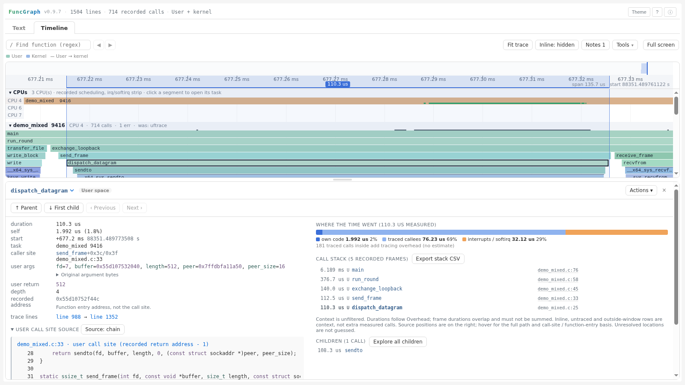

# FuncGraph

**从用户函数到内核调用，看清执行过程和时间去向。**

将 Linux ftrace、uftrace 记录变成可离线打开的交互式 HTML。沿调用链找慢调用，查看记录到的参数、返回值和对应源码。

[English](README.md) · [简体中文](README.cn.md) ·
[使用指南](docs/guide.cn.md) ·
[命令行参数](docs/cli.cn.md) ·
[下载安装包](https://github.com/pengdonglin137/FuncGraph/releases)

[](https://github.com/pengdonglin137/FuncGraph/actions/workflows/ci.yml)

**从你的任务出发：**

- **第一次自己录制：** [安装](#安装)后，跟着[快速开始](#快速开始)采集、出报告、找调用。
- **手里已有 trace：** [跳过采集，直接生成报告](#已有记录直接生成报告)。
- **只想先看效果：** 打开[在线混合报告](https://pengdonglin137.github.io/FuncGraph/sample_mixed.html)，点 `dispatch_datagram` 查看参数和调用点。无需安装，也可看[纯内核报告](https://pengdonglin137.github.io/FuncGraph/sample.html)。

[](https://pengdonglin137.github.io/FuncGraph/sample_mixed.html)

## 安装

需要 Python **3.8+**。从 [GitHub Releases](https://github.com/pengdonglin137/FuncGraph/releases) 下载 wheel（不从 PyPI 安装），按用途选：

- **生成报告或只录内核：** 选 `py3-none-any.whl`；纯内核采集另需目标机的 Linux tracefs 和 root 权限。
- **录用户态或混合模式，或读取 uftrace 采集目录：** 按架构选 `linux_x86_64.whl` 或 `linux_aarch64.whl`，内置补丁版 uftrace；已导出的 FuncGraph JSONL 不需要它。

例如安装通用 wheel，将 `<version>` 换成下载文件的版本号：

```bash
python3 -m pip install './funcgraph-<version>-py3-none-any.whl'
fgreport --help
```

需要快速符号解析和源码高亮时，在引号内的 wheel 文件名后加 `[all]`。平台 wheel 的系统库要求和手动指定采集器的方法见[安装包选择与依赖](docs/capture.cn.md#选择安装包与采集模式)。

## 快速开始

### 最佳实践：采集 → 生成报告 → 分析

**1. 采集：** 从一个短而可重复的命令开始。以下示例在有 root 权限、tracefs 空闲（`tracing_on=0`）的 Linux 目标机上
录制 `cat /etc/hostname` 的内核调用并保存为 `kernel.txt`。内核是默认模式，不用传 `--kernel`。

```bash
sudo "$(command -v fgcapture)" -o kernel.txt -- cat /etc/hostname
```

分析自己的程序时，把 `--` 后面的命令换成能复现问题的工作负载。只有需要用户态调用时，才[选择 `--user` 或 `--mixed`](#采集用户态与内核态)。
如果采集器提示追踪活动中，不要关闭其他会话；改用空闲测试环境，或[重放样例](#重放内置样例)。

**2. 生成报告：** 用 `fgreport` 读取刚才保存的 `kernel.txt`。只看调用结构不需要 root、`vmlinux` 或预设；经常用同一个内核看源码时，可以[保存内核预设](#可选保存内核预设)。

```bash
fgreport --open kernel.txt
```

默认在记录旁生成 `kernel.html`。目标机没有浏览器时，可以把原始记录带到工作站再生成报告，或省略 `--open`，只把生成的 HTML 拿到本地打开。

**3. 分析：** 在 Timeline 选中感兴趣的调用，再点击 trace 行链接跳到 Text 查看上下文。
先试界面筛选，确认范围后再决定是否需要缩小报告或重新采集。保留原始 trace，便于用不同参数生成报告。

日常只需要两个命令：`fgcapture` 录原始数据，`fgreport` 调用底层的 `funcgraph` 生成报告。已有记录不用重新录，已有 HTML 直接用浏览器打开。

### 已有记录：直接生成报告

已有 trace 就跳过采集，按下表选择输入方式。没有采集权限也可以[重放内置样例](#重放内置样例)。

| 手上的输入 | 用 `fgreport` 打开 | 额外要求 |
| --- | --- | --- |
| ftrace `function_graph` 文本 | `fgreport --open trace.txt`；也支持 `.gz`、`.xz`、`.bz2`、stdin 和多文件输入。 | 仅查看调用结构无额外依赖。 |
| trace-cmd 二进制容器 | `fgreport --open trace.dat`；自动识别格式。 | 可选原生解码库与主机 C 编译器，见 [raw 输入配置](docs/raw-input.cn.md)；裸 `trace_pipe_raw` 页不是独立输入文件。 |
| uftrace 采集目录 | `fgreport --open --uftrace capture.data`；目录不能当普通文件传入。 | FuncGraph 补丁版 uftrace；安装包内置时自动选用。 |
| FuncGraph uftrace JSONL 导出 | `fgreport --open capture.jsonl` | 无需本机 uftrace；并非任意上游 JSON 格式。 |

### 可选：保存内核预设

经常分析同一内核的 trace 时，用 `fgreport init` 保存**与采集时运行的内核匹配**的 `vmlinux` 和源码路径。`target` 是自选名称，把示例路径换成实际路径：

```bash
fgreport init target --vmlinux /path/to/matching/vmlinux --kernel-src /path/to/linux
fgreport -p target --open kernel.txt
```

`init` 只保存配置，不采集也不生成报告。用 `fgreport presets` 查看已有预设；在 `init` 时加 `--default`，之后未设置 `FG_PRESET` 时可不写 `-p target`。只用一次则直接传参。

### 不用预设，直接传参

如果只为本次报告指定镜像和源码，可直接传给 `fgreport`，不用先运行 `init`：

```bash
fgreport -P --open trace.txt -- --vmlinux ./vmlinux --kernel-src ./linux
```

- **`--` 是分隔符**：前面是 `fgreport` 的选项，后面是 [funcgraph 的选项](docs/cli.cn.md#funcgraph)。显式传入的值优先于配置文件。
- **`-P` 跳过预设**，但 `[default]` 仍可生效；没有默认预设、也没设置 `FG_PRESET` 时可以省略。
- **`--no-config` 非必需**：放在 `--` 后让转换器忽略配置文件。只在希望不受本机配置影响时使用，例如重放样例。

### 重放内置样例

先取得本仓库（wheel 不含 `samples/`），再从仓库根目录执行。命令特意跳过本机配置，不需要 root、采集器或匹配的内核镜像：

```bash
mkdir -p build/examples
fgreport -P -o build/examples/kernel.html samples/sample_io.txt -- --no-config
fgreport -P -o build/examples/mixed.html samples/sample_mixed.jsonl -- --no-config --user-src samples
```

打开 `build/examples/kernel.html`，在 **Text → Filter → cpu** 选择 CPU 6，可以看到
`demo_io`（PID 613）的调用。确认范围后，用同一份 trace 另存只保留该任务 `read` 调用树的小报告。
第一条命令的 `-n` 只预览转交给 `funcgraph` 的命令，第二条才写入文件：

```bash
fgreport -P -n -o build/examples/task.html samples/sample_io.txt -- --no-config --pid 613 --graph '^__x64_sys_read$'
fgreport -P -o build/examples/task.html samples/sample_io.txt -- --no-config --pid 613 --graph '^__x64_sys_read$'
```

## 报告怎么看

| 你想确认什么 | 下一步 |
| --- | --- |
| 慢在哪里？ | 在 **Timeline** 选中慢调用，看调用树和 Total/Self 耗时。Self 不等于 CPU 执行时间；分析等待和唤醒需要调度事件。 |
| 调用为什么失败？ | 在调用详情查看记录到的参数、返回值和调用点；跳到 **Text** 核对 trace 上下文。 |
| 只看某个 CPU 或事件？ | 在 **Text → Filter → cpu** 勾选 CPU，或用 **Event type**（手机端在 **More** 中）勾选事件类型。控件需要报告中有相应记录；旧报告可重新生成。 |
| trace 太大，只分析一个任务？ | 确认目标后再[另存小报告](#重放内置样例)，保留原始记录。界面筛选可以清除，生成前裁掉的数据不能恢复；uftrace 目录和 JSONL 使用界面筛选。 |
| 改动前后有区别吗？ | 用同一工作负载和采集设置各录一次，再运行 `fgreport -c baseline.txt --open current.txt`。在 **Compare** 里先核对调用次数，再看单次耗时；不要用同一个 PID 筛不同运行。 |

## 采集用户态与内核态

| 想录什么 | 选哪个模式 | 输出与要求 |
| --- | --- | --- |
| 只看内核，不重编应用 | `fgcapture`（默认） | 文本文件；需要 Linux tracefs 和 root。 |
| 只看用户态调用 | `fgcapture --user` | uftrace 目录；需要应用插桩和补丁版 uftrace，不需要 root。 |
| 同一次运行中关联用户态与内核态 | `fgcapture --mixed` | uftrace 目录；在用户态要求之外，还需要 root 和空闲的专用 tracefs。 |

需要分析调度和唤醒时，在纯内核采集命令的 `--` 前加 `--sched`。用户态和混合模式每次使用新的采集目录，录完用 `fgreport --open --uftrace DIR` 打开。
Android 内核若提供 `sched:sched_blocked_reason`，开启调度采集时会自动记录。点击 Timeline 的 off-CPU 段，在 **Wait chain** 查看内核记录的阻塞位置和 I/O wait 标记。
设备没有 `function_graph` 时，可改用 [纯调度事件采集](docs/raw-input.cn.md#android-纯调度采集)，不需要函数调用栈也能查看等待原因。
从编译、插桩到生成报告的可执行命令见[用户态与混合采集示例](docs/capture.cn.md#最短流程)；跟踪额外事件见[函数调用与额外事件一起采集](docs/capture.cn.md#函数调用与额外事件一起采集)。

## 源码与类型信息

**用户态与内核态源码分别配置。** 用[混合模式示例](docs/capture.cn.md#最短流程)得到 `mixed.data` 后，可按下面的方式添加源码。内核路径和版本必须对应**采集时运行的内核**，而不是分析机的内核：

```bash
VMLINUX=/path/to/matching/vmlinux
KERNEL_SRC=/path/to/linux
KERNEL_REV=recorded-kernel-commit
KERNEL_WEB_REV=matching-upstream-tag-or-commit
fgreport -P --uftrace mixed.data -o mixed.html -- --no-config \
    --user-src "$PWD" --vmlinux "$VMLINUX" --kernel-src "$KERNEL_SRC" \
    --source-rev "$KERNEL_REV" --source-browser github --source-browser-rev "$KERNEL_WEB_REV"
```

- **用户源码：**`--user-src` 指定允许嵌入的本地源码根目录，按记录路径选择：
  上面的新采集使用 `"$PWD"`，公开 JSONL 样例使用 `samples`。
  用户路径不会套用内核源码浏览器链接。
- **内核源码：**匹配的 `vmlinux`、源码树和工具链用于解析调用点及内联栈。
  `--source-rev` 控制嵌入的内核源码，`--source-browser-rev` 独立控制网页链接。
  默认使用 GitHub 的 `torvalds/linux`，也可通过 `--source-browser elixir` 切换。
  请固定匹配的标签／commit，不要依赖会变化的 `master`／`latest`。
- **参数与返回值：**可用的内核 BTF 用于修正已知参数个数、位宽及返回值解释；
  用户参数名和类型来自可用的已记录 DWARF／规格信息，而不是内核 BTF。
  原始证据、未知信息和不支持的情况保持可区分。

内核配置可[保存为预设](#可选保存内核预设)，用户源码仍可在生成报告时用 `-- --user-src "$PWD"` 指定。
模块、交叉工具链、路径映射和自定义浏览器等配置，见[使用指南](docs/guide.cn.md)。

## 大型 trace

**先试默认单 HTML**：可离线打开、方便分享，大报告会自动采用窗口化 Text。
如果希望 Text 和源码按需从磁盘读取，再生成 **sidecar 目录**：

```bash
fgreport --report-mode sidecar -o trace.report --open trace.txt
```

用 `fgview trace.report --open` 重新打开，分享时发送**整个目录**，不是单独的 `index.html`。
需要浏览器原生整篇查找时，在窗口化 Text 中切换 **Full Text**。其他模式和阈值见[本地查看器](docs/viewer.cn.md)。

分享报告前，检查嵌入的参数、路径和源码是否有敏感信息。要能重生成报告，请单独保存原始 trace 和匹配的调试文件。

## 文档导航

| 目标 | 从这里开始 |
| --- | --- |
| 查每个命令的参数、默认值、限制和选项归属 | [命令行参数参考](docs/cli.cn.md) |
| 了解控件、过滤、配色和分析面板 | [使用指南](docs/guide.cn.md) |
| 重放、预设、对比与 JSON/CSV 导出 | [场景用例](docs/examples.cn.md) |
| 采集纯内核、纯用户或混合执行流 | [完整采集案例](docs/capture.cn.md) |
| 编译并跟踪真实工具和依赖库 | [pigz + zlib](docs/pigz.cn.md) |
| 安装／构建 uftrace，了解采集边界 | [uftrace 集成](docs/uftrace.cn.md) |
| 读取 trace-cmd 二进制输入 | [raw 输入](docs/raw-input.cn.md) |
| 分析 Host QEMU/KVM 进入与退出时序 | [Host KVM Timeline](docs/kvm.cn.md) |
| 打开大报告，选择交付方式 | [本地查看器](docs/viewer.cn.md) |
| 理解实现或维护发布流程 | [设计文档](docs/design.md) · [发布操作清单与验收记录](docs/releasing.cn.md) |

## 开发与验证

从仓库根目录执行 `python3 -m pip install '.[all]'` 可安装源码版；它不会编译 uftrace。需要构建采集器时，见[固定版本构建步骤](docs/uftrace.cn.md)。

```bash
tests/run.sh
```

测试覆盖解析、分析、命令行流程和浏览器交互。安装 Playwright／Chromium、Node 后
可执行浏览器和 JavaScript 检查；可选原生与真实内核测试还需对应依赖。
请按[发布验证说明](docs/releasing.cn.md)准备环境，不要将跳过的可选测试当作已覆盖。
第三方源码固定到 commit，uftrace 的本地修改通过可校验的补丁序列维护：
[依赖版本锁](third_party/README.md) · [uftrace 补丁](patches/uftrace/README.md)。

背景文章：[ftrace 可视化工具](https://mp.weixin.qq.com/s/xRVVgF5IDnLXGu2i-TbS5Q) ·
[续篇](https://mp.weixin.qq.com/s/Mq8uTR3c8V1gAR2zklsFPw) ·
[写了个 ftrace 可视化工具](https://mp.weixin.qq.com/s/rNiWXC8YlZiAjfcjv7QtQA)。
