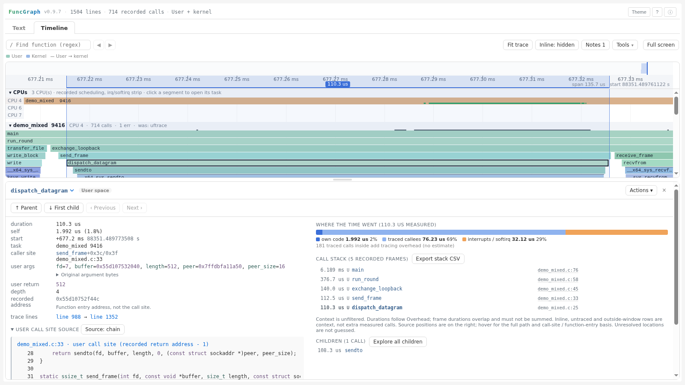

# FuncGraph

**Follow Linux execution from application functions into the kernel.**

Turn Linux ftrace and uftrace recordings into interactive HTML you can open offline. Follow call trees to find slow calls, inspect recorded arguments and returns, and jump to source.

[English](README.md) · [简体中文](README.cn.md) ·
[User guide](docs/guide.en.md) ·
[CLI options](docs/cli.md) ·
[Releases](https://github.com/pengdonglin137/FuncGraph/releases)

[](https://github.com/pengdonglin137/FuncGraph/actions/workflows/ci.yml)

**Choose a starting point:**

- **Record your first trace:** [Install](#install), then follow the [quick start](#quick-start) to capture, generate a report, and inspect a call.
- **Already have a trace:** [Skip capture and generate a report](#already-have-a-trace-generate-a-report-directly).
- **Just want to see it:** Open the [live mixed report](https://pengdonglin137.github.io/FuncGraph/sample_mixed.html) and select `dispatch_datagram` to inspect its arguments and caller site. No installation needed; there's also a [kernel-only report](https://pengdonglin137.github.io/FuncGraph/sample.html).

[](https://pengdonglin137.github.io/FuncGraph/sample_mixed.html)

## Install

Use Python **3.8+**. Download a wheel from [GitHub Releases](https://github.com/pengdonglin137/FuncGraph/releases), not PyPI. Pick one for your task:

- **Generate reports or capture kernel calls only:** Use the `py3-none-any.whl` wheel. Kernel capture also needs Linux tracefs and root on the target.
- **Capture user or mixed calls, or open a uftrace recording directory:** Use `linux_x86_64.whl` or `linux_aarch64.whl` for your architecture; they bundle patched uftrace. A saved FuncGraph JSONL export doesn't need it.

For example, install the portable wheel. Replace `<version>` with the version in the file you downloaded:

```bash
python3 -m pip install './funcgraph-<version>-py3-none-any.whl'
fgreport --help
```

Add `[all]` after the wheel filename inside the quotes for fast symbol lookup and source highlighting. See [package selection and requirements](docs/capture.md#choose-a-package-and-capture-mode) for platform libraries and recorder overrides.

## Quick start

### Recommended workflow: capture, generate, analyze

**1. Capture:** Start with a short, repeatable command. On a Linux target with
root access and idle tracefs (`tracing_on=0`), record the kernel calls for `cat /etc/hostname` to `kernel.txt`.
Kernel capture is the default, so you don't need `--kernel`.

```bash
sudo "$(command -v fgcapture)" -o kernel.txt -- cat /etc/hostname
```

To investigate your own program, replace the command after `--` with the workload that reproduces the issue.
[Choose `--user` or `--mixed`](#capture-user-and-kernel-calls) only when you need user-space calls.
If the recorder reports active tracing, don't stop another session; use an idle test environment or [replay a sample](#replay-the-included-samples).

**2. Generate:** Read `kernel.txt` with `fgreport`. Viewing call structure doesn't require root, `vmlinux`, or a preset. If you regularly need source for the same kernel, [save a kernel preset](#optional-save-a-kernel-preset).

```bash
fgreport --open kernel.txt
```

By default, this writes `kernel.html` next to the trace. On a headless target, move the trace to your workstation and generate the report there, or omit `--open` and copy the HTML instead.

**3. Analyze:** Select a call in Timeline and follow its trace-line link into Text for context.
Try the report's filters before narrowing the report or recording again. Keep the raw trace so you can regenerate reports with different options.

You normally need just two commands: `fgcapture` records raw data; `fgreport` uses the underlying `funcgraph` converter to generate the report. Reuse an existing trace without recording again, or open an existing HTML directly in your browser.

### Already have a trace? Generate a report directly

Skip capture and use the command for your input below. Without capture access, you can still [replay an included sample](#replay-the-included-samples).

| Input you have | Open with `fgreport` | Additional requirement |
| --- | --- | --- |
| ftrace `function_graph` text | `fgreport --open trace.txt`; `.gz`, `.xz`, `.bz2`, stdin and multiple files also work. | None for call visualization. |
| trace-cmd binary container | `fgreport --open trace.dat`; format detection is automatic. | Optional native decoding libraries and a host C compiler; [raw input setup](docs/raw-input.md). Bare `trace_pipe_raw` pages are not standalone inputs. |
| uftrace recording directory | `fgreport --open --uftrace capture.data`; don't pass the directory as a trace file. | FuncGraph's patched uftrace, selected automatically when bundled. |
| FuncGraph uftrace JSONL export | `fgreport --open capture.jsonl` | No local uftrace needed; not an arbitrary upstream JSON format. |

### Optional: save a kernel preset

If you often analyze traces from the same kernel, use `fgreport init` to save the `vmlinux` and source paths **matching the kernel that ran during capture**. `target` is a name you choose; replace the example paths with your own:

```bash
fgreport init target --vmlinux /path/to/matching/vmlinux --kernel-src /path/to/linux
fgreport -p target --open kernel.txt
```

`init` only saves settings; it doesn't record a trace or generate a report. List presets with `fgreport presets`. Add `--default` to `init` to omit `-p target` on later runs when `FG_PRESET` is unset. For a one-off report, pass options directly instead.

### Pass options without a preset

To use an image and source tree for just one report, pass them to `fgreport` directly without running `init`:

```bash
fgreport -P --open trace.txt -- --vmlinux ./vmlinux --kernel-src ./linux
```

- **`--` separates the options**: `fgreport` options come first, followed by [funcgraph options](docs/cli.md#funcgraph). Explicit values override the configuration file.
- **`-P` skips preset selection**, but `[default]` can still apply. Omit it if neither a default preset nor `FG_PRESET` is set.
- **`--no-config` is optional**: pass it after `--` to have the converter ignore config files. Use it when local settings should not affect the result, as in the examples.

### Replay the included samples

Get a checkout of this repository (the wheel doesn't contain `samples/`), then run from its root. These commands skip local settings and don't need root, a recorder, or a matching kernel image:

```bash
mkdir -p build/examples
fgreport -P -o build/examples/kernel.html samples/sample_io.txt -- --no-config
fgreport -P -o build/examples/mixed.html samples/sample_mixed.jsonl -- --no-config --user-src samples
```

Open `build/examples/kernel.html` and select CPU 6 in **Text → Filter → cpu** to see calls
from `demo_io` (PID 613). Once you've checked the scope, save a second report focused on
that task's `read` call trees. The first command's `-n` previews the invocation; the second writes the file:

```bash
fgreport -P -n -o build/examples/task.html samples/sample_io.txt -- --no-config --pid 613 --graph '^__x64_sys_read$'
fgreport -P -o build/examples/task.html samples/sample_io.txt -- --no-config --pid 613 --graph '^__x64_sys_read$'
```

## Read the report

| What do you want to check? | Next step |
| --- | --- |
| Where did the time go? | Select a slow call in **Timeline** and check its call tree and total/self time. Self time isn't CPU time; investigating waits and wakeups needs scheduling events. |
| Why did a call fail? | Check recorded arguments, return values and the caller site in call details. Follow the trace-line link to **Text** for context. |
| Just one CPU or event type? | Pick CPUs in **Text → Filter → cpu** or pick events from **Event type** (under **More** on phones). The report needs the corresponding records; regenerate older reports to get the controls. |
| Need a smaller report for one task? | Confirm the scope, then [save a smaller report](#replay-the-included-samples). Keep the original trace: report filters can be cleared, but records omitted before generation can't be restored. Use report filters for uftrace directories and JSONL. |
| Did a change make a difference? | Record the same workload with the same settings, then run `fgreport -c baseline.txt --open current.txt`. In **Compare**, check call counts before comparing per-call timings. Don't filter different runs on a single PID. |

## Capture user and kernel calls

| What do you need to record? | Mode | Output and requirements |
| --- | --- | --- |
| Kernel only, without rebuilding the app | `fgcapture` (default) | Text file; Linux tracefs and root. |
| User-space calls only | `fgcapture --user` | uftrace directory; application instrumentation and patched uftrace, no root. |
| User and kernel calls from the same run | `fgcapture --mixed` | uftrace directory; user-mode requirements plus root and idle dedicated tracefs. |

For scheduling and wakeup analysis, add `--sched` before `--` in the kernel-only capture command. For user or mixed capture, use a new recording directory for each run and open it with `fgreport --open --uftrace DIR`.
On Android kernels exposing `sched:sched_blocked_reason`, scheduling capture also records it automatically. Click an off-CPU segment in Timeline to see the recorded blocking function and I/O-wait flag in **Wait chain**.
If the device has no `function_graph` tracer, [record scheduling events alone](docs/raw-input.md#android-scheduling-without-function_graph) to inspect waits without kernel call stacks.
See the [user and mixed capture walkthrough](docs/capture.md#quick-start) for commands from build and instrumentation through report generation, or [recording extra events](docs/capture.md#record-functions-and-extra-events-together) for event selection.

## Source and type information

Keep **user and kernel sources separate**. After the [mixed capture walkthrough](docs/capture.md#quick-start) produces `mixed.data`, add source as shown here. Use paths and revisions for the kernel **running during capture**, not the analysis machine's kernel:

```bash
VMLINUX=/path/to/matching/vmlinux
KERNEL_SRC=/path/to/linux
KERNEL_REV=recorded-kernel-commit
KERNEL_WEB_REV=matching-upstream-tag-or-commit
fgreport -P --uftrace mixed.data -o mixed.html -- --no-config \
    --user-src "$PWD" --vmlinux "$VMLINUX" --kernel-src "$KERNEL_SRC" \
    --source-rev "$KERNEL_REV" --source-browser github --source-browser-rev "$KERNEL_WEB_REV"
```

- **User code:** `--user-src` allows local source embedding. Choose the root from
  recorded paths: fresh captures above use `"$PWD"`, while the saved public JSONL
  uses `samples`. User paths are never sent to a kernel source browser.
- **Kernel code:** a matching `vmlinux`, source tree and toolchain resolve call
  sites and inline frames. `--source-rev` chooses embedded kernel content;
  `--source-browser-rev` independently chooses web links. GitHub's
  `torvalds/linux` is the default browser; `--source-browser elixir` is available.
  Pin a matching tag/commit rather than relying on moving `master`/`latest` links.
- **Arguments and returns:** available kernel BTF corrects known parameter
  counts/bit widths and return interpretation. User parameter names/types come
  from available recorded DWARF/specifications, not kernel BTF. Raw evidence and
  unsupported/missing information remain distinguishable.

You can [save the kernel settings in a preset](#optional-save-a-kernel-preset) and still specify user source with `-- --user-src "$PWD"` at report time.
See the [source/configuration guide](docs/guide.en.md#4-generating-a-report) for
modules, cross-toolchains, path remapping and custom source browsers.

## Large traces

**Start with the default single HTML.** It opens offline, is easy to share, and
automatically uses windowed Text for large reports. If you want Text and source
resources read from disk on demand, generate a **sidecar directory**:

```bash
fgreport --report-mode sidecar -o trace.report --open trace.txt
```

Reopen it with `fgview trace.report --open`, and share the **whole directory**, not just `index.html`.
For the browser's own whole-document Find, switch from windowed Text to **Full Text**.
See the [viewer guide](docs/viewer.md) for other modes and thresholds.

Before sharing a report, check embedded arguments, paths, and source for sensitive information. Keep the raw trace and matching debug files separately so you can regenerate the report.

## Documentation

| Goal | Start here |
| --- | --- |
| Look up each command's options, defaults and restrictions | [Command-line reference](docs/cli.md) |
| Learn controls, filters, colors and analysis panels | [User guide](docs/guide.en.md) |
| Replay, use presets, compare runs or export JSON/CSV | [Scenario examples](docs/examples.md) |
| Record kernel, user or mixed execution | [Capture cases](docs/capture.md) |
| Build and trace a real tool with its dependency | [pigz + zlib](docs/pigz.md) |
| Install/build uftrace; inspect recording limits | [uftrace integration](docs/uftrace.md) |
| Read trace-cmd binary inputs | [Raw input](docs/raw-input.md) |
| Inspect Host QEMU/KVM entry/exit timing | [Host KVM Timeline](docs/kvm.md) |
| Serve large reports and choose delivery modes | [Local viewer](docs/viewer.md) |
| Understand implementation or publish a release | [Design](docs/design.md) · [Release checklist and verified records](docs/releasing.md) |

## Development and validation

Run `python3 -m pip install '.[all]'` from the checkout root to install from source. This doesn't compile uftrace; see the [pinned native build instructions](docs/uftrace.md#reproducible-native-build) if you need to build the recorder.

```bash
tests/run.sh
```

The suite covers parsing, analysis, CLI workflows and browser interactions.
Playwright/Chromium and Node enable browser/JavaScript checks; optional native
and real-kernel cases need their documented dependencies. See
[validation setup](docs/releasing.md#2-validate-locally) before treating skipped
optional tests as coverage. Third-party sources are pinned by commit, and local
uftrace changes are maintained as a checked patch series:
[dependency pins](third_party/README.md) · [uftrace patches](patches/uftrace/README.md).

Background articles (Chinese): [introduction](https://mp.weixin.qq.com/s/xRVVgF5IDnLXGu2i-TbS5Q) ·
[follow-up](https://mp.weixin.qq.com/s/Mq8uTR3c8V1gAR2zklsFPw) ·
[implementation story](https://mp.weixin.qq.com/s/rNiWXC8YlZiAjfcjv7QtQA).
