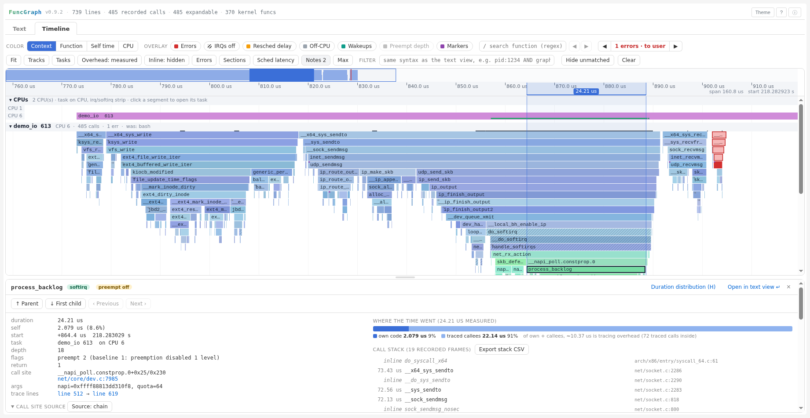

# FuncGraph - Specialized Linux ftrace Visualization Tool

Ordinary CLI output remains an offline single HTML file. For large reports, opt into `funcgraph TRACE --timeline --report-mode sidecar --output REPORT_DIRECTORY`, then run `fgview REPORT_DIRECTORY`. Timeline opens without downloading or creating Text rows; Compare loads separately. Text loads **in full** on first use, a line jump/hash anchor, or unified filtering. Sources remain embedded. This is deferred delivery, not Text virtualization or automatic threshold selection; see the [viewer guide](docs/viewer.md).

[](https://github.com/pengdonglin137/FuncGraph/actions/workflows/ci.yml)

[](https://pengdonglin137.github.io/FuncGraph/sample.html)

## What is FuncGraph?

FuncGraph converts `function_graph` ftrace output into an interactive, filterable HTML report for kernel developers and performance engineers. It is optimized for fast triage: source linking, high-speed address resolution, parameter and duration filtering, and keyboard-friendly call folding.

> **Try it online**: [home page](https://pengdonglin137.github.io/FuncGraph/) · [sample report](https://pengdonglin137.github.io/FuncGraph/sample.html) (opens in the browser, no install).
>
> **User guide** (detailed: capture options, every field and color in the views, panels, compare, export, FAQ): [English](docs/guide.en.md) · [中文](docs/guide.cn.md). Design: [docs/design.md](docs/design.md).

## Cheat Sheet

- Common flags: `--fast`, `--filter`, `--func-links`, `--highlight-code` 🔧
- Filter syntax: `cpu:3 AND duration:>10 sort:desc` ⏱️
- Graph filter: `graph:funcname` (show call tree), `notrace:funcname` (hide call tree) 🌲
- Latency filter: `irqs:d AND hirq:h` (latency-mode traces only) 🔎
- Keyboard: Tab focuses fold icon; Enter toggles fold; `Esc` clears selection ⌨️

## Key features

- Interactive ftrace visualization with fold/unfold call blocks
- Clickable source links (local or online) and optional syntax highlighting
- High-performance address resolution (`fastfaddr2line.py`)
- **Unified filter** with `field:value` syntax, AND/OR/NOT logic, field-selector buttons with dropdown menus
- **Graph filtering**: `graph:func` / `notrace:func` to show/hide entire call trees (like ftrace's `set_graph_function` / `set_graph_notrace`)
- **Latency field support**: parses irqs-off, need-resched, hardirq/softirq, preempt-depth from latency-mode traces
- Keyboard-friendly navigation and accessible fold controls
- **Timeline tab** (`--timeline`): per-task flame chart over time with context, irqs-off, scheduling-delay, off-CPU and error-path coloring

## Sample

[sample.html](sample.html) ([open online](https://pengdonglin137.github.io/FuncGraph/sample.html), 3.0 MiB) is the report of [samples/sample_io.txt](samples/sample_io.txt): one process ([samples/demo_io.c](samples/demo_io.c)) reads 4 KB of a file, writes 4 KB to another file, sends a UDP datagram to itself over loopback and receives it, then calls `recvfrom` once more on the empty queue (`-EAGAIN`). Only these four system calls are traced, from their entry points (`__x64_sys_*`), with arguments, return values, call sites and scheduler events; the file and socket setup happens before them and is not traced. The five calls span 132 us: 739 lines, 485 recorded calls, no lost events or truncated calls.

What to look at:
- **Timeline**: `__x64_sys_sendto` runs `udp_sendmsg -> ip_output -> loopback_xmit`, and the receive side (`net_rx_action -> process_backlog -> udp_rcv`) runs in the softirq at the end of the same call (green). The overview selects `process_backlog` (24.21 us) inside `sendto` (73.43 us).
- **Errors**: one chain, `udp_recvmsg -11 EAGAIN` returned to user space by `__x64_sys_recvfrom`.
- **Text view**: arguments on every line; expanding a line shows the call site's source with its inline chain ([samples/sample_text.png](samples/sample_text.png)).

How it was made:

```bash
# on the target (QEMU x86_64, kernel 7.4.0-rc2), as root
gcc -O2 -static -o /tmp/demo_io samples/demo_io.c
dd if=/dev/urandom of=/tmp/demo_in.bin bs=4096 count=1
dd if=/dev/zero of=/tmp/demo_out.bin bs=4096 count=1
cat /tmp/demo_in.bin /tmp/demo_out.bin > /dev/null      # page cache warm
fgcapture.sh --args --sched --calibrate \
    -g __x64_sys_read,__x64_sys_write,__x64_sys_sendto,__x64_sys_recvfrom \
    -o sample_io.txt -- /tmp/demo_io

# on the host
python3 funcgraph.py --timeline --tail-calls --enable-fold --filter --func-links --highlight-code --fast \
    --vmlinux /vol_1t/Qemu/linux/x86_64/vmlinux --kernel-src /vol_1t/Qemu/linux \
    --source-rev 7475ea8b58616b33c04afb976cf0fbaad9dd63fb \
    --source-browser github --source-browser-rev v7.4-rc2 \
    --output sample.html samples/sample_io.txt

# refresh the overview, Text example and guide screenshots (Playwright + Chromium)
FG_CONFIG=/dev/null python3 samples/make_shots.py
FG_CONFIG=/dev/null python3 docs/img/make_shots.py
```

The sample was recaptured on November 10, 2026. The trace, QEMU runtime and host build identify `7.4.0-rc2`, build `#3` (`Tue Nov 10 21:07:54 CST 2026`). The host source at `/vol_1t/Qemu/linux` has no tracked modifications; its commit above matches the peeled upstream `v7.4-rc2` tag, independently checked on GitHub. Embedded source uses that exact local commit, and external GitHub links are pinned to that tag, not moving `master`. Calibration recorded 143 ns per traced child and 77 ns per call. The older `sample_io_slow.txt` remains a historical 7.2.0+ capture for Compare examples, not a controlled cross-version performance baseline.

---

<!-- Installation & Usage continues below -->

## Installation & Usage

### Requirements
- Python 3.8+
- addr2line (from binutils)
- pyelftools (for `--fast` or optional `--tail-calls`; the latter also needs matching-architecture `objdump`)
- Optional: Pygments (for syntax highlighting)

### Install a release package

Download a wheel from GitHub Releases and install it with optional dependencies:

```bash
python3 -m pip install './funcgraph-<version>-py3-none-any.whl[all]'
fgreport -P trace.txt
```

Replace `<version>` with the version in the downloaded filename; a source version bump does not publish a GitHub Release.

The package installs `funcgraph`, `fgreport`, `fastfaddr2line`, and `fgcapture.sh`;
the base install works without Python dependencies, while `[all]` adds pyelftools
and Pygments. Pushing a matching `vX.Y.Z` tag automatically tests, builds, and
publishes the wheel and source package as a GitHub Release (not PyPI).
See [Building and releasing](docs/releasing.md) for the release checklist,
verification commands, and troubleshooting.

### Quick start: `fgreport`

`fgreport` wraps `funcgraph.py` with all features on and the kernel paths kept in a preset, so a report is one short command:

```bash
# once per kernel: store vmlinux / sources in ~/.config/funcgraph/config.ini
./fgreport init pi4 --vmlinux /path/to/vmlinux --kernel-src /path/to/linux \
    --cross-compile aarch64-linux-gnu- --source-browser github --source-browser-rev v6.18 --default

./fgreport trace.txt                 # -> trace.html next to the trace (timeline, folding, filter, links, highlighting)
./fgreport -p vm72 --open trace.txt  # another preset, open in the browser
./fgreport --lite trace.txt          # quick look: no source blocks or links
./fgreport -c before.txt after.txt   # with a Compare tab
./fgreport trace.txt -- --pid 1234   # anything after -- is passed to funcgraph.py
./fgreport presets                   # list presets (* = default)
```

It picks `--fast` / `--highlight-code` when pyelftools / Pygments are installed, switches to `--timeline --no-text-view` above 150k lines (`--text` keeps the text view), and prints the full `funcgraph.py` command it runs (`-n` only prints it).

### Basic Usage

```bash
python3 funcgraph.py trace.txt \
    --vmlinux /path/to/vmlinux \
    --kernel-src /path/to/kernel/src \
    --module-dirs /path/to/modules \
    --base-url https://elixir.bootlin.com/linux/v6.18/source \
    --filter \
    --fast \
    --highlight-code \
    --output result.html
```

### Binary raw input

`funcgraph trace.dat --timeline --output trace.html` accepts binary **trace-cmd containers**, with optional native decoding libraries and a host C compiler. Text inputs remain dependency-free; compressed raw/stdin, nanosecond timestamps and `--raw-instance NAME` are supported. Bare `trace_pipe_raw` pages are not standalone inputs. Setup, pinned submodules and exact limits: [Raw input guide](docs/raw-input.md).

### Parameter Description

The following table documents each command-line option supported by `funcgraph.py`, including types, defaults, and examples.

| Parameter | Type / Default | Description | Example |
|-----------|----------------|-------------|---------|
| `ftrace_file` | paths (required) | Trace file(s); `-` reads stdin, `.gz`/`.xz`/`.bz2` are decompressed, several files are merged by timestamp | `trace.txt`, `- `, `cpu*.txt.gz` |
| `--input-format` | `auto` / `text` / `raw` | Auto-detect text or trace-cmd binary containers (default: auto); comparison inputs are independently detected | `--input-format raw` |
| `--raw-instance` | name | Select a named binary buffer instead of the top-level buffer; also applies to raw comparison inputs | `--raw-instance capture` |
| `--vmlinux` | path (optional) | vmlinux for address -> source resolution, source links and BTF; without it the trace views, timeline and analyses still work | `--vmlinux /path/to/vmlinux` |
| `--kernel-src` | path | Kernel source tree root (used for local source linking and syntax highlighting) | `--kernel-src /usr/src/linux` |
| `--module-dirs` | paths... | Directories to search for kernel modules (can specify multiple) | `--module-dirs /lib/modules /usr/lib/modules` |
| `--module-srcs` | paths... | Module source directories for module-specific source linking | `--module-srcs /path/to/module/src` |
| `--source-browser` | `github` (default) / `elixir` | Online kernel source browser: torvalds/linux on GitHub or Bootlin Elixir | `--source-browser elixir` |
| `--source-browser-rev` | revision | Online revision; default `master` on GitHub, `latest` on Elixir. Independent of embedded source | `--source-browser-rev v7.4-rc2` |
| `--base-url` | URL | Custom source-link root, overriding the built-in browser | `--base-url https://elixir.bootlin.com/linux/v6.18/source` |
| `--module-url` | url:mods (appendable) | Map specific modules to a source URL; format: `url:mod1,mod2`. Can be specified multiple times. | `--module-url https://url1.com:modA,modB` |
| `--output` | path (default: `ftrace_viz.html`) | HTML file path, or a dedicated directory in sidecar mode | `--output result.html` |
| `--report-mode` | `single` (default) / `sidecar` | Offline HTML or an HTTP report directory; sidecar requires Timeline and loads Text in full on first use | `--timeline --report-mode sidecar --output report-dir` |
| `--auto-search` | flag | Auto-search common module directories (adds common `/lib/modules` paths) | `--auto-search` |
| `--verbose` | flag | Enable verbose logging for debugging and diagnostics | `--verbose` |
| `--fast` | flag | Use bundled `fastfaddr2line.py` for faster vmlinux processing | `--fast` |
| `--use-external` | flag | Force use of external `faddr2line`/`addr2line` (mutually exclusive with `--fast`) | `--use-external` |
| `--highlight-code` | flag | Enable C source syntax highlighting in HTML (requires Pygments) | `--highlight-code` |
| `--path-prefix` | paths... | Path prefixes to strip/replace when mapping addr2line paths to kernel-src | `--path-prefix /home/user/build/kernel` |
| `--filter` | flag | Include the unified filter UI (supports `field:value` queries with AND/OR/NOT) | `--filter` |
| `--func-links` | flag | Add clickable source links to function names (adds some processing overhead) | `--func-links` |
| `--entry-offset` | int (default: `0`) | Offset to add to function entry addresses (useful for patched functions) | `--entry-offset 8` |
| `--enable-fold` | flag | Enable function call folding UI (collapse/expand call blocks) | `--enable-fold` |
| `--timeline` | flag | Add the Timeline tab (per-task flame chart over time, see below) | `--timeline` |
| `--tail-calls` | flag | Opt-in static direct tail-jump evidence for caller/parent mismatches; requires `--timeline --vmlinux`, pyelftools and objdump; never changes measured nesting or durations | `--timeline --tail-calls --vmlinux vmlinux` |
| `--btf` | paths... | BTF sources for return-type checks: raw `/sys/kernel/btf/*` copies or ELF files (default: `.BTF` of vmlinux/modules) | `--btf vmlinux.btf` |
| `--no-btf` | flag | Do not use BTF for error-path detection | `--no-btf` |
| `--compare` | path | Add a Compare tab: per-function calls / self / inclusive / max / error differences against this base trace | `--compare before.txt` |
| `--overhead` | `CHILD[,SELF]` ns | Tracing overhead estimate for corrected durations (default: read from the `fgcapture.sh --calibrate` header) | `--overhead 1115,463` |
| `--config` / `--preset` | path / name | Option defaults from an INI file (`./funcgraph.ini` or `~/.config/funcgraph/config.ini`); `[default]` plus `[preset NAME]`; `--no-config` ignores it | `--preset pi4` |
| `--source-url` / `--source-rev` | template / rev | Source blocks from a URL (`{path}`, `{rev}`; cached in `~/.cache/funcgraph/src`) or from `git show REV:path` in `--kernel-src`; a version check is reported | `--source-rev v6.18` |
| `--export` | path | Also write the analyses as JSON (functions, errors, critical sections, latency, atomic sleeps, off-CPU) or CSV (function statistics) | `--export result.json` |
| `--no-text-view` | flag | Only build Timeline/Compare; skip Text rows and, by default, address resolution | `--timeline --no-text-view` |
| `--keep-source` | flag | Opt into resolved source/inline frames without Text rows; adds normal source-resolution cost | `--timeline --no-text-view --keep-source` |
| `--pid` / `--comm` / `--cpu` | lists | Pre-filter: keep only these tasks / comm regexes / CPUs (comma separated) | `--pid 1234,1235` |
| `--time-range` | `START:END` | Pre-filter: keep calls starting in this window; absolute seconds or `+offset` with units | `--time-range +2ms:+5ms` |
| `--graph` / `--notrace` | regexes | Pre-filter: keep / drop whole call trees of matching functions | `--graph vfs_read` |

**Notes:**
- `--fast` and `--use-external` should not be used together; if both are specified, `--use-external` will be ignored.
- `--module-url` supports either a bare URL (default for all modules) or `url:mod1,mod2` mappings; repeat the flag to add multiple mappings.

### Online source browser

```bash
# GitHub is the default; pin a tag to avoid moving line numbers
python3 funcgraph.py trace.txt --vmlinux vmlinux --source-browser-rev v7.4-rc2

# Select Elixir instead
python3 funcgraph.py trace.txt --vmlinux vmlinux --source-browser elixir --source-browser-rev v6.18
```

This selects outgoing links in Text, source blocks and Timeline, including CALL STACK; it does not fetch files or change embedded source. `--source-rev` still selects the local/URL source revision and is **not** automatically reused for web links: a custom local commit may not exist upstream. Choose a tag/branch/commit available on GitHub, or a version published on Elixir. Without `--source-browser-rev`, links follow moving `master` / `latest`, not an automatically detected kernel version; for reproducible reports, always pin it. Custom kernels and upstream baselines may differ in line numbers.

An explicit `--base-url` overrides browser settings. Existing `base-url` presets continue to work; an explicit CLI `--source-browser` overrides an inherited `base-url`. Both new options can be stored in INI files and with `fgreport init`; one-off wrapper overrides go after `--`, e.g. `fgreport trace.txt -- --source-browser elixir --source-browser-rev v6.18`. Module-specific `--module-url` mappings keep their precedence.

### Module URL Example

```bash
# Set different URLs for different modules
python3 funcgraph.py trace.txt \
    --vmlinux vmlinux \
    --base-url https://elixir.bootlin.com/linux/v6.18/source \
    --module-url https://url1.com:mod1,mod2 \
    --module-url https://url2.com:mod3,mod4 \
    --module-url https://default.com \
    --filter --fast
```

Rules:
- `mod1,mod2` → use `https://url1.com`
- `mod3,mod4` → use `https://url2.com`
- other modules → use `https://default.com`
- no default URL → use `--base-url`

### Path Prefix Handling

```bash
# addr2line returns: /home/user/build/kernel/fs/open.c
# Kernel source path: /home/user/linux/fs/open.c

python3 funcgraph.py trace.txt \
    --vmlinux vmlinux \
    --kernel-src /home/user/linux \
    --path-prefix /home/user/build/kernel \
    --filter --fast
```

### Cross-Compilation & LLVM

**Cross-compilation:**
```bash
export CROSS_COMPILE=aarch64-linux-gnu-
python3 funcgraph.py trace.txt --vmlinux vmlinux --filter --fast
```

**LLVM Toolchain:**
```bash
export LLVM=1
# or export LLVM=/usr/bin/
# or export LLVM=-10
python3 funcgraph.py trace.txt --vmlinux vmlinux --filter --fast
```

## Timeline View (`--timeline`)

`--timeline` adds a **Timeline** tab next to the text view. Each task gets a track; inside a track, x is time and y is call depth, so a slice's width is its duration (similar to Android Studio method traces or Perfetto, but for kernel function_graph data). The data is embedded in the same HTML file and drawn on a canvas, so 100k+ calls stay interactive.

What it shows:
- **Context colors** from the latency flags: task (blue), softirq (green), hardirq (orange), NMI (purple). Hatching marks irqs-off; an amber band/corner marks a pending need-resched (scheduling delay window); an optional bar shows preempt depth.
- **Off-CPU periods** from the context-switch markers, labeled with the function the task was waiting in (e.g. `mutex_lock`) and whether it was preempted or blocked.
- **Error paths** from `funcgraph-retval`: the origin (first function returning an errno) is solid red when the error reaches user space (`*_sys_*` in the chain) and orange when a caller handled it; propagating frames get a red outline. Return types are read from BTF, so void functions (leftover register values) and unsigned/bool returns are not reported, and pointer returns are checked with `IS_ERR` semantics.
- **Call sites** from `funcgraph-retaddr`; a purple corner marks calls whose caller is not the parent slice (untraced, inlined or assembly frames in between).
- **CPU tracks** (top, timed traces only): which task ran on each CPU, with a thin strip for softirq/hardirq/NMI time. Click a segment to open that task.
- **Task navigator** (**Tasks**): find every recorded identity by name/old name, PID or CPU, including scheduler-only tasks; inspect call/match/error/run counts and record extent, reveal a track, or export all matching tasks to CSV. Extent includes gaps, not CPU time; Fit includes scheduling events after the last traced call.
- **Scoped child-call explorer** (**Explore all children** in call details): inspect every direct recorded child function or occurrence under one parent, sort/filter, jump to the longest call, and export all groups/calls without expanding every page. The top-eight preview remains compact; untraced gaps and inclusive sums are not presented as a complete runtime callee list or a parent-time partition.
- **Recorded-tree navigation**: detail buttons or ↑/↓/`[`/`]` follow recorded parents, children and siblings across missing depths, not neighboring drawing rows. Task roots stay within their task; synthetic frames lead to their actual recorded calls without inventing ancestry.
- **Truthful dense pixels**: subpixel groups stay bright when any member matches both search and the shared filter, without brightening unmatched neighboring pixels. Hover explains the frame/match count and representative; click selects the first matching frame. Synthetic frames likewise match any recorded child, not just the first.
- **Filter**: the unified filter of the text view (`pid:`, `comm:`, `graph:`, `ret:` ...) also applies here. Non-matching calls are dimmed, error navigation and range summaries only count matches, and *Hide unmatched* removes tracks without matches. The filter can be edited in the timeline as well.
- Color modes: context, function name, self time, CPU, module.
- **Function search**: case-insensitive regex with previous/next buttons and a current/total match counter. Search navigation respects the shared filter, and repeated jumps reuse cached matches on large reports. Invalid expressions show a message instead of reusing stale matches.

Interaction: `W`/`S` or Ctrl+wheel zoom, `A`/`D` or drag to pan, double-click to zoom into a slice, `E`/`Shift+E` next/previous error, `/` search, `Shift`+drag to summarize a time range (self/inclusive time per function, context breakdown, off-CPU time), `Enter` opens the selected call in the text view, and `Alt`+click on a text line shows it in the timeline. Press `?` in the timeline for the full list.

The tool adapts to the options the trace was captured with and tells you what is missing:

| Missing option | Effect in the timeline |
|---|---|
| `funcgraph-abstime` | No real time axis: slices are packed back-to-back by duration ("compressed time") |
| `latency-format` | Context is inferred from IRQ/softirq entry function names; no irqs-off / need-resched / preempt overlays |
| `funcgraph-proc` | Tasks are reconstructed from context-switch markers, otherwise one track per CPU |
| `funcgraph-retval` | No error paths |
| `funcgraph-retaddr` | No call sites |
| `funcgraph-duration` | Durations are taken from the next timestamp (marked as estimated) |

BTF: by default the `.BTF` section of `--vmlinux` (needs `CONFIG_DEBUG_INFO_BTF=y`) and of the modules found via `--module-dirs` is used. If your vmlinux has no `.BTF`, copy `/sys/kernel/btf/vmlinux` from the target and pass `--btf vmlinux.btf`. `--no-btf` disables the check (errors are then guessed from the value alone).

### Capturing for the timeline

```bash
cd /sys/kernel/tracing
echo 0 > tracing_on
echo 1 > options/funcgraph-abstime    # real time axis (required for gaps and off-CPU)
echo 1 > options/latency-format       # irqs-off / need-resched / hardirq / softirq / preempt flags
echo 1 > options/funcgraph-proc
echo 1 > options/funcgraph-retval
echo 1 > options/funcgraph-retaddr
echo 1 > options/funcgraph-tail       # function name on every '}' (better pairing)
echo function_graph > current_tracer
echo 1 > tracing_on; sleep 1; echo 0 > tracing_on
cat trace > ~/ftrace.txt
```

Notes:
- With `funcgraph-retaddr` on, kernels such as 6.18 do not print arguments even if `funcgraph-args` is set. Capture arguments in a separate run without `funcgraph-retaddr`.
- On kernels without the BTF printing optimizations (e.g. 6.18), `funcgraph-args` makes reading `trace` very slow (measured ~36 ms per line on a Raspberry Pi 4). Always narrow it with `set_graph_function`, `set_ftrace_filter` or `set_ftrace_pid` first.
- Optionally enable `events/sched/sched_switch`, `sched_waking` and `sched_wakeup` (`fgcapture.sh --sched`): the timeline then shows the task state at switch-out, wakeup arrows and wait chains.
- Use a larger `buffer_size_kb` if you see `LOST EVENTS`.

## Capture helper (`fgcapture.sh`)

Run on the target as root. It sets up tracefs for the scenario, captures, checks for lost events and restores every setting it changed.

```bash
fgcapture.sh -d 0.5 -o /tmp/all.txt                 # timeline options, whole system, 0.5 s
fgcapture.sh --sched --calibrate -- cat /nonexistent # trace one command (+children), sched events, overhead estimate
fgcapture.sh --args -g vfs_read,vfs_write -d 1       # arguments (no retaddr; requires -g/-p, slow to read on 6.18)
```

`--calibrate` measures the tracing overhead with the same options (vfs_read with and without traced children) and writes `# fgcapture: overhead child=..ns self=..ns` into the trace header. On a Raspberry Pi 4 (6.18, lockdep) it is about 1.1 us per traced child call and 0.46 us per call: a traced `do_el0_svc` of 41 us is about 10 us without tracing.

## Analysis features

- **Pre-filter** (`--pid`, `--comm`, `--cpu`, `--time-range`, `--graph`, `--notrace`): applied before conversion and keeps whole call trees, so big traces shrink before the HTML is built.
- **Compare tab** (`--compare BASE`): per-function calls, self time, inclusive time, mean, max and error counts with differences; sort by absolute/relative change, filter by regex, and export all matching results as CSV in the browser. Pinned function names and headers keep wide tables readable in narrow windows. Pre-filters apply to both traces.
- **Timeline panels**: *Errors* groups error chains by syscall, origin function and errno (click to step through occurrences); *Sched latency* lists need-resched windows with the self time spent inside them; `H` shows the duration distribution (histogram, p50/p90/p99, slowest calls) of the selected function.
- **Range summaries**: Shift + drag selects one track; add Alt for all tracks. Sort cached per-function overlap estimates, load more than 300 functions, and export every scoped, filtered result as CSV with explicit time-mode and estimation metadata.
- **Duration drill-down**: keep and reset call-site selections, choose histogram buckets by mouse or keyboard, load every matching call, and export the complete selected call list as CSV. Cached populations avoid repeated trace scans/sorts; charts follow window sizes and themes.
- **Window analyses**: Sections / Sched latency filter by matching calls inside each window, with sorting, append-only pagination and full CSV export. Overlap indexes and cached statistics avoid repeated full-track scans. Proportional self estimates follow Overhead; original window positions and lengths never change.
- **Error drill-down**: Errors caches groups and atomic-sleep statistics, navigates every occurrence beyond the first 50, sorts every statistic, paginates groups and exports complete group / chain / atomic-call CSVs. Atomic calls remain browsable without errno chains; unknown outcomes stay distinct from handled or returned-to-user errors.
- **Where the time went**: the detail panel splits a call's recorded duration into own code, traced callees, interrupts/softirqs and blocked/preempted time. Real parent links handle skipped depths and deep stacks without counting synthetic frames; overlapping or inconsistent recordings are disclosed rather than shown as a valid 160% partition.
- **Complete call context**: browse deep call stacks, error propagation paths, inline chains and every recorded call inside synthetic frames in 100-row pages. Native frame buttons support keyboard navigation; each list exports its complete CSV without expanding the panel. Recorded calls, inline/untraced context and true capture-boundary gaps remain distinct, with explicit units and no invented timings.
- **Slow vs fast and call sites**: the duration panel (`H`) compares the slowest ceil(10%) with the fastest half of matching calls. Browse every descendant function in sortable 100-row pages, inspect fast/slow examples without leaving the panel, and export the full profile plus exact cohort membership. The comparison stays open through filter/site/Overhead refreshes; descendants retain full context independently of the duration bucket. Self follows Overhead; scheduling-context rows remain recorded observations, not an additive causal explanation.
- **Critical sections** (*Sections*): every irqs-off, preempt-off and BH-off region in task context with where it started and ended and what ran inside; function_graph itself adds one preempt level to every line, which is detected and subtracted everywhere in the timeline.
- **Sleeping in atomic context**: calls of sleeping functions (`mutex_lock`, `__might_sleep`, `wait_for_completion`, ...) with irqs off, preemption disabled or from an interrupt are flagged on the slice and listed in *Errors*.
- **Busy schedulers**: the text view's *Order* button groups lines by task (each task's lines together, context switches replaced by a summary with the time off-CPU); the timeline draws bunched wakeups as small markers and shows the full arrows for the hovered/selected task.
- **Wakeups and wait chains** (with `sched_waking`/`sched_wakeup`): arrows from the waker to the woken task; clicking an off-CPU segment shows the recorded waker, function and wake latency. Earlier waits of the waker are explicitly temporal candidates, not proven dependencies, with a 50 ms link-gap limit and a visible stop reason. Load more appends 100 waits; export the entire chain as CSV, independently of the text filter and Overhead. Task buttons support keyboard navigation; open waits show a lower bound, not a fabricated resume.
- **Overhead correction**: with an estimate, `O` (or the *Overhead* button) switches tooltips, panels and summaries to durations with the overhead subtracted. Slice positions always stay as measured. Compare offers the same switch when both traces have an estimate.
- **Untraced frames**: when the kernel's call depth jumps by two or more levels (a frame entered without a recorded entry, e.g. arm64 `el1_interrupt` around `irq_enter_rcu`), the calls still belong to the enclosing call and the missing level is drawn as a dashed `untraced` frame named after their caller, so the stack has no hole and self times stay right.
- **Selected call**: as in Perfetto, its start and end are marked over all tracks and on the time ruler with its duration. The detail panel shows the call site's `file:line` and its source block (reused from the text view), and tags such as irqs off, preempt off, BH off, need-resched. Drag the bar above the panel to resize it; `M` hides the page header for more room.
- **Inline frames**: call sites inside inlined code get their inline chain. The timeline's *Inline* button (`I`) switches between traced frames only and traced + inline frames (dashed; their extent is the first to last traced call inside, the real inlined code may start earlier and end later). Call stacks always list the inline frames; source blocks can be shown as a collapsible inline chain or flat (*Source* button).
- **Kernels with BTF-aware funcgraph-retval** (e.g. the 7.2 `trim_retval` patches): `ret=true/false`, unsigned and `(trunc)` values, no `ret=` for void functions and ERR_PTRs as errnos are understood; error paths are then verified from the kernel's own typing, without host BTF. `fgcapture.sh --args` probes whether args can be printed together with retaddr and how fast, and keeps all timeline options when they can.
- **Flexible usage**: `--vmlinux` is optional; `--config`/`--preset` read defaults from an INI file; input can be `-` (stdin), `.gz/.xz/.bz2` or several files merged by timestamp; `--source-url`/`--source-rev` fetch sources from a URL or a git revision and check that they match; `--export` writes the analyses as JSON/CSV.
- **Large traces**: above ~150k lines the text view becomes too heavy for browsers; use a pre-filter or `--timeline --no-text-view` (362k lines: 15.7 MB, opens in about a second). Reopening a report saved on Timeline/Compare suppresses Text rendering before trace lines are parsed, instead of painting the entire text page first. With at least 1 MiB of Timeline JSON, first opening Timeline shows preparation stages; **Back to Text**, **Escape**, or another tab cancels between work chunks. Completed models are cached. Text/source content stays intact, and line anchors still open Text. This is main-thread cooperative preparation, not text virtualization or background parsing; large individual phases and GC can still block. See the [startup measurements and readiness trade-off](docs/design.md#8-性能数据).

Default single-file generation streams UTF-8 sections and atomically publishes the completed file; failures preserve an existing report. Its output must be a regular file, not a device such as `/dev/null`. Explicit `--report-mode sidecar` instead publishes a dedicated report directory and defers complete Text delivery; see the [viewer guide](docs/viewer.md). **Automatic selection and Text virtualization are not implemented**. Complete-trace symbol resolution still runs; see the [separate generation measurements](docs/design.md#83-分段写出的生成阶段内存2026-11-10).

## Capturing Trace

### Recommended Settings

```bash
cd /sys/kernel/tracing

# Stop current tracing
echo 0 > tracing_on

# Enable recommended options
echo 1 > options/funcgraph-retaddr    # Return address (call sites, source mapping)
echo 1 > options/funcgraph-proc       # Process name and PID
echo 1 > options/funcgraph-retval     # Return value
echo 1 > options/funcgraph-args       # Function parameters

# Set tracer
echo function_graph > current_tracer

# Start tracing (1 second)
echo 1 > tracing_on; sleep 1; echo 0 > tracing_on

# Save result
cat trace > ~/ftrace.txt
```

`fgcapture.sh` (above) does this for you and checks what the kernel supports. Whether `funcgraph-args` works together with `funcgraph-retaddr` depends on the kernel: on 6.18 arguments are dropped while retaddr is on (and reading is slow, so narrow it with `set_graph_function`), on 7.2 with the BTF printing changes both work.

### Option Description

| Option | Purpose | Recommended |
|--------|---------|-------------|
| `funcgraph-retaddr` | Provides return address for source mapping | ⭐⭐⭐⭐⭐ |
| `funcgraph-proc` | Shows process name and PID for filtering | ⭐⭐⭐⭐ |
| `funcgraph-retval` | Shows function return value for debugging | ⭐⭐⭐⭐ |
| `funcgraph-args` | Shows function parameters for analysis | ⭐⭐⭐⭐ |

## Fastfaddr2line Tool

### Standalone Usage

```bash
# Show help
python3 fastfaddr2line.py -h

# Parse a single address
python3 fastfaddr2line.py vmlinux arch_stack_walk+0x150/0x4a8
```

### Parameter Description

| Parameter | Description |
|-----------|-------------|
| `-f, --functions` | Show function names |
| `-s, --basenames` | Show only file names (no path) |
| `-i, --inlines` | Show inline functions |
| `-p, --pretty-print` | Pretty print output |
| `-C, --demangle` | C++ symbol demangling |
| `--path-prefix` | Path prefix replacement |
| `--module-srcs` | Module source directories |
| `--entry-offset` | Entry address offset |

## Usage Example

### 1. Capture Trace
```bash
cd /sys/kernel/tracing
echo 0 > tracing_on
echo 1 > options/funcgraph-retaddr
echo 1 > options/funcgraph-proc
echo 1 > options/funcgraph-retval
echo 1 > options/funcgraph-args
echo function_graph > current_tracer
echo 1 > tracing_on; sleep 1; echo 0 > tracing_on
cat trace > ~/ftrace.txt
```

### 2. Generate HTML
```bash
python3 funcgraph.py ~/ftrace.txt \
    --vmlinux /path/to/vmlinux \
    --kernel-src /path/to/kernel \
    --base-url https://elixir.bootlin.com/linux/v6.18/source \
    --filter \
    --fast \
    --output result.html
```

### 3. In the Browser

Open `result.html` and use the unified filter:
- **Find slowest functions**: `duration:>0 sort:desc`
- **Find outliers**: `duration:>100 OR duration:<0.1`
- **Specific process**: `pid:1234 OR pid:5678`, `comm:nginx OR comm:bash`
- **Combined filtering**: `cpu:0 AND pid:1234 AND duration:>5`
- **Graph filter**: `graph:schedule` (show schedule's call tree), `notrace:rcu_read_lock` (hide rcu call trees)
- **Function match**: `func:mutex` (match function name only, no subtree)
- **Combined graph**: `graph:vfs_read AND cpu:0` (graph filter + other conditions)
- **Latency mode**: `irqs:d AND hirq:h` (only for latency-mode traces)
- **Mouse workflow**: Click field buttons (cpu, pid, graph, notrace...) to open dropdown selectors
- **Fold calls**: Click the `▶` icon before function entry lines to fold/expand

#### Supported Filter Fields

| Field | Attribute | Operators | Example |
|-------|-----------|-----------|---------|
| `cpu` | data-cpu | regex | `cpu:0`, `cpu:0\|1` |
| `pid` | data-pid | regex | `pid:1234` |
| `comm` | data-comm | regex | `comm:bash` |
| `ret` | data-ret | regex, `all` | `ret:all`, `ret:-22` |
| `params` | data-params | regex | `params:folio` |
| `duration` | data-duration | `>`, `<`, `>=`, `<=` | `duration:>10` |
| `func` | data-func | regex | `func:schedule` |
| `graph` | data-func + fold hierarchy | regex | `graph:vfs_read` (show call tree) |
| `notrace` | data-func + fold hierarchy | regex | `notrace:rcu_read_lock` (hide call tree) |
| `irqs` | data-irqs | char | `irqs:d` (disabled) |
| `resched` | data-resched | char | `resched:N` |
| `hirq` | data-hirq | char | `hirq:h` (hardirq) |
| `preempt` | data-preempt | `>`, `<`, `>=`, `<=` | `preempt:>1` |

## Project Structure

```
funcgraph.py          # Entry point
fastfaddr2line.py     # Address resolution tool (standalone)
fglib/                # Implementation: parser, resolver, report, timeline, btf, prefilter, compare, cli ...
fgcapture.sh          # Capture helper (run on the target)
fgreport              # Report helper: funcgraph.py with all features and kernel-path presets
assets/report/        # Text view JS/CSS (inlined into the HTML)
assets/timeline/      # Timeline tab JS/CSS
assets/compare/       # Compare tab
assets/views/         # Tab switching shared by the extra views
tests/                # Self-tests (tests/run.sh) and fixtures from a Raspberry Pi 4
docs/design.md        # Design document
site/index.html       # GitHub Pages home page (published with the sample by .github/workflows/ci.yml)
.github/workflows/    # CI: tests on Python 3.8 / 3.12, then Pages
samples/              # Current 7.4-rc2 sample, historical 7.2.0+ Compare trace, demo_io.c, screenshots and make_shots.py
docs/img/             # Guide screenshots (make_shots.py regenerates them)
sample.html           # Report of samples/sample_io.txt (see Sample)
sample.png            # Screenshot of sample.html
ftrace.txt            # Older x86 example trace (used by the tests)
```

## Tests

```bash
tests/run.sh                       # unit + end-to-end + browser smoke tests, no kernel tree needed
python3 tests/golden.py --update   # record report baselines for real kernels
tests/run.sh --golden              # compare against them after a change
```

Browser tests need Playwright with Chromium, JS syntax checks need `node`; both are skipped when missing. See docs/design.md §9.

## References

- [ftrace visualization tool](https://mp.weixin.qq.com/s/xRVVgF5IDnLXGu2i-TbS5Q)
- [ftrace visualization tool (continued)](https://mp.weixin.qq.com/s/Mq8uTR3c8V1gAR2zklsFPw)
- [Wrote an ftrace visualization tool](https://mp.weixin.qq.com/s/rNiWXC8YlZiAjfcjv7QtQA)

## License

Open source project, contributions welcome!

---

**Version**: v0.9.2 (source version; Release pending)
**Last Updated**: 2026-11-10
**Status**: ✅ Production Ready
