# FuncGraph 使用指南

新生成的大型 sidecar Text（超过 4,096 条原始记录，包括表头）采用每块最多 4,096 条的网络资源，不再先下载一个完整 `text.html` 再开始准备。每块保留完整行/源码占位及原始顺序，逐块校验、显示加载进度并支持取消/重试；HTML 资源缓存独立限制为最多 4 块、合计 16 MiB 已校验 UTF-8 字节，超大单块可加载但不缓存。取消会丢弃未挂载节点，重入可复用仍在缓存的块，被淘汰的块需要重读。**当前仍准备全部记录后完整挂载，不是视口窗口化，完整 DOM/模型内存没有上限。** 小型/旧 sidecar 保留完整 `text.html` 路径；single 和 auto 未超字节阈值时不使用这些外部块。旧报告需重新生成。

**raw 采集文件**：自动识别 trace-cmd 二进制容器：`funcgraph trace.dat --timeline --output trace.html`。原生依赖、固定子模块、buffer 选择及边界见 [raw 输入文档](raw-input.cn.md)；不支持独立 trace_pipe_raw 裸页。

报告加载：普通报告仍为离线单文件。大报告可显式运行 `funcgraph TRACE --timeline --report-mode sidecar --output REPORT_DIRECTORY`，再用 `fgview REPORT_DIRECTORY` 打开。默认 Timeline 不加载 Text 行，Compare 按需读取；统一过滤按需加载完整 Text 过滤索引，不挂载 Text DOM，提供进度、取消及失败保留旧结果后的重试。首次进入 Text 或跳转 trace 行号/锚点时才**完整加载 Text**，在文档外分批准备、显示进度并支持取消，随后重新应用当前过滤。最终布局仍可能阻塞，完整 DOM 仍常驻；不是虚拟列表，也不保证打开总时间更短。保存的 Text 偏好和行号锚点优先于初始 Timeline。sidecar 源码正文按最多 64 条记录分块按需读取，支持校验、共享请求、加载/Retry 反馈和取消；资源缓存采用最多 8 块、合计 16 MiB 已校验 UTF-8 JSON 字节数的 LRU。被淘汰的块可重新读取，已展示源码不消失；超大单块可查看但不缓存，这不是整个报告的内存上限。已解析悬停位置不请求源码正文，单文件源码仍内嵌。旧报告需重新生成才能使用新缓存策略。可选 `--report-mode auto --sidecar-threshold BYTES` 仅在完整 HTML 严格超过显式字节阈值时选择 sidecar，没有默认阈值。共享、更新和错误恢复见[查看器指南](viewer.cn.md)。

本文介绍从采集 trace 到阅读报告的完整流程，并逐一说明报告中每个视图的字段和配色。命令行参数的完整列表见 `python3 funcgraph.py --help`，实现细节见 [design.md](design.md)。English: [guide.en.md](guide.en.md).

## 目录

1. [概述](#1-概述)
2. [安装](#2-安装)
3. [采集 trace](#3-采集-trace)
4. [生成报告](#4-生成报告)
5. [文本视图](#5-文本视图)
6. [时间轴视图](#6-时间轴视图)
7. [分析面板](#7-分析面板)
8. [对比视图](#8-对比视图)
9. [导出与自动化](#9-导出与自动化)
10. [常见问题](#10-常见问题)

---

## 1. 概述

FuncGraph 读取内核 `function_graph` tracer 的文本输出，生成一个可以离线打开的 HTML 报告。报告包含以下标签页：

| 标签页 | 内容 | 需要 |
|---|---|---|
| **Text** | 原始 trace 逐行显示，加上源码定位、折叠、过滤和耗时热力图 | 默认生成 |
| **Timeline** | 每个任务一条轨道的时序火焰图，横轴是时间，纵轴是调用深度；附带错误、临界区、调度延迟、唤醒等分析 | `--timeline` |
| **Compare** | 和另一份 trace 按函数比较调用次数和耗时 | `--compare BASE` |

一个典型流程：

```bash
# 目标机上（root）：采集一条命令的执行过程，带调度事件和开销标定
fgcapture.sh --sched --calibrate -o /tmp/ftrace.txt -- cat /nonexistent

# 开发机上：生成报告
python3 funcgraph.py --timeline --enable-fold --filter --fast \
    --vmlinux vmlinux --kernel-src linux/ \
    --base-url https://elixir.bootlin.com/linux/v6.18/source \
    --output report.html ftrace.txt
```

## 2. 安装

FuncGraph 不需要安装，直接运行仓库里的 `funcgraph.py` 即可。

| 依赖 | 用途 | 是否必需 |
|---|---|---|
| Python 3.8+ | 主程序（只用标准库，BTF 解析也是自己实现的） | 必需 |
| binutils `addr2line`，交叉编译时用 `aarch64-linux-gnu-addr2line` 等 | 把地址解析成源码位置 | 提供 `--vmlinux` 时需要 |
| pyelftools | `--fast` 模式的地址解析（`fastfaddr2line.py`） | 用 `--fast` 时需要 |
| Pygments | `--highlight-code` 源码语法高亮 | 可选 |
| git | `--source-rev` 从 git 仓库读取指定版本的源码 | 可选 |

`--fast` 的源码片段由 Python 读取，不依赖 `gawk`；没有 `gawk` 也能显示代码行。
使用原生内核 `faddr2line` 且缺少 `gawk` 时，仍保留已解析的源码位置、链接与内联调用链，
包括 Timeline 的 CALL STACK 和已解析的尾跳转位置；需要代码上下文片段时请优先使用 `--fast`。

交叉编译的内核需要设置工具链前缀，规则和内核的 `scripts/faddr2line` 一样：

```bash
export CROSS_COMPILE=aarch64-linux-gnu-     # GCC 工具链
export LLVM=1                               # 或使用 llvm-addr2line
```

## 3. 采集 trace

### 3.1 用 fgcapture.sh 采集（推荐）

`fgcapture.sh` 在目标机上以 root 运行。它会按场景设置 tracefs、采集、检查是否丢事件，最后恢复所有被它改过的设置。

```bash
fgcapture.sh -d 0.5 -o /tmp/all.txt                  # 全系统采集 0.5 秒
fgcapture.sh --sched -- cat /nonexistent             # 只跟踪一条命令（含子进程），带调度事件
fgcapture.sh --sched --calibrate -p 1234 -d 1        # 跟踪指定 pid，并标定跟踪开销
fgcapture.sh --args -g vfs_read,vfs_write -d 1       # 带函数参数，只跟踪这两个函数的调用树
fgcapture.sh -n __schedule -d 1                      # 不跟踪调度器内部的调用
```

| 选项 | 含义 |
|---|---|
| `-o FILE` | 输出文件，默认 `./ftrace.txt` |
| `-d SECONDS` | 没有指定命令时的采集时长，默认 1 秒 |
| `-p PID[,PID]` | 只跟踪这些进程（`set_ftrace_pid`） |
| `-g FUNC[,..]` | 只跟踪这些函数的调用树（`set_graph_function`） |
| `-n FUNC[,..]` | 不跟踪这些函数的调用树（`set_graph_notrace`） |
| `-b KB` | 每个 CPU 的环形缓冲区大小，默认 16384 KB |
| `--sched` | 同时记录 `sched_switch`、`sched_waking`、`sched_wakeup` 事件，用于唤醒箭头和等待链 |
| `--calibrate` | 先用相同的选项测量跟踪开销，结果写进输出文件的第一行 |
| `--args` | 记录函数参数（见 3.3 节） |
| `--keep` | 采集后不恢复 tracefs 的原有设置 |
| `-- CMD ...` | 运行 CMD 并只跟踪它和它的子进程。命令启动时先暂停，把 pid 写入 `set_ftrace_pid` 后再继续运行 |

默认开启的 ftrace 选项是 `funcgraph-abstime`、`funcgraph-proc`、`funcgraph-retval`、`funcgraph-retaddr`、`funcgraph-tail`、`latency-format`、`funcgraph-duration`、`funcgraph-cpu`、`funcgraph-overhead` 和 `funcgraph-irqs`。

采集结束后脚本会检查有没有丢事件。如果出现 `WARNING: events were lost`，说明环形缓冲区写满被覆盖了，可以加大 `-b`、缩短 `-d`，或者用 `-p`/`-g` 缩小跟踪范围。

> 脚本通过 `trap` 在退出时恢复设置，进程被 `kill -9` 杀掉时来不及恢复。这时可以手动执行：`echo nop > /sys/kernel/tracing/current_tracer`。

### 3.2 手动采集

```bash
cd /sys/kernel/tracing
echo 0 > tracing_on
for o in funcgraph-abstime funcgraph-proc funcgraph-retval funcgraph-retaddr \
         funcgraph-tail latency-format; do echo 1 > options/$o; done
echo function_graph > current_tracer
echo 1 > tracing_on; sleep 1; echo 0 > tracing_on
cat trace > ~/ftrace.txt
echo nop > current_tracer
```

### 3.3 每个选项影响报告的哪部分

FuncGraph 能处理任意的选项组合，缺少的信息会在报告顶部用提示条说明。

| ftrace 选项 | 提供的信息 | 缺少时的影响 |
|---|---|---|
| `funcgraph-abstime` | 每行的绝对时间戳 | 时间轴没有真实的时间轴，切片按耗时首尾相接（"压缩时间"）；看不到空隙、off-CPU 和唤醒 |
| `funcgraph-duration` | 每个函数的耗时 | 耗时改用下一行的时间戳推算，在报告里标为"估算" |
| `funcgraph-proc` | 每行的进程名和 pid | 根据上下文切换标记推断任务，推断不出时每个 CPU 一条轨道 |
| `latency-format` | flags 列：关中断、need-resched、硬/软中断、preempt 深度 | 上下文改为根据中断入口函数名推断；没有关中断、调度延迟、临界区等分析 |
| `funcgraph-retval` | 返回值 | 没有错误路径分析 |
| `funcgraph-retaddr` | 调用点（返回地址） | 没有源码位置、调用点统计和内联帧 |
| `funcgraph-tail` | 每个 `}` 后面打印函数名 | 调用配对的可靠性稍差（开了 retval 时内核本来也会打印函数名） |
| `funcgraph-args` | 函数参数 | 只是看不到参数 |
| `sched_switch` / `sched_waking` 事件 | 换出时的任务状态、谁唤醒了谁 | 等待链里看不到唤醒者 |

**关于 `funcgraph-args`，不同内核差别很大：**

- **6.18 及没有合入 BTF 打印优化的内核**：读取 `trace` 时格式化参数非常慢，树莓派 4 上实测约 36ms 一行；而且同时开着 `funcgraph-retaddr` 时参数根本不会输出。所以采参数时必须先用 `set_graph_function`、`set_ftrace_filter` 或 `set_ftrace_pid` 缩小范围，并且关掉 retaddr。
- **带 BTF 打印优化的内核**（例如 7.2 的 trim_retval 补丁）：参数和返回地址可以同时输出，11.7 万行读出来约 1.1 秒。

`fgcapture.sh --args` 会先在一个函数上做小规模探测，自动判断属于哪种情况，然后选择合适的选项组合。

### 3.4 跟踪开销

function_graph 在每次函数进入和退出时都执行 hook，这部分时间会算进函数的耗时里。函数下面被跟踪的子调用越多，耗时被高估得越多。实测数据：

| 环境 | 每个被跟踪子调用的开销 | 每次调用自身的测量开销 |
|---|---|---|
| 树莓派 4，6.18 arm64，开启 lockdep | 约 1.1 us | 约 0.46 us |
| QEMU x86_64，7.2 | 约 0.2 us | 约 0.1 us |

用 `--calibrate` 采集，或者转换时用 `--overhead CHILD,SELF` 手动指定开销，报告里就可以切换显示扣除开销后的耗时（见 6.7 节）。

## 4. 生成报告

### 4.1 常用组合

最省事的是用 `fgreport`（README 的"快速上手"一节）：内核路径用 `fgreport init` 保存一次，以后 `fgreport trace.txt` 就会打开全部功能生成 `trace.html`。它的预设写在 4.4 节的配置文件里，和 `funcgraph.py --preset` 通用。下面是直接调用 `funcgraph.py` 的写法：

```bash
# 完整报告：文本视图（折叠、过滤、函数名链接、源码高亮）+ 时间轴
python3 funcgraph.py --timeline --enable-fold --filter --func-links --highlight-code --fast \
    --vmlinux vmlinux --kernel-src linux/ \
    --base-url https://elixir.bootlin.com/linux/v6.18/source \
    --output report.html ftrace.txt

# 没有 vmlinux：只看 trace 本身和时间轴，没有源码信息
python3 funcgraph.py --timeline --enable-fold --filter --output report.html ftrace.txt

# 很大的 trace（十几万行以上）：只生成时间轴
python3 funcgraph.py --timeline --no-text-view --vmlinux vmlinux --output report.html ftrace.txt

# 先缩小范围再生成：只保留 pid 1234 中 vfs_read 的调用树
python3 funcgraph.py --timeline --pid 1234 --graph vfs_read --vmlinux vmlinux --output report.html ftrace.txt
```

### 4.2 参数分组说明

**源码定位**

| 参数 | 含义 |
|---|---|
| `--vmlinux PATH` | 用于地址到源码的解析、函数名链接和 BTF。可选 |
| `--kernel-src DIR` | 内核源码根目录，用来显示源码内容和计算相对路径 |
| `--fast` | 使用自带的 `fastfaddr2line.py` 解析地址（需要 pyelftools），比内核脚本快得多 |
| `--source-browser github\|elixir` | 在线内核源码浏览器，默认 GitHub torvalds/linux |
| `--source-browser-rev REV` | 网页端版本：GitHub 标签/分支/提交或 Elixir 版本；默认会变化的 `master` / `latest` |
| `--base-url URL` | 自定义在线源码根地址，覆盖内置浏览器设置 |
| `--func-links` | 把文本视图里的函数名也解析成源码链接 |
| `--highlight-code` | 源码块使用 C 语法高亮（需要 Pygments） |
| `--module-dirs DIR...` / `--module-srcs DIR...` | 内核模块 `.ko` 文件所在目录 / 模块源码目录 |
| `--module-url URL:mod1,mod2` | 指定某些模块使用的在线源码地址，可以重复多次 |
| `--path-prefix PATH...` | 编译时的路径前缀，从 DWARF 文件名中去掉 |
| `--entry-offset N` | 函数入口地址的偏移量，用于 `-fpatchable-function-entry` 编译的内核 |

用 `--source-browser github --source-browser-rev v7.4-rc2` 固定 GitHub 链接，也可以选择 `elixir` 及其已发布的版本。Text、源码块和 Timeline CALL STACK 共用该设置，不增加源码下载。这两个参数只改变外部跳转，不选择内嵌文件，也不会自动推断内核版本。尽量固定实际的上游标签/提交；本地定制补丁可能使行号偏移。下方的 `--source-rev` 是独立设置，不会自动复制到网页链接。命令行显式 `--source-browser` 可覆盖配置/预设中的 `base-url`；显式 `--base-url` 优先于内置设置。模块专用 URL 的优先级不变。

模块查找遵循 `--module-dirs` 的目录顺序，只匹配完整模块名，允许 `-` 与 `_` 及其混合拼写等价，
不会把 `demo_extra.ko` 当成 `demo`。同一根目录中先选原始拼写，再按 `.ko`、`.ko.debug`、
`.ko.gz`、`.ko.xz`、`.ko.zst` 的顺序选择；重复位置按较浅路径、路径字典序稳定选择。
第一有效根目录中的原名 `.ko` 可直接命中，否则按需建立目录索引，BTF、函数入口和调用点共用，
已找到和未找到的结果都在本次报告中复用，不启动额外的 `find` 进程。缺失模块不会中断报告，
对应源码保持未解析；`--verbose` 可查看选择结果。无需模块 BTF 或源码的纯 Timeline 不扫描模块树。

文件名匹配不证明二进制与采集内核一致：多版本目录请缩小到实际内核的构建/安装目录。
压缩后缀的发现不增加解压能力，源码定位仍应提供解析器可读取的、带 DWARF 的模块文件。
目录索引仅在本次运行内复用，构建产物变更后重新生成报告即可重新查找。

**源码来源**（默认读取 faddr2line 能找到的本地文件）

源码路径按原始文件名处理：空格、中文、冒号、`#`、`?` 和 `%` 在生成网页链接时自动编码，
页面中仍显示原路径，行号锚点保持独立。不要预先编码 DWARF 路径；例如文件名中的 `%2F`
表示字面字符，不会被当成目录分隔符。自定义基础 URL 中已有的编码不重复编码。

| 参数 | 含义 |
|---|---|
| `--source-rev REV` | 从 `--kernel-src` 这个 git 仓库读取指定版本的文件（`git show REV:path`）。本地工作区已切到其他分支时使用 |
| `--source-url TEMPLATE` | 从 URL 下载源码文件，模板中 `{path}` 是文件路径，`{rev}` 是 `--source-rev` 的值 |
| `--source-cache DIR` | 下载文件的缓存目录，默认 `~/.cache/funcgraph/src` |

```bash
--source-url 'https://raw.githubusercontent.com/torvalds/linux/{rev}/{path}' --source-rev v6.18
--source-url 'https://git.kernel.org/pub/scm/linux/kernel/git/stable/linux.git/plain/{path}?h={rev}' --source-rev v6.18.5
```

`--source-url` 只编码替换进去的 `{path}` 与 `{rev}`，保留模板本身的查询参数和已有编码；
路径中的 `/` 保持目录分隔含义，版本值按单个 URL 组成部分编码。文件名里的 `#`、`?` 或 `%`
不会截断下载地址或与其他文件共用错误的缓存。

使用这两种来源时，工具会检查源码版本是否和 vmlinux 一致，结果显示在命令行输出和报告的 ⓘ 信息面板里，例如 `90% match the function names`。检查方法：内联链里外层帧的那一行应当调用了内层函数，所以内层函数名应该出现在那一行。版本正确时实测匹配率是 86% 到 94%，错误时是 26% 到 59%。低于 75% 时会警告"probably a different version than the vmlinux"，这时源码行号可能对不上。

**报告内容**

| 参数 | 含义 |
|---|---|
| `--enable-fold` | 文本视图支持折叠调用块 |
| `--filter` | 文本视图显示统一过滤器 |
| `--timeline` | 生成 Timeline 标签页 |
| `--compare BASE` | 生成 Compare 标签页，和 BASE 这份 trace 比较 |
| `--no-text-view` | 不生成逐行的文本视图；未加 `--keep-source` 时也不解析地址，只生成 Timeline/Compare。用于很大的 trace |
| `--keep-source` | 配合 `--timeline --no-text-view`，保留调用点源码及内联帧，不生成逐行 Text DOM；需要匹配的调试/源码信息，并承担正常地址解析开销 |
| `--btf FILE...` / `--no-btf` | 指定 BTF 来源（例如从目标机复制的 `/sys/kernel/btf/vmlinux`）/ 不使用 BTF |
| `--overhead CHILD[,SELF]` | 跟踪开销估计值（纳秒）。默认从 `fgcapture.sh --calibrate` 写入的文件头读取 |
| `--export FILE.json\|FILE.csv` | 另外导出分析结果（见第 9 节） |
| `--output FILE` | 输出的 HTML 文件，默认 `ftrace_viz.html` |
| `--report-mode single\|sidecar\|auto` | 默认离线文件，或专用报告目录；目录模式需 Timeline，sidecar 在首次使用时准备完整 Text |
| `--sidecar-threshold BYTES` | auto 必填：完整未压缩 UTF-8 HTML 严格超过字节阈值才 sidecar，否则保留离线 index.html；无默认值 |

**预过滤**：在转换前执行，保留完整的调用树，不会从中间截断。

| 参数 | 含义 |
|---|---|
| `--pid 1,2` | 只保留这些任务 |
| `--comm RE[,RE]` | 只保留进程名匹配这些正则的任务 |
| `--cpu 0,1` | 只保留这些 CPU |
| `--time-range START:END` | 只保留在这个时间窗口内开始的调用（连同它们的子调用）。可以写绝对秒数，如 `2003249.69:2003249.70`；也可以写相对第一个时间戳的偏移并带单位，如 `+2ms:+5ms`；两端都可以省略 |
| `--graph RE[,RE]` | 只保留这些函数的调用树 |
| `--notrace RE[,RE]` | 去掉这些函数的调用树 |

### 4.3 输入方式

```bash
python3 funcgraph.py ftrace.txt                  # 普通文件
python3 funcgraph.py ftrace.txt.gz               # 自动解压 .gz / .xz / .bz2
ssh target cat /sys/kernel/tracing/trace | python3 funcgraph.py -   # 从 stdin 读取
python3 funcgraph.py cpu0.txt cpu1.txt cpu2.txt  # 多个文件按时间戳合并
```

多个文件都有 `funcgraph-abstime` 时间戳时按时间合并；只要有一个文件没有时间戳，就按给出的顺序直接拼接，命令行会提示。

### 4.4 配置文件和预设

把每次都一样的参数写进 INI 文件，工具会按 `--config` 指定的文件、`./funcgraph.ini`、`~/.config/funcgraph/config.ini` 的顺序查找：

```ini
[default]
fast = true
filter = true
enable-fold = true

[preset pi4]
vmlinux = /vol_1t/raspi/linux/vmlinux
kernel-src = /vol_1t/raspi/linux
source-browser = github
source-browser-rev = v6.18
cross-compile = aarch64-linux-gnu-
timeline = true

[preset vm72]
vmlinux = /vol_1t/Qemu/trim_retval/x86_64/vmlinux
kernel-src = /vol_1t/Qemu/trim_retval
source-rev = HEAD
source-browser = github
source-browser-rev = v7.2
timeline = true
```

```bash
python3 funcgraph.py --preset pi4 --output r.html ftrace.txt
```

规则：
- `[default]` 段总是生效，`--preset NAME` 再叠加 `[preset NAME]` 段，命令行参数优先级最高。
- 键名就是长参数名去掉 `--`。开关类参数写 `true` 或 `false`；多值参数用空格分隔，例如 `module-dirs = a b`。
- `cross-compile` 和 `llvm` 会设置对应的环境变量（环境里已经设置了的话不覆盖）。
- 写错的键名会直接报错。`--no-config` 忽略所有配置文件。

## 5. 文本视图

### 5.1 页面布局

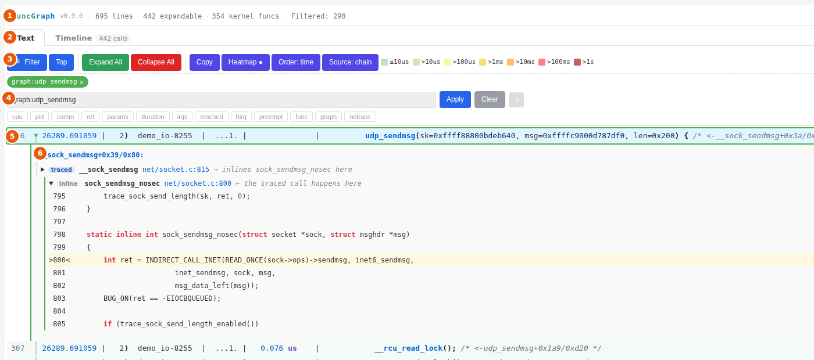

*文本视图（sample.html，过滤 `graph:udp_sendmsg` 并展开第一行）。1 页头，2 标签页，3 工具栏，4 过滤框（5.7 节），5 一行 trace（5.2 节），6 展开的源码块，按内联链排列（5.5 节）。*

- **页头**：trace 总行数、可展开行数、解析到的内核函数数；启用 Timeline 时另有 `N recorded calls`，从 Timeline 标签上移到这里。它表示报告内已记录调用的总次数（不是唯一函数数，也不是 trace 行数；一次调用可有入口/出口两行），不含合成的 inline/untraced 帧，也不随页面过滤改变。用于了解报告规模、比较采集量，不是待处理数量；悬停可查看口径，过滤命中数仍在各视图单独显示。过滤后会显示 `Filtered: N`。右侧依次是 **Theme**（切换深色/浅色）、**?**（快捷键说明）和 **ⓘ**（信息面板：运行环境、处理耗时、源码来源及版本一致性检查、生成参数）。
- **标签页**：Text / Timeline / Compare。
- 页头保持在窗口宽度内，不会被超长的 trace 行撑宽；窄屏时统计信息另起一行，Theme、?、ⓘ 仍可直接点击。trace 内容继续保留原始排版，可以左右滚动。
- **顶部工具栏**（滚动时保持在顶部）：

| 按钮 | 作用 |
|---|---|
| Filter | 显示或隐藏过滤框 |
| Top | 回到页面顶部 |
| Expand All / Collapse All | 展开或收起所有源码块 |
| Copy | 把当前可见的行复制为纯文本 |
| Heatmap | 打开或关闭耗时热力着色，右侧显示图例 |
| Order: time / by task | 行的顺序：按时间（原样，所有 CPU 的行交错）或按任务分组，见 5.6 节 |
| Source: chain / flat | 源码块的排列方式，见 5.5 节 |

### 5.2 一行 trace 的各列

以开了全部选项的一行为例：

```
2003237.699097 |   0)  true-130265   |  d.h1. | + 12.500 us   |    link_path_walk(); /* <-path_lookupat+0x84/0x180 ret=-2 */
└─ 时间戳 ────┘   └CPU┘ └─ 任务 ──┘     └flags┘ └─ 耗时 ─────┘   └ 缩进 + 函数 ┘     └─ 调用点 ─────────────┘ └返回值┘
```

| 列 | 来自哪个选项 | 含义 |
|---|---|---|
| 时间戳 | `funcgraph-abstime` | 事件发生时间，单位秒，精确到微秒 |
| CPU | `funcgraph-cpu` | 事件发生的 CPU |
| 任务 | `funcgraph-proc` | `进程名-pid`。`<idle>-0` 是 idle 任务 |
| flags | `latency-format` | 5 个字符，含义见下表 |
| 耗时 | `funcgraph-duration` | 函数耗时。叶子函数在调用行显示，非叶子函数在 `}` 行显示。前面的标记字符表示耗时等级，见下表 |
| 函数 | | 按调用深度缩进。`func() {` 是进入，`func();` 是叶子调用（进入和返回合成一行），`}` 是返回 |
| `/* <-caller+off/len */` | `funcgraph-retaddr` | 调用点：从哪个函数的哪个偏移调用的。`len` 是调用者函数的长度 |
| `ret=` | `funcgraph-retval` | 返回值，见 5.3 节 |

**flags 列**（与 `/sys/kernel/tracing` 文档中 latency-format 的定义一致）：

| 位置 | 字符 | 含义 |
|---|---|---|
| 1 中断 | `d` | 关中断 |
| | `D` | 关中断且关软中断（BH） |
| | `b` | 只关软中断 |
| | `.` | 都没关 |
| 2 需要调度 | `N` | 设置了 TIF_NEED_RESCHED，且 preempt 计数要求调度 |
| | `n` | 只设置了 TIF_NEED_RESCHED |
| | `p` | 只有 preempt 计数要求调度 |
| | `L` / `l` | 懒抢占（PREEMPT_LAZY）的 need-resched，`L` 同时有 preempt 要求 |
| | `B` / `b` | need-resched 和 lazy 同时设置（`B` 同时有 preempt 要求） |
| | `.` | 不需要调度 |
| 3 上下文 | `h` | 硬中断 |
| | `s` | 软中断 |
| | `H` | 软中断中又来了硬中断 |
| | `z` / `Z` | NMI / 硬中断中的 NMI |
| | `.` | 进程上下文 |
| 4 preempt 深度 | `0`–`f` | preempt_count 的低 4 位，`.` 表示 0 |
| 5 migrate-disable 深度 | `0`–`f` | 禁止迁移的嵌套深度，`.` 表示 0 |

注意：preempt 深度是在跟踪 hook 里读到的，跟踪路径本身通常会多加 1。所以在 6.18 和 7.2 上，进程上下文里正常的值是 `1` 而不是 `.`。时间轴分析会自动识别这个基线（见 7.3 节）。

**耗时标记字符**（内核 `trace_find_mark()` 的定义）：

| 标记 | 耗时 | 热力图等级 | 热力图颜色 |
|---|---|---|---|
| （空格） | ≤ 10 us | 1 | 很淡的绿 |
| `+` | > 10 us | 2 | 浅绿 |
| `!` | > 100 us | 3 | 黄 |
| `#` | > 1 ms | 4 | 琥珀 |
| `*` | > 10 ms | 5 | 橙 |
| `@` | > 100 ms | 6 | 红 |
| `$` | > 1 s | 7 | 深红 |

热力图打开后，整行的背景色按这个等级着色。

### 5.3 语法高亮的颜色

| 元素 | 颜色（浅色主题） |
|---|---|
| CPU 编号 | 红色加粗 |
| 时间戳、耗时数字 | 蓝色 |
| 单位 `us` | 紫色加粗 |
| 函数名 | 紫色加粗；开了 `--func-links` 时是可点击的链接 |
| 模块函数名 | 青蓝色加粗 |
| 十六进制值（参数、地址） | 深蓝色 |
| 注释 `/* ... */` | 灰色斜体 |
| 括号、分号等 | 深灰加粗 |
| `ret=` 是已知 errno（如 -2） | **红色带浅红底**，后面附上名字，例如 `ret=-2 /* ENOENT */` |
| `ret=` 其他值 | 灰色加粗 |

返回值的格式和内核版本有关：
- **6.18 等内核**：错误码以负的十进制打印（`ret=-2`），其他值都是十六进制（`ret=0x0`）。void 函数也会打印 `ret=`，内容是寄存器里的残留值，不代表任何意义。
- **带 BTF 感知 retval 的内核**（如 7.2 trim_retval）：void 函数不打印 `ret=`；bool 打印成 `ret=true/false`；有符号整数用十进制，无符号用十进制或十六进制；超过 long 宽度的类型后面带 `(trunc)`；返回 ERR_PTR 的指针打印成负 errno。

手机上的 Text 只固定一行工具栏：**Filter**、**Top** 和 **More**。**Filter** 在 trace 上方打开查询编辑器和字段快捷按钮，不改变 trace 行的位置；关闭后若显示 **Filter · On**，说明筛选仍生效。层级线、批量展开/收起、复制、热力图、顺序和源码模式收在 **More** 中。点按面板外或按 Esc 可关闭面板，不会清除筛选。桌面保留内联工具栏和原有的筛选编辑器显示设置。

### 5.4 折叠

桌面端开启 `--enable-fold` 后，每个 `func() {` 的函数名前有一个跟随原始缩进的细线空心箭头（向右表示已折叠，向下表示已展开）。细灰色层级线按完整行高连接，出口以小圆角收尾，并与箭头保持同一轴线。祖先线、箭头下方连接线和源码链边线共用主题对应的中性灰，悬停时稍加强调。

手机上，同一折叠按钮移到行号左侧的触控列，宽 44 CSS px、高一行，相邻按钮不会重叠。不必先横滑到深层调用的函数名，就能折叠它。触控列随 trace 横向滚动；向右阅读时仍可点按入口的 `{`。缩进、层级线配色、行高和复制出的 trace 原文不变。没有可折叠调用的报告不预留触控列。

新生成的 Text 报告每 512 条完整记录分成一个静态绘制块，减少大型页面悬停/聚焦时的浏览器重绘开销；每行和紧随的源码面板保持在同一块中，任务分组标题留在块外以保留粘性定位。支持 `overflow-clip-margin` 的浏览器启用绘制隔离，并留出 6px 避免裁掉边界折叠按钮和焦点轮廓；同时给块提供合成提示，降低大型 DOM 的鼠标命中测试成本，不给每行单独建层，也不移动文字。是否实际合成及保留多少层由浏览器决定；其他浏览器保留原始绘制方式。跨块原生拖选、滚动尺寸和源码展开保持不变。全部 trace 行、源码与 Timeline 数据仍在同一 HTML 中；这不是按需加载、虚拟列表或 sidecar，内存占用仍随报告增长。旧报告需要重新生成。

祖先线、箭头下方的连接线、出口拐角和悬停强调统一在一个视口画布中绘制，采用同一设备像素网格和线宽，避免分数 `ch` 的重复渐变将不同深度的线模糊成不同粗细。线宽约为 1 CSS px，取最接近的整数设备像素（DPR 1/1.25 为 1 像素，1.5/2 为 2 像素）；强调只换颜色，不加粗。缩进间距仍精确跟随原始文字，不能通过取整层级间距来换取线宽一致，否则深层会逐渐错位。只定位可见绘制块及其中的可见行，不为每层增加 DOM，也不再缓存整份报告的行引用来绘线。

- 点击空心箭头折叠或展开这个调用块；按住 Shift 点击会递归折叠或展开所有子块。
- 入口的 `{` 也可以折叠，但不会触发源码展开；参数很长、括号移到屏幕外时，函数名前的箭头仍可使用。箭头获焦后可用原生 Enter/Space 激活；点击带源码行的其他位置仍打开源码块。
- **Tree guides: on/off** 在桌面端紧挨 **Top**，在手机端位于 **More** 中。它只控制层级线，不隐藏折叠控件。设置按报告保存，在解析 trace 行之前恢复；关闭前后列位置和行高不变。以前生成的 HTML 需要重新生成，才会包含新开关。
- 鼠标悬停箭头、左括号或收尾拐角时，轻微强调该调用在可见后代中的同一列层级线及入口/出口标记；键盘聚焦箭头也有同样反馈，其他列不变亮。层级线依据原始缩进和已配对的调用，不代表推断出的完整调用栈；任务交错、过滤行和展开的源码块可能打断线条。任务交错影响阅读时可切换 **Order: task**。
- 折叠父调用时，所有后代调用及其已打开的源码块都会一并隐藏，不影响其他调用树或父调用自己的源码块。重新展开父调用后，只恢复可见调用的源码块，并保留各子调用原来的折叠/展开状态；刷新报告或按任务分组后也遵循相同规则。
- 过滤与折叠共同决定显示：应用或清空过滤不会打开已折叠的祖先，展开调用也不会显示过滤拒绝的行及其源码。**Clear** 只为可见行恢复保存的源码展开状态。摘要始终统计完整已记录子树，不只统计过滤命中的调用。深度、递归和保存状态恢复先统一修改折叠状态，再一次投影行。Sidecar/auto-sidecar 在首次打开 Text 的准备过程中协作生成完整记录和折叠元数据，完成后才挂载行，不再让首次折叠承担建模成本；准备可取消、重试，不挂载部分行，也不为此额外下载过滤索引。内嵌 Text 仍保留惰性同步建模。两种路径仍保留完整 DOM，初始化/布局仍可能阻塞，准备总时间也可能增加，不能保证每种交互都加速。
- 新报告预先索引精确的折叠成员范围：单个子树不再扫描全 trace 查找成员，递归/批量操作只更新实际改变状态的子树并集，同一行只投影一次。范围保留任务交错的空隙，任务/时间排序及过滤不改变原始调用树。该索引有准备和常驻内存成本；导航候选刷新、深度控制和完整 DOM 布局仍有全量工作，不等于已经实现 Text 按需分块、窗口化或内存上限。旧报告需要重新生成。
- 按数字键 `1`–`9`：只显示深度不超过 N 的调用；`0`：展开全部。
- 折叠后显示 `{ … }`，紧接简短摘要，再显示调用点尾注：全部已记录后代调用次数（包括叶子调用，不计出口和入口自身）、可获得的实测包含耗时、返回值。普通返回值保持灰色，已知 errno 才保留错误配色。次数只统计 trace 中记录到的调用，不代表 CPU 上执行过的全部函数。
- 折叠状态保存在浏览器的 localStorage 中，按报告区分。

折叠相关的行背景色：

| 颜色 | 含义 |
|---|---|
| 很淡的绿 | 调用块的入口行 `func() {` |
| 很淡的蓝 | 调用块内部的行 |
| 很淡的红 | 调用块的出口行 `}` |
| 很淡的中性灰 | 已折叠的入口行 |
| 低对比度灰色细线及拐角 | 缩进层级和配对调用的边界，可关闭 |

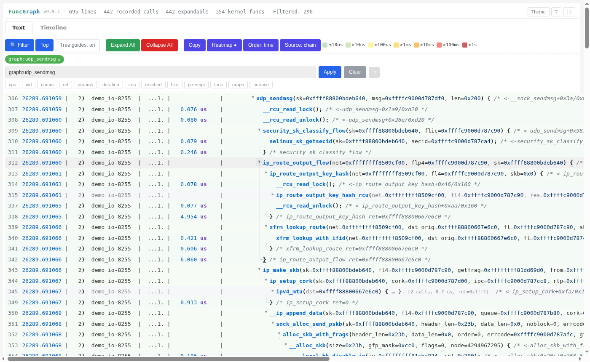

### 5.5 源码块

带调用点的行可以展开，点击行或按 Enter 都可以。展开后显示调用点对应的源码：前后各 5 行，当前行高亮，标成 `>行号<`。

调用点落在内联代码里时，faddr2line 会给出一条内联链。**Source** 按钮在两种排列之间切换：

- **chain**（默认）：从外到内排列。标 `traced` 的是被 ftrace 跟踪到的那个函数，下面依次是内联进来的各层 `inline` 函数，每层缩进一级、可以折叠，并注明"→ inlines X here"。只有最内层（"← the traced call happens here"，真正发起这次调用的那一行）默认展开。每层右边的 ↗ 是在线源码链接。
- **flat**：和 faddr2line 的原始输出一样，最内层在前，全部展开。

Text 工具栏与 Timeline 调用点面板的 Source 按钮保持同步。在支持弱引用的浏览器中，切换只重排已填充的源码面板，不扫描整份 trace 的空占位块，也不会提前解析尚未使用的源码池。未打开的块首次展开时直接使用当前模式；被替换的详情面板不会被登记表强引用保留。旧浏览器仍可切换模式，但使用兼容扫描路径。这不改变源码内容。sidecar 展开时只请求对应的校验源码块，收起的 Timeline 源码面板等到打开才读取；等待显示 **Loading source…**，失败提供 **Retry**。收起、替换/关闭详情或切换视图会取消当前面板的请求，不影响同块其他消费者；返回视图时重启仍展开的未完成面板，成功块复用缓存。单文件报告仍同步读取内嵌源码。

### 5.6 按任务分组

ftrace 按时间输出所有 CPU 的事件。同时运行的任务越多、切换越频繁，同一个任务的调用就越零散：实测相邻两行属于不同 CPU 的比例在 25% 到 58% 之间。

点 **Order** 切换成"by task"后：
- 每个任务的行连在一起，保持原有顺序。行数多的任务排在前面，idle 任务排在最后。
- 每组上方有一个固定在顶部的标题：`任务名 pid · 行数 · 运行过的 CPU`。
- 每次上下文切换后插入一行灰色斜体的摘要，例如 `⇣ switched out on CPU 0 → idle-0; resumes at line 19703 after 7.640 ms (1 lines of other tasks in between)`，含义是：在 CPU 0 上被切走，换上了谁，多久之后在第几行恢复，中间插了多少行其他任务。切换标记之间的分隔线和空行会被隐藏。
- 折叠、过滤、热力图和源码展开在分组模式下都照常可用。切回"time"后按行号恢复原顺序。

### 5.7 统一过滤器

在过滤框中输入 `字段:值`，可以用 `AND`、`OR`、`NOT` 和括号组合，按 Enter 或 Apply 生效。也可以点下面的字段按钮，从下拉列表里选。

| 字段 | 匹配 | 示例 |
|---|---|---|
| `cpu` | CPU 编号（正则） | `cpu:0`、`cpu:0\|1` |
| `pid` | 进程 pid（正则） | `pid:1234` |
| `comm` | 进程名（正则） | `comm:bash` |
| `func` | 本行的函数名（正则），只匹配这一行 | `func:mutex` |
| `graph` | 匹配函数的**整棵调用树**（类似 `set_graph_function`） | `graph:vfs_read` |
| `notrace` | 隐藏匹配函数的整棵调用树（类似 `set_graph_notrace`） | `notrace:__schedule` |
| `ret` | 返回值的数字（正则）；`ret:all` 匹配所有已知的错误码 | `ret:-22`、`ret:-2$`、`ret:all` |
| `params` | 参数文本（正则） | `params:folio` |
| `duration` | 耗时（us），支持 `>` `<` `>=` `<=` | `duration:>10` |
| `irqs` | flags 第 1 位 | `irqs:d` |
| `resched` | flags 第 2 位 | `resched:N` |
| `hirq` | flags 第 3 位 | `hirq:h`、`hirq:s` |
| `preempt` | preempt 深度，支持比较 | `preempt:>1` |
| `sort:desc` / `sort:asc` | 按耗时对可见行排序 | `duration:>0 sort:desc` |

`sort:asc` / `sort:desc` 是展示指令，不是过滤条件：可单独使用，也可附在表达式后；不改变匹配行集合或 Timeline 的时间顺序。在 Timeline 输入单独排序指令会保留到 Text 打开时执行，不提前下载过滤索引或 Text。排序保留 trace 行与相邻源码块，不覆盖已有 **Order** 任务/时间偏好；清空过滤或移除排序指令后恢复该偏好，也可用 **Order** 手动切换。过滤匹配使用完整原始记录模型，而非当前显示的行或折叠摘要；延后加载的 Text 在挂载前准备，内嵌 Text 则在首次过滤/折叠使用时惰性准备。后续查询复用模型，单独排序不请求过滤索引。完整模型和 DOM 仍占用内存，排序和展示更新仍可能阻塞，不是虚拟列表。

示例：

```
comm:cat AND graph:anon_pipe_read             cat 进程里 anon_pipe_read 的完整调用树
graph:vfs_read AND NOT notrace:security_      vfs_read 调用树，但去掉 security_ 开头的子树
ret:all AND comm:ls                           ls 进程里所有返回错误码的行
irqs:d AND duration:>50                       关中断状态下耗时超过 50 us 的调用
```

过滤结果会同步到时间轴（见 6.6 节）。

### 5.8 键盘与鼠标

顶栏右上角的 **?** 是统一帮助入口，内容随当前视图区分：Text 显示键盘与折叠操作，Timeline 显示缩放、导航、Search/Filter 区别与图例，Compare 显示筛选、排序和导出说明。普通布局不再重复显示 Timeline 工具栏的 **?**；只有最大化隐藏页头时，工具栏才显示帮助按钮。支持按钮原生 Enter/Space、关闭按钮和 Escape；切换视图会关闭 Text/Compare 的共享提示。Timeline 尚在准备时会等待完成，不强制同步初始化；准备取消或切到别的视图后不会再弹出过期帮助。

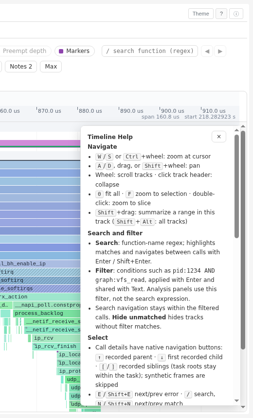

| 操作 | 作用 |
|---|---|
| `j` / `k` 或 ↓ / ↑ | 移到下一个/上一个可展开的行 |
| `h` / `l` | 左右滚动 |
| Enter | 展开或收起当前行的源码块 |
| Space / PageDown / PageUp | 翻页 |
| `gg` / `G`（或 Home / End） | 跳到开头/结尾 |
| `1`–`9` / `0` | 折叠到深度 N / 展开全部 |
| Esc | 取消选中 |
| `?` | 显示快捷键说明 |
| 点击行号 | 复制这一行的锚点链接（`#L行号`），可以分享给别人直接定位 |
| Alt + 点击一行 | 在时间轴中定位这一行对应的调用 |

Text 的焦点与滚动分开处理：初始化、恢复选中或其他明确要求不滚动的操作保留原生行焦点，但不会自动跳动页面；键盘导航需要定位时才显式平滑滚动。顶部固定工具栏的实际高度也计入可见范围，窄窗口里换行后的工具栏不会遮住导航选中的行。

`j`/`k` 和方向键按当前 Text 展示顺序导航，首尾循环；从注释或出口行出发，选择该方向最近的可见、可展开源码的调用，不再额外跳过一条。时间/任务顺序与耗时排序保留选中的 trace 行身份，过滤和折叠同步更新导航候选。Home/End 选择首尾可见的可展开行；没有可展开调用时退回可见普通行，没有可见行时不操作。逻辑查找使用完整数字行号索引，行点击、锚点选中和候选刷新不再查询所有已挂载行。源码、焦点与滚动仍需要目标 DOM 节点，完整渲染/布局仍可能阻塞；旧报告需重新生成才能使用这些修复。

新 sidecar 索引为每个可展开行记录准确的源码池 ID，包括有效的 `0`；`null` 明确表示不能展开源码。延迟 Text 从这些完整记录准备导航，不再单独扫描 DOM 的展开能力。已加载索引时直接复用，否则在读取文档外完整行的同时采集同样的元数据，不会仅为导航额外请求过滤索引。旧版 version-1 索引仍可读取，其源码能力是未知而非不存在，因此退回原始行采集。这只是模型解耦，不是视口虚拟化：Text 仍完整加载并挂载所有行，源码展开、焦点和滚动仍需要已挂载元素。

## 6. 时间轴视图

[uftrace 混合报告](uftrace.cn.md)在每个匹配的内核调用顶边画细分界线，线段只覆盖
该调用的实测时段。工具栏图例和调用栈标记解释两态的转换；默认 Context 配色下
用户态有独立配色。单态报告无分界线。Text / Timeline 共用的 Filter 支持
`space:user` 和 `space:kernel`。
可打开[混合示例](../sample_mixed.html)实际体验，操作和重建步骤见 [uftrace 指南](uftrace.cn.md)。
选中 `dispatch_datagram` 可看采集到的函数地址、参数和返回值。Text 将这些字段放在对应的入口、
退出行；无法解码的 payload 保留为原始字节，不猜测其含义。
跟踪真实工具和依赖库的编译与操作步骤见 [pigz + zlib 压缩实战](pigz.cn.md)。
采到 `sched_process_exec` 或 `sched_process_exit` 时，**Exec / exit** 显示实测生命周期事件，
可跳到 Text；**Markers** 切换轨道刻度。缺失事件不会由 `main` 或最后一帧推算。

### 6.1 布局

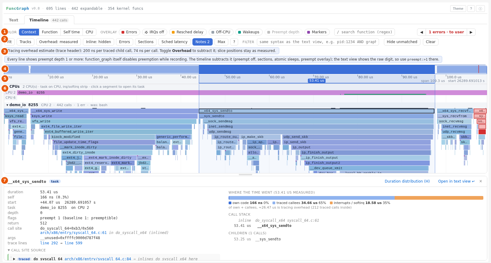

*时间轴（sample.html，选中 `__x64_sys_sendto`），编号对应下面的列表。*

从上到下依次是：

1. **工具栏第一行**：Color（配色模式）、Overlay（叠加层开关）、函数搜索框、错误导航。
2. **工具栏第二行**：Fit（显示全部）、Tracks（展开或收起所有轨道）、Tasks（任务导航，7.7 节）、Overhead（实测/扣除开销）、Inline（内联帧视图）、Errors、Sections、Sched latency（分析面板）、Notes（收起或展开提示条）、Max（隐藏页头和标签页，快捷键 `M`），右边是 **Filter**：与文本视图共用的过滤表达式，见 6.6 节。帮助统一使用页头右上角 **?**，最大化时才在工具栏显示替代入口。窗口窄时工具栏会折成更多行。
3. **提示条**：说明这份 trace 缺少哪些信息、有什么限制，例如"No timestamps…""Arguments are not printed…"。蓝色是提示，黄色是需要注意的问题。
4. **概览条**：整份 trace 的缩略图。蓝色柱子表示各时刻的繁忙程度，红色竖线是错误源头（高的表示传到了用户态，矮的橙色表示被调用者处理掉了），蓝框是当前看到的范围。点击或拖动可以跳转，在上面滚动滚轮可以缩放。
5. **时间刻度**：右侧显示当前范围的跨度（`span`）和起始的绝对时间（`start`）。框选范围后会显示 `selected`，鼠标所在位置的时间显示在光标旁。
6. **CPU 轨道**（只在有时间戳时显示）和**任务轨道**。时间从 trace 中最早的事件算起（可能是第一个调用之前的调度事件），所以第一个调用不一定在 0；打开时和按 Fit 时显示从第一个调用到最后一次调用、运行、等待边界、唤醒或临界区/调度延迟窗口边界的范围，向左平移可以看到之前的事件。最后一次调用之后的调度记录仍可访问；开放等待只按此报告边界补齐几何宽度，不代表观察到了恢复。
7. **底部面板**：点击切片或打开分析面板时出现，拖动上方的横条可以调整高度（6.5 节）。

窄屏或矮窗口中，工具栏按钮会自动换行；工具栏和提示条各自可以上下滚动，不会把画布和详情面板挤出屏幕。窄屏的切片详情改为单列。可点击 **Notes** 收起提示条，或使用 **Max / M** 获取更多画布空间；调整后的面板高度偏好仍会保留。

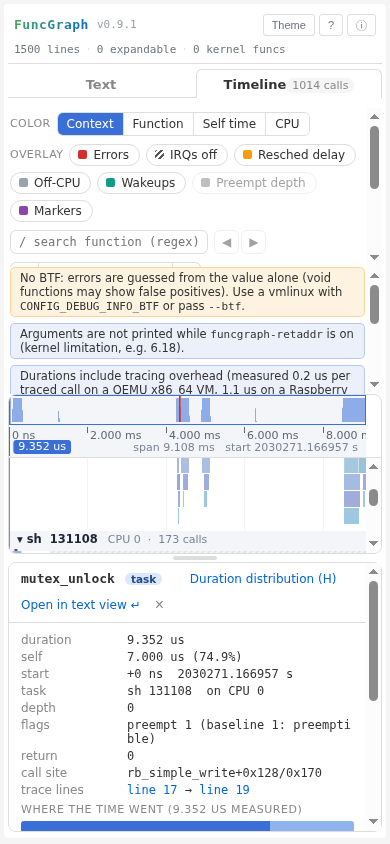

*390 × 844 窗口中的时间轴：工具栏、提示条和详情独立滚动，画布仍在可视区域内。*

**时间模式**取决于 trace 里有哪些列，在时间刻度右侧注明：

| 模式 | 条件 | 横轴含义 |
|---|---|---|
| abs | 有 `funcgraph-abstime` | 真实时间，空隙也是真实的 |
| rel | 有相对时间戳 | 同上 |
| compressed | 只有耗时 | 每个任务内的调用按耗时首尾相接，看不到空隙，标为"compressed time" |
| count | 都没有 | 每个叶子调用算一个单位，只表示调用顺序 |

### 6.2 轨道

**任务轨道**：每个任务一条，任务越繁忙越靠上，idle 任务排在最后并默认收起。

- 标题：`进程名 pid`，后面是运行过的 CPU、调用次数、错误数。过滤时还有匹配数（`N matched`）；任务改过名字时显示 `was: 旧名字`（例如 exec 前叫 bash）。没有 `funcgraph-proc` 时标题是 `CPU N (no funcgraph-proc)`。
- 点击标题可以收起或展开这条轨道。收起后只剩一行很窄的条，显示最外层的调用。
- 轨道内横轴是时间，纵轴是调用深度，最外层在最上面。**切片的宽度就是函数的实测耗时。**

**CPU 轨道**（顶部的 `CPUs`）：每个 CPU 一行，显示这个 CPU 上依次运行了哪个任务。

- 每段的颜色按任务名取色（同一任务颜色相同），宽度足够时标上 `任务名 pid`。
- 段底部的细条表示中断占用：**橙色**是硬中断，**绿色**是软中断，**紫色**是 NMI。
- 悬停显示这个任务在这个 CPU 上连续运行了多久，以及期间硬中断和软中断各占多少时间；点击跳到对应任务，并选中该时刻最内层的真实调用（支持从非零深度开始采集）。没有重叠调用时清除旧切片详情，打开单任务范围的 Tasks，保留当前时间视野。仅有调度记录的轨道按需显示头部，不伪造切片。

### 6.3 配色模式（Color）

| 模式 | 颜色表示什么 |
|---|---|
| **Context**（默认） | 执行上下文。**蓝色**：进程上下文；**绿色**：软中断；**橙色**：硬中断；**紫色**：NMI。同一上下文中不同函数的色相和亮度有轻微差别，方便区分相邻的切片 |
| **Function** | 按函数名取色，同名函数颜色相同，用来找同一个函数在各处的调用 |
| **Self time** | 自身耗时（不含子调用），对数刻度。**蓝色**表示最短，过渡到**红色**表示最长，用来找真正耗时的地方 |
| **CPU** | 调用运行在哪个 CPU 上，每个 CPU 一种颜色。未知时为灰色。用来观察迁移 |
| **Module** | 所属的内核模块，每个模块一种颜色；内核本体的函数是浅灰色。trace 里没有模块函数时不显示这个选项 |

没有 `latency-format` 时，Context 模式下的上下文是根据中断入口函数名（如 `gic_handle_irq`、`__sysvec_*`、`handle_softirqs`）推断出来的。这些切片的悬停提示里会标注 `(inferred)`。

### 6.4 叠加层（Overlay）和标记

每个叠加层都可以单独开关。trace 里缺少相应数据时，对应的按钮会隐藏。

| 叠加层 | 显示 | 含义 |
|---|---|---|
| **Errors** | **深红实心**切片 | 错误源头，且错误一直返回到了用户态（调用链上有 `*_sys_*`） |
| | **橙色实心**切片 | 错误源头，但被某个调用者处理掉了 |
| | **浅红底 + 红边框** | 错误传播：返回了和子调用相同的错误码 |
| | **浅橙底 + 橙边框** | 被处理掉的错误的传播帧 |
| | 小**三角**（红/橙） | 错误源头太窄、放不下标签时，在它上方画一个三角 |
| | 切片标签 `func = ENOENT` | 错误源头会在函数名后附上 errno 名字 |
| **IRQs off** | 切片上的**斜纹** | 这次调用开始时中断是关闭的 |
| | 轨道标题底部的**深灰色细线** | 关中断的时间段（真实的起止） |
| **Resched delay** | 切片右上角的**琥珀色三角** | 这次调用开始时已经设置了 need-resched，也就是该调度了但还没调度 |
| | 轨道标题底部的**琥珀色横条** | need-resched 窗口：从设置到真正发生调度的这段时间，即调度延迟 |
| **Off-CPU** | 灰色斜纹段，标注 `off-CPU 7.640 ms · do_wait [S]` | 任务不在 CPU 上的时间，画在当时打开的那一帧的下一层。标注依次是：时长、在哪个函数里等待、换出时的状态（`S` 可中断睡眠、`D` 不可中断、`R` 仍可运行） |
| | 同样的段带**琥珀色底** | 被抢占（任务本来还能继续运行） |
| **Wakeups** | **青色箭头**，从唤醒者的圆点指向被唤醒者恢复运行的位置 | 谁在什么时候唤醒了谁（需要 `sched_waking` 或 `sched_wakeup`） |
| | 只有一个小三角 | 唤醒挤在一起时只画终点。悬停或选中某个任务、悬停某段 off-CPU 时，会画出相关的完整箭头；右上角提示“N of M wakeups bunched”，窄窗口保留计数、省略操作提示 |
| **Preempt depth**（默认关闭） | 切片底部的灰色条，越深表示 preempt 深度越大 | |
| **Markers** | 切片右边缘的**点线** | 只看到了进入，没看到返回（采集窗口在这里结束，或者事件丢失） |
| | 切片左边缘的**点线** | 只看到了返回，没看到进入（调用在采集开始之前就已经开始） |
| | 切片左上角的**紫色小方块** | 调用点所在的函数与记录中的父切片不同；可能是尾调用、内联或未跟踪代码，原因尚未确定，不等于漏采了一层函数 |
| | 切片左上角的**灰色小箭头** | `--tail-calls` 在提供的二进制中找到通向该函数的直接尾跳转；是静态证据，不是本次执行的分支记录 |
| | 切片底部的**红色下划线** | 在原子上下文中调用了可能睡眠的函数（见 7.4 节） |

缩放后，Wakeups 仍会显示穿过当前时间窗口的箭头，即使唤醒时刻在左侧屏外。等待链和导出继续使用完整记录。

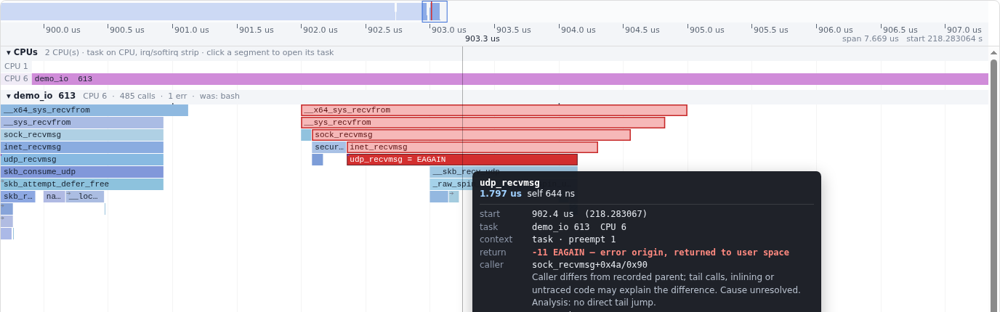

*错误路径（第二次 `recvfrom`）：`udp_recvmsg` 是源头（实心红，标签 `= EAGAIN`），往外各帧是浅红底加红边框的传播帧；悬停提示给出 errno 和去向。*

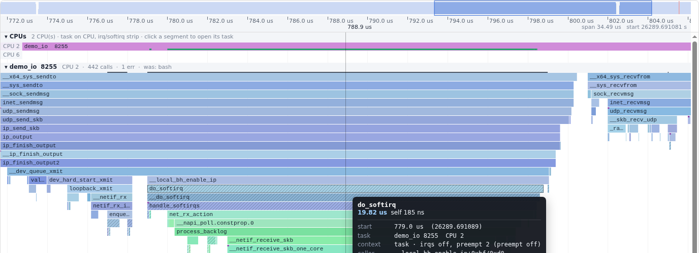

*关中断：`do_softirq`、`__do_softirq` 带斜纹（进入时中断关闭）；轨道标题下的深灰色细线是关中断的时间段；软中断里的调用是绿色。*

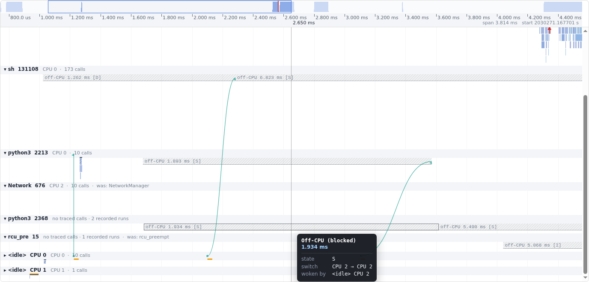

*Off-CPU 和唤醒（tests/data/pi4_sched.txt）：淡灰斜纹段是任务不在 CPU 上的时间，青色箭头从唤醒者指向被唤醒的任务；悬停 off-CPU 段显示状态和唤醒者。*

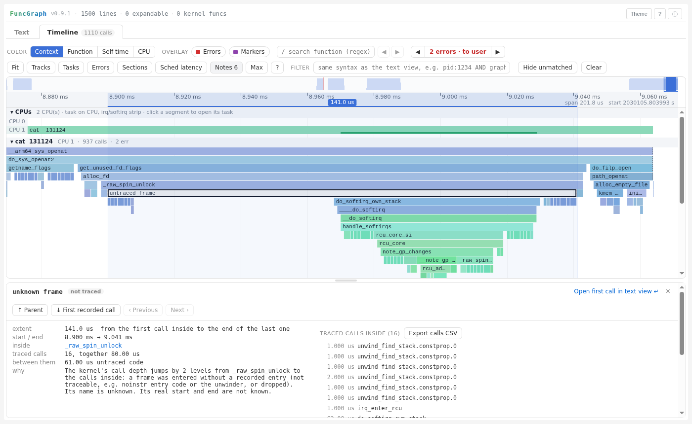

*未跟踪帧（tests/data/pi4_nodur.txt）：`_raw_spin_unlock` 和里面的 `unwind_find_stack` 等之间缺了两层，画成虚线框 `untraced frame`；这份夹具没有调用点，所以名字未知。*

容易看错的两点：

- **斜纹只反映进入调用那一刻的状态**。latency 列记录的是每一行打印时的中断状态，切片用的是入口那一行。函数中途关中断或开中断（例如 `spin_lock_irqsave` 之后的那些调用），切片本身看不出来。关中断真实持续了多久，看轨道标题下的深灰色细线，或者 Sections 面板（7.3 节），那里列出每一段的开始、结束和期间运行的代码。
- **两种斜纹**：切片上颜色较深的斜纹是关中断，只覆盖那一个切片；灰色很淡、带 `off-CPU …` 标注、从某一层一直铺到轨道底部的斜纹段，是任务不在 CPU 上的时间，和中断无关。

其他视觉效果：

- **变暗**：被搜索或过滤排除的切片显示为原透明度的 18%。
- **密集块**：在当前缩放下，宽度不足 1.5 CSS 像素的切片会共用像素。匹配统计覆盖全部成员：**任意一个帧**同时满足函数搜索与统一过滤器，该像素就保持明亮；未匹配的相邻像素仍变暗。颜色取首个匹配代表帧，无匹配则取首帧；相邻且明暗状态一致的像素可合并绘制。悬停显示**帧数**、匹配数和代表身份，点击选择首个匹配帧（无匹配则选首帧）。这是同任务/深度下的像素分组，不是新运行时调用或实测耗时合计；合成帧只计为帧，不冒充真实被跟踪调用。鼠标实际落在宽调用内时优先选择宽调用，而非附近细帧。可放大或使用记录树导航逐个检查；起点位于视野左边界的零耗时调用也会显示。
- **选中**：粗的深色边框。**悬停**：细边框。选中后（参照 Perfetto）画布上用两条蓝色竖线标出切片的起点和终点，中间加浅蓝底；时间标尺上用蓝色区间标出同一段时间，并显示它的时长；概览条上也标出它的位置。框选范围时不显示这些标记。
- **内联帧**（Inline 视图下）：灰色半透明底加虚线框，标签是 `inline 函数名`。见 6.8 节。
- **未跟踪帧**（始终显示）：灰色半透明底加虚线框，标签是 `untraced 函数名`。内核打印的调用深度有时一下跳了两级或更多，例如 arm64 上 `unwind_find_stack` 直接出现在 `__might_sleep` 下两级（中间的 `arch_stack_walk` 没有入口记录），中断入口 `irq_enter_rcu`、`do_interrupt_handler` 也一样（中间是不可跟踪的 `el1_interrupt`）。以前这里会空出一行。现在这些调用归到外层切片下（外层的 self 时间不再包含它们），缺的那一层画成未跟踪帧：名字取自这些调用的返回地址（也就是它们的调用者），缺多层时外面几层显示 `untraced frame`（名字未知）；范围是里面第一个到最后一个调用，真实的起止时间不知道。悬停和详情面板会说明这一点，调用栈里也会列出这些帧（标为 `untraced`）。

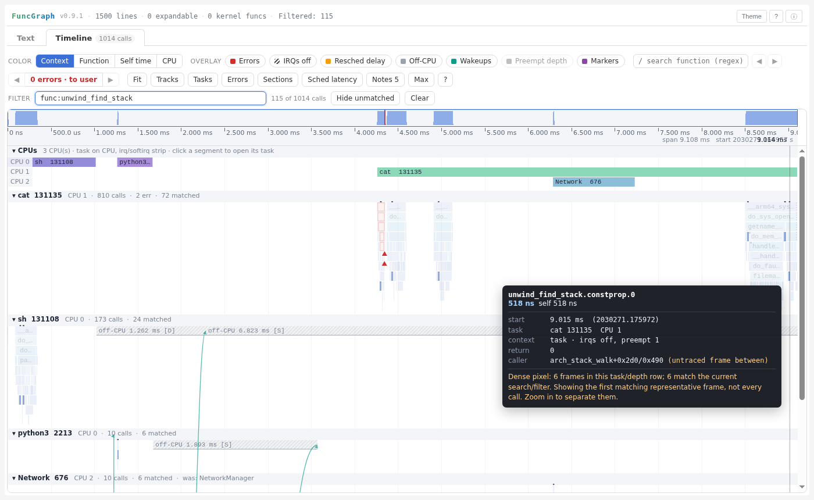

*真实调度 trace 中的密集帧：过滤后仍保留内部匹配，悬停说明像素分组，而非让用户误以为只有代表帧存在。*

内联/未跟踪帧只要任一真实孩子同时满足搜索与统一过滤器的**交集**，就保持明亮。重复悬停复用当前合成帧的原始范围/覆盖事实，Overhead 不改变这份几何。行匹配前缀与合成匹配结果按搜索/过滤身份缓存，重绘、主题、窗口调整和 Overhead 不会反复扫描全部分组成员；改变任一过滤后首次重绘才准备新的匹配事实，不再仅抽样第一个帧。

#### 可选：尾调用的静态证据

```bash
python3 funcgraph.py --timeline --tail-calls --fast --func-links \
    --vmlinux /path/to/vmlinux --kernel-src /path/to/linux \
    --output report.html trace.txt
```

尾调用可能用 `jmp` / `b` 替代普通调用，保留更外层的返回地址。因此“返回地址所在函数 ≠ 记录中的父函数”不能直接解释成漏采。默认报告只提示原因未确定；加上 `--tail-calls` 后，才会检查提供的二进制是否含有父函数通向子函数入口的直接尾跳转。没有该选项，不读取 ELF 做尾调用分析，也不启动反汇编工具。

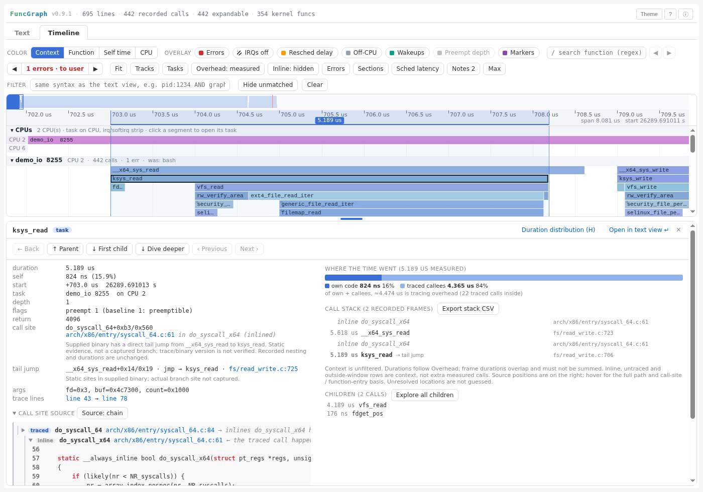

*示例中的 `__x64_sys_read → ksys_read`：调用栈右侧有低调的 `⇢ tail jump` 标记，详情单独列出跳转指令及可点击源码位置，不把静态位置替换成原始调用点。*

- **显示方式**：Markers 开启时，足够宽的切片用灰色小箭头替代未确定原因的紫色方块；调用栈保留原有对齐，不新增缩进或高饱和颜色。详情列出全部匹配的静态跳转点；已有 DWARF 解析结果时显示源码链接，否则明确显示 `Source unavailable`。
- **证据边界**：只说明提供的二进制里存在直接跳转，不证明本次执行走过该指令，也不自动证明 trace 与二进制版本一致。函数可能还有普通调用路径。记录中的父子关系、层级、切片宽度、耗时、自身耗时、调用数和导航保持不变；不补造返回事件或栈帧。
- **依赖与覆盖**：需要 pyelftools（`pip install 'funcgraph[fast]'` 或 `[all]`）及对应架构的 GNU/LLVM objdump，沿用 `CROSS_COMPILE` / `LLVM`。当前仅支持带符号表的 ELF64 小端 x86-64 / arm64 已链接二进制。模块、间接跳转、符号缺失/歧义、深度缺口、预算超限或工具不可用都保留为未确定，不能据此断言“没有尾调用”。`funcgraph-tail` 只是出口行函数名选项，与这项分析无关。
- **raw 输入**：与文本共用同一分析流程，但必须有可解析的返回地址，形成 caller/parent 不匹配关系。没有这类数据时不会仅凭嵌套形状猜测尾调用；裸 `trace_pipe_raw` 仍不支持。
- **开销与导出**：按不同的父/子函数与模块组合去重，只读取候选父函数代码，一批调用 objdump，不逐次调用反汇编。开启会增加生成阶段成本，浏览器不会运行反汇编。`--export result.json` 增加独立的 `tail_calls` 证据；命令行导出发生在 HTML 源码补充之前，因此不保证包含静态点的源码位置。上下文 CSV 追加 `relationship`、`relationship_basis`、`tail_jump_sites`、`trace_binary_version_verified`，其中静态证据的版本核验值为 `false`；普通函数统计 CSV 不变。`--no-text-view` 仍默认跳过源码解析，需 `--keep-source` 才保留这些位置。

### 6.5 悬停提示和详情面板

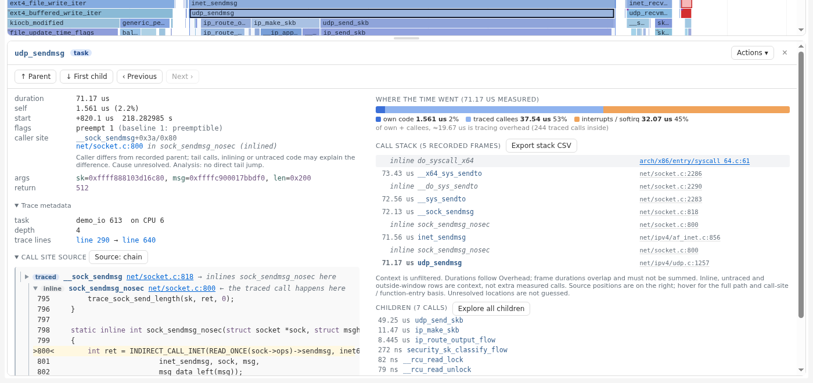

*`udp_sendmsg` 的详情面板（已向上拖大）：左栏是各项数值、调用点 `net/socket.c:800` 和它的源码块；右栏是耗时拆分、带可点击源码位置的调用栈（斜体为内联帧）和子调用。源码路径悬停时强调；顶端按钮在记录父调用、子调用和兄弟调用之间切换。*

**悬停在切片上**时显示：

| 字段 | 含义 |
|---|---|
| 函数名 `[模块]` | 模块函数会附上模块名 |
| 耗时、`self` | 实测耗时和自身耗时。标了 `(estimated)` 表示没有 duration 列，耗时是由时间戳推算的 |
| start | 相对 trace 起点的时间，括号里是绝对时间戳 |
| task | 任务和 CPU |
| context | 上下文，后面附上 flags 的解读：irqs off、BH off、need-resched 类型、preempt N、migrate-off N。`(inferred)` 表示是推断的 |
| return | 返回值。是错误时后面附上 errno 名字、角色（error origin 错误源头 / propagated 传播）和去向（returned to user space 返回到用户态 / handled by caller 被调用者处理 / propagates beyond trace 传出了采集范围）。`unverified: no BTF type` 表示没有类型信息，只是根据数值判断的 |
| caller | 记录的返回地址。与父切片不符时说明可能原因；有尾跳转静态证据时显示证据及版本未核验提示，不再一律称为漏采帧 |
| source | 已解析的调用点源码位置 `文件:行号`，即发起这次调用的那一行（需要地址解析，通常提供 `--vmlinux`，但不要求挂载 Text 视图） |
| inlined in | 调用点所在的内联函数链 |
| args | 函数参数（采集时开了 `funcgraph-args` 才有） |

新报告使用紧凑调用点位置索引生成这部分悬停提示，内联链选择最内层的实际调用位置。悬停已解析或明确没有可用位置的调用点，不再解析整份源码池和 Text 源码行映射；不可用的调用点不会借用函数入口行号。旧格式或尚未支持的位置表示仍保留原有源码 HTML 回退；打开源码详情时仍按需解析内嵌的代码池。本次不引入外部源码分块，也不是 Text 虚拟化。

**悬停在 off-CPU 段上**：等待时长、在哪个函数里等待、换出时的状态、从哪个 CPU 换出又在哪个 CPU 上恢复、唤醒者。

**点击切片**会在下方打开详情面板：

- 标题旁的标签：上下文（`?` 表示推断）、irqs off、BH off、need-resched、preempt off（抢占计数高于这份 trace 的基线，`×N` 表示多关了几层，悬停标签可看到具体数值。function_graph 在记录时自己关了一层抢占，开了 `CONFIG_PREEMPTION` 的内核上每行的 preempt 数字都多 1：基线取任务上下文里出现过的最小值，最大为 1，这样整份 trace 都在关抢占区间里时也不会被掩盖。时间轴里的 preempt off、Sections、在原子上下文睡眠、Preempt depth 叠加层、Sched latency 的 max preempt off 都扣除了基线；文本视图显示的是原始数字，过滤时要用 `preempt:>1` 这样的写法）、migrate off、error origin/propagated、may sleep in atomic context、no exit、no entry、estimated。
- 左栏：duration、self（及占总耗时的比例）、start、task、depth、flags、return、call site、args、trace lines（入口和出口在 trace 中的行号，点击跳到文本视图）。
  - **call site** 下面是调用所在的源码位置（`文件:行号`，点击打开在线源码）；调用点在内联代码里时附上 `in 内联函数 (inlined)`。
  - **Call site source**：调用点的源码块，和文本视图展开一行时看到的完全相同（语法高亮、`>行号<` 标出调用所在行、内联链按 Source 按钮的 chain/flat 布局）。点标题可以收起，状态会被记住。Text 和 Timeline 共享去重源码池及“trace 行号 → source ID”索引，不要求对应 Text 行已存在于 DOM 中。没有 `--kernel-src` / `--source-rev` / `--source-url` 时只显示位置链接；普通 `--no-text-view` 不保留两者，加上 `--keep-source` 可在纯 Timeline 报告中保留已有的源码/位置/内联信息。
- 右栏：
  - **Where the time went**：一条堆叠条，分解记录中的区间。按真实父子关系处理深度缺口和超过 256 层的栈，不把合成的 inline/untraced 帧算成额外调用：

    | 颜色 | 部分 |
    |---|---|
    | 深蓝 | own code：函数自身的代码 |
    | 浅蓝 | traced callees：被跟踪的子调用 |
    | 橙色 | interrupts / softirq：打断这次调用的中断和软中断 |
    | 灰色 | blocked：阻塞、睡眠的时间 |
    | 黄色 | preempted：被抢占的时间 |
    | 紫色 | unattributed：已有分类无法解释的区间余量 |

    下方注明里面有多少次真实的被跟踪调用，以及大约多少时间是跟踪开销（有估计值时）。这份分解始终使用原始几何，不受 Overhead 和共享过滤影响。若记录重叠或不一致导致分类合计超过记录区间，会明确提示超出量，并以分类合计为百分比分母，不再误导性地显示“占区间 160%”。调用顺序和压缩几何会明确标注，不冒充实际调度时间。
  - **Error chain**：完整的记录内传播路径，按最外层传播帧到源头排列，不再默默停在 64 帧。顶端/长度元数据不一致、无效父子边或循环会明确提示，不冒充完整路径。
  - **Call stack**：从最外层到选中调用的全部已记录祖先，不再限制为 128 帧。耗时属于真实调用；内联帧和缺失深度分别标为 `inline` / `untraced`，不编造实测值。只有最早可见祖先确实从非零深度开始，才显示“... N frame(s) outside trace window”，不会把显示上限隐藏的祖先误称为采集范围之外。
  - **Children**：跨过缺失深度后的真实直接记录子调用，按函数分组、总耗时排序，`×N` 表示调用次数。紧凑预览最多显示八个函数，超过时标注前八项及总数。原生按钮打开对应函数的**最长**调用，不再随意选第一个。**Explore all children** 可查看完整分组及逐次调用（7.8 节），包括预览之外的函数。
- 右上角链接：**Duration distribution (H)**（见 7.2 节）和 **Open in text view ↵**。

调用栈中的耗时/类型、函数符号、源码位置使用整份可见列表共享的三列，而不是各行分别计算列宽。较长耗时、`inline` / `untraced`、窗口外提示和加粗选中帧不会单独推移函数名；增大字体时也保持同列对齐。显式行高为下划线和下伸字母保留空间，不用隐藏前导下划线来制造“对齐”。加载更多和切换 Overhead 时，列宽随已显示内容统一更新，不额外扫描 trace。

**记录调用导航**：详情中的 **↑ Parent**、**↓ First child**、**‹ Previous**、**Next ›** 与 ↑/↓/`[`/`]` 行为一致。导航依据最近的**真实记录父节点**，而不是相邻绘图深度行：缺失深度不同的孩子仍属于同一记录父节点，另一个父调用下的函数不会被误当作兄弟。没有记录父节点的调用按同一任务内的根调用切换，不表示已知它们有共同运行时调用者。顺序使用原切片索引，支持起点相同和零耗时调用；到达端点不会循环跳转。

导航栏只保留这四个按钮，移除功能重叠的 **Back** 和 **Dive deeper**。连续点击 **First child** 即可逐层下探，连续点击 **Parent** 即可逐层返回。First child 始终进入第一个直接记录子调用，即使它是叶子；需要选择其他分支时，先用 **Previous** / **Next** 切换兄弟，再继续下探。Parent 依据记录层级返回，不回溯选择历史，也不补造缺失帧。调用栈和子调用列表中的按钮仍可直接跳转。

**每帧源码位置**放在函数符号右侧，与耗时、函数名组成列对齐的紧凑列表。调用栈按帧顺序自上而下排列，不再额外缩进；长函数名最多两行，长路径省略但保留右侧行号。源码用低调灰色，链接悬停或键盘聚焦时才强调；完整路径及位置口径放在悬停说明中，不在每行重复 `call site` / `entry` 标签。真实帧与内联帧都可显示：调用点是该帧内部通向下一帧的源码位置；最内层或无法匹配调用点的真实帧使用已有的函数入口解析结果，不把它冒充调用行或函数声明。入口位置需要生成时启用 `--func-links`；没有对应 DWARF/解析结果时明确显示 `Source unavailable`，不猜测行号。路径是与选中调用按钮分离的原生链接，支持 Tab/Enter、新标签打开和复制链接；只有配置了 `--base-url` / 模块 URL 的位置才链接到相应源码站点，未配置时保留路径文字。复用已有解析结果及 URL 规则，不在浏览器里重新符号化、不扫描 Text DOM；`--no-text-view --keep-source` 也适用。上下文 CSV 的 `source_file/source_line/source_kind/source_url` 保留相同来源与口径。

内联/未跟踪帧详情提供记录父调用与 **First recorded call**；合成帧不混入真实同级序列。统一过滤器不改写上下文关系，Overhead/Inline 不改变导航链接。按钮的安全悬停提示保留目标函数全名，缺少目标时禁用，支持 Tab/Enter/Space。导航会显示目标并将新详情滚回顶部；同方向还有目标时保留按钮焦点，到达端点则返回画布，不会悄悄激活相反方向。窄屏下按钮自动换行。

**上下文列表**默认渲染 100 行，**Load more context** 每次追加 100 行，不替换已显示的行，也不丢失仍可加载按钮的焦点。调用栈、错误路径、内联链和内联/未跟踪帧内的真实调用使用同一机制。真实帧行是原生按钮，Tab 聚焦后可按 Enter/Space 选中该调用。长名称最多显示两行，悬停查看完整名称和源位置；窄屏或矮窗口的标题随内容纵向滚动，不遮住列表。

**Export stack / error chain / inline chain / calls CSV** 导出选中列表的全部记录，包括尚未加载的行，不展开 DOM。字段保留行类型/顺序、真实及所属切片索引、深度/显示层级、trace/任务索引、返回值/调用点/参数/模块、内联文件行号、实际窗口外帧数、耗时/自身耗时及原始起止。错误路径还保留原始源头/顶端/声明帧数、errno、结果和 `path_status`。只有真实调用填写实测列；仅有源码的内联/调用点、未跟踪及窗口外上下文不填写伪造的耗时。`_units` 表示调用顺序单位，`_ns` 表示时间值；`time_mode`、`duration_basis`、`position_basis` 区分开销修正和压缩几何。CSV 复用 UTF-8、引号与电子表格公式防护。

列表内容独立于共享过滤条件，保留完整上下文。真实选中调用不再匹配时仍会关闭详情；合成帧只要还有任一真实子调用匹配，就保持选中。Overhead 仅改变耗时/自身耗时数值，不改变原始位置和缓存结构。同一选择的 Inline/过滤/Overhead 刷新保留已加载页数。祖先帧时长相互包含，不能当作选中区间的分区相加。

详情面板和各个分析面板共用底部区域。拖动面板上方的横条可以调整高度，画布随之变高或变矮；双击横条恢复默认高度（窗口高度的 32%，限制在 180 到 400 像素之间）。高度按占窗口的比例记在浏览器里，换一份报告或换一个窗口尺寸也保持同样的比例。

当面板高度不足 140px（例如手机横屏或手动缩得很小）时，关闭按钮旁会出现低调的**展开图标**。点击后，详情临时借用图表区域；再次点击恢复分屏，关闭详情或按 Esc 也会恢复图表。它与 **Max / M** 隐藏页头的作用不同，不会修改已保存的分屏比例，也不清空查询、当前任务页或调用选择。展开状态在本次视图切换、窗口调整和面板导航期间保留，不保存到下一次打开报告；帮助按钮仍正常可用。极矮窗口仍可滚动详情。

想让画布更大时：工具栏的 **Max**（快捷键 `M`）隐藏页头和视图标签页，再按一次恢复；**Notes N** 按钮收起或展开工具栏下方关于这份 trace 的提示（缺少哪些选项、开销估计值等），收起状态会被记住。

### 6.6 搜索和过滤

- **搜索框**（快捷键 `/`）：输入不区分大小写的函数名正则，只搜索真实被跟踪的函数，不搜索参数、调用点或合成的内联帧。不匹配的切片变暗。
- **匹配导航**：点击搜索框旁的 ◀ / ▶，或在搜索框内按 Shift+Enter / Enter；离开输入框后也可用 Shift+`N` / `N`。右侧显示 `当前位置 / 总数 calls`，例如 `2 / 17 calls`；当前选中项不在结果中时只显示总数。按任务、任务内时间顺序循环跳转；未选中时，下一个从首项开始，上一个从末项开始。
- **搜索状态**：输入时显示 `Searching…`；无结果显示 `0 calls`，正则语法错误显示 `Invalid regex` 并标红输入框，两个导航按钮均禁用。错误表达式不会保留旧的高亮或跳转结果；Esc 清空搜索并离开输入框。相同表达式的匹配结果会缓存，连续跳转无需重新扫描所有切片。
- **Filter 栏**：语法和文本视图的统一过滤器完全相同（5.7 节），两边同步。不匹配的调用变暗，错误导航、范围内调用汇总和耗时样本使用匹配调用，窗口必须实际重叠匹配调用；右侧显示 `N of M calls`。需要上下文时会保留完整范围：off-CPU 范围、等待链和所选调用的原始分解不受过滤影响，快慢对比只筛选根调用，仍包含其全部真实后代。**Hide unmatched** 隐藏没有任何匹配的轨道，**Clear** 清除过滤。
- **组合使用**：搜索计数和跳转只包含通过 Filter 的调用；修改或清除过滤条件会立即更新搜索结果，不会跳到隐藏的未匹配轨道。用 Tab 聚焦按钮后，Enter / Space 正常激活按钮；执行画布导航快捷键后，焦点回到画布，此时 Enter 可在文本视图打开当前调用。

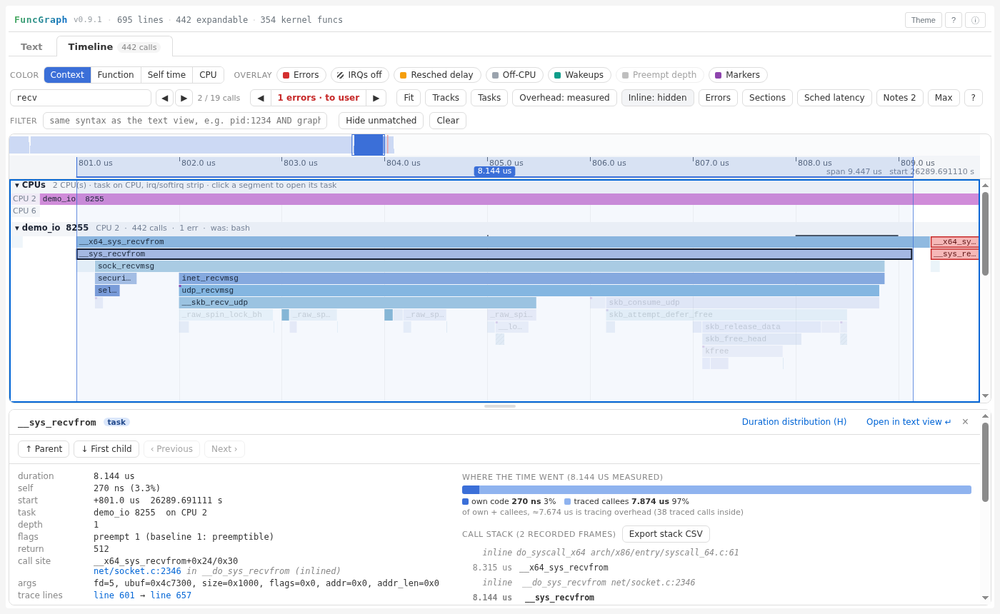

*搜索 `recv`，通过搜索导航定位第二个匹配调用；计数与当前切片选择同步。*

### 6.7 实测耗时与扣除开销

有跟踪开销估计值时（`fgcapture.sh --calibrate` 写入的文件头，或者 `--overhead` 参数），工具栏会出现 **Overhead** 按钮（快捷键 `O`）：

- **measured**：显示实测耗时。
- **subtracted**：悬停提示、详情面板、各种汇总和分析面板里的耗时，都改成扣除开销后的值。计算方法：`实测 - 每个子调用的开销 × 被跟踪的子孙调用数 - 每次调用的开销`，最小为 0。

**切片的位置和宽度始终按实测时间绘制**，只有显示的数字会变。这个修正值是估计：开销会随 CPU、频率和内核配置变化，在中断较多或缓存行为不同的路径上会有偏差。

### 6.8 内联帧视图（Inline）

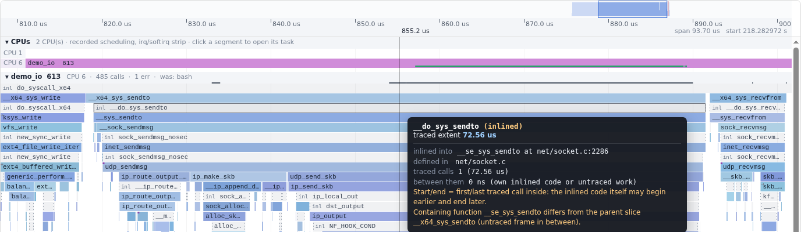

*Inline 视图：虚线框是内联帧（`inline __do_sys_sendto` 等），悬停提示说明了它们的范围是怎么来的。*

开启 `--vmlinux` 并有 `funcgraph-retaddr` 时，工具会知道每个调用点是否位于内联代码中。**Inline** 按钮（快捷键 `I`）在两种视图间切换，选择会被记住：

- **hidden**：只显示被 ftrace 跟踪到的帧。
- **shown**：在父切片和子切片之间插入内联帧。同一个父切片下，连续几个调用如果位于同一段内联代码里，会合并成一个内联帧。

内联帧的**开始和结束位置**是它里面第一个被跟踪调用的开始和最后一个被跟踪调用的结束。内联代码本身没有进入和返回事件，所以真实的开始可能更早、结束可能更晚，这一点在提示和详情里都有说明。

内联帧的悬停提示和详情面板显示：

| 字段 | 含义 |
|---|---|
| traced extent | 第一个到最后一个被跟踪调用的跨度 |
| start / end | 开始和结束时间 |
| inlined into | 内联到哪个函数的哪个文件哪一行 |
| defined in | 这个内联函数定义在哪个文件 |
| traced calls | 里面有多少次被跟踪的调用，合计多少时间 |
| between them | 跨度减去这些调用的时间：内联函数自身的代码、没被跟踪的调用和中断 |
| Inline chain at the call site | 完整的内联链，当前这一层加粗 |
| Traced calls inside | 里面的全部真实调用，支持 100 行分页、键盘跳转和全量 CSV |

两种视图下，调用栈都会列出内联帧。

内联/未跟踪帧详情缓存当前帧的原始跨度信息，刷新不再反复扫描所有子调用。内联链导出区分解析出的调用点所在函数与实际 trace 调用，不给仅有源码的帧编造切片索引或耗时。

### 6.9 键盘和鼠标

| 操作 | 作用 |
|---|---|
| `W` / `S`，或 Ctrl + 滚轮 | 以鼠标位置为中心放大 / 缩小 |
| `A` / `D`、← / →、拖动、Shift + 滚轮 | 左右平移 |
| 滚轮 | 上下滚动轨道 |
| `0` 或 Home | 显示全部 |
| `F` | 放大到选中的切片或框选的范围 |
| 双击切片 / off-CPU 段 | 放大到这个切片 / 这段时间 |
| 点击切片 | 选中并打开详情面板 |
| 点击 off-CPU 段 | 打开等待链（7.5 节） |
| 点击轨道标题 | 收起或展开这条轨道 |
| Shift + 拖动 | 在当前轨道内框选一段时间并汇总（7.1 节） |
| Shift + Alt + 拖动 | 在所有轨道上框选并汇总 |
| ↑ / ↓ | 选中记录父调用 / 第一个真实记录子调用（跳过合成帧） |
| `[` / `]` | 上一个 / 下一个记录兄弟；根调用限定同一任务，端点不循环 |
| `E` / Shift + `E` | 下一个 / 上一个错误源头 |
| `/`、`N` / Shift + `N` | 搜索、下一个 / 上一个匹配 |
| `H` | 选中函数的耗时分布 |
| `O` | 实测耗时 / 扣除开销 |
| `I` | 隐藏 / 显示内联帧 |
| `M` | 最大化（隐藏页头和标签页）/ 恢复 |
| 拖动面板上方横条 / 双击 | 调整底部面板高度 / 恢复默认 |
| Enter | 在文本视图中打开选中的调用 |
| Esc | 关闭帮助；取消选中和框选 |
| `?` | 帮助和图例 |

## 7. 分析面板

分析面板都显示在时间轴下方的详情区，会跟随过滤条件和 Overhead 开关更新。表头可以点击排序（当前排序列带下划线），表格行可以点击跳转到时间轴。

### 7.1 范围汇总（Shift + 拖动）

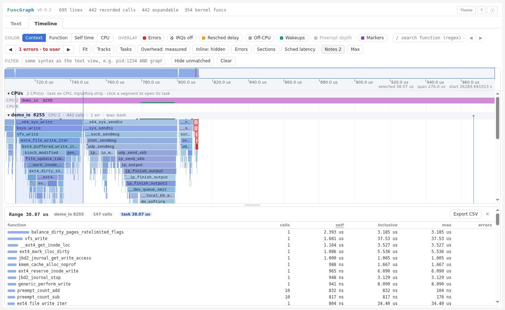

*混合示例的完整范围汇总：326 个函数按自身耗时排序，当前显示第 1–300 个；U / K 区分用户态和内核态。*

在一条轨道上按住 Shift 拖动，可以框选一段时间；同时按住 Shift 和 Alt 则框选所有轨道。框选后显示：

- 标题标签：范围长度、轨道、调用次数，以及各上下文的自身耗时（task / softirq / hardirq / NMI）和 off-CPU 时间。
- 表格：**calls** 统计在左闭右开区间 `[start, end)` 内开始的调用，包含起点处的零耗时调用，不包含终点处的调用。**self** 和 **inclusive** 按重叠比例估算；对于部分重叠的调用，这并不能精确还原区间内实际执行的工作。**max** 取整次调用的耗时；**errors** 统计与区间重叠的错误源头调用，不代表错误发生的时间一定在区间内。off-CPU 时间统计所选轨道，不受调用过滤条件影响。
- 点击列标题排序，当前排序列有下划线。每页最多 300 个函数，**Previous / Next** 替换当前页，不随浏览累积函数行；状态显示当前范围与总数。普通刷新、重开同一范围和 Text 往返保留页码；范围、轨道、共享过滤器、Overhead 或排序改变时返回首页。分页复用统计与排序缓存，不重新遍历调用。点击函数行仍把精确函数名填入搜索框并高亮匹配调用，但不会选中某一次调用。
- **Export CSV** 导出当前范围、轨道、过滤条件和排序下的**全部**函数，不限于当前页。UTF-8 CSV 包含范围起止、轨道、off-CPU 总量、过滤表达式、`time_mode` 和 `duration_basis`。自身/总耗时列明确命名为 `self_estimate_ns` / `inclusive_estimate_ns`，`max_call_ns` 保留整次调用的耗时；扣除 Overhead 后的数值仍是估算。在调用顺序模式（`count`）下，列名改用 `_units`，不再冒充纳秒（一个单位对应一个调用顺序步长）；压缩模式（`compressed`）中的位置来自按耗时紧密排列，并非真实时间戳。函数名和其他字符串单元格均防止被电子表格解释为公式。

不超过 300 个函数时不展示翻页按钮。分页条停靠在面板底部，极短面板恢复普通纵向滚动；窄屏标题随内容纵向滚动，避免遮住表格。横向滚动宽表时，标题和分页控件仍留在视窗内，触控翻页与导出按钮至少 44px 高。布局、全量导出校验和性能数据见[范围分页记录](performance-range-summary.md)。

即使框选前打开过其他分析面板，修改过滤条件或切换 Overhead 也会保持范围面板。没有匹配调用时会显示明确提示并禁用 CSV 导出；窄窗口中的标题栏自动换行，导出和关闭按钮仍可操作。

### 7.2 耗时分布（H）

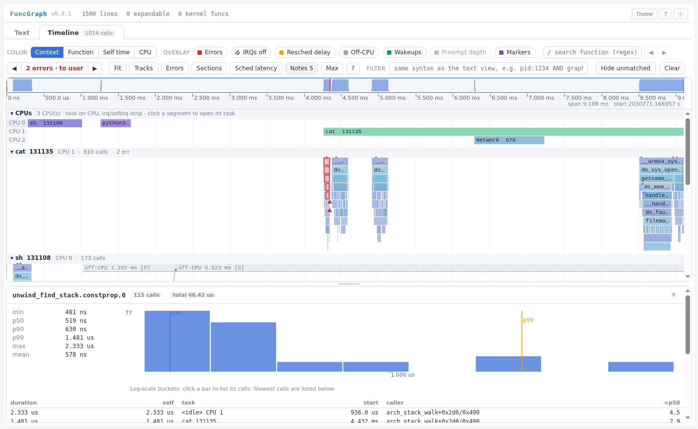

*耗时分布（tests/data/pi4_sched.txt 里的 `unwind_find_stack.constprop.0`，115 次调用）：分位数、对数直方图与耗时降序排列的第 1–50 条调用。图中向上拖动了详情分隔条；默认高度下也可以用 **Histogram** 收起图表，把空间留给调用列表。*

选中一个切片后按 `H`，或点详情面板里的 **Duration distribution**：

- **统计值**：当前函数和所选调用点中，满足过滤条件的调用的 min、p50、p90、p99、max 和 mean。所有分位数（包括调用点表格）统一取升序样本中下标为 `round(p × (count − 1))` 的值。Overhead 开关更新耗时和自身耗时，但时间轴位置仍按原始测量值。
- **Histogram 开关**：默认显示直方图；标题右侧的按钮支持鼠标、触控和 Enter / Space。收起后六个统计值紧凑排列，区间选择、当前页、调用行和 CSV 范围不变。选择在当前报告内跨刷新、重开及切换函数保留，重新加载页面后恢复默认；不会修改保存的详情分隔位置。手机上控件至少 44px 高，区间菜单仍有可访问名称。布局实测与紧凑视图截图见[分页与布局记录](performance-duration-calls.md#compact-histogram-follow-up)。
- **直方图**：横轴是耗时（对数刻度），纵轴是调用次数（对数刻度）。蓝色竖线是 p50，琥珀色竖线是 p99；包含错误源头的柱子画成红色。点击柱子，或通过支持键盘操作的 **Duration bucket** 菜单，筛选调用列表及其 CSV 导出；**All durations** 取消区间选择。区间标签为便于阅读经过舍入，CSV 保留左闭右开的数值边界。分位数和总量始终描述整个函数/调用点的样本，而非仅描述所选柱子。直方图随窗口调整尺寸，主题切换后也会重新绘制。
- **最慢的调用**：耗时、自身耗时、任务、开始时间、调用点，`×p50` 表示是总体中位数的多少倍。每页最多 50 次调用，**Previous / Next** 替换当前页，不随浏览累积调用行；状态显示当前范围和总数。普通刷新和重开保留页码；函数、调用点、耗时区间、共享过滤器或 Overhead 改变样本时从首页开始。分页条仅在调用列表区域内停靠，不覆盖后面的对比或调用点表格；极短面板恢复普通滚动。点击某一行只高亮这次调用，不关闭耗时分布面板。触控翻页、区间和导出控件至少 44px 高；实测和限制见[耗时调用分页记录](performance-duration-calls.md)。
- **By call site**：按调用点分组，显示调用次数和 p50/p99/max。同一个函数从不同位置调用，耗时可能差别很大。筛选后表格仍然可见：点击某行选择调用点，再点选中的行或 **All call sites** 取消；**More call sites** 加载前 12 项之外的调用点。若共享过滤器排除了所选调用点的全部调用，面板会显示明确的空状态，并保留可用的重置按钮。
- **Export calls CSV** 导出当前函数、共享过滤条件、调用点及耗时区间内的全部调用，不限于当前页，按耗时从高到低排列。内容包含耗时、自身耗时、相对报告原点的测量起止位置、任务、调用点、trace 行号、错误源头标记、过滤条件、区间边界、`time_mode` 和 `duration_basis`。耗时和自身耗时随 Overhead 开关变化，起止位置不变。时间列使用 `_ns`；调用顺序模式使用 `_units`（一个单位对应一个调用顺序步长），压缩模式的位置来自紧密排列，并非真实时间戳。UTF-8 编码、引号转义及电子表格公式防护与范围导出保持一致。
- **Slow vs fast** 比较最慢的 `ceil(count / 10)` 和最快的 `floor(count / 2)` 次匹配根调用，至少需要六次。样本跟随函数、共享过滤条件和调用点，**不受耗时柱子区间影响**。按当前耗时降序、原始切片索引升序排列，耗时并列时两组也不重叠。过滤/调用点/Overhead 刷新后保留展开状态，样本不足时明确提示；**Hide comparison** 可折叠，保留已准备的结果。
- **完整对比表**：按每次所选根调用，比较每个真实后代函数的平均调用次数和自身耗时，以及 `(own code)`、`(interrupts / softirq)`、`(blocked off-CPU)`、`(preempted)`。排除合成的 inline/untraced 帧；递归后代针对每个被选中的祖先分别计入。即使后代不满足根调用的过滤条件，也保留其上下文。各统计列均可排序，**Load more profile rows** 每次追加 100 行，包括没有变化的函数和零耗时调用，不再悄悄只保留十五个差异。**fast** / **slow** 实例按钮支持 Enter/空格，直接高亮实际后代调用，不替换耗时分布面板。
- **解释口径**：函数自身耗时随 Overhead 更新，可能包含 off-CPU；own code 为原始 on-CPU 自身耗时扣去估计的自身开销，最低为零。中断/阻塞/抢占行保留原始调度几何，**不能与函数行相加**。展开 **Scope and interpretation** 可查看口径和递归计数规则。差异只是关联，不是因果证明；调用顺序或压缩位置不是实际调度时间。
- **Export profile CSV** 按当前对比排序导出全部行，不限已加载项：类型/名称索引、每根调用的次数和数值、带符号差值、快慢实例切片索引、分组/总体大小、根调用平均耗时、`selection_basis`、逐行 `value_basis`、过滤条件及调用点。**Export cohorts CSV** 导出两组确切的根调用成员，包括原始切片/trace/任务索引、耗时/自身耗时、不变的起止位置及范围元数据。调用顺序模式列名为 `_units`，其余为 `_ns`，使用 UTF-8 和电子表格公式防护。导出不会展开表格，排序、分页、折叠后重新展开均复用已准备的对比结果。

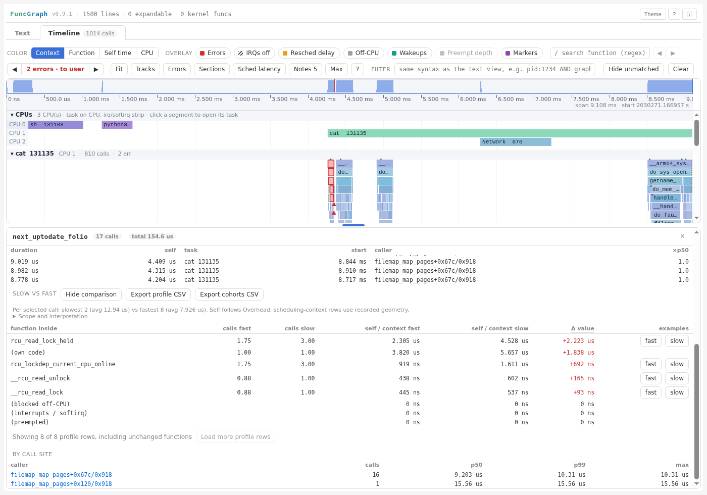

*真实调度 trace 的快慢对比：完整后代统计、明确的分组与数值口径，以及可直接跳转的实例。*

切换函数、共享过滤条件或 Overhead 后，会重置耗时区间选择。切换调用点复用已经排序的样本缓存，不再反复扫描和排序整份 trace。窄窗口中，过长的函数标题和所选调用点标签会缩略显示（悬停可看全文），避免标题占满详情面板，挡住关闭和重置按钮。

横向滚动宽表时，比较控件、口径说明和分页按钮仍留在视窗内。窄屏或矮窗口中，分布标题随内容纵向滚动，比较表头不会保留已经失效的标题高度偏移。

### 7.3 临界区（Sections）

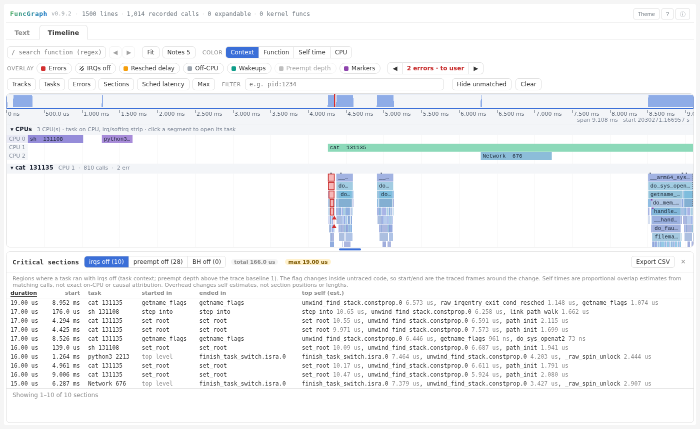

*Sections 面板（tests/data/pi4_sched.txt）：irqs off / preempt off / BH off 三类区间，每行是一段区间，带开始、结束的位置和其中自身耗时最多的函数。*

列出进程上下文中每一段**关中断**、**关抢占**、**关软中断**的区间，用顶部的按钮在三类之间切换，按钮上显示各类的数量：

| 列 | 含义 |
|---|---|
| duration | 区间时长，真实时间模式超过 100 us 的标红 |
| start / task | 开始时间和任务 |
| started in / ended in | flag 变化时栈顶的被跟踪函数。`top level` 表示不在任何函数里；`switched out / end` 表示任务被换出或者采集结束；`interrupt` 表示中断进来了（说明中断其实已经在没被跟踪的代码里重新打开了） |
| max depth | 关抢占时 preempt 深度的最大值（只在 preempt off 这一类中显示） |
| top self (est.) | 区间内匹配调用的自身耗时估算最高的 3 个函数；按这一列排序时比较第一名的估算值 |

preempt 深度是相对基线计算的。trace 中进程上下文的最小 preempt 深度会被识别为基线（6.18 和 7.2 上都是 1），面板说明里会显示这个值。

精度说明：开关中断、开关抢占的操作通常是内联代码，不会出现在 trace 里，所以区间的起止只能定位到"flag 变化前后的两个被跟踪的调用"之间。点击一行会在时间轴上框选出这段区间。

**过滤与耗时口径**：应用共享过滤条件后，只保留与匹配的真实调用重叠的区间；三类按钮的数量、当前类别的 total / max 都按这些完整区间计算，而不是按整条任务轨道是否有命中判断。未过滤时，即使没有被跟踪的调用覆盖，记录到的区间也会保留。开始 / 结束位置及对应函数始终保留原记录，不会被过滤条件裁剪。自身耗时只累计匹配调用，按调用与区间重叠的比例分摊；它不是精确的 on-CPU 耗时，也不能证明因果归属。Overhead 会更新自身耗时估算，**不会改变区间的起止和长度**。

**排序、分页与导出**：duration、自身耗时和（preempt off 类的）max depth 降序，start / task 升序；可用键盘 Enter / Space 激活表头按钮。每页最多 200 行，**Previous / Next** 替换当前页，不累积保留旧行。三类区间分别记住各自的页码，普通刷新、重开和 Text 往返保留当前页；排序、共享过滤器或 Overhead 改变时回到首页。已准备的统计和估算复用缓存，新访问的区间按需计算自身耗时估算。**Export CSV** 导出当前类别、过滤条件和排序下的**全部区间**，不受页码限制。CSV 包含原始 `section_index`、任务、起止位置、区间长度、开始 / 结束函数及行号、前三函数的自身耗时估算、`time_mode`、`self_duration_basis`、`window_duration_basis` 和 `filter`；没有贡献的函数留空。

CSV 的时间列在时间模式使用 `_ns`；count 模式使用 `_units`（调用顺序单位），不是纳秒。`window_duration_basis` 区分 `timestamp_span`、`packed_estimate`、`call_order`；`self_duration_basis` 区分实测 `measured`、扣除开销估算 `overhead_subtracted_estimate`、调用顺序 `call_order`。没有时间戳的 packed / count 坐标不能当作真实调度延迟或临界区墙钟长度。窄窗口中标题栏换行，导出与关闭按钮仍可访问，标题随详情一起滚动，避免遮住表格。

不超过一页时不展示翻页按钮。分页条仅在面板高度足够时停靠在底部，极短面板恢复普通纵向滚动；横向滚动宽表时，标题和分页控件仍留在视窗内。触控翻页、类别、排序及导出控件至少 44px 高。翻页不改变当前时间轴定位或窗口选择，详细实测见[窗口分页记录](performance-window-paging.md)。

### 7.4 错误汇总（Errors）

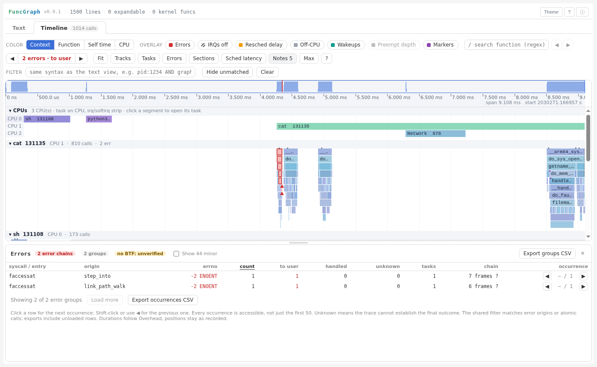

*Errors 面板（tests/data/pi4_sched.txt）：按系统调用、源头函数和 errno 分组，保留每次出现的位置；`?` 表示至少一条链含未经类型验证的帧。*

- 顶部（如果有）：**Sleeping functions called in atomic context**。列出在关中断、关抢占、关软中断或中断上下文中调用的可能睡眠的函数（`__might_sleep`、`mutex_lock*`、`down*`、`wait_for_completion*`、`msleep`、`schedule_timeout*` 等），按函数、原因和父函数分组，不会把不同调用者混成一行。**即使没有 errno 错误链，也能浏览这些调用**。数量和列表只统计符合共享过滤条件的真实调用，不受 minor 开关影响。默认显示 100 组，**Load more** 每次追加 100 组。
- 表格：把错误链按 **syscall / entry → origin → errno** 分组：

| 列 | 含义 |
|---|---|
| syscall / entry | 错误所在的系统调用（去掉了 `__x64_sys_` 等前缀）；不在系统调用里时显示最外层函数，并标 `no syscall` |
| origin | 错误源头：第一个返回这个错误码、且它的子调用都没有返回同一个错误码的函数 |
| errno | 错误码和名字 |
| count | 发生次数 |
| to user | 其中一直返回到用户态的次数（标红） |
| handled | 其中被某个调用者处理掉的次数 |
| unknown | 错误离开了已跟踪的调用窗口，无法确定最终结果的次数；不等于被处理或返回用户态 |
| tasks | 涉及几个任务 |
| chain | 传播链最长有几帧；`?` 表示其中有未经类型验证的帧，悬停可看未经验证的链数 |
| occurrence | 当前访问的位置 / 全部出现次数；左右按钮访问上一次 / 下一次 |

点击一行跳到第一次出现的位置，再次点击依次跳到下一次；Shift + 点击或 `◀` 可反向访问，首次反向访问从最后一次开始。组内按源头调用起点、原始索引排序，首尾循环，**不再只保留前 50 次**；原子睡眠表也支持完整导航。左右按钮支持 Enter / Space，行内显示进度并同步时间轴选择，保留当前 Errors 面板。排序或切换 Overhead 不丢失组内位置；改变过滤条件或 minor 范围时重置错误组导航。

**排序与分页**：syscall / entry、origin、errno 升序，其余计数和最大传播深度降序；所有可排序表头都是原生按钮，相同值按原始首条错误链索引稳定排序。默认显示 200 个错误组，**Load more** 每次追加 200 组，不替换旧行，也不丢失加载按钮的键盘焦点。排序恢复第一页并定位到错误表开头；重开同一范围保留已加载数量。汇总按过滤位图和 minor 开关缓存，原子睡眠另按过滤位图缓存；排序、分页和 Overhead 切换不会重新汇总错误链。

**过滤和导出**：共享过滤条件匹配错误链的**源头调用**，或原子睡眠调用本身；顶部数量、表格及导出使用同一范围。`count = to user + handled + unknown`。普通最外层函数始终标记 `no syscall`，即使它与去掉前缀的 syscall 同名也不会合并。Errors 包含全部结果类型；工具栏错误导航的 `to user / all` 开关只限制工具栏导航，不改变这个汇总。

- **Export groups CSV**：导出所有排序后的错误组，包括未加载行；包含入口及是否 syscall、源头、errno、三类结果次数、任务数量与标签、最大链长、已验证 / 未验证链数、minor 数量以及过滤范围。
- **Export occurrences CSV**：在错误表页脚导出每条错误链，按当前组排序及组内出现顺序排列。包含原始 `chain_index`、源头 / 顶端切片与 trace 行号、任务、结果、验证与 minor 标记、起止及调用耗时。
- **Export atomic CSV**：导出全部原子睡眠调用，而不只是每组的第一个；包含原始 `slice_index`、函数、父函数、原因及位掩码、任务、trace 行号、起止、总耗时和自身耗时。

`group_id` 只标识当前过滤 / minor 范围内的组，不是跨范围的全局 ID；`chain_index` 和 `slice_index` 保留源报告的原始索引。调用级 CSV 的耗时随 Overhead 更新，但起止不变；`time_mode`、`duration_basis` 和 `filter` 明确记录口径。count 模式使用 `_units`，不是 `_ns`；packed 的起止是排列坐标，不能当作真实墙钟时间。CSV 复用 UTF-8 BOM、引号和公式注入防护。窄屏 / 矮窗口的标题随内容纵向滚动，不留下空白表头偏移；横向滚动宽表时，导出与关闭仍固定在视窗内。

**次要错误（minor）默认隐藏**：只有一帧、马上被调用者处理掉、并且这个函数的负返回值在整份 trace 里从来没有向上传播过的错误源头。这类通常是带符号但不是 errno 的数值（例如 `memcg_state_val_in_pages` 返回 -1 这样的页数增量），或者正常的探测路径（尝试各个 binfmt 处理器时 `load_script` 返回 -ENOEXEC）。它们不在切片上标记，不计入错误导航、概览条和对比。错误面板里勾选 *show N minor* 可以显示它们，`--export` 导出时标记为 `"minor": true`。

**错误是怎么判定的**：

1. 有 BTF（`--vmlinux` 的 `.BTF` 段、`--btf` 指定的文件，或者内核本身就按 BTF 格式化返回值）时，按函数的返回类型判断：
   - void、无符号、bool、枚举：不算错误；
   - 有符号整数：先截断到类型宽度，值在 [-4095, -1] 内算错误；
   - 指针：按 `IS_ERR` 判断。返回 NULL 不算错误，但会单独标记。
   - 名字里带 `cmp`/`compare` 的比较函数不算错误，因为它们返回的是差值。
2. 没有 BTF 时只能根据数值判断，void 函数的寄存器残值会造成误报。这类结果在报告里标为 unverified（未验证）。

原生文本和 raw 解码后的 `ret=0x...` 保留完整十六进制位模式，再按类型宽度判定负 errno、`ERR_PTR` 和 NULL；非零指针不会因为以 `0` 开头而被标为 NULL。无法完整识别的返回值 token 不参与错误判断，不能用其数字前缀代替原值。

错误导航按钮（工具栏上的 `◀ N errors · to user ▶`）：点中间的文字，可以在"只看返回到用户态的错误"和"全部错误"之间切换。

### 7.5 等待链（点击 off-CPU 段）

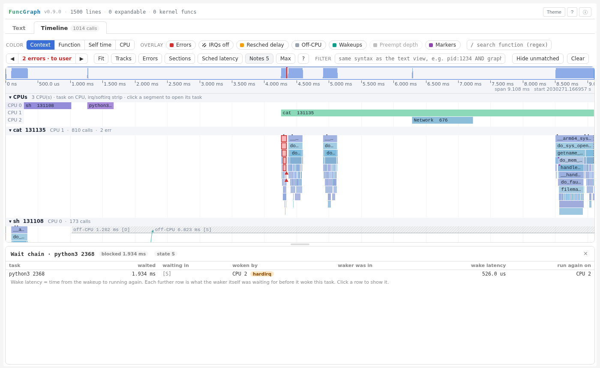

*等待链（tests/data/pi4_sched.txt）：`python3` 睡了 1.934 ms，被 CPU 2 上的硬中断唤醒，从唤醒到重新运行用了 526 us。*

一行表示一次等待，从被点击的这段 off-CPU 开始：

| 列 | 含义 |
|---|---|
| task / waited | 任务和等待时长 |
| waiting in | 在哪个函数里等待（栈上第一个不属于调度器的函数），方括号里是换出时的状态 |
| woken by | 唤醒者；如果是在中断上下文中唤醒的，附上上下文标签 |
| waker was in | 唤醒者当时在执行什么：跳过了 `try_to_wake_up`、`__wake_up*` 等唤醒函数之后的第一帧，例如 `anon_pipe_write` |
| wake latency | 从被唤醒到真正开始运行的时间，超过 1 ms 的标红 |
| run again on | 在哪个 CPU 上恢复运行 |
| link gap | 时间关联候选行恢复运行，到上一行唤醒事件之间的间隔；首行选中的等待没有关联间隔 |

首行选中的等待及其关联的唤醒事件来自实际记录。后续每行只是**时间关联候选**，不证明它的等待造成了上一行的等待：取唤醒者在上一行唤醒事件之前最近结束的 off-CPU 区间，关联间隔**最多 50 ms**。表格上方始终显示这一性质和阈值，展开提示可查看详细解释。同一次等待关联多个唤醒事件时，显示最后记录的事件。页脚解释停止原因：未记录唤醒、唤醒者为 idle/仅 CPU 轨道、中断上下文、没有更早的已结束等待、间隔超过 50 ms，或重复访问同一区间。没有时间戳时只显示选中的区间，不推断时间关联。

**Load more waits** 每次追加 100 行，不替换已有行。**Export chain CSV** 解析并导出整条链，包括尚未显示的行，保留原始 off-CPU/任务索引、原始时间戳或调用顺序单位、关联间隔、50 ms 阈值和最终停止原因；导出不会展开表格。范围始终包含全部任务，不受文本过滤影响，Overhead 也不会改变记录中的调度位置或延迟。点击一行，或在任务按钮上按 Enter/空格，会显示该任务及唤醒者并缩放到对应区间，不替换当前面板。

trace 结束时仍未闭合的等待，在时长前显示 **≥**，表示下界。此时恢复 CPU 和唤醒延迟未知，CSV 将结束时间/恢复 CPU/延迟字段留空，并标记 `end_status=trace_end_lower_bound`。即使没有调度事件，已有等待信息仍可查看，同时提示如何采集。长任务名/函数名不会把关闭、导出按钮挤出紧凑窗口；宽表格在面板内部横向滚动。

唤醒者优先取 `sched_waking` 事件：它在唤醒者自己的上下文里触发。`sched_wakeup` 有时在目标 CPU 的 IPI 里触发，这时看到的唤醒者会变成 idle。所以建议采集时开启 `sched_waking`，`fgcapture.sh --sched` 默认就会开。

### 7.6 调度延迟（Sched latency）

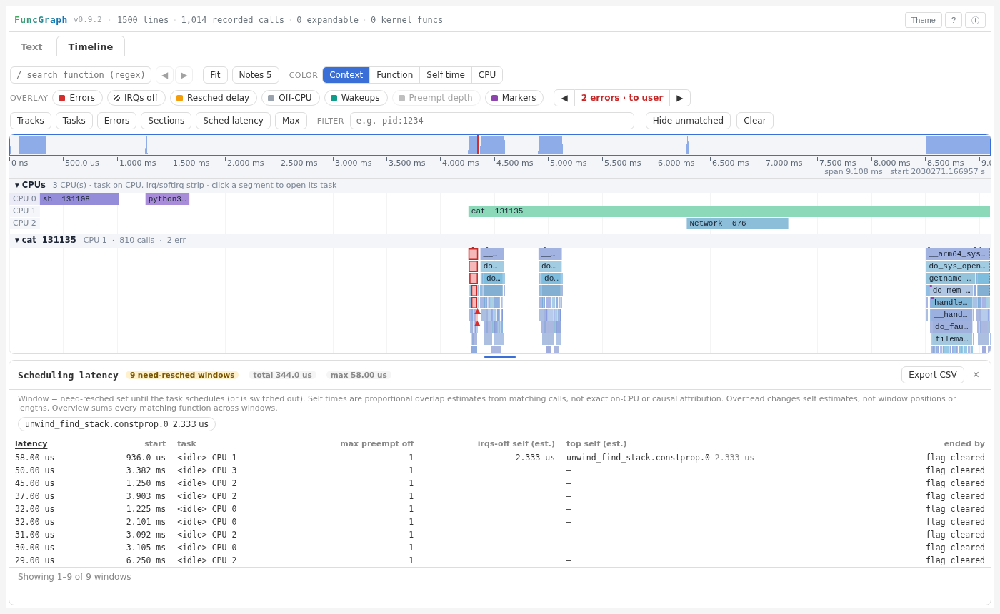

*Sched latency 面板（tests/data/pi4_sched.txt）：每个 need-resched 窗口的长度、期间最大的 preempt off 深度，以及关中断调用与各函数的自身耗时估算。*

列出每个 **need-resched 窗口**，也就是从设置 need-resched 标志到任务真正调度出去或者标志被清除的这段时间：

- 标题标签：窗口数量、总时长、最长的一个。下方标签按所有保留窗口内**全部匹配函数**的估算总量列出前 8 名，不只累计每个窗口的前三名；这些是排查线索，不是"该函数造成调度延迟"的证明。
- 表格列：latency（真实时间模式超过 100 us 的标红）、start、task、max preempt off（窗口内的最大抢占深度，已扣除 trace 基线）、irqs-off self (est.)（入口带关中断标志的匹配调用自身耗时的比例估算，**不是精确的关中断区间长度**）、top self (est.)（前三函数及自身耗时估算）、ended by（flag cleared 标志被清除 / switched out 被换出 / trace end 采集结束）。所有表头都可排序：start / task / ended by 升序，其余降序；相同值保持原窗口索引顺序。
- 点击一行，会在时间轴上框选这个窗口。
- 每页最多 300 个窗口，**Previous / Next** 替换当前页，不累积旧行；重开与 Text 往返保留页码，排序、共享过滤器或 Overhead 改变时回到首页。**Export CSV** 导出当前过滤和排序下的全部窗口，不限于当前页。导出包含 `window_index`、原始窗口起止与长度、最大抢占深度、是否观察到关中断、`irqoff_self_estimate_ns`、结束原因、前三函数自身耗时估算，以及与 Sections 相同的模式、估算口径和过滤元数据；count 模式的耗时列改为 `_units`。
- 与 Sections 相同，过滤逐窗口检查重叠的真实调用，统计数量 / total / max 使用保留窗口的原始长度；自身耗时只来自匹配调用。Overhead 仅更新自身耗时估算。每轨道按调用深度建立重叠索引，排序和追加行复用统计，不为每个窗口反复扫描整条轨道。

需要 `latency-format` 和时间戳才能计算。

### 7.7 任务导航（Tasks）

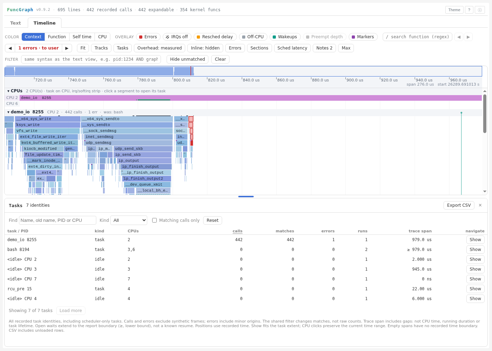

*sample.html 中全部 7 个任务身份都可访问，包括 6 个没有跟踪调用的任务；时间范围覆盖最后一次调用之后的调度尾部。*

- **Find** 按当前/历史名称、PID 和 CPU 标签做不区分大小写的字面匹配，`[` 等字符不是正则。**Kind** 区分普通任务、idle、CPU 回退和全局回退身份。**Reset** 清除这些条件，以及 CPU 点击产生的单任务范围。
- 列包括任务/PID、类型、观察到的 CPU、真实调用数、统一过滤器匹配数、**含 minor 链的错误源头数**、记录的运行区间条数与 trace span。点击可排序表头：名称升序，数值统计降序，同值保持原任务索引顺序。CPU 0 不会被漏掉；内联/未跟踪合成帧不增加调用和错误数。
- **Trace span** 是此身份的调用、运行、等待、唤醒和窗口记录的最早到最晚几何跨度，包含空隙，**不是 CPU 时间、运行耗时或任务生命周期**。未观察到恢复的等待延伸到报告边界，跨度带 `≥`（下界），不表示已经恢复。没有任何边界的身份显示 `—`，禁用 Show。count 模式使用调用顺序单位，compressed 模式使用压缩耗时，不伪称真实经过时间。
- **Show** 显示并展开对应轨道、缩放到其跨度，清除旧切片选择，但保留 Tasks 面板。不会默认把所有仅有调度记录的任务都加入画布。原来的 **Tracks** 按钮仍负责整体折叠/展开；Tasks 不引入另一套隐藏状态。
- 每页最多 100 个任务，**Previous** / **Next** 替换当前页，不随浏览累积行节点；普通刷新和重开保留当前页，新的查询、类型、排序或匹配条件从首页开始。正常高度面板的分页条固定在底部，极短面板则随内容滚动，避免覆盖控件；触控布局的翻页、Show 和导出按钮至少 44px 高。**Export CSV** 导出当前查询、类型、仅匹配任务、单任务范围和排序下的全部记录，包括未浏览页；包含原任务索引、名称历史/CPU、计数、起止/跨度、开放等待和下界标记、位置/跨度口径以及查询/统一过滤元数据。count 模式的位置列使用 `_units`，其余使用 `_ns` 并明确实测/压缩口径。边界与实测见[任务分页性能记录](performance-tasks.md)。
- 紧凑触控布局默认收起任务查询与筛选，点击分页条中的 **Filters** 展开；存在查询、类型或匹配限制时显示 **Filters · on**，收起控件和调整窗口都不会清空条件。桌面布局直接显示这些控件，避免手机首屏只有筛选栏而看不到任务。
- 统一过滤器只影响 matches 列及可选的 **Matching calls only**，不改变原始计数或任务边界。Overhead/Inline 不改变这些事实。原始统计首次打开时懒计算，排序、查询和重开复用缓存。窄屏控件保持横向可访问，长名称最多两行，提示/CSV 保留全文。

### 7.8 直接记录子调用（Explore all children）

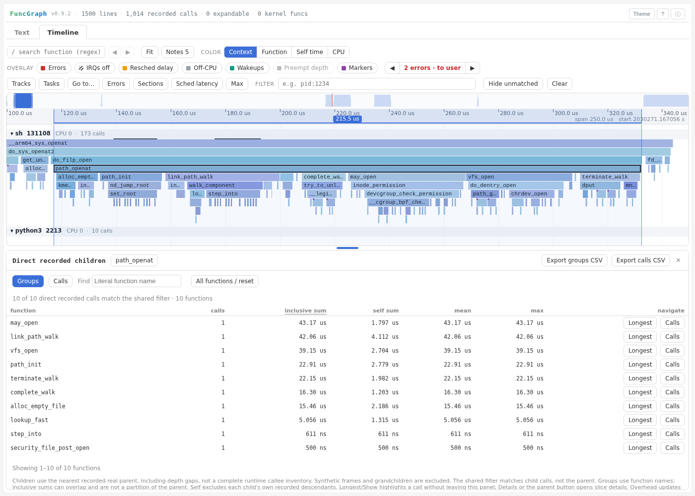

*tests/data/pi4_sched.txt 中 `path_openat` 的全部 10 个直接记录子函数，不再只有预览中的 8 项。*

- 打开真实调用详情，选择 **Explore all children**。**Groups** 列出全部函数的次数、inclusive 合计、self 合计、均值与最大值；**Calls** 列出逐次子调用的耗时/自身耗时、原始起点、CPU 和调用点。原生可排序表头按名称/起点升序，其余数值降序，同值保持原切片索引顺序。
- 分组行的 **Calls** 限定为这个父调用下该函数的所有直接子调用；**All functions / reset** 清除这个范围与不区分大小写的字面 **Find** 查询，但不清除统一过滤器。两个 CSV 按钮分别导出各自排序下、当前查询/函数范围/统一过滤条件内的全部分组或调用，无需先打开相应模式或加载全部页。
- **Longest** 和 **Show** 选中并缩放到实际记录的调用，不替换当前面板；**Details** 打开该调用的完整详情，标题中的父函数按钮返回父调用详情。预览也选择实际最长的一次；耗时相同时保留最早原切片索引。
- 关系是**最近的真实记录父节点**，不是完整运行时被调函数清单。深度缺口可能隐藏中间未跟踪/内联执行；合成帧和孙辈不计作直接子调用。分组按函数名；逐次导出保留模块、调用点、参数、返回值和原切片/trace/任务/深度索引，以及深度缺口。
- inclusive 合计可能重叠，**不是父调用的时间分区**；self 排除各子调用自己的记录后代。统一过滤器匹配子调用而不是父调用所在行；空范围保持面板和重置入口。紧凑预览仍保留未过滤上下文，探索面板则展示匹配的子调用。
- 首屏 100 行，**Load more** 每次追加 100 行，不替换已有行或有焦点的按钮。真实孩子集合及未过滤的耗时口径聚合只缓存当前父调用；过滤聚合、查询与排序分开做有界缓存。Overhead 改变数值估算和排序，不改变成员/位置，且保留已加载行数；Inline 不增加合成调用。
- CSV 保留父调用身份、完整分组/逐次指标、首个/最长索引、父子关系/查询/过滤范围及明确的耗时/位置口径。count 模式使用 `_units`，compressed 位置为压缩耗时而非经过时间。复用 CSV 引号/公式防护，长名用安全提示保留全文。宽表的标题/工具/页脚保持横向可访问，紧凑窗口标题纵向滚动。

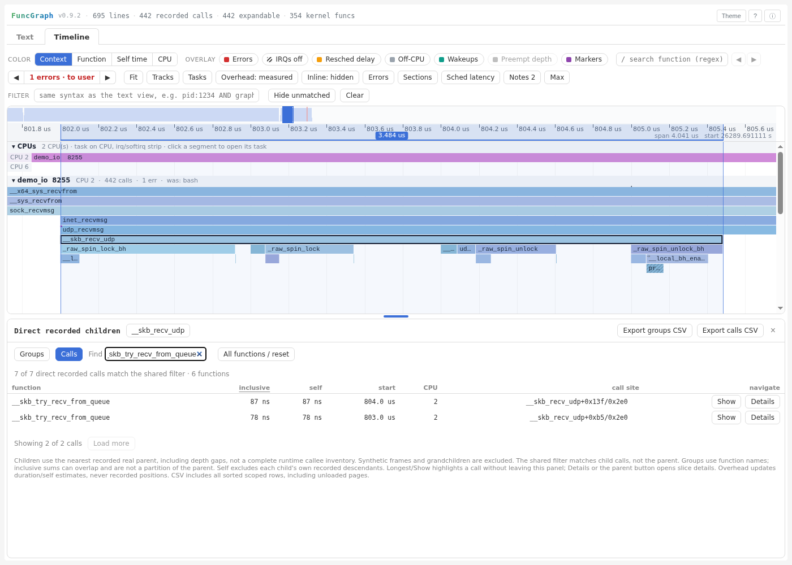

*样例中这个 `__skb_recv_udp` 下的两次 `__skb_try_recv_from_queue`，范围限定为该父调用，而不是报告内此函数的所有出现。*

## 8. 对比视图

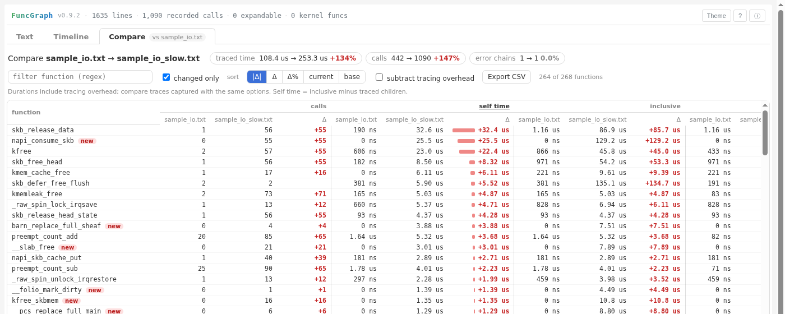

*对比历史 samples/sample_io_slow.txt（7.2.0+）和当前 samples/sample_io.txt（7.4.0-rc2）。此图演示不同采集之间的函数级差异，不是受控的性能回归基准：内核版本、跟踪开销和实际执行的工作量均不同。*

```bash
python3 funcgraph.py --compare before.txt --output cmp.html after.txt
```

当前 trace（这里是 `after.txt`）和基准 trace（`before.txt`）会按相同的方式重建调用、按函数汇总。预过滤参数会同时作用于两份 trace。不需要 `--timeline` 也能生成对比视图，排序控件和浏览器 CSV 导出均可独立使用。

**返回类型与模块**：提供 `--vmlinux`、`--btf` 和 `--module-dirs` 时，两侧分别按自身实际记录的模块选择返回类型，包括仅出现在基准中的模块；不会把当前 trace 的模块类型表直接套到基准上。同一次报告复用已解析的内核和模块 BTF，连续生成新报告则重新读取，不沿用前一次的内核类型。上述路径仍同时适用于两侧，请使用与采集匹配的二进制；这不提供两套不同内核构建的自动匹配。缺少类型的错误判断仍属未验证，不能据此确认某个负值必然是错误。

- **顶部标签**：traced time（最外层调用的总时长）、calls、error chains 三项的变化，`+` 表示增加、`-` 表示减少。变化小于 5% 显示为灰色，增加为红色，减少为绿色。两份 trace 的时间模式不同时（例如一份有时间戳一份没有），会显示黄色警告。
- **表格**：每个指标都有三列：基准值、当前值、差值 Δ。

| 指标 | 含义 |
|---|---|
| calls | 调用次数 |
| self time | 自身耗时（总耗时减去被跟踪的直接子调用） |
| inclusive | 总耗时 |
| mean incl | 平均每次调用的总耗时 |
| max | 最长的一次 |
| errors | 错误源头次数 |

- **Δ 列的颜色**：**红色**表示增加，**绿色**表示减少，**灰色**表示变化不到 5%。排序列旁边的横条长度表示变化幅度。函数名后的 **new** 表示只在当前 trace 里出现，**gone** 表示只在基准里出现。
- **控件**：函数名正则过滤；**changed only** 只显示有变化的函数，调用次数、总耗时、自身耗时、最大耗时或错误数任一变化都会保留；排序方式：`|Δ|`（变化的绝对值）、`Δ`、`Δ%`、`current`、`base`；点击表头切换排序的指标。两份 trace 都有开销估计值时，会出现 **subtract tracing overhead** 选项。过滤后无结果时会显示提示。
- **窄屏与滚动**：表格高度随窗口和上方控件自动调整；横向滚动时函数名固定在左侧，纵向滚动时表头固定。可用 Tab 聚焦表格区域后通过方向键滚动；完整函数名可悬停查看。
- **Export CSV**：按当前正则、changed only、排序和开销修正选项，导出全部匹配函数，不仅是当前加载的行。无需重新生成报告，导出前会立即应用尚未提交的过滤输入；非法正则会显示提示并禁用导出，无匹配结果时也禁用。按 Enter 可立即应用过滤。
- **CSV 格式**：第一列 `function`，每项指标有 `base_`、`current_`、`delta_` 三列，差值为当前减去基准；耗时列后缀 `_ns` 表示纳秒，次数和错误数无单位。文件为带 BOM 的 UTF-8，正确转义逗号、引号和换行；可能被电子表格识别为公式的函数名会加单引号前缀。文件名中的 `raw` / `adjusted` 区分实测值与开销修正值；顶部汇总标签始终使用实测值。
- **大表格**：首次加载最多 400 行，点击底部提示每次追加最多 1000 行，复用已有行和排序结果；调整过滤、排序或开销选项后再重新计算。变化横条使用全部匹配结果统一缩放，追加行不会改变已有横条的比例。

需要注意：两份 trace 的跟踪开销要相近（用相同的选项、在同一台机器上采集），差值才有意义。

## 9. 导出与自动化

`--export FILE.json` 或 `--export FILE.csv` 会在生成 HTML 的同时导出分析结果，不需要开 `--timeline`：

```bash
python3 funcgraph.py --export result.json --output report.html ftrace.txt
```

JSON 中的耗时单位都是 ns，时间都相对第一个事件：

| 键 | 内容 |
|---|---|
| `meta` | trace 名、时间模式、能力（caps）、开销估计值、调用总数 |
| `functions` | 每个函数的 `name, calls, total, self, max, p50, p90, p99, errors`，按 self 从大到小排序 |
| `errors` | 每条错误链：`origin, top, entry, errno, name, fate`（user 返回用户态 / handled 被处理 / escaped 传出采集范围）`, verified, frames, task, pid, start` |
| `sections` | 临界区：`kind`（irqs_off / preempt_off / bh_off）`, duration, task, pid, start, started_in, ended_in, max_depth` |
| `sched_latency` | need-resched 窗口：`task, pid, start, duration, max_preempt, irqs_off` |
| `atomic_sleep` | 原子上下文中调用的睡眠函数：`function, reasons, parent, task, pid, start` |
| `off_cpu` | off-CPU 段：`task, pid, start, duration, waiting_in, state, preempted, woken_by` |

CSV 只包含 `functions` 表。

用在 CI 中的例子：

```bash
python3 funcgraph.py --export r.json --no-text-view --timeline --output r.html ftrace.txt
python3 - <<'EOF'
import json, sys
d = json.load(open('r.json'))
f = {x['name']: x for x in d['functions']}
if f.get('vfs_read', {}).get('p99', 0) > 50_000:            # p99 超过 50 us
    sys.exit('vfs_read p99 regression')
if any(s['kind'] == 'irqs_off' and s['duration'] > 200_000 for s in d['sections']):
    sys.exit('irqs off for more than 200 us')
if d['atomic_sleep']:
    sys.exit('sleeping function called in atomic context')
EOF
```

## 10. 常见问题

**报告太大，浏览器打不开或者很慢**

文本视图为每一行生成 DOM。超过约 15 万行时，命令行会给出提示。可以：
- 用预过滤缩小范围：`--pid`、`--comm`、`--graph`、`--time-range`；
- 只生成时间轴：`--timeline --no-text-view`。实测 36 万行的 trace 生成的报告是 15.7 MB，约 1 秒打开。

若要没有 Text 行但仍保留源码分析，使用 `--timeline --no-text-view --keep-source --vmlinux vmlinux --kernel-src /path/to/linux`。默认轻量 `--no-text-view` 行为不变；新选项保留完整解析后的源码池、内联链和原始 trace 行号，不生成逐行 Text DOM，点击 Text 跳转仍会说明视图已省略。源码面板自带 **Source: chain/flat** 按钮，点击、Enter、Space 均可切换且不会误收起面板，并与 Text 工具栏保持同步。源码解析会增加生成耗时和报告大小。这仍是内嵌数据、可离线打开的报告，不是异步源码分块、Text 虚拟化或自动 sidecar。

保留文本时，停留在 **Timeline** 或 **Compare** 后重新打开报告，页面会提前读取已保存的标签页，在解析逐行文本之前抑制 Text 渲染；主题也在这时恢复，初始化不会抢焦点到隐藏的文本行。不会删除文本或源码，切回 Text 后仍可过滤、折叠和跳转。带 `#L行号` 的链接优先打开 Text；`--no-text-view` 报告仍默认打开 Timeline。

内嵌 **Timeline JSON 达到 1 MiB** 时，首次打开时间轴还会**分阶段准备**，显示读取数据、准备列、构建内联/未跟踪帧、索引任务轨道、绘制等状态。阈值按 JSON 字符数判断，不是 HTML 文件体积或 trace 行数；小报告、已经初始化完成的时间轴仍走同步路径。

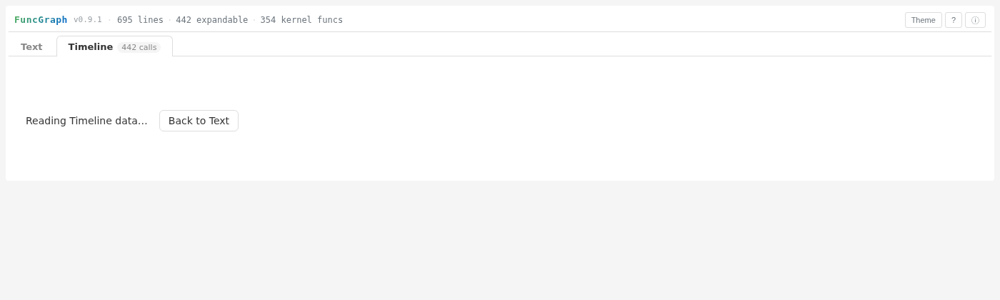

截图暂停了真实 sample 的第一个准备阶段，不表示时间轴已经可用。点击 **Back to Text** 或按 **Escape**，回到之前的 Text 滚动位置并聚焦 Text 标签；切到 Text/Compare 也会取消。取消不保留半成品，再打开重新准备；完整模型才会缓存。Alt+点击文本行会等准备完成后再选中目标，取消后的请求不会稍后抢回视图。失败时显示安全转义的错误信息和返回按钮。原生按钮支持 Enter/Space，时间轴快捷键尚未注册时也可操作。

准备仍在**主线程**执行，在模型阶段及每 8192 个内联调用之间让出控制权。8ms 是协作式工作预算而非硬上限：JSON 解析、排序、单个阶段、样式/布局和 GC 仍可能阻塞。状态已显示、能取消，**不等于画布已经就绪**，也不保证总启动时间更短。逐行文本 DOM 仍然存在；首次打开没有保存状态的大型文本报告，仍建议预过滤或 `--no-text-view`。反馈、完整就绪及长任务分别测量，见 [设计文档性能数据](design.md#8-性能数据)。

默认单文件逐段写出 UTF-8，成功后原子发布，失败保留旧文件。其目标必须为普通文件（非 `/dev/null`、FIFO 或目录），上级目录必须可写；保留已有权限和输出符号链接，旧 `generate_html()` 字符串 API 不变。显式 `--report-mode sidecar` 发布独立目录，延迟完整 Text 的传输。可选 `--timeline --report-mode auto --sidecar-threshold BYTES --output DIRECTORY` 仅在完整 HTML 未压缩 UTF-8 字节数严格超过显式阈值时切换，否则在该目录保留离线 `index.html`。没有默认阈值、行数触发或 Text 虚拟化。CLI 会输出判断结果，两种结果均可用 `fgview DIRECTORY` 打开，目录模式的 `fgreport --open` 前台服务至 Ctrl+C。配置、安全更新及临时磁盘要求见[查看器指南](viewer.cn.md)。生成阶段仍解析完整 trace，见[生成实测](design.md#83-分段写出的生成阶段内存2026-11-10)，带内核符号流水线的峰值 RSS 几乎不变。

**时间轴上没有空隙，横轴写着 compressed time**

采集时没有开 `funcgraph-abstime`。

**看不到中断、关中断、调度延迟**

没有开 `latency-format`。没有 flags 列时，上下文只能根据中断入口函数名推断，标为 `(inferred)`。

**有很多看起来不对的错误，比如 `do_raw_spin_unlock = -1`**

这是 void 函数返回值寄存器里的残留值。提供带 `.BTF` 段的 vmlinux（需要 `CONFIG_DEBUG_INFO_BTF=y`），或者用 `--btf` 指定从目标机复制的 `/sys/kernel/btf/vmlinux`，工具就会按返回类型过滤掉这类误报。使用带 BTF 感知 retval 的内核时，内核本身就不会为 void 函数打印 `ret=`。

**开了 `funcgraph-args` 但参数没有输出**

在 6.18 等内核上，开着 `funcgraph-retaddr` 时参数不会输出。用 `fgcapture.sh --args` 采集，它会自动处理。

**源码行看起来对不上**

源码版本和 vmlinux 不一致。看一下 ⓘ 信息面板里的 Source 一行，或者用 `--source-rev` 指定构建 vmlinux 时用的那个版本。

**全局视图里有些切片空白，放大后才出现**

旧版本绘制时有这个 bug，已经修复。重新生成报告即可。

**等待链里唤醒者是 `<idle>`**

那次唤醒是从中断里触发的，或者 trace 里只有 `sched_wakeup` 没有 `sched_waking`。采集时用 `--sched`，它会同时开启 `sched_waking`。

**每个 CPU 一份 trace 文件**

直接把它们都传给 funcgraph.py，会按时间戳合并。

**在没有内核源码的机器上看源码**

用 `--source-url` 加 `--source-rev` 从网上获取源码。生成报告时需要网络，下载的文件会缓存；生成的报告本身是单个离线文件。
