# FuncGraph User Guide

The Text / Timeline tabs (and Compare when enabled) stay at the top while
scrolling, with Text controls directly below them. Switching views retains
Text's vertical/horizontal reading position and Timeline's selection, time
range and filter; trace-line links still navigate to the requested record.
Regenerate older HTML reports to receive these changes.
See [view round-trip behavior and performance limits](performance-view-roundtrip.md).

Switching back to Timeline after opening source in Text retains the source panels
and reading position without unloading Text. Selected passages are suspended while
Text is hidden and restored on return. Empty native caret ranges are cleared to
avoid repeated browser scans of hidden Text delaying slice highlights and tooltips;
editable controls retain their editing selection.

Text keyboard navigation, `#L<n>` anchors and Timeline → Text jumps now share a
latest-request-wins path. Leaving Text or pressing Escape cancels a pending jump;
late loads and delayed scrolling cannot pull focus back. Mounted rows still
respond synchronously in the default renderer. Default Text initialization still loads all rows.
New chunked sidecar reports now offer **experimental windowed Text**: use the
**Windowed Text** tool or append `?text=windowed` to the HTTP URL before entering Text.
It mounts at most 160 trace rows while retaining complete filter/fold/order metadata.
In task order, a caption below the toolbar preserves the viewport's current task
across eviction and horizontal scrolling. Its count covers the complete task group,
not filtered hits; time and duration order do not show this caption.
Use **Full Text** for whole-document browser operations. See [windowed usage and
limits](performance-text-window.md) and [the underlying row-access contract](performance-text-rows.md);
regenerate older reports for the new renderer and presentation index.

Windowed Text now reuses an unchanged complete duration order and navigation
index when rebuilding after folds or filters. Scroll feedback cannot cancel
an in-progress rebuild. Large-model work and scattered HTML parsing still cost
time; see the [two-size interaction comparison](performance-text-rebuild.md).

Rebuilds also reuse original record ordinals in task/duration orders and compute
heights alongside visible rows. Unfiltered folds reuse prepared scope ranges
with a temporary one-byte-per-record mask, fixing entry visibility only inside
those ranges; filtered reports keep the selective ancestor predicate. Complete
fold semantics, original IDs and source pairing remain unchanged. Ordinal arrays
still add up to eight bytes per record, separately from the mask. No mask is
allocated without a matching enabled scope; full-model work can still block.
See [fold-range measurements](performance-text-fold-visibility.md) and the
[earlier ordinal comparison](performance-text-geometry.md).

Navigation visibility is now updated once per windowed rebuild, with complete
binary-mask validation before any change. Unchanged entries skip Set/Map work;
local mounted-row updates and complete order checks remain. The private cache
and temporary input each add one byte per record, separately from fold masks
and ordinal arrays. See [navigation measurements and limits](performance-text-navigation-visibility.md).
This does not eliminate cold reads or synchronous full-model work.

On a duration-order cache miss above 16,384 records, windowed Text sorts stable
numeric-position batches and yields between them. The previous window remains
until a complete order is ready. A new rebuild, leaving Text, a width change or
Full Text cancels outdated ranking; returning at the same width resumes the
requested order. Failed preparation offers Retry; failed Full Text allows either
retry. Small inputs and non-finite durations retain native sorting. Temporary
typed buffers total `16 × N` bytes, excluding outputs; this is not a total-memory
bound. Other full-model and scattered DOM work can still block. See
[cooperative sorting and measurements](performance-text-cooperative-ranking.md).

Windowed rebuilds also avoid per-row temporary entry pairs and a redundant task
boundary index, retaining full identity, permutation and source checks. Hidden
task/gap semantics remain unchanged. No new option or total-memory bound is
introduced; see [allocation measurements and limits](performance-text-rebuild-allocation.md).

Scattered window rows now share one verified read per HTML network resource,
avoiding repeated download, checksum and decoding after small-cache eviction.
Display order and full paint-block validation are unchanged; no new option is
needed. See [grouped window reads and remaining costs](performance-text-block-locality.md).

The offscreen-layout and complete-delivery notes below describe the **default
complete renderer**. The explicit windowed renderer above follows a separate
mounting path; their initial loading scope and DOM size are not interchangeable.

New chunked sidecar Text uses browser-managed offscreen layout skipping when `content-visibility`, intrinsic block sizes and `:has()` are supported. Complete rows and analysis remain available; selected/focused blocks and expanded source panels retain normal layout, while filtering, folding and reordering refresh offscreen extent estimates. Previously visited blocks discard remembered sizes after content or narrow/wide breakpoint changes, avoiding stale blank space. Far jumps in this mode are immediate to avoid smooth-scroll targets drifting during layout changes; nearby navigation stays smooth. Unsupported browsers and printing use full layout. Horizontal extent can grow when longer rows become relevant. This reduces avoidable offscreen rendering, not the number of DOM/model records or a guaranteed memory limit; regenerate older reports to use it.

Complete inline Text with **4,096 or more rows**, including headers/comments, now automatically uses the same browser offscreen-rendering mechanism to reduce repeated Timeline → Text repainting. Text-only reports benefit too, without new options. Inline mode additionally measures each block's real trace-row width in a batch, retaining the horizontal extent of long rows not yet visited rather than sizing from visible blocks alone. Filtering, folding, reordering and narrow/wide font changes refresh these cached widths; ordinary view round trips do not remeasure them, and expanded source retains normal layout. Initial preparation and size refreshes can still be expensive. Complete DOM, arguments, sources, selections, find and print remain available: this is neither on-demand downloading nor windowing, and it does not change single/sidecar output-selection thresholds. See [measurements and reproduction](performance-view-roundtrip.md).

New large sidecar Text reports (more than 4,096 original records, including headers) use network resources of up to 4,096 records instead of downloading a monolithic `text.html` before preparation. Each chunk preserves complete rows/source placeholders and original order, with verification, loading progress, cancellation and retry. A separate HTML-resource cache retains at most 4 chunks and 16 MiB of verified UTF-8 bytes; oversized chunks load without being cached. Cancellation discards detached nodes; reentry reuses retained chunks but must refetch evicted ones. **All records still prepare before a complete mount: this is not viewport windowing or a bound on DOM/model memory.** Small/older sidecars keep their complete `text.html`; single output and auto at/below its byte threshold do not use these external chunks. Regenerate older reports to use this delivery.

Sidecar resources of at least 1 MiB use up to two lazily started, reusable Workers for SHA-256 verification. Original byte buffers transfer back before main-thread decoding. Unsupported browsers retain full main-thread verification; a running Worker failure rejects active pool jobs and never caches unverified data, and Retry uses the main thread. The pool size is not a bound on queued resources or total memory. Text prefetches only the next chunk, overlapping download/verification with current-block parsing rather than loading every resource at once. Default single output, auto thresholds and complete analysis scope remain unchanged. See [parallel checksum measurements](performance-checksum-workers.md) and the earlier [Text delivery measurements](performance-text-delivery.md). Regenerate older reports to use this delivery.

**Raw capture files:** binary trace-cmd containers are auto-detected: `funcgraph trace.dat --timeline --output trace.html`. Native dependencies, pinned submodules, buffer selection and limitations are documented in [Binary raw input](raw-input.md); bare trace_pipe_raw pages are not supported.

Report loading: ordinary reports remain self-contained and work offline. Opt into `funcgraph TRACE --timeline --report-mode sidecar --output REPORT_DIRECTORY`, then use `fgview REPORT_DIRECTORY` for large-report deferred delivery. Timeline opens without Text rows; Compare loads on demand. Unified filtering loads a complete Text filter index, not Text DOM; it reports progress, supports cancellation and retains the previous result on error with a Retry button. Text loads **in full** on first use or a trace-line jump/hash anchor, prepares detached batches with progress/cancellation, then reapplies the active filter. Final layout can still block and the complete DOM remains cached; this is not virtualization or a guarantee of faster opening. Saved Text preferences and line anchors override the initial Timeline view. Sidecar source bodies load on demand in chunks of up to 64 records, with verified shared requests, loading/Retry feedback and cancellation. Their LRU resource cache retains at most 8 chunks and 16 MiB of verified UTF-8 JSON bytes in total. Evicted chunks reload on demand without removing displayed code; oversized chunks remain viewable but uncached. This is not a complete-report memory bound. Compact resolved hover positions need no source-body request. Single-file sources remain embedded; regenerate older reports for the new cache policy. Optional `--report-mode auto --sidecar-threshold BYTES` selects sidecar strictly above the explicit complete-HTML byte threshold; there is no default threshold. See the [viewer guide](viewer.md) for sharing, updates and error recovery.

This guide covers the whole workflow from capturing a trace to reading the report, and explains every field and color in each view. For the full option list run `python3 funcgraph.py --help`; for implementation details see [design.md](design.md). 中文版：[guide.cn.md](guide.cn.md).

## Contents

For a first run, use the [scenario examples](examples.md) to replay saved data,
then choose kernel-only, user-only or mixed recording.

1. [Overview](#1-overview)
2. [Installation](#2-installation)
3. [Capturing a trace](#3-capturing-a-trace)
4. [Generating a report](#4-generating-a-report)
5. [Text view](#5-text-view)
6. [Timeline view](#6-timeline-view)
7. [Analysis panels](#7-analysis-panels)
8. [Compare view](#8-compare-view)
9. [Export and automation](#9-export-and-automation)
10. [FAQ](#10-faq)

---

## 1. Overview

FuncGraph reads kernel `function_graph` text, trace-cmd containers and patched
uftrace directories / JSONL, supporting user-only, kernel-only and mixed calls.
The default single HTML works offline; large reports can use sidecar directories
served by `fgview`. The report has these tabs:

| Tab | Content | Needs |
|---|---|---|
| **Text** | The trace line by line, with source locations, folding, filtering and a duration heatmap | generated by default |
| **Timeline** | A flame chart over time, one track per task: x is time, y is call depth; plus analyses of errors, critical sections, scheduling latency and wakeups | `--timeline` |
| **Compare** | Per-function call counts and durations compared with another trace | `--compare BASE` |

A typical workflow:

```bash
# on the target (root): trace one command, with scheduler events and an overhead estimate
fgcapture.sh --sched --calibrate -o /tmp/ftrace.txt -- cat /nonexistent

# on the development machine: build the report
python3 funcgraph.py --timeline --enable-fold --filter --fast \
    --vmlinux vmlinux --kernel-src linux/ \
    --base-url https://elixir.bootlin.com/linux/v6.18/source \
    --output report.html ftrace.txt
```

## 2. Installation

For report-only use, run `funcgraph.py` from the checkout. For user/mixed
recording, prefer the Release wheel matching the recording host:
`linux_x86_64` or `linux_aarch64`. It includes patched uftrace and five libmcount
libraries, automatically selected by `fgcapture --user/--mixed` without a path
option. The generic `py3-none-any` wheel / sdist does not include native binaries.
Platform wheels still require compatible glibc and system shared libraries; see
the [installation and mode selection table](capture.md). Saved JSONL needs no
uftrace. The table below primarily describes report-generation dependencies.

| Dependency | Used for | Required |
|---|---|---|
| Python 3.8+ | the program (standard library only; the BTF reader is built in) | yes |
| binutils `addr2line` (`aarch64-linux-gnu-addr2line` etc. when cross-compiling) | address to source resolution | with `--vmlinux` |
| pyelftools | address resolution in `--fast` mode (`fastfaddr2line.py`) | with `--fast` |
| Pygments | C syntax highlighting with `--highlight-code` | optional |
| git | reading a given revision with `--source-rev` | optional |

`--fast` reads source snippets in Python and needs no `gawk` to display code lines.
Without `gawk`, the native kernel `faddr2line` fallback still preserves resolved
locations, links and inline chains, including Timeline CALL STACK and resolved
tail-jump sites. Prefer `--fast` for source-code context snippets.

For cross-compiled kernels set the toolchain the same way as for the kernel's `scripts/faddr2line`:

```bash
export CROSS_COMPILE=aarch64-linux-gnu-     # GCC toolchain
export LLVM=1                               # or llvm-addr2line
```

## 3. Capturing a trace

### 3.1 With fgcapture (recommended)

Choose a mode first; user/mixed workloads need instrumentation and debugging data:

| Mode | Entry point | Output / privilege |
| --- | --- | --- |
| Kernel (default) | `fgcapture --kernel -o kernel.txt -- CMD` | Text file; root and tracefs |
| User | `fgcapture --user -o user.data -- ./app` | uftrace directory; no root / tracefs |
| Same-run user + kernel | `fgcapture --mixed -o mixed.data -- ./app` | uftrace directory and restoration evidence; root and idle dedicated tracefs |

User/mixed modes automatically record arguments, returns, call sites and source
metadata. Mixed mode adds available scheduling and exec/exit events; its default
scope is architecture syscall roots and 8 kernel levels, not every kernel
function. See the [complete capture cases](capture.md) for compilation through
HTML, or [pigz + zlib](pigz.md) for an application and rebuilt dependency.
Raw `fguftrace record` remains an expert interface.

`fgcapture.sh` runs on the target as root. It sets up tracefs for the scenario, captures, checks for lost events and restores every setting it changed.
The legacy commands and option table below are for **kernel-only mode**. Do not
apply its `-d/-p/--keep` options to the simplified user/mixed wrapper.

```bash
fgcapture.sh -d 0.5 -o /tmp/all.txt                  # whole system for 0.5 s
fgcapture.sh --sched -- cat /nonexistent             # one command (and its children), with scheduler events
fgcapture.sh --sched --calibrate -p 1234 -d 1        # one pid, with an overhead estimate
fgcapture.sh --args -g vfs_read,vfs_write -d 1       # with arguments, only these call graphs
fgcapture.sh -n __schedule -d 1                      # without the scheduler's internals
```

| Option | Meaning |
|---|---|
| `-o FILE` | output file, default `./ftrace.txt` |
| `-d SECONDS` | capture time when no command is given, default 1 s |
| `-p PID[,PID]` | trace only these pids (`set_ftrace_pid`) |
| `-g FUNC[,..]` | trace only the call graphs of these functions (`set_graph_function`) |
| `-n FUNC[,..]` | do not trace these call graphs (`set_graph_notrace`) |
| `-b KB` | per-CPU ring buffer size, default 16384 KB |
| `--sched` | also record available switch / waking / wakeup and exec / exit events for wait chains and lifecycle |
| `--calibrate` | measure the tracing overhead with the same options first; the result goes into the first line of the output |
| `--args` | record function arguments (see 3.3) |
| `--no-args` | disable arguments and skip the automatic capability probe |
| `--keep` | do not restore the previous tracefs settings |
| `-- CMD ...` | run CMD and trace only it and its children: it starts stopped, its pid is written to `set_ftrace_pid`, then it continues |

Options enabled by default: `funcgraph-abstime`, `funcgraph-proc`, `funcgraph-retval`, `funcgraph-retaddr`, `funcgraph-tail`, `latency-format`, `funcgraph-duration`, `funcgraph-cpu`, `funcgraph-overhead` and `funcgraph-irqs`.

After capturing, the script checks for lost events. `WARNING: events were lost` means the ring buffer wrapped: increase `-b`, shorten `-d`, or narrow the capture with `-p`/`-g`.

> Exit traps cannot restore settings after SIGKILL, power loss or kernel crashes.
> Writing `nop` is not full restoration: clocks, filters, events, CPU masks and
> buffers may also have changed. Establish session ownership before manually
> comparing saved settings. The mixed wrapper keeps additional readback evidence
> beside its capture in `.fgcapture/`.

### 3.2 By hand

```bash
cd /sys/kernel/tracing
echo 0 > tracing_on
for o in funcgraph-abstime funcgraph-proc funcgraph-retval funcgraph-retaddr \
         funcgraph-tail latency-format; do echo 1 > options/$o; done
echo function_graph > current_tracer
echo 1 > tracing_on; sleep 1; echo 0 > tracing_on
cat trace > ~/ftrace.txt
echo nop > current_tracer
```

### 3.3 What each option contributes

FuncGraph accepts any combination of options; missing information is explained by notes at the top of the report.

| ftrace option | Provides | Without it |
|---|---|---|
| `funcgraph-abstime` | absolute timestamp of each line | no real time axis: calls are packed back-to-back by duration ("compressed time"); no gaps, off-CPU periods or wakeups |
| `funcgraph-duration` | duration of each function | durations are derived from the next timestamp and marked "estimated" |
| `funcgraph-proc` | task name and pid of each line | tasks are inferred from context-switch markers, otherwise one track per CPU |
| `latency-format` | flags column: irqs off, need-resched, hard/soft irq, preempt depth | context is inferred from interrupt entry function names; no irqs-off, scheduling-latency or critical-section analysis |
| `funcgraph-retval` | return values | no error paths |
| `funcgraph-retaddr` | call sites (return addresses) | no source locations, no call-site statistics, no inline frames |
| `funcgraph-tail` | the function name after every `}` | call pairing is slightly less robust (with retval the kernel prints the name anyway) |
| `funcgraph-args` | function arguments | arguments are just not shown |
| `sched_switch` / `sched_waking` events | task state at switch-out, who woke whom | the wait chain cannot name the waker |

**`funcgraph-args` behaves very differently between kernels:**

- **6.18 and other kernels without the BTF print optimizations**: formatting arguments while reading `trace` is very slow (about 36 ms per line on a Raspberry Pi 4), and with `funcgraph-retaddr` enabled no arguments are printed at all. Narrow the capture with `set_graph_function`, `set_ftrace_filter` or `set_ftrace_pid` first and disable retaddr.
- **Kernels with the BTF print optimizations** (for example the 7.2 trim_retval patches): arguments and return addresses can be printed together; 117k lines are read in about 1.1 s.

`fgcapture.sh` now probes one function by default and enables arguments only
when fast and compatible with return addresses. Otherwise it retains call
sites and explains the fallback. `--args` explicitly requests arguments using
the old-kernel scoped behavior; `--no-args` skips the probe.

### 3.4 Tracing overhead

function_graph runs a hook at every function entry and exit, and that time is part of the measured durations. The more traced calls below a function, the more its duration is overstated. Measured values:

| Environment | Per traced child call | Per call (own measurement) |
|---|---|---|
| Raspberry Pi 4, 6.18 arm64, lockdep enabled | about 1.1 us | about 0.46 us |
| QEMU x86_64, 7.2 | about 0.2 us | about 0.1 us |

Capture with `--calibrate`, or pass `--overhead CHILD,SELF` when converting, and the report can show durations with the overhead subtracted (see 6.7).

## 4. Generating a report

### 4.1 Common combinations

The shortest way is `fgreport` (README, "Quick start"): store the kernel paths once with `fgreport init`, then `fgreport trace.txt` writes `trace.html` with all features on. Its presets live in the config file of 4.4 and work with `funcgraph.py --preset` as well. Calling `funcgraph.py` directly:

```bash
# full report: text view (folding, filter, function links, highlighted source) + timeline
python3 funcgraph.py --timeline --enable-fold --filter --func-links --highlight-code --fast \
    --vmlinux vmlinux --kernel-src linux/ \
    --base-url https://elixir.bootlin.com/linux/v6.18/source \
    --output report.html ftrace.txt

# no vmlinux: the trace and the timeline, without source information
python3 funcgraph.py --timeline --enable-fold --filter --output report.html ftrace.txt

# very large trace (more than ~100k lines): timeline only
python3 funcgraph.py --timeline --no-text-view --vmlinux vmlinux --output report.html ftrace.txt

# narrow first: only the vfs_read call trees of pid 1234
python3 funcgraph.py --timeline --pid 1234 --graph vfs_read --vmlinux vmlinux --output report.html ftrace.txt
```

### 4.2 Options by topic

**Source locations**

| Option | Meaning |
|---|---|
| `--vmlinux PATH` | for address to source resolution, function links and BTF. Optional |
| `--kernel-src DIR` | kernel source root, used to show source and compute relative paths |
| `--fast` | resolve addresses with the bundled `fastfaddr2line.py` (needs pyelftools), much faster than the kernel script |
| `--source-browser github\|elixir` | online kernel browser; defaults to torvalds/linux on GitHub |
| `--source-browser-rev REV` | web revision: GitHub tag/branch/commit or Elixir version; defaults to moving `master` / `latest` |
| `--base-url URL` | custom online source root; overrides the built-in browser |
| `--func-links` | turn function names in the text view into source links too |
| `--highlight-code` | C syntax highlighting in source blocks (needs Pygments) |
| `--module-dirs DIR...` / `--module-srcs DIR...` | where module `.ko` files / module sources are |
| `--module-url URL:mod1,mod2` | online source URL for some modules; may be repeated |
| `--path-prefix PATH...` | build path prefixes to strip from DWARF file names |
| `--entry-offset N` | entry address offset for kernels built with `-fpatchable-function-entry` |

Use `--source-browser github --source-browser-rev v7.4-rc2` for version-pinned GitHub links, or select `elixir` with a version available there. Text, source blocks and Timeline CALL STACK share this setting; no source download is added. These options only change outgoing links: they do not select embedded files or automatically detect the kernel version. Pin the actual upstream tag/commit when possible; custom local patches can shift line numbers. `--source-rev` below is independent and is never silently copied into web links. An explicit CLI `--source-browser` replaces a config/preset `base-url`; an explicit `--base-url` takes precedence over built-in settings. Existing module URL mappings retain priority.

Module discovery respects `--module-dirs` order and matches complete module
names, treating hyphens and underscores, including mixed spellings, as equivalent.
`demo_extra.ko` cannot supply `demo`. Within one root, the requested spelling wins,
then `.ko`, `.ko.debug`, `.ko.gz`, `.ko.xz` and `.ko.zst`; equal candidates use
shallower paths, then lexical path order. An exact `.ko` in the first valid root
is a direct hit. Otherwise, a lazy directory index and positive/negative lookups
are shared by BTF, function entries and call sites for this report, without
spawning `find`. Missing modules leave sources unresolved rather than stopping
the report; `--verbose` shows selections. Timeline-only reports with no module
BTF or source requirements do not scan module trees.

Filename matching does not prove the binary matches the recorded kernel: narrow
multi-version trees to the actual kernel build/install directory. Recognizing a
compressed suffix does not add decompression support; source resolution still
needs a readable module containing DWARF. The index is run-scoped, so regenerate
the report after changing build artifacts to perform a fresh lookup.

**Source origin** (default: the local files faddr2line finds)

Source paths are literal filenames: spaces, Unicode, colons, `#`, `?` and `%`
are encoded in outgoing links while displayed paths stay readable and line
anchors remain separate. Do not pre-encode DWARF paths: a filename containing
`%2F` means those literal characters, not a directory separator. Existing
encoding in a custom base URL is preserved.

| Option | Meaning |
|---|---|
| `--source-rev REV` | read files of this revision from the `--kernel-src` git repository (`git show REV:path`), useful when the work tree is on another branch |
| `--source-url TEMPLATE` | download files from a URL; `{path}` is the file path, `{rev}` the `--source-rev` value |
| `--source-cache DIR` | cache for downloaded files, default `~/.cache/funcgraph/src` |

```bash
--source-url 'https://raw.githubusercontent.com/torvalds/linux/{rev}/{path}' --source-rev v6.18
--source-url 'https://git.kernel.org/pub/scm/linux/kernel/git/stable/linux.git/plain/{path}?h={rev}' --source-rev v6.18.5
```

`--source-url` encodes only the substituted `{path}` and `{rev}`, preserving the
template's own query syntax and existing escapes. Path slashes remain directory
separators; revisions are encoded as one URL component. Filename characters such
as `#`, `?` and `%` cannot truncate a download URL or alias another file's cache.

With either origin the tool checks whether the source matches the vmlinux and reports the result on the console and in the ⓘ info panel, e.g. `90% match the function names`. The check: in an inline chain, the line of an outer frame is where the inner function is called, so the inner function's name must appear on that line. Measured: 86–94% for the right version, 26–59% for a wrong one. Below 75% a warning says "probably a different version than the vmlinux": line numbers may not match.

**Report content**

| Option | Meaning |
|---|---|
| `--enable-fold` | folding of call blocks in the text view |
| `--filter` | the unified filter in the text view |
| `--timeline` | the Timeline tab |
| `--compare BASE` | the Compare tab against the trace BASE |
| `--no-text-view` | No per-line text view; skip address resolution unless `--keep-source` is used. Only Timeline/Compare; for very large traces |
| `--keep-source` | With `--timeline --no-text-view`, retain resolved call-site source and inline frames without per-line Text DOM. Needs matching debug/source information and adds normal address-resolution cost |
| `--btf FILE...` / `--no-btf` | BTF sources (e.g. `/sys/kernel/btf/vmlinux` copied from the target) / do not use BTF |
| `--overhead CHILD[,SELF]` | tracing overhead estimate in ns; default: read from the header written by `fgcapture.sh --calibrate` |
| `--export FILE.json\|FILE.csv` | also export the analyses (section 9) |
| `--output FILE` | output HTML, default `ftrace_viz.html` |
| `--report-mode single\|sidecar\|auto` | Offline file (default) or a dedicated report directory; directory modes require Timeline; sidecar prepares complete Text on first use |
| `--sidecar-threshold BYTES` | Required with auto: sidecar only strictly above complete uncompressed UTF-8 HTML bytes; smaller/equal stays offline index.html; no default |

**Pre-filter**: applied before conversion; call trees are kept whole, never cut in the middle.

| Option | Meaning |
|---|---|
| `--pid 1,2` | keep only these tasks |
| `--comm RE[,RE]` | keep tasks whose name matches |
| `--cpu 0,1` | keep only these CPUs |
| `--time-range START:END` | keep calls that start in this window, with all their children. Absolute seconds (`2003249.69:2003249.70`) or offsets from the first timestamp with units (`+2ms:+5ms`); either end may be omitted |
| `--graph RE[,RE]` | keep only the call trees of these functions |
| `--notrace RE[,RE]` | drop the call trees of these functions |

### 4.3 Input

```bash
python3 funcgraph.py ftrace.txt                  # a file
python3 funcgraph.py ftrace.txt.gz               # .gz / .xz / .bz2 are decompressed
ssh target cat /sys/kernel/tracing/trace | python3 funcgraph.py -   # stdin
python3 funcgraph.py cpu0.txt cpu1.txt cpu2.txt  # several files merged by timestamp
```

Several files are merged by time when all have `funcgraph-abstime` timestamps; otherwise they are concatenated in the given order and the console says so.

### 4.4 Config file and presets

Options that never change go into an INI file, looked up as `--config FILE`, `./funcgraph.ini`, then `~/.config/funcgraph/config.ini`:

```ini
[default]
fast = true
filter = true
enable-fold = true

[preset pi4]
vmlinux = /vol_1t/raspi/linux/vmlinux
kernel-src = /vol_1t/raspi/linux
source-browser = github
source-browser-rev = v6.18
cross-compile = aarch64-linux-gnu-
timeline = true

[preset vm72]
vmlinux = /vol_1t/Qemu/trim_retval/x86_64/vmlinux
kernel-src = /vol_1t/Qemu/trim_retval
source-rev = HEAD
source-browser = github
source-browser-rev = v7.2
timeline = true
```

```bash
python3 funcgraph.py --preset pi4 --output r.html ftrace.txt
```

Rules:
- `[default]` always applies, `--preset NAME` adds `[preset NAME]` on top, and the command line wins over both.
- Keys are the long option names without `--`. Switches take `true` or `false`; list options take space-separated values (`module-dirs = a b`).
- `cross-compile` and `llvm` set the matching environment variables unless they are already set.
- Unknown keys are an error. `--no-config` ignores all config files.

## 5. Text view

### 5.1 Layout

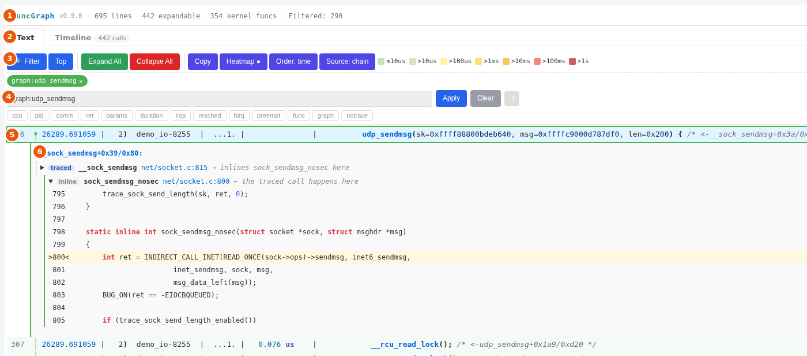

*Text view (sample.html, filter `graph:udp_sendmsg`, first line expanded). 1 header, 2 tabs, 3 toolbar, 4 filter (5.7), 5 one trace line (5.2), 6 the expanded source block as an inline chain (5.5).*

- **Header**: total lines, expandable lines and resolved kernel functions; with Timeline enabled, `N recorded calls` now appears here rather than on the Timeline tab. This is the report's total recorded call count, not unique functions or trace lines (one call may have separate entry/exit lines). It excludes synthetic inline/untraced frames and does not change with display filters. It indicates report size and capture volume, not pending work; hover for its definition. Filter matches remain separate in each view, with `Filtered: N` while a Text filter is active. On the right: **Theme** (dark/light), **?** (shortcuts) and **ⓘ** (info panel: environment, processing times, source origin and version check, the options used).
- **Tabs**: Text / Timeline / Compare.
- The header, tabs and toolbar stay within the window width even when trace lines are very long. On narrow screens, statistics move to a separate row so Theme, ? and ⓘ remain reachable. Only the Text body scrolls horizontally, retaining original formatting and complete arguments/source. Use a touch swipe, horizontal trackpad/mouse scrolling, or `h` / `l` (also `H` / `L`); input fields still accept these letters normally. Vertical scrolling remains on the page. Vertical keyboard navigation and line anchors retain the horizontal reading position, as does returning from another view. Regenerate older HTML to use this layout.
- **Top toolbar** (stays at the top while scrolling):

In narrow windows, heatmap keys wrap as color/threshold pairs. Filter fields can shrink without losing their values, keeping Apply, Clear and help inside the window.

| Button | Action |
|---|---|
| Filter | show / hide the filter box |
| Top | back to the top |
| Expand All / Collapse All | open / close all source blocks |
| Copy | copy the visible lines as plain text |
| Heatmap | duration coloring on / off, legend on the right |
| Order: time / by task | line order: as captured (all CPUs interleaved by time) or grouped by task, see 5.6 |
| Source: chain / flat | layout of source blocks, see 5.5 |

### 5.2 Columns of a trace line

A line with all options enabled:

```
2003237.699097 |   0)  true-130265   |  d.h1. | + 12.500 us   |    link_path_walk(); /* <-path_lookupat+0x84/0x180 ret=-2 */
└─ timestamp ─┘   └CPU┘ └─ task ───┘     └flags┘ └─ duration ─┘   └ indent + function ┘ └─ call site ─────────┘ └return┘
```

| Column | Option | Meaning |
|---|---|---|
| timestamp | `funcgraph-abstime` | time of the event in seconds, microsecond resolution |
| CPU | `funcgraph-cpu` | CPU of the event |
| task | `funcgraph-proc` | `name-pid`; `<idle>-0` is the idle task |
| flags | `latency-format` | 5 characters, see below |
| duration | `funcgraph-duration` | duration of the function: on the call line for leaves, on the `}` line for others. The leading mark is the duration class, see below |
| function | | indented by call depth. `func() {` is an entry, `func();` a leaf (entry and return in one line), `}` a return |
| `/* <-caller+off/len */` | `funcgraph-retaddr` | call site: offset inside the calling function; `len` is the caller's size |
| `ret=` | `funcgraph-retval` | return value, see 5.3 |

**Flags column** (the latency-format definition of tracefs):

| Position | Char | Meaning |
|---|---|---|
| 1 interrupts | `d` | irqs disabled |
| | `D` | irqs and softirqs (BH) disabled |
| | `b` | only BH disabled |
| | `.` | neither |
| 2 need-resched | `N` | TIF_NEED_RESCHED set and the preempt count asks for a reschedule |
| | `n` | only TIF_NEED_RESCHED |
| | `p` | only the preempt count asks for it |
| | `L` / `l` | lazy need-resched (PREEMPT_LAZY); `L` also with the preempt request |
| | `B` / `b` | need-resched and lazy both set (`B` also with the preempt request) |
| | `.` | no reschedule pending |
| 3 context | `h` | hard interrupt |
| | `s` | softirq |
| | `H` | hard interrupt inside a softirq |
| | `z` / `Z` | NMI / NMI inside a hard interrupt |
| | `.` | task context |
| 4 preempt depth | `0`–`f` | low 4 bits of preempt_count, `.` for 0 |
| 5 migrate-disable depth | `0`–`f` | nesting of migrate_disable, `.` for 0 |

Note: the preempt depth is read inside the tracing hook, and the tracing path usually adds one. On 6.18 and 7.2 the normal value in task context is therefore `1`, not `.`. The timeline analyses detect this baseline automatically (7.3).

**Duration marks** (kernel `trace_find_mark()`):

| Mark | Duration | Heat level | Heatmap color |
|---|---|---|---|
| (space) | ≤ 10 us | 1 | very light green |
| `+` | > 10 us | 2 | light green |
| `!` | > 100 us | 3 | yellow |
| `#` | > 1 ms | 4 | amber |
| `*` | > 10 ms | 5 | orange |
| `@` | > 100 ms | 6 | red |
| `$` | > 1 s | 7 | dark red |

With the heatmap on, the whole line background has the color of its level.

### 5.3 Syntax colors

| Element | Color (light theme) |
|---|---|
| CPU number | bold red |
| timestamps and duration numbers | blue |
| unit `us` | bold purple |
| function name | bold purple; a link with `--func-links` |
| module function name | bold teal |
| hex values (arguments, addresses) | dark blue |
| comments `/* ... */` | grey italic |
| brackets, semicolons | bold dark grey |
| `ret=` with a known errno (e.g. -2) | **red on light red**, followed by the name: `ret=-2 /* ENOENT */` |
| other `ret=` values | bold grey |

New ftrace Text reports put adjacent same-style `()[];` characters in one
highlight span to remove redundant DOM. Folding braces `{` / `}` stay separate.
Colors, original text, arguments, filters and source data are unchanged; no new
option is needed. Regenerate old reports. This is node reduction, not DOM
windowing or a memory bound; see [measurements and visual fidelity](performance-text-symbols.md).
Structured uftrace Text is unaffected.

The format of return values depends on the kernel:
- **6.18 and similar**: error codes are negative decimals (`ret=-2`), everything else is hex (`ret=0x0`). Void functions print `ret=` too, with whatever was left in the register; it means nothing.
- **Kernels with BTF-aware retval** (e.g. 7.2 trim_retval): void functions print no `ret=`; bool prints `ret=true/false`; signed integers are decimal, unsigned ones decimal or hex; types wider than long get `(trunc)`; pointers holding an ERR_PTR are printed as negative errnos.

On phones, Text keeps a one-row toolbar with **Filter**, **Top**, and **More**. **Filter** opens the query editor and field shortcuts over the trace without changing row positions; **Filter · On** means a query remains applied when the editor is closed. **More** contains Tree guides, bulk expand/collapse, Copy, Heatmap, Order, and Source. Tap outside or press Escape to close the panel without clearing the query. Desktop keeps its inline toolbar and saved filter editor preference.

### 5.4 Folding

On desktop, with `--enable-fold`, a small outlined chevron sits immediately before each `func() {`, following its original indentation (right-facing when folded, downward when open). Thin grey guides span the row height, with gently rounded exit corners on the same axis as the chevrons. Ancestor guides, arrow connectors and source-chain borders share the theme's neutral grey and are subtly emphasized on hover.

On a phone, the same buttons move into a 44 CSS px gutter to the left of the line numbers. Each tap target is one row tall, so adjacent controls do not overlap. You can fold deeply indented calls before scrolling horizontally to the function name. The gutter scrolls with the trace; the opening `{` remains a second fold target when reading to the right. Indentation, guide colors, row height and copied trace text are unchanged. Reports without foldable calls do not reserve a gutter.

New Text reports group every 512 complete records into a static paint chunk to reduce browser repaint work during hover/focus on large pages. Each row stays with its following source panel; task-group headers remain outside chunks so they can stay sticky. Browsers supporting `overflow-clip-margin` enable paint containment with a 6px margin to preserve boundary folding buttons and focus outlines. A chunk-level compositing hint also reduces pointer hit-testing costs on large DOMs without creating a layer per row or moving text. The browser decides whether to composite and how many layers to retain; other browsers retain the original painting path. Native drag selection across chunks, scroll dimensions and source expansion remain unchanged. All trace rows, source content and Timeline data remain in the same HTML file. This is not lazy loading, virtualization or sidecar delivery, and memory still grows with report size. Regenerate existing reports to benefit.

Ancestor rails, arrow continuations, exit corners and hover emphasis share one viewport canvas, device-pixel grid and stroke width. This avoids fractional `ch` gradient tiles blurring different depths into different apparent widths. The stroke is approximately 1 CSS px, rounded to whole device pixels (1 pixel at DPR 1/1.25; 2 at 1.5/2). Hover changes color, not thickness. Indentation spacing still follows the original text exactly: rounding the spacing would accumulate drift in deep trees. Painting locates only visible chunks and their visible rows, without per-depth DOM or a whole-report row-reference cache for guides.

- Click the chevron to fold/unfold the block; Shift+click folds/unfolds recursively.
- The opening `{` is another fold target, not a source toggle. The arrow remains reachable even when long arguments push the brace off-screen. Focus the arrow and press Enter/Space for native keyboard activation; clicking elsewhere on a source-enabled row still opens its source panel.
- **Tree guides: on/off**, next to **Top** on desktop and in **More** on phones, shows/hides the hierarchy lines, not the folding controls. The setting is saved per report and restored before trace rows are parsed. Hiding guides keeps the same column positions and row heights. Previously generated HTML files must be regenerated to contain the new control.
- Hover an arrow, opening brace or closing corner to gently emphasize that call's guide column across its visible descendants and its entry/exit markers; keyboard focus on the arrow does the same. Other columns remain quiet. Guides follow recorded indentation and paired calls, not an inferred complete stack; interleaved tasks, filtered rows and open source panels can interrupt the lines. Use **Order: task** when cross-task interleaving makes the tree hard to follow.
- uftrace user-only/mixed reports reserve a consistent arrow gutter and align the trunk with the folding controls. Recorded in-call events, including `callsite`, belong to the actual thread/address-space call: its trunk, hover emphasis and parent folding include these rows. Missing entries, unknown intervals after loss, other threads and cross-space records without verified clock alignment never borrow the current call's hierarchy. Guides retain a uniform thin stroke and muted colors, without stronger saturation or weight. Regenerate older HTML reports to apply the fix.
- Folding a parent hides every descendant call and its open source panel, without affecting other call trees or the parent's own source panel. Reopening the parent restores source panels only for visible calls and preserves each child's folded/unfolded state; this also works after reloading the report and in task-grouped order.
- Filters and folding compose: applying or clearing a filter keeps collapsed ancestors closed, and unfolding never reveals rejected rows or their source panels. **Clear** restores saved source expansions only for visible rows. Summary counts always describe the complete recorded subtree, not just filter matches. Depth, recursive and saved-state folding update their state together before projecting rows once. Sidecar/auto-sidecar prepares complete row and fold metadata cooperatively during the first Text opening, before mounting rows, rather than charging it to the first fold. You can cancel and retry preparation without mounting partial rows or fetching the filter index unnecessarily. Embedded Text retains lazy synchronous model preparation. Both paths still retain the full DOM; initialization/layout can block, preparation can take longer overall, and individual clicks are not guaranteed to be faster.
- New reports preindex exact fold-member ranges: an individual subtree no longer scans the entire trace to find members, and recursive/bulk operations project only the union of scopes whose states actually changed, once per row. Ranges preserve gaps for interleaved tasks; task/time reordering and filtering do not redefine the recorded call tree. The index adds preparation and retained-memory costs. Navigation candidate refresh, depth controls and full-DOM layout still include global work; this is not on-demand Text chunking, windowed rendering or bounded memory. Regenerate older reports to use it.
- Keys `1`–`9`: show only calls up to depth N; `0`: unfold everything.
- A folded entry shows `{ … }` followed by a compact summary before any call-site annotation: all recorded descendant calls (including leaf calls, excluding exits and the entry itself), recorded inclusive time when available, and return value. Ordinary values stay grey; known errno returns retain error coloring. These are recorded-call counts, not all functions that ran on the CPU.
- Folding state is kept in the browser's localStorage, per report.

Background colors related to folding:

| Color | Meaning |
|---|---|
| very light green | entry line `func() {` of a block |
| very light blue | lines inside a block |
| very light red | exit line `}` of a block |
| very light neutral grey | a folded entry line |
| thin low-contrast grey guides and corners | indentation levels and paired call boundaries; optional |

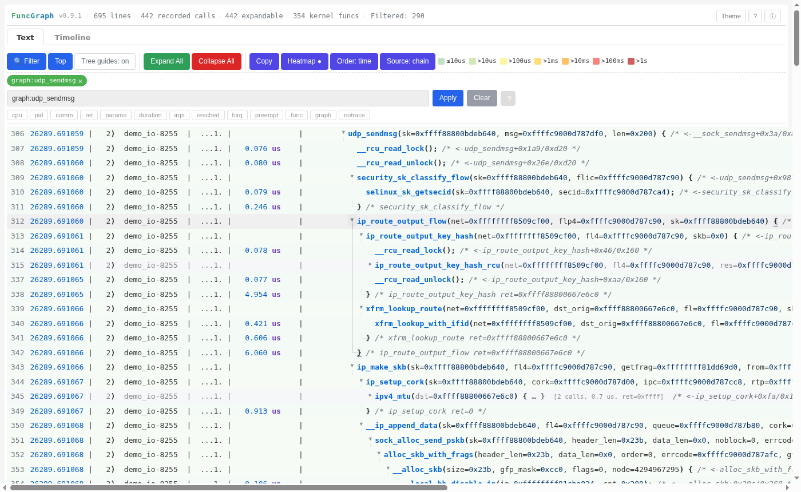

### 5.5 Source blocks

Lines with a call site can be expanded (click the line or press Enter). The block shows the source around the call site: 5 lines before and after, the current line highlighted and marked `>line<`.

When the call site is inside inlined code, faddr2line returns an inline chain. The **Source** button switches between two layouts:

- **chain** (default): outer to inner. `traced` is the function ftrace saw; below it each inlined `inline` function, indented one level, collapsible, with "→ inlines X here". Only the innermost one ("← the traced call happens here", the line that makes this call) is open. ↗ on each level is an online source link.
- **flat**: exactly like faddr2line's output, innermost first, everything open.

The Text toolbar and Timeline call-site Source buttons stay synchronized. In browsers with weak-reference support, switching only rebuilds populated source panels, without scanning empty placeholders across the trace or parsing an unused source pool. Unopened blocks use the current mode on first expansion; replaced detail panels are not kept alive by the registry. Older browsers retain a compatible scanning path. Source content is unchanged. In sidecar reports, expansion fetches only the source's verified chunk; a closed Timeline source panel waits until opened. Pending requests show **Loading source…** and failures provide **Retry**. Collapse, detail replacement/close and view changes cancel that panel's request, not other consumers of the same chunk; still-open pending panels restart on view reentry. Successful chunks are reused without refetching. Single-file reports keep synchronous embedded sources.

### 5.6 Grouping by task

ftrace prints the events of all CPUs ordered by time. With several busy tasks and frequent switches a task's calls are scattered: measured 25–58% of adjacent lines belong to different CPUs.

With **Order: by task**:
- Each task's lines are together, in their original order. Tasks with more lines come first, idle tasks last.
- Each group has a sticky header: `name pid · lines · CPUs it ran on`.
- After each context switch a grey italic summary line is inserted, e.g. `⇣ switched out on CPU 0 → idle-0; resumes at line 19703 after 7.640 ms (1 lines of other tasks in between)`: where it was switched out, who came next, when and at which line it resumes, and how many lines of other tasks lie in between. Separator and blank lines of the switch markers are hidden.
- Folding, filters, heatmap and source blocks keep working. **Order: time** restores the original order by line number.

New reports prepare and reuse time/task permutations, headers and switch-gap
descriptions from complete records instead of repeatedly reading live row DOM.
Header counts still describe full records, not current filter hits; filtering
and folding do not rewrite that permutation. Sidecar prepares a saved task
order in stages before mounting. This is not DOM windowing: reparenting and
layout can still block. See [measurements and limits](performance-text-order.md).

### 5.7 Unified filter

Type `field:value` in the filter box, combine with `AND`, `OR`, `NOT` and parentheses, and press Enter or Apply. The field buttons below open drop-down lists of values.

| Field | Matches | Examples |
|---|---|---|
| `cpu` | CPU number (regex) | `cpu:0`, `cpu:0\|1` |
| `pid` | pid (regex) | `pid:1234` |
| `comm` | task name (regex) | `comm:bash` |
| `func` | function name of the line (regex), this line only | `func:mutex` |
| `func:="…"` | case-sensitive literal match of the complete raw symbol; JSON string escaping inside quotes | `func:="inode_has_perm.isra.0"` |
| `graph` | the **whole call tree** of matching functions (like `set_graph_function`) | `graph:vfs_read` |
| `notrace` | hides the whole call tree of matching functions (like `set_graph_notrace`) | `notrace:__schedule` |
| `ret` | return value number (regex); `ret:all` matches every known error code | `ret:-22`, `ret:-2$`, `ret:all` |
| `params` | argument text (regex) | `params:folio` |
| `duration` | duration in us, with `>` `<` `>=` `<=` | `duration:>10` |
| `irqs` | flags position 1 | `irqs:d` |
| `resched` | flags position 2 | `resched:N` |
| `hirq` | flags position 3 | `hirq:h`, `hirq:s` |
| `preempt` | preempt depth, with comparisons | `preempt:>1` |
| `sort:desc` / `sort:asc` | sort the visible lines by duration | `duration:>0 sort:desc` |

`sort:asc` / `sort:desc` are presentation directives, not filter conditions: use them alone or after an expression. They do not change the matching line set or Timeline timestamps/order. A standalone sort entered in Timeline is retained until Text opens, without loading its filter index or Text early. Sorting keeps trace rows with their adjacent source blocks without overwriting the preferred task/time **Order**. Clearing the filter or removing its sort directive restores that preference; **Order** can also switch it manually. Matching uses the complete authored-record model, not just displayed rows or generated fold summaries. Deferred Text prepares this model before mounting; embedded Text prepares it lazily on first filtering/folding use. Later queries reuse it, and standalone sorting does not request a filter index. The full model and DOM still consume memory, and sorting/display updates can block; this is not virtualization.

Examples:

```
comm:cat AND graph:anon_pipe_read             the complete anon_pipe_read call trees of cat
graph:vfs_read AND NOT notrace:security_      vfs_read call trees without the security_* subtrees
ret:all AND comm:ls                           every line of ls returning an error code
irqs:d AND duration:>50                       calls longer than 50 us with irqs disabled
```

The filter is shared with the timeline (6.6).

### 5.8 Keyboard and mouse

The top-right header **?** is the shared help entry, with content specific to the active view: Text keyboard/folding shortcuts, Timeline zoom/navigation/Search-versus-Filter/legend, or Compare filtering/sorting/export guidance. Timeline no longer duplicates the button in its normal toolbar; a toolbar fallback appears only when maximization hides the header. Buttons support native Enter/Space; use the close button or Escape to dismiss. Switching views closes the shared Text/Compare hint. Timeline help waits for preparation without forcing synchronous initialization; canceled or superseded requests cannot open stale help.

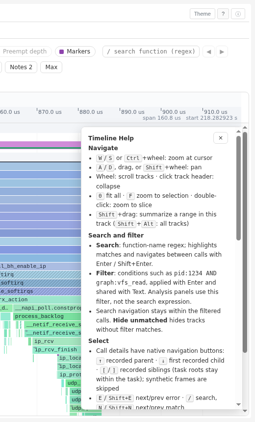

| Action | Effect |
|---|---|
| `j` / `k` or ↓ / ↑ | next / previous expandable line |
| `h` / `l` | scroll left / right |
| Enter | open / close the source block of the line |
| Space / PageDown / PageUp | page |
| `gg` / `G` (or Home / End) | top / bottom |
| `1`–`9` / `0` | fold to depth N / unfold all |
| Esc | clear the selection |
| `?` | shortcut help |
| click a line number | copy an anchor link (`#Lnumber`) to share the exact line |
| Alt + click a line | show this call in the timeline |

Text handles focus separately from scrolling: initialization, selection restoration and other explicitly non-scrolling updates keep native row focus without moving the viewport. Keyboard navigation scrolls explicitly when needed. The visible range accounts for the sticky toolbar's actual height, including wrapped controls in narrow windows, so navigation reveals rows behind it.

`j`/`k` and the arrow keys follow the current Text presentation order and wrap at either end. From a comment or exit row they choose the nearest visible source-expandable call in that direction, without skipping it. Time/task ordering and duration sorting keep the selected trace line's identity; filtering and folding update the navigation candidates together. Home/End use the first/last visible expandable row, falling back to visible plain rows if no source-expandable calls remain; with no visible rows they do nothing. Logical lookup uses a complete numeric line index, so clicks, anchor selection and candidate refresh no longer query every mounted row. Sources, focus and scrolling still require the target DOM node, and full rendering/layout can still block. Regenerate old reports to use these fixes.

New sidecar indexes carry the exact source-pool ID for every expandable row, including ID `0`; `null` explicitly means no source expansion. Deferred Text prepares navigation from these complete records without a second DOM capability scan. It reuses an already-loaded index, or captures the same metadata while reading the detached rows; opening Text does not request the filter index just for navigation. Legacy version-1 indexes remain readable and fall back to the authored rows because their source capabilities are unknown, not absent. This is model decoupling, not viewport virtualization: Text still loads and mounts all rows, and source expansion/focus/scroll still need mounted elements.

## 6. Timeline view

For [uftrace recordings](uftrace.md) containing both address spaces, a thin line
marks each linked user → kernel transition over the kernel call's recorded
span. The toolbar legend and call-stack labels explain the boundary; user code
has its own Context color. Single-space reports have no divider. Use
`space:user` or `space:kernel` in the shared Text/Timeline Filter.
Try the [mixed sample](../sample_mixed.html) or see the
[uftrace walkthrough](uftrace.md#mixed-sample-follow-sendto-into-the-kernel).
Select `dispatch_datagram` to inspect its recorded address, arguments and
return value. Text shows these on the corresponding entry/exit rows. Values
that uftrace could not decode stay labeled as raw bytes.
See the [pigz + zlib case](pigz.md) to build and trace a real tool and its library.
When recorded, **Exec / exit** lists kernel lifecycle events and links to Text;
**Markers** toggles their task-track ticks. Missing endpoints are not inferred.

### 6.1 Layout

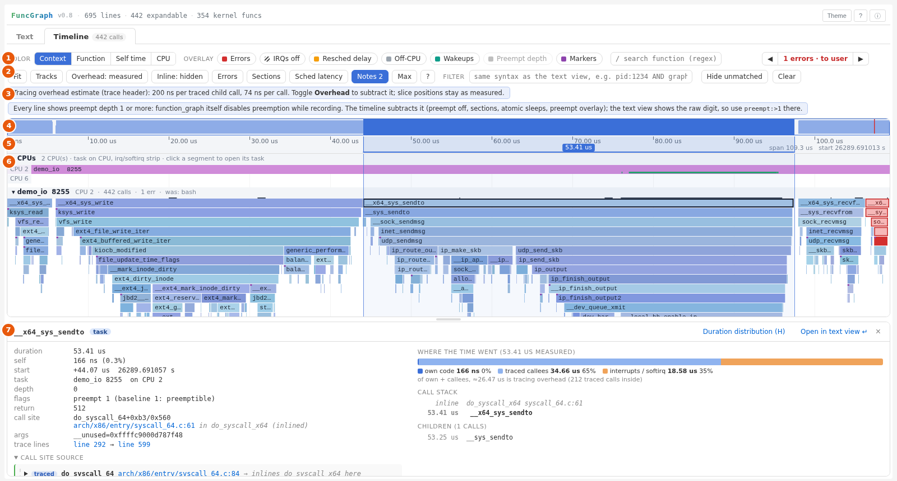

*The timeline (sample.html, `__x64_sys_sendto` selected); the numbers match the list below.*

From top to bottom:

1. **Primary toolbar**: function Search and match navigation, zoom / **Fit trace**, immediately followed by **Inline: hidden / shown** (`I`), **Notes**, and **Full screen** (`M`). Inline is hidden when no inline information is available. Full screen is always visible, not hidden in a menu; on phones it sits beside Search, with zoom / Fit trace / Inline / Notes / **Tools** below, wrapping to fit the available width.
2. **View and analysis tools**: Color, Overlay, error navigation, Tracks (expand / collapse), Tasks (7.7), Go to… (6.10), Overhead, Errors, **Critical sections**, **Scheduling latency**, and the **Filter** shared with Text (6.6). Desktop and phone layouts put these controls in the grouped **Tools ▾** dropdown instead of spreading buttons across the chart. Opening it does not resize the canvas; click outside or press Escape to close it. Tab navigates its controls. Related navigation and analysis buttons are grouped separately. Use the header **?** for help; full screen provides a toolbar fallback.
3. **Notes**: what this trace lacks and what that means ("No timestamps…", "Arguments are not printed…"). Blue notes are information, yellow ones need attention.
4. **Overview strip**: the whole trace in miniature. Blue bars show how busy each moment is, red lines are error origins (tall: reached user space, short orange: handled by a caller), the blue frame is the visible range. Click or drag to jump, use the wheel to zoom.
5. **Time axis**: the right side shows the visible span (`span`) and the absolute start time (`start`), plus `selected` for a range selection; the time under the cursor is shown next to it.
6. **CPU tracks** (only with timestamps) and **task tracks**. Time counts from the earliest event, possibly a scheduler event before the first call, so the first call need not be at 0. The initial view focuses on all calls and recorded exec / exit milestones rather than shrinking short work into long scheduling context; without either it shows the full extent. The overview and **Fit trace** / `0` / `Home` always cover all calls, runs, wait boundaries, wakeups and critical/latency-window boundaries. **Tools → Navigate → Fit calls** fits all recorded calls independently of the shared filter, without changing selection or analysis; it is disabled without calls. Open waits end geometrically at the report boundary, not at an observed resume.
7. **Bottom panel**: opens when a slice is clicked or an analysis panel is opened; drag the bar above it to resize (6.5).

In narrow or short windows, toolbar buttons wrap, and the toolbar and notes scroll vertically within their own areas instead of pushing the canvas and detail panel off screen. Slice details use one column on narrow screens. Collapse **Notes**, or use **Full screen / M**, for more canvas space; the preferred panel height remains remembered.

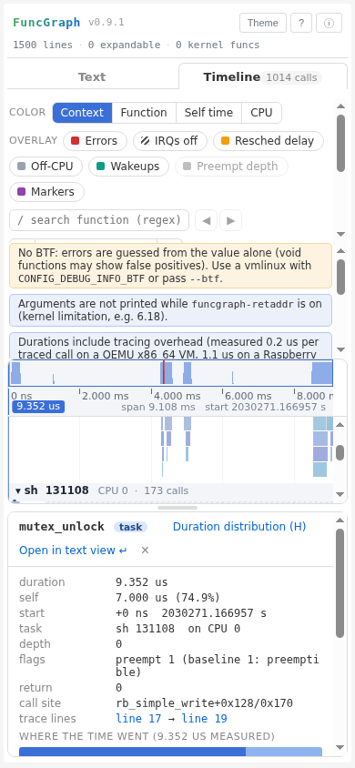

*Timeline in a 390 × 844 window: independently scrolling toolbar, notes and details keep the canvas visible.*

The **time mode** depends on the columns in the trace and is named at the right of the axis:

| Mode | Condition | x axis |
|---|---|---|
| abs | `funcgraph-abstime` | real time, gaps are real |
| rel | relative timestamps | same |
| compressed | durations only | calls of a task are packed back-to-back; no gaps ("compressed time") |
| count | neither | each leaf counts as one unit: call order only |

### 6.2 Tracks

**Task tracks**: one per task, busiest first; idle tasks last and collapsed.

- Header: `name pid`, then the CPUs it ran on, call count and error count. While filtering also the number of matches (`N matched`); if the task was renamed, `was: old name` (e.g. bash before exec). Without `funcgraph-proc` the header reads `CPU N (no funcgraph-proc)`.
- Click the header to collapse / expand the track. A collapsed track is one thin row with the outermost calls.
- Inside a track x is time and y is call depth, outermost at the top. **A slice's width is the function's measured duration.**

**CPU tracks** (`CPUs` at the top): one row per CPU showing which task ran on it.

- Each segment is colored by task name (same task, same color) and labeled `name pid` when wide enough.
- The thin strip at the bottom of a segment is interrupt time: **orange** hardirq, **green** softirq, **purple** NMI.
- Hover: how long the task ran on this CPU in one go and how much of it went to hard/soft interrupts; click to jump to the task's track and select the innermost real call at that time (even when tracing began at nonzero depth). With no overlapping call, the click clears the previous slice details and opens Tasks scoped to this identity, keeping the time range. Tracks without calls are revealed on demand as headers, not invented slices.

Canvas labels and detail titles hide recognized trailing compiler suffixes: for example,
`inode_has_perm.isra.0` displays as `inode_has_perm`. Known GCC numeric clones,
`.cold`/`.hot`, LLVM `.llvm.<hex hash>` and known demangled `[clone ...]` suffixes
are supported. Unknown suffixes, embedded dots and `.plt`/`.ifunc` remain.
**Only display names change**: recorded-call, inline/untraced-frame and function
distribution titles use the same rules. Title tooltips, canvas hover and CALL STACK
preserve the exact symbol. Regex search, source resolution, parameter types, function
colors and statistics keep original identities; clones are not merged.
Regenerate older HTML reports to use the readable labels.

### 6.3 Color modes (Color)

Choose **Timeline → Tools → Color** without changing slice positions, widths, selection or filters.

| Mode | The color shows |
|---|---|
| **Context** (default) | execution context: **blue** task, **green** softirq, **orange** hardirq, **purple** NMI. Functions of the same context differ slightly in hue and lightness so neighbors can be told apart |
| **Function** | the function name: same function, same color; find the calls of one function everywhere |
| **Total time** | total duration, including child calls and recorded waits; a **blue → red** log scale highlights longer complete calls |
| **Self time** | total duration minus direct child-call durations, clamped to zero; the same blue-to-red palette distinguishes a parent's own duration from its children |
| **CPU** | the CPU a call ran on, one color per CPU, grey if unknown: shows migrations |
| **Module** | the kernel module, one color per module, light grey for the core kernel. Hidden when the trace has no module functions |

Both duration modes show a scale inside Tools, from zero to the **maximum across all real calls in the report**, computed separately for each metric with 20 `log1p` bins. Zoom, search and filters do not rescale it, so a call keeps its color. For example, if A takes 10 ms and its direct child B takes 9 ms, Total time colors A by 10 ms and Self time by the remaining 1 ms. **Neither metric measures CPU execution time**: self time can still include untraced work and waits.

**Overhead** updates colors and the menu scale to overhead-subtracted estimates; slice geometry stays measured. All-zero durations remain blue, with no invalid scale. Call-order reports without durations and reports without calls hide both options. Synthetic inline/gap frames stay neutral, not measured durations. **Errors** overlays take priority; switch them off for a pure duration comparison. The mixed User/Kernel color key is only shown in Context mode; address-space boundaries remain unchanged. See [duration color semantics and validation](timeline-colors.md).

Without `latency-format` the context in Context mode is inferred from interrupt entry functions (`gic_handle_irq`, `__sysvec_*`, `handle_softirqs`, …); such slices say `(inferred)` in the tooltip.

### 6.4 Overlays and markers

Each overlay can be switched off; buttons of overlays without data are hidden.

| Overlay | Looks like | Meaning |
|---|---|---|
| **Errors** | **solid dark red** slice | error origin, and the error reached user space (a `*_sys_*` in the chain) |
| | **solid orange** slice | error origin, handled by some caller |
| | **light red with red outline** | error propagation: returns the same errno as a child |
| | **light orange with orange outline** | propagation of a handled error |
| | small **triangle** (red / orange) | an error origin too narrow for a label |
| | label `func = ENOENT` | error origins get the errno name after the function name |
| **IRQs off** | **hatching** on a slice | irqs were disabled when the call started |
| | **thin dark grey line** under the track header | periods with irqs disabled (real start and end) |
| **Resched delay** | **amber triangle** in the top right corner of a slice | need-resched was already set when the call started: a reschedule was due but had not happened |
| | **amber band** under the track header | need-resched window: from setting the flag until the schedule happens, i.e. scheduling latency |
| **Off-CPU** | grey hatched segment labeled `off-CPU 7.640 ms · do_wait [S]` | the task was not on a CPU; drawn one level below the frame that was open. Label: duration, function it waited in, state at switch-out (`S` interruptible sleep, `D` uninterruptible, `R` still runnable) |
| | the same with an **amber tint** | preempted (it could have kept running) |
| **Wakeups** | **teal arrow** from a dot at the waker to where the woken task resumes | who woke whom and when (needs `sched_waking` or `sched_wakeup`) |
| | only a small head | bunched wakeups show just the end point. Hovering or selecting a task, or hovering an off-CPU segment, draws its full arrows. The top right shows “N of M wakeups bunched” and drops the interaction hint on narrow windows |
| **Preempt depth** (off by default) | grey bar at the bottom of a slice, darker for deeper | |
| **Markers** | **dotted right edge** | entry seen, return not (the capture ended, or events were lost) |
| | **dotted left edge** | return seen, entry not (the call started before the capture) |
| | **small purple square** top left | caller differs from the recorded parent: tail calls, inlining or untraced code may explain it; the cause is unresolved, not necessarily a missing frame |
| | **small grey arrow** top left | `--tail-calls` found a direct tail jump to this function in the supplied binary; static evidence, not a captured branch |
| | **red underline** | a sleeping function called in atomic context (7.4) |

When zoomed in, Wakeups keeps arrows crossing the time window even if their wakeup starts offscreen. Wait Chain and exports still use the complete records.

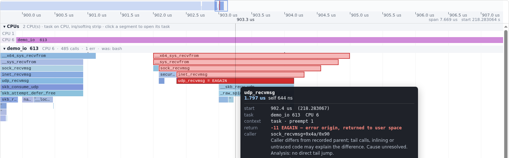

*An error path (the second `recvfrom`): `udp_recvmsg` is the origin (solid red, label `= EAGAIN`), the frames above are propagation frames (light red, red outline); the tooltip gives the errno and its fate.*

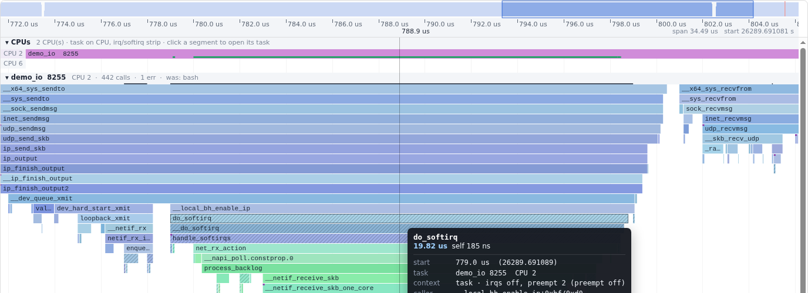

*Irqs off: `do_softirq` and `__do_softirq` are hatched (irqs off when they started); the dark grey line under the track header shows the irqs-off periods; calls in the softirq are green.*

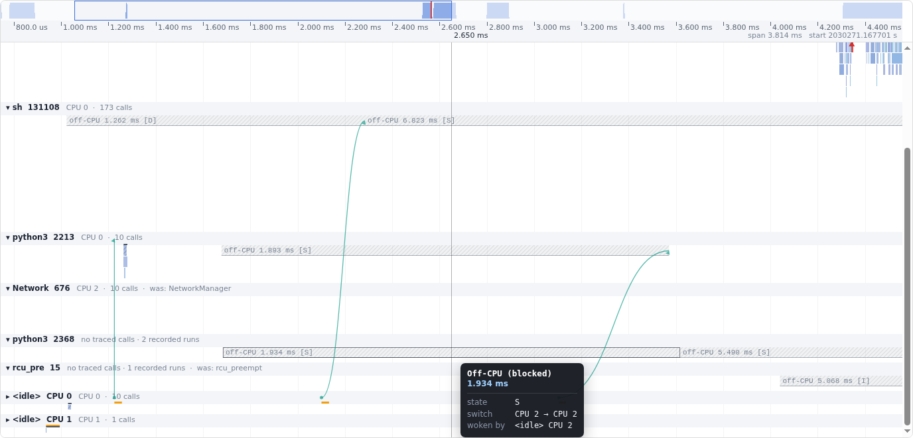

*Off-CPU and wakeups (tests/data/pi4_sched.txt): light grey hatched segments are time off the CPU, teal arrows go from the waker to the woken task; hovering an off-CPU segment shows its state and waker.*

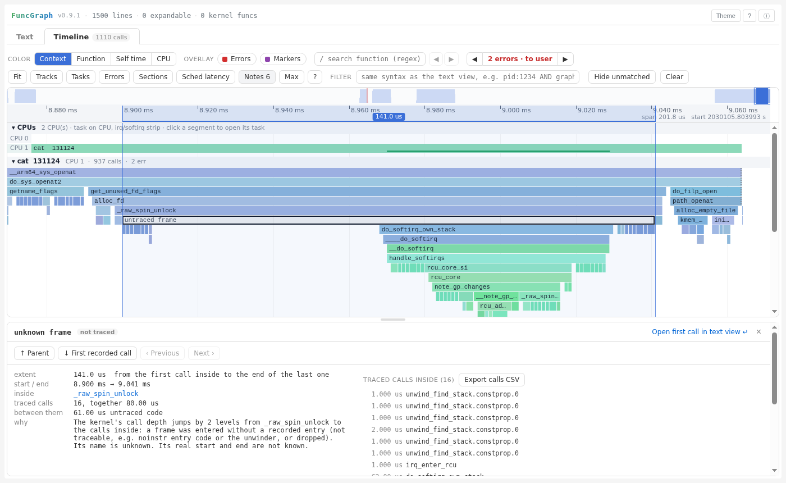

*Untraced frames (tests/data/pi4_nodur.txt): two levels are missing between `_raw_spin_unlock` and the `unwind_find_stack` calls inside, drawn as a dashed `untraced frame`; this fixture has no call sites, so the name is unknown.*

Two things that are easy to misread:

- **Hatching shows the state when the call started.** The latency column records the irq state of each printed line, and a slice uses its entry line. Disabling or enabling irqs in the middle of a function (e.g. the calls after `spin_lock_irqsave`) does not show on the slice itself. For how long irqs were really off, look at the dark grey line under the track header or the Sections panel (7.3), which lists each region's start, end and what ran inside.
- **Two kinds of hatching**: the darker hatching on a slice is irqs off and covers only that slice; the very light grey hatched segment with an `off-CPU …` label, reaching from one level down to the bottom of the track, is time the task was not on a CPU and has nothing to do with interrupts.

Other visuals:

- **Dimmed**: slices excluded by search or filter are drawn at 18% opacity.
- **Dense blocks**: slices narrower than 1.5 CSS px share a pixel at this zoom. Every member contributes to matching: a pixel stays bright if **any one frame** matches both the function search and shared filter; an unmatched neighboring pixel stays dim. Color uses the first matching representative, or the first frame if none match, and neighboring pixels with the same dim state can merge for drawing. Hover reports the **frame count**, matching count and representative; click chooses the first matching frame (otherwise the first). This is a task/depth pixel group, not a new runtime call or a sum of measured time; synthetic frames are counted as frames, not traced calls. A wide call actually under the cursor wins over nearby thin frames. Zoom in or use recorded navigation to inspect individual calls. Zero-duration calls starting at the view's left boundary are included.
- **Selected**: thick dark outline. **Hovered**: thin outline. As in Perfetto, the selected slice's start and end are marked with two blue lines over all tracks (light blue in between); the time ruler shows the same span as a blue bracket with its duration, and the overview strip shows where it is. These marks are hidden while a range is selected.
- **Inline frames** (Inline view): a soft neutral fill with a thin dashed outline. A small `inl` tag precedes the function name when space permits; narrow slices prioritize the name. Hover slightly strengthens the fill, and selection uses the same outline as recorded calls. See 6.8.
- **Untraced frames** (always shown): translucent grey with a dashed outline, labeled `untraced name`. The kernel's call depth sometimes jumps by two or more levels, e.g. on arm64 `unwind_find_stack` appears two levels below `__might_sleep` (no entry was recorded for `arch_stack_walk` in between), and so do the interrupt entry calls `irq_enter_rcu` and `do_interrupt_handler` (the untraceable `el1_interrupt`). That used to leave an empty row. These calls now belong to the enclosing slice (its self time no longer includes them) and the missing level is drawn as an untraced frame named after the calls' return address (their caller); further missing levels are shown as `untraced frame` (name unknown). Its extent is the first to the last call inside; the real start and end are unknown. Tooltip and detail panel say so, and call stacks list these frames (marked `untraced`).

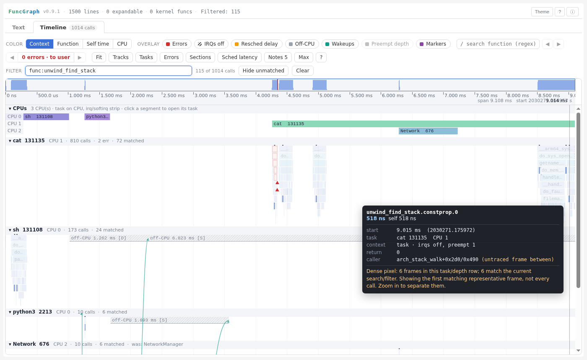

*Dense frames in the real scheduling trace: filtering keeps matching members visible, and the tooltip identifies the pixel group rather than pretending that only its representative exists.*

Inline/untraced frames stay bright if any recorded child matches the **intersection** of search and shared filtering. Repeated hover reuses the current synthetic frame's raw extent/coverage facts; Overhead never changes that geometry. Matching prefixes and synthetic results are cached by search/filter identity, so repainting, theme changes, resizing and Overhead do not repeatedly scan all grouped members. The first repaint after changing either filter prepares new match facts; the scope remains complete rather than sampling only the first frame.

#### Optional static tail-call evidence

```bash
python3 funcgraph.py --timeline --tail-calls --fast --func-links \
    --vmlinux /path/to/vmlinux --kernel-src /path/to/linux \
    --output report.html trace.txt
```

A tail call can use `jmp` / `b` instead of a regular call and retain an outer return address. A caller/parent mismatch therefore does not necessarily mean that a frame was missed. Default reports explain the unresolved causes. Only `--tail-calls` inspects the supplied binary for a direct jump from the recorded parent to the child's entry. Without it, no tail-call ELF analysis or disassembler runs.

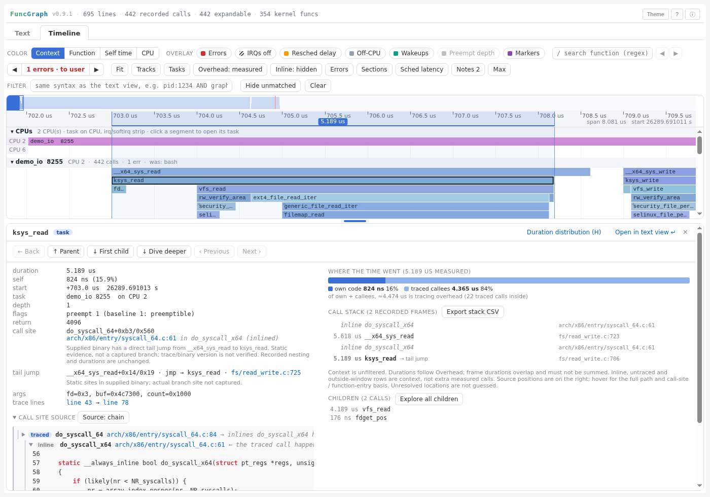

*The sample's `__x64_sys_read → ksys_read`: a restrained `⇢ tail jump` stack tag and a separate static instruction/source field, without replacing the recorded call site.*

- **Presentation**: with Markers enabled, sufficiently wide slices use a small grey arrow instead of the unresolved purple square. Stack rows stay aligned, without new indentation or saturated colors. Detail lists every matching static site with a clickable source position when DWARF resolution is available, otherwise `Source unavailable`.
- **Evidence limits**: a direct jump exists in the supplied binary; this does not prove the captured invocation executed it or automatically verify the trace/binary version. The function may also have ordinary call paths. Recorded parents, depths, slice widths, durations, self time, counts and navigation remain unchanged. No return events or measured frames are invented.
- **Requirements and coverage**: pyelftools (`pip install 'funcgraph[fast]'` or `[all]`) and matching-architecture GNU/LLVM objdump, honoring `CROSS_COMPILE` / `LLVM`. Currently supports linked little-endian ELF64 x86-64 / arm64 binaries with symbol tables. Modules, indirect jumps, missing/ambiguous symbols, depth gaps, exhausted budgets and unavailable tools remain unresolved, never proof of no tail calls. The ftrace `funcgraph-tail` option only adds names to closing lines; it is unrelated to this analysis.
- **Raw input**: shares the text analysis pipeline, but needs resolved return addresses that produce caller/parent mismatches. Nesting alone cannot identify a tail call. Bare `trace_pipe_raw` remains unsupported.
- **Cost and export**: deduplicates parent/child/module combinations, reads only candidate parent code and batches objdump rather than disassembling each invocation. This adds opt-in generation work, not browser-side disassembly. `--export result.json` includes separate `tail_calls` evidence; CLI export precedes HTML source enrichment, so static source positions are not guaranteed there. Context CSV appends `relationship`, `relationship_basis`, `tail_jump_sites`, `trace_binary_version_verified` (static evidence uses `false`); the ordinary function-statistics CSV is unchanged. Plain `--no-text-view` still skips source resolution; add `--keep-source` to retain these positions.

### 6.5 Tooltip and detail panel

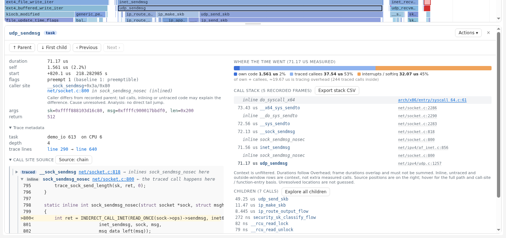

*Detail panel of `udp_sendmsg` (dragged taller): values, the call site `net/socket.c:800` and its source block on the left; the time breakdown, call stack with clickable source positions (inline frames in italics) and children on the right. Hover emphasizes a source link; the navigation row moves between recorded parents, children and siblings.*

**Hovering a slice** shows:

| Field | Meaning |
|---|---|
| name `[module]` | module functions get the module name |
| duration, `self` | measured and self time; `(estimated)` when there was no duration column and the value comes from timestamps |
| start | time since the start of the trace, absolute timestamp in parentheses |
| task | task and CPU |
| context | context plus the decoded flags: irqs off, BH off, need-resched kind, preempt N, migrate-off N; `(inferred)` if inferred |
| return | return value; for errors the errno name, the role (error origin / propagated) and the fate (returned to user space / handled by caller / propagates beyond trace). `unverified: no BTF type` means it was judged by value only |
| caller | recorded return address; a mismatch explains possible causes or static tail-jump evidence and the unverified trace/binary version, rather than always claiming a missing frame |
| source | resolved source position `file:line` of the call site, i.e. the line that made this call (needs address resolution, usually `--vmlinux`, but not a mounted Text view) |
| inlined in | inline chain around the call site |
| args | arguments (only with `funcgraph-args`) |

New reports use the compact call-site position index for this tooltip, including the innermost position of an inline chain. Hovering a known resolved or unavailable call site does not parse the full source-code pool or Text source-line map. Unavailable call sites do not borrow a function-entry line. Legacy or unsupported position metadata retains the existing source-HTML fallback; opening source-code details still loads/parses the embedded code pool on demand. This does not introduce external source chunks or virtualize Text.

**Hovering an off-CPU segment**: wait time, function it waited in, state at switch-out, CPU it left and CPU it resumed on, waker.

**Clicking a slice** opens the detail panel below:

- Tags next to the title: context (`?` if inferred), irqs off, BH off, need-resched, preempt off (preempt count above the trace's baseline, `×N` for N extra levels; hover the tag for the numbers. function_graph disables preemption itself while recording, so on `CONFIG_PREEMPTION` kernels every line's preempt digit is one too high: the baseline is the lowest value seen in task context, capped at 1, so a trace that lies entirely in a preempt-off region is not hidden. Preempt off, Sections, atomic sleeps, the Preempt depth overlay and Sched latency's max preempt off all subtract it; the text view shows the raw digit, so filter with e.g. `preempt:>1` there), migrate off, error origin/propagated, may sleep in atomic context, no exit, no entry, estimated.
- Left column: duration, self (and its share), start, task, depth, flags, return, caller site, args, trace lines (entry and exit line numbers; click to open the text view).
  - Detail fields share one aligned list without a **Trace metadata** heading or disclosure: timing (duration/self/start), task/CPU and flags/context warnings, call site and arguments/return, then depth/recorded entry address/trace-line links. Recorded **flags** retain the raw preempt count and baseline explanation, including in kernel-only reports. `none` means latency flags were recorded and clear; no flags row is shown without recorded latency data, including user calls without kernel flags. Original return bits follow a BTF-decoded return, preserving the raw evidence and its explanation.
  - Below **call site**: the source position of the call (`file:line`, click to open the online source); `in FUNC (inlined)` when the call sits in inlined code.
  - **Call site source**: the call site's source block, the same as when expanding the line in the text view (highlighting, `>line<` marks the call, inline chain in the chain/flat layout of the Source button). Click the title to collapse it; the choice is remembered. Text and Timeline share one de-duplicated source pool and a trace-line → source-ID index; the corresponding Text row does not need to exist in the DOM. Without `--kernel-src` / `--source-rev` / `--source-url` only the position link is shown. Plain `--no-text-view` omits both; add `--keep-source` to retain available source/position/inline information in Timeline-only reports.
- Right column:
  - **Where the time went**: a stacked bar splitting the recorded interval. It uses real parent links, including skipped depths and stacks deeper than 256 calls; synthetic inline/untraced frames are never counted as extra calls:

    | Color | Part |
    |---|---|
    | dark blue | own code: the function's own code |
    | light blue | traced callees |
    | orange | interrupts / softirq that interrupted the call |
    | grey | blocked: sleeping, waiting |
    | yellow | preempted |
    | purple | unattributed: a gap not explained by the recorded categories |

    Below it: how many real traced calls are inside, and roughly how much is tracing overhead (with an estimate). This breakdown always uses raw geometry, independently of Overhead and the shared filter. If overlapping or inconsistent trace intervals make the categories exceed the recorded interval, a warning gives the excess; percentages then use the category total, not a misleading fraction above 100% of the interval. Call-order and packed geometry are labelled as such, not as elapsed scheduling time.
  - **Error chain**: the complete recorded propagation path, ordered from the outermost propagation frame to the origin. It no longer silently stops at 64 frames. Inconsistent top/length metadata or invalid/cyclic parent links are reported, not treated as complete paths.
  - **Call stack**: all recorded ancestors, ordered outermost to selected, without a 128-frame cutoff. Durations belong to recorded calls; inline frames and skipped depths have explicit `inline` / `untraced` labels and no fabricated measurements. "… N frame(s) outside trace window" appears only when the oldest observed ancestor actually starts below depth zero, never because a display limit hid recorded ancestors.
  - **Children**: real direct recorded children, even across skipped depths, grouped by function and ordered by total duration; `×N` = number of calls. The compact preview shows up to eight functions and labels the top-eight/total. Its native buttons open the **longest** call of each function, not an arbitrary first call. **Explore all children** opens complete groups and individual calls (7.8), including functions outside the preview.
- **Actions ▾** at the top right groups **Duration distribution** (7.2, shortcut `H`)
  and **Open in Text** (shortcut `Enter`) instead of repeating two links beside
  the symbol. It supports mouse, touch and keyboard; reports without Text disable
  that action with an explanation. See [detail layout](detail-layout.md) for interaction details.

The visible stack shares three columns for duration/type, function symbol and source position instead of sizing each row independently. Long durations, `inline` / `untraced`, outside-window notes and bold selected frames cannot shift only their own symbol; columns also stay aligned with larger fonts. Explicit line height leaves room for underscores and descenders rather than hiding leading underscores to simulate alignment. Loading more rows or toggling Overhead updates the shared columns using displayed content only, without another trace scan.

**Recorded call navigation**: the detail panel's **↑ Parent**, **↓ First child**, **‹ Previous** and **Next ›** buttons have the same behavior as ↑/↓/`[`/`]`. Navigation follows the nearest **recorded real parent**, not the adjacent visual depth row: children with different depth gaps remain siblings, while calls belonging to another parent are never substituted. Calls without a recorded parent are navigable roots within their own task, not proof of a common runtime caller. Order follows the original slice indexes, including timestamp ties and zero-duration calls; endpoints do not wrap.

The navigation row contains only these four buttons; **Back** and **Dive deeper** are removed to avoid overlapping controls. Repeated **First child** moves down one recorded level at a time; repeated **Parent** moves up. First child always chooses the first direct recorded child, including a leaf; use **Previous** / **Next** to choose another sibling before continuing down. Parent follows the recorded hierarchy, not selection history, and never restores missing frames. Stack and child-list buttons remain available for direct jumps.

**Per-frame source positions** sit to the right of function symbols in a compact, column-aligned list with durations. The stack runs top to bottom in frame order without extra indentation. Long names occupy at most two lines; long paths are ellipsized while keeping the line number visible. Source positions use muted grey, with links emphasized on hover or keyboard focus. Full paths and position provenance appear in tooltips, not repeated `call site` / `entry` labels on every row. Both recorded and inline frames can show locations. A call site denotes the position inside that frame leading to the next frame; the innermost recorded frame, or one without a matching call site, uses its existing resolved function entry, never presented as a calling line or declaration. Entry positions require `--func-links` when generating the report. Missing DWARF/resolution is explicitly `Source unavailable`, not a guessed line. Paths are native links separate from call-selection buttons, supporting Tab/Enter, opening in a new tab and copying the link. Configured `--base-url` / module URLs determine destinations; without a URL the path remains text. This reuses resolved data and existing URL rules, with no browser symbolization or Text DOM scans; `--no-text-view --keep-source` is supported too. Context CSV retains the same provenance in `source_file/source_line/source_kind/source_url`.

Inline/untraced detail panels offer the recorded parent and **First recorded call**; synthetic frames are not inserted into the recorded sibling sequence. Filtering does not rewrite this context, and Overhead/Inline do not change the navigation links. Buttons expose the target function in a safely escaped tooltip, disable missing targets and work with Tab/Enter/Space. Navigation reveals the target and returns its details to the top. The activated control retains focus when another target exists; at the endpoint focus returns to the canvas rather than silently activating a different direction. Narrow layouts wrap the controls.

**Context lists** initially render 100 rows; **Load more context** appends 100 without replacing existing rows or losing the enabled paging button's focus. The same mechanism covers call stacks, error paths, inline chains and recorded calls inside inline/untraced frames. Recorded-frame rows are native buttons: Tab then Enter/Space selects that call. Long names use two lines with the full name/source in a tooltip; compact-window titles scroll vertically instead of covering the list.

**Export stack / error chain / inline chain / calls CSV** exports the entire selected list, including unloaded rows, without expanding the DOM. Columns retain row kind/order, recorded and owning slice indexes, depth/display level, trace/task indexes, return/caller/arguments/module, inline file/line, explicit outside-window counts, duration/self and original positions. Error paths also retain original chain origin/top/declared length, errno, outcome and `path_status`. Only actual recorded calls have measured columns; resolved inline/call-site, untraced and outside-window rows leave them blank. `_units` denotes call-order steps, `_ns` time values; `time_mode`, `duration_basis` and `position_basis` distinguish adjusted values and packed geometry. CSV uses UTF-8, quoting and spreadsheet-formula protection.

The list contents retain complete context independently of the shared filter. A selected real call still closes when it stops matching; a synthetic frame remains selected while any recorded child matches. Overhead changes numerical duration/self values, never the original positions or cached structure. Inline/filter/Overhead refreshes retain loaded pages for the same selection. Frame durations overlap and must not be summed as if they partitioned the selected interval.

The detail panel and the analysis panels share the bottom area. Drag the bar above the panel to change its height; the canvas grows or shrinks accordingly. Double-click the bar to restore the default (32% of the window height, between 180 and 400 px). The height is stored in the browser as a fraction of the window, so other reports and other window sizes keep the same split.

Resizing preserves the current selection, time range and complete recorded data. Canvas resizing and repainting share the same animation frame, avoiding a blank chart during dragging; repeated same-size updates do not clear the canvas. This fixes the resize path, not the initial DOM cost of large single-file Text/source reports. Existing standalone HTML embeds its own runtime and needs regeneration to receive UI fixes; this does not require dropping calls, arguments, flags or source information.

When the panel is shorter than 140px, such as phone landscape or a manually reduced split, a subdued **expand icon** appears beside Close. It temporarily borrows the chart area for details; press it again to restore the split, or close the panel / press Esc to restore the chart. Unlike **Full screen / M**, this does not hide the page header. It does not change the saved split, query, current task page or call selection. Expansion survives view changes, resizing and panel navigation in this session, but is not saved for the next report load. Help remains available, and extremely short windows can still scroll the details.

For a larger canvas, select **Full screen** (`M`). It hides page chrome and requests browser full screen; **Exit full screen**, `M`, or `Escape` restores the page. Unsupported or denied native full screen falls back to filling the page viewport, with a brief status message. Browser-initiated exits update the button as well. Switching to Text exits full screen; reopening Timeline does not enter it automatically. Zoom, call selection, filters, model identity and the saved detail split do not change. The detail-expansion control is independent: it borrows the chart area rather than entering full screen. **Notes N** toggles capture notes and remembers that preference. Regenerate existing reports to get these controls.

Timeline **Open in Text**, **Enter**, and recorded trace-line links move focus
to the visible **Text** tab. This also handles a native full-screen request
finishing after the jump; later completion does not override a newer navigation
or input/focus choice. Native focus restoration may follow the full-screen exit
event rather than the first frame where `fullscreenElement` is null. See
[Text handoff details](detail-layout.md#text-handoff-and-full-screen-focus--文本跳转与全屏焦点).

### 6.6 Search and filter

Select a real call, then choose **Actions → Focus this task / Focus this function**
to prepare a filter without typing an identity or escaping a symbol. The action
combines the current draft, if any, with the new condition using parenthesized
`AND`, opens the existing Filter and focuses its input. Results change only after
**Apply** / Enter. Task focus uses the complete PID/TID, plus CPU for an idle task;
it is disabled when the recorded task identity is unavailable. Function focus
matches the complete, case-sensitive raw symbol and address space, retaining
compiler suffixes such as `.isra.0`. It neither matches the other address space
nor expands a call tree. Spaces, parentheses, quotes and backslashes are escaped.
After successful application, a temporary **Undo focus** restores the previously
applied filter. This is one-step undo, not a history; it is disabled while editing
a draft or filtering, and removed when another filter takes effect. Reports
without shared Filter controls do not add these two menu items. Focus does not automatically
hide tracks, zoom or change Find, and retains context and raw data as before.

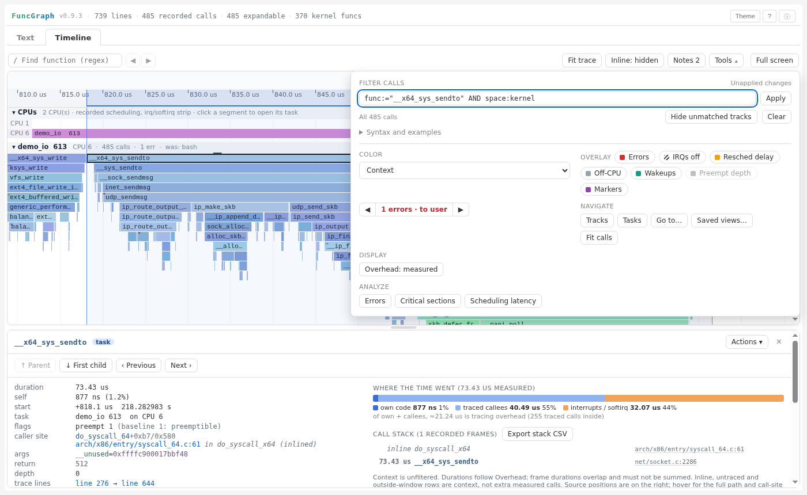

- **Search box** (`/`): a case-insensitive function-name regex over real traced calls, not arguments, call sites or synthetic inline frames. Non-matching slices are dimmed.
- **Match navigation**: click ◀ / ▶ beside the search box, or press Shift+Enter / Enter inside it; outside the input, Shift+`N` / `N` also works. The status shows `position / total calls`, such as `2 / 17 calls`, or just the total when the current selection is not a match. Navigation wraps in task order, then time order within each task; without a selection, next starts at the first result and previous at the last.
- **Search status**: typing shows `Searching…`; no matches shows `0 calls`. Invalid syntax shows `Invalid regex`, marks the input red and disables both navigation buttons. It clears stale highlighting and navigation results; Esc clears the search and leaves the input. Repeated navigation reuses cached matches rather than rescanning all slices.
- **Filter bar**: the same syntax as the text view's unified filter (5.7), kept in sync with it. Non-matching calls are dimmed; error navigation, range call summaries and duration populations use matching calls; windows require actual overlap with matching calls. The right side shows `N of M calls`. Context is retained where needed: off-CPU scope, wait chains and a selected call's raw breakdown are filter-independent, and Slow vs fast filters root invocations but includes their full real descendants. **Hide unmatched** hides tracks without matches, **Clear** removes the filter.
- **Together**: search counts and navigation only include calls that pass Filter. Changing or clearing the filter updates search results immediately, without jumping into hidden unmatched tracks. Tab to focus controls, then Enter / Space activates them normally. Canvas navigation shortcuts move focus back to the canvas, where Enter opens the selected call in the text view.

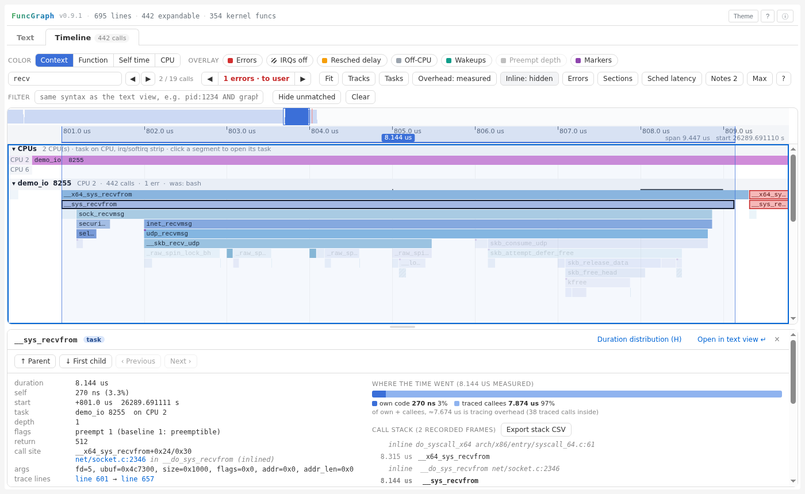

*Search for `recv` and navigate to its second matching call; the counter follows the selected slice.*

### 6.7 Measured durations and overhead subtraction

With an overhead estimate (the header written by `fgcapture.sh --calibrate`, or `--overhead`) the **Overhead** button (`O`) appears:

- **measured**: measured durations.
- **subtracted**: tooltips, the detail panel, summaries and analysis panels use durations with the overhead removed: `measured - per-child overhead × traced descendants - per-call overhead`, never below 0.

**Slices are always placed and sized by measured time**; only the numbers change. The correction is an estimate: overhead depends on CPU, frequency and kernel configuration, and is off on paths with many interrupts or different cache behavior.

### 6.8 Inline frames (Inline)

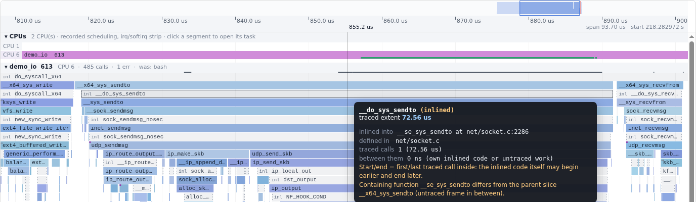

*Inline view: a soft fill, small `inl` tag and thin dashed outline distinguish inlined functions (`__do_sys_sendto`, ...); the tooltip explains where their extent comes from. Untraced frames retain their full dashed outline and `untraced` label.*

With `--vmlinux` and `funcgraph-retaddr` the tool knows whether a call site is inside inlined code. **Inline** (`I`) switches between two views and is remembered:

- **hidden**: only the frames ftrace traced.
- **shown**: inline frames between a parent and its children. Consecutive calls under the same parent that sit in the same inlined code are merged into one inline frame.

An inline frame **starts and ends** with the first and the last traced call inside it. Inlined code has no entry or return events, so the real start may be earlier and the real end later; tooltip and details say so.

The thin dashed outline indicates this extent limitation; it is clipped with the slice rather than adding borders at viewport edges. Function names keep the same font as recorded calls, with a subdued `inl` tag omitted when space is tight; hover and details retain the complete inline identity. The fill stays neutral rather than coloring an inferred extent as a measured duration. This styling does not change hierarchy, extent, filtering or hit testing.

Tooltip and detail panel of an inline frame:

| Field | Meaning |
|---|---|
| traced extent | span from the first to the last traced call |
| start / end | start and end time |
| inlined into | function, file and line it was inlined into |
| defined in | file that defines the inlined function |
| traced calls | traced calls inside and their total time |
| between them | span minus those calls: the inlined code itself, untraced calls, interrupts |
| Inline chain at the call site | the full chain, this level in bold |
| Traced calls inside | every recorded call inside; 100-row pages, keyboard navigation and full CSV export |

In both views the call stacks list the inline frames.

Inline and untraced details cache the selected frame's raw extent facts, so refreshing does not rescan every child. Inline-chain exports distinguish the resolved containing call-site function from actual recorded calls and never assign source-only frames fabricated slice indexes or durations.

### 6.9 Keyboard and mouse

| Action | Effect |
|---|---|
| `W` / `S`, or Ctrl + wheel | zoom in / out around the mouse |
| `A` / `D`, ← / →, drag, Shift + wheel | pan |
| wheel | scroll the tracks |
| `0` or Home | show all |
| `F` | zoom to the selected slice or range |
| double-click a slice / off-CPU segment | zoom to it |
| click a slice | select it and open the detail panel |
| click an off-CPU segment | open the wait chain (7.5) |
| click a track header | collapse / expand the track |
| Shift + drag | select a time range in this track and summarize it (7.1) |
| Shift + Alt + drag | the same over all tracks |
| ↑ / ↓ | select the recorded parent / first recorded child (skip synthetic frames) |
| `[` / `]` | previous / next recorded sibling; roots stay within the task; no wrapping |
| `E` / Shift + `E` | next / previous error origin |
| `/`, `N` / Shift + `N` | search, next / previous match |
| `G` | open precise positioning without changing the selected call (6.10) |
| `H` | duration distribution of the selected function |
| `O` | measured / overhead subtracted |
| `I` | hide / show inline frames |
| `M` | enter / exit full screen; Escape also exits |
| drag / double-click the bar above the panel | resize the bottom panel / reset it |
| Enter | open the selected call in the text view |
| Esc | close an open menu/help first; otherwise exit full screen, or clear selection and range in normal mode |
| `?` | help and legend |

### 6.10 Precise positioning (Go to…)

Click **Go to…**, or press `G` outside an input in Timeline. The button is inside **Tools** on desktop and phones.
Enter a coordinate in **Start / center**. A blank **End** keeps the current zoom and centers the coordinate,
subject to the existing pan limits near trace edges. Supplying both fields shows the exact interval,
for example `100 us` to `0.2 ms`. This changes only the viewport: it does not select a nearby function
or change filters, the selected call, tracks or the bottom panel's analysis scope.

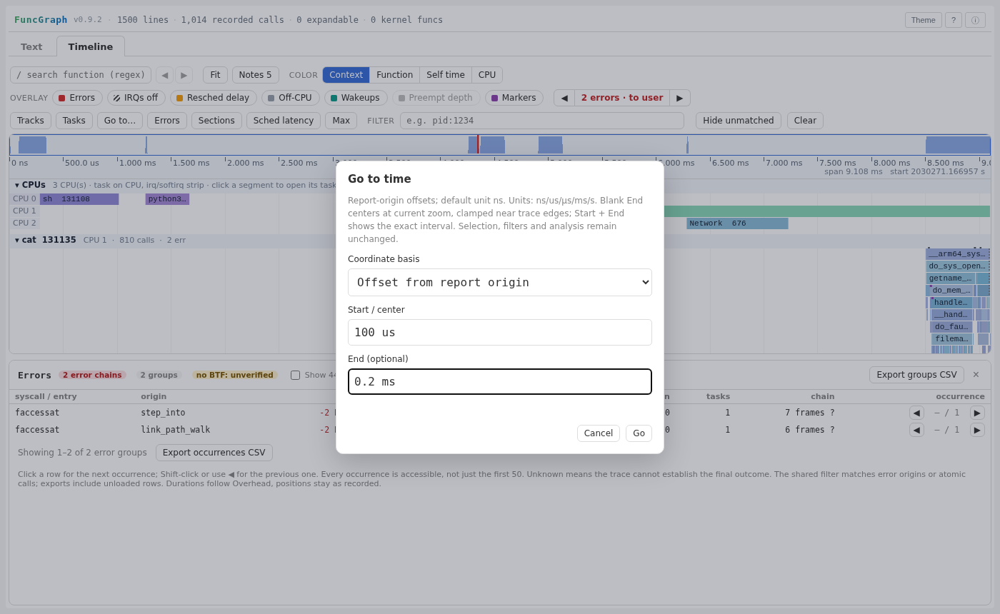

- **Measured time**: offsets are relative to the report origin. Accepted units are `ns`, `us`, `µs`, `μs`,
  `ms` and `s`; no unit means nanoseconds. The origin can precede the first function call and is not
  necessarily the first visible call's start.
- **Recorded timestamp**: offered only with a trustworthy exact origin. No unit means seconds here;
  a recorded timestamp can be entered directly. The integer-nanosecond origin is subtracted exactly
  before conversion to frontend coordinates, preserving low bits even above JavaScript's safe absolute
  integer range. These are not calendar timestamps. Unverified mixed clocks do not offer this option;
  offset navigation does not establish cross-space clock alignment either.
- **Duration-based / packed modes without timestamps**: inputs refer to the report's constructed
  coordinates, not original timestamps. Packed coordinates cannot recover real idle gaps; the dialog
  describes the current mode.
- **Call-order mode**: use `u` / `unit` / `units` (default `u`), with exact thousandths supported.
  This is a drawing coordinate, not an ordinal call lookup; time units are rejected.

Only decimal values are accepted: no hexadecimal, exponential notation, fractional nanoseconds,
negative offsets, positions past the recorded extent or relative coordinates outside the safe integer
range. End must exceed start. Invalid fields keep their text and display an inline explanation without
moving the viewport. Changing the coordinate basis converts both valid fields exactly.
`Enter` submits; `Esc` / **Cancel** closes without moving. Dialog keys do not activate underlying
Timeline shortcuts, and closing restores focus to an available control.

### 6.11 Saved views

Locate a useful call or interval, open **Tools → Saved views…**, give it a name,
optionally expand **Add a note (optional)**, and choose **Save current view**.
Click a saved name to restore it. The entry stays inside Tools: there is no
permanent sidebar or extra row of toolbar buttons.

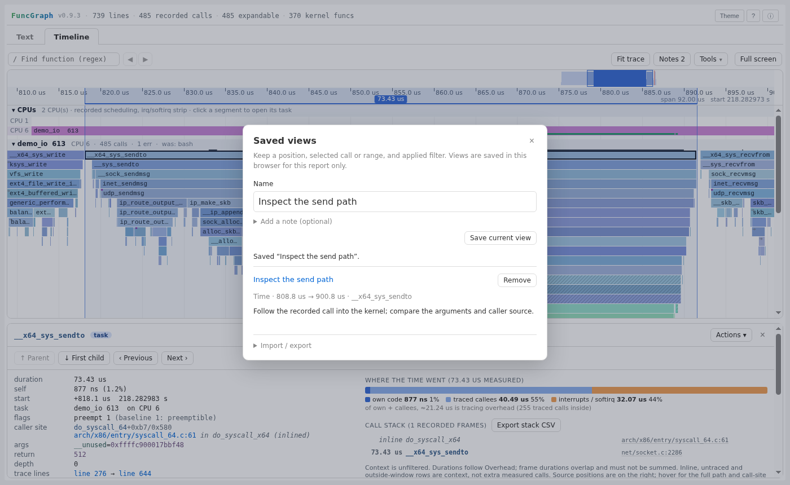

- Saves the visible interval, selected call or range, applied shared filter,
  Find input, collapsed tracks, vertical reading position, and Inline / Overhead
  settings. Unsubmitted filter drafts are excluded; wait for or cancel active filtering.
- Does not save expanded source or analysis-panel pagination, and does not
  overwrite theme, full-screen state, detail height, colors or overlays. Restore
  reuses the Timeline model without changing recorded data. Untimed reports keep
  their original coordinate basis, not measured time.
- Views stay in this browser and are restored explicitly, not automatically on
  report open. Each report can keep 50 views and up to 1 MiB; reaching a limit
  produces an explanation instead of silently dropping earlier views.
- Expand **Import / export** to transfer JSON. It contains positions, filters
  and notes, not trace data, source or screenshots; share the matching report
  separately. Check notes and filters for private information before sharing.
- A generation-time fingerprint binds views to Timeline data, ignoring build
  duration, across matching single-file and sidecar reports. Different traces,
  parsing results or source annotations can change it. Mismatches are rejected,
  never guessed from function names or line numbers. Import merges existing
  views, skips duplicate content, and rejects a corrupt, oversized or incompatible
  file as a whole rather than partially changing the saved list.
- If browser storage is unavailable or full, views remain usable and exportable
  in the current tab; the dialog warns that they may not survive closing it.
  Corrupt existing storage is not overwritten. **Remove** deletes a saved view,
  never a call or the trace.

The dialog is created on first use. Saving, restoring and transfer run only on
explicit actions; hovering, zooming and switching views do not scan saved views
or recompute fingerprints. Escape closes the dialog before leaving full screen
and restores the available toolbar control's focus.

## 7. Analysis panels

Analysis panels open in the detail area below the timeline and follow the filter and the Overhead switch. Column headers sort (the sorted column is underlined); rows jump to the timeline.

### 7.1 Range summary (Shift + drag)

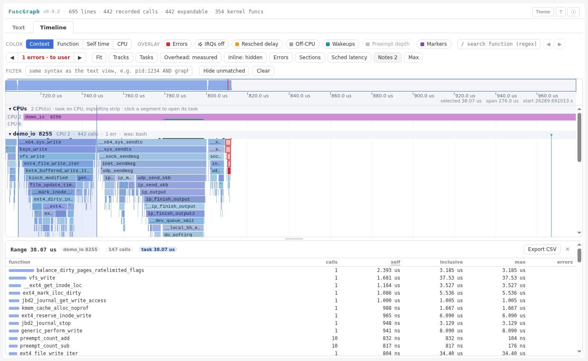

*The mixed sample's full range: 326 functions sorted by self time, showing functions 1–300; U / K identifies user and kernel space.*

Shift + drag on a track selects a time range in that track; Shift + Alt + drag selects over all tracks. The summary shows:

- Tags: range length, track, number of calls, self time per context (task / softirq / hardirq / NMI) and off-CPU time.
- Table per function: **calls** counts calls starting in the half-open interval `[start, end)`, including zero-duration calls at the start but not at the end. **Self** and **inclusive** are proportional overlap estimates, not an exact reconstruction of where the work ran inside a partly overlapping call. **Max** is the whole-call duration, and **errors** counts overlapping error-origin calls, not error events timestamped inside the range. Off-CPU time covers the selected tracks independently of the call filter.
- Click a column header to sort; the active sort is underlined. Each page has at most 300 functions; **Previous / Next** replaces that page instead of accumulating rows, with the current interval and total shown. Ordinary refresh, reopening the same range and Text round trips preserve the page; changing the range, track, shared filter, Overhead or sort returns to page one. Paging reuses the aggregates and prepared sort without walking the calls again. Clicking a function row still puts its exact name into the search box and highlights matching calls without selecting one.
- **Export CSV** downloads **all** functions in the current range, track scope, filter and sort order, not just the current page. The UTF-8 CSV includes range boundaries, scope, off-CPU total, filter expression, `time_mode` and `duration_basis`. Self/inclusive columns are explicitly named `self_estimate_ns` / `inclusive_estimate_ns`; `max_call_ns` retains the whole-call duration. Overhead-subtracted values are estimates. In call-order mode (`count`), columns use `_units` instead of `_ns` (one unit = one call-order step); compressed mode (`compressed`) uses packed durations, not real timestamps. Function names and other string cells are protected against spreadsheet formula interpretation.

For 300 or fewer functions, no paging buttons appear. The footer pins to the panel bottom, reverting to normal vertical scrolling in very short panes. Narrow headers scroll vertically with the content rather than cover the table. Header and paging controls stay in the viewport when a wide table scrolls horizontally; touch paging and export buttons are at least 44px high. See the [range-paging record](performance-range-summary.md) for layout, complete-export checks and measurements.

The range panel stays open when filtering or switching Overhead, even if an analysis panel was open before selecting the range. No matching calls produces an explicit empty state and disables CSV export. The header wraps in narrow windows so export and close remain reachable.

### 7.2 Duration distribution (H)

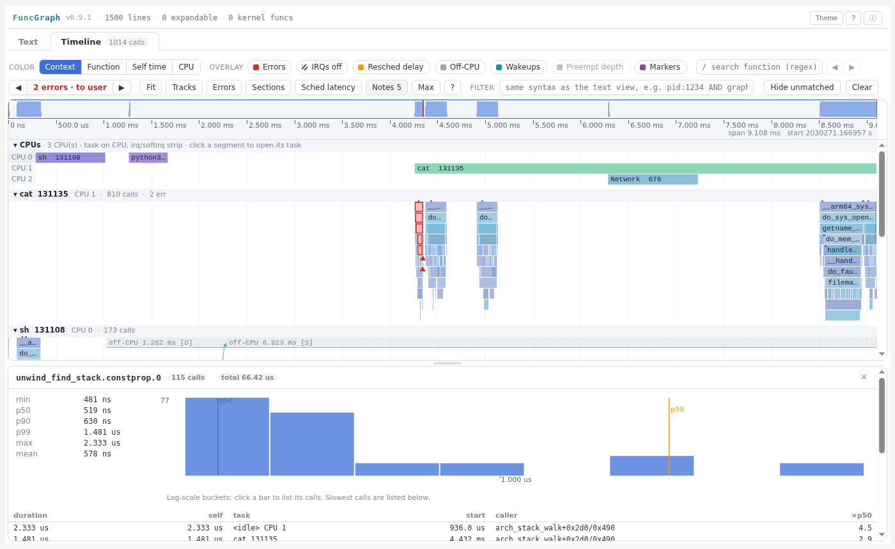

*Duration distribution (`unwind_find_stack.constprop.0` in tests/data/pi4_sched.txt, 115 calls): percentiles, log histogram and calls 1–50, slowest first. The detail divider is dragged upward; at the default height, **Histogram** can instead collapse the chart to leave room for calls.*

Press `H` with a slice selected, or choose **Actions ▾ → Duration distribution** in the detail heading:

- **Statistics**: min, p50, p90, p99, max and mean over matching calls of the function and selected call site. Percentiles consistently use the ascending sample at `round(p × (count − 1))`, including the call-site table. The Overhead switch updates durations and self time; positions on the timeline remain measured.
- **Histogram toggle**: the chart is open by default. The header button supports mouse, touch and Enter / Space. Collapsing it keeps all six statistics in a compact layout without changing the bucket, current page, call rows or CSV scope. The choice survives refreshes, reopening and switching functions within this report; reloading the page restores the default. It never changes the saved detail split. Touch controls are at least 44px tall and the bucket selector keeps its accessible name. See the [paging and layout record](performance-duration-calls.md#compact-histogram-follow-up) for measurements and a compact-view screenshot.
- **Histogram**: x is duration (log scale), y the number of calls (log scale). The blue line is p50, the amber one p99; bars containing error origins are red. Click a bar, or use the keyboard-accessible **Duration bucket** menu, to restrict the call list and its CSV export. **All durations** clears this selection. Bucket labels are rounded for readability; CSV records the numeric lower-inclusive / upper-exclusive bounds. Percentiles and totals continue to describe the whole function/call-site population, not just the selected bucket. The histogram resizes with the window and repaints after theme changes.
- **Slowest calls**: duration, self, task, start, call site, and `×p50` (how many times the population median). **Previous / Next** replace pages of at most 50 calls without accumulating attached call rows; the status gives the current range and total. Ordinary refreshes and reopening preserve the page; changes to the function, call site, duration bucket, shared filter or Overhead population start at the first page. The pager stays within the call-list section, not over the following comparison or call-site tables; very short panes use normal scrolling. Click a row to highlight that call while keeping the distribution panel open. Touch paging, bucket and export controls are at least 44px tall. See the [duration-call paging record](performance-duration-calls.md) for measurements and limits.
- **By call site**: one row per call site with calls and p50/p99/max; the same function called from different places can behave very differently. The table stays visible while filtering: click a row to select it, then click the selected row again or **All call sites** to undo. **More call sites** reveals entries beyond the initial 12. If a shared filter removes every call at the selected site, the panel remains open with an explicit empty state and a working reset button.
- **Export calls CSV** downloads every call in the current function, shared filter, call site and duration bucket, not just the displayed page, ordered slowest first. Includes duration, self time, measured start/end positions relative to the report origin, task, caller, trace line, error-origin flag, filter settings, bucket bounds, `time_mode` and `duration_basis`. Duration/self values follow the Overhead switch; start/end positions do not. Time-valued columns use `_ns`, or `_units` in call-order mode (one unit = one call-order step). Compressed-mode positions are packed, not real timestamps. UTF-8, quoting and spreadsheet-formula protection match range exports.
- **Slow vs fast** compares the slowest `ceil(count / 10)` with the fastest `floor(count / 2)` matching root invocations (at least six required). The population follows the function, shared filter and call site, **not the duration bucket**. Calls are ordered by descending current duration, then original slice index; cohorts are disjoint even when durations tie. The comparison remains open through filter/site/Overhead refreshes, including explicit empty states, and **Hide comparison** collapses it without losing prepared results.
- **Full comparison table**: per selected root, average calls and self time for every real descendant function, plus `(own code)`, `(interrupts / softirq)`, `(blocked off-CPU)` and `(preempted)`. Synthetic inline/untraced frames are excluded; recursive descendants contribute once for each selected ancestor. Descendants remain included even if they do not match the root filter. Every statistic column sorts; **Load more profile rows** appends 100 rows, including unchanged functions and zero-time calls, instead of silently keeping only 15 differences. **fast** / **slow** example buttons support Enter/Space and highlight actual descendant calls without replacing the distribution panel.
- **Interpretation**: function self follows Overhead and can contain off-CPU time. Own code subtracts estimated self overhead from raw on-CPU self, clamped at zero. Interrupt/blocked/preempted rows stay on the original scheduling geometry and are **not additive with function rows**. Expand **Scope and interpretation** for the basis and recursion rules. Differences are associations, not proof of a cause; call-order/packed positions are not elapsed scheduling time.
- **Export profile CSV** includes every row in the current comparison sort order, not just loaded rows: kind/name index, per-root calls and values, signed deltas, fast/slow example slice indexes, cohort/population sizes, mean root durations, `selection_basis`, per-row `value_basis`, filter and call site. **Export cohorts CSV** records the exact fast/slow root members with original slice/trace/task indexes, duration/self, unchanged start/end positions and scope metadata. CSV uses `_units` in call-order mode, `_ns` otherwise, UTF-8 and spreadsheet-formula protection. Export does not expand the table; sorting, pagination and collapsing/reopening reuse the prepared comparison.

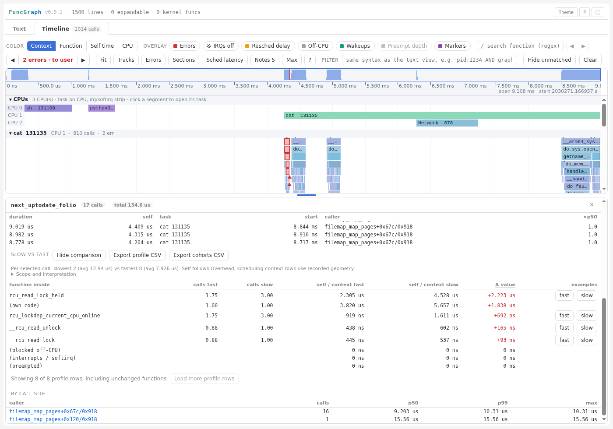

*Slow vs fast on a real scheduler trace: complete descendant profiles, explicit cohorts/bases and direct example navigation.*

Changing the function, shared filter or Overhead setting resets a duration-bucket selection. Call-site changes reuse the cached sorted population instead of rescanning and sorting the trace. In narrow windows, long titles and selected-site labels are visually abbreviated (hover for the full text) so the close/reset controls do not fill the detail panel.

Comparison controls, scope notes and pagination remain inside the viewport when scrolling wide tables horizontally. In narrow or short windows, the distribution title scrolls vertically with the content; comparison table headers use no stale title-height offset.

### 7.3 Critical sections (Sections)

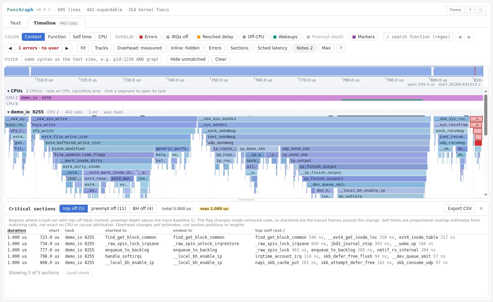

*Sections panel (tests/data/pi4_sched.txt): irqs-off / preempt-off / BH-off regions, one row each, with where they started and ended and the functions with most self time inside.*

Every region in task context with **irqs off**, **preemption off** or **BH off**; the buttons at the top switch between the three kinds and show their counts:

| Column | Meaning |
|---|---|
| duration | length; red above 100 us in timestamped modes |
| start / task | start time and task |
| started in / ended in | the traced function on top of the stack when the flag changed. `top level`: outside any function; `switched out / end`: the task was switched out or the capture ended; `interrupt`: an interrupt came in (so irqs had been re-enabled in untraced code) |
| max depth | maximum preempt depth (preempt off only) |
| top self (est.) | the 3 highest self-time estimates from matching calls inside the region; sorting compares the first function's estimate |

The preempt depth is relative to a baseline: the lowest preempt depth seen in task context (1 on both 6.18 and 7.2), shown in the panel text.

Precision: enabling/disabling irqs or preemption is usually inlined code that does not appear in the trace, so a region's ends are only known up to the two traced calls around the flag change. Clicking a row selects the region in the timeline.

**Filtering and duration basis:** the shared filter retains only sections overlapping matching real calls, not every section on a track with any match. Kind-button counts and the current kind's total / max use these complete retained sections. Without a filter, recorded sections remain even when no traced call covers them. Start/end coordinates and their function names stay as recorded, without clipping them to the filter. Self time sums only matching calls, apportioned by their overlap fraction; it is not exact on-CPU time or causal attribution. Overhead updates self estimates, **never section positions or lengths**.

**Sorting, pagination and export:** duration, self estimate and (for preempt off) max depth sort descending; start / task sort ascending. Header buttons support Enter / Space. Each page has at most 200 rows; **Previous / Next** replaces the page rather than accumulating rows. The three section kinds remember independent pages; ordinary refresh, reopening and Text round trips retain them. Changing sort, the shared filter or Overhead returns to page one. Prepared statistics/profiles remain cached; a newly visited section computes its self estimate on demand. **Export CSV** exports **every section** in the current kind, filter and sort order, independently of the page. Fields include the original `section_index`, task, start/end coordinates, window duration, start/end functions and source trace lines, top-three self estimates, `time_mode`, `self_duration_basis`, `window_duration_basis` and `filter`. Missing contributors are left blank.

Time columns use `_ns`, or `_units` in count mode (call-order units, not nanoseconds). `window_duration_basis` distinguishes `timestamp_span`, `packed_estimate` and `call_order`; `self_duration_basis` distinguishes `measured`, `overhead_subtracted_estimate` and `call_order`. Without timestamps, packed / count coordinates are not real scheduling latency or wall-clock section lengths. Compact windows wrap the header, keep export/close reachable and scroll the header with the detail content so it cannot cover the table.

One-page populations need no paging buttons. The footer pins to the panel bottom when enough height is available; very short panes use normal vertical scrolling. Header and paging controls remain horizontally anchored when a wide table scrolls. Touch paging, kind, sorting and export controls are at least 44px high. Paging does not change the current chart position or selected window. See the [window-paging record](performance-window-paging.md) for measurements.

### 7.4 Error summary (Errors)

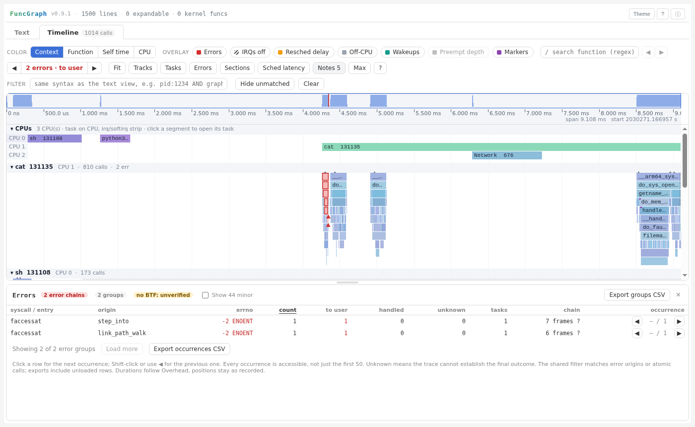

*Errors panel (tests/data/pi4_sched.txt, Show minor enabled): grouped by syscall, origin and errno, retaining every occurrence; `?` means at least one chain has unverified frames.*

- At the top (if any): **Sleeping functions called in atomic context**. Calls of functions that may sleep (`__might_sleep`, `mutex_lock*`, `down*`, `wait_for_completion*`, `msleep`, `schedule_timeout*`, …) with irqs off, preemption disabled, BH disabled or from an interrupt. Groups distinguish function, reasons and parent function rather than conflating different callers. **These calls remain browsable even without errno chains.** Counts and rows include only matching real calls, independently of the minor toggle; browse at most 100 groups per page with **Previous / Next**.
- The table groups error chains by **syscall / entry → origin → errno**:

| Column | Meaning |
|---|---|
| syscall / entry | the system call (without prefixes such as `__x64_sys_`); if there is none, the outermost function, tagged `no syscall` |
| origin | the error origin: the first function returning this errno while none of its children returned the same |
| errno | number and name |
| count | occurrences |
| to user | of these, how many reached user space (red) |
| handled | how many were handled by a caller |
| unknown | errors leaving the traced call window, with no established final outcome; neither handled nor known to reach user space |
| tasks | number of tasks involved |
| chain | longest propagation chain in frames; `?` when some frames are not type-verified, with the number of unverified chains in the tooltip |
| occurrence | current position / full occurrence count; arrows visit the previous / next occurrence |

Click a row for the first occurrence, then the next; Shift-click or `◀` goes backward, starting with the last occurrence when none is selected. Groups wrap in origin-start / original-index order and **retain every occurrence, not just the first 50**. Atomic groups use the same complete navigation. Arrow buttons support Enter / Space, show the current position and synchronize the timeline selection without replacing Errors. Sorting and Overhead preserve each group's cursor; changing the filter or minor scope resets error-group navigation.

**Sorting and pagination:** syscall / entry, origin and errno ascend; counts and maximum propagation depth descend. Every sortable header is a native button, with ties ordered by the original first chain index. Error groups have at most 200 rows per page and atomic groups at most 100; **Previous / Next** replaces rows without accumulating DOM. The tables remember independent pages. Paging, reopening, refresh and Text round trips preserve each group's occurrence position; Overhead also preserves pages. Sorting or changing minor scope resets only the error-group page, while shared-filter changes reset both. Endpoint focus moves to a usable button; single-page scopes omit paging controls. Error aggregates cache by filter bitmap / minor toggle; atomic groups cache separately by filter bitmap. Sorting, pagination and Overhead do not reaggregate chains.

Touch paging, occurrence, sorting and export controls are at least 44px high; occurrence arrows are also at least 44px wide. Export and paging regions stay horizontally anchored over wide tables. Very short panes release sticky table headers so they cannot obscure content. Complete statistics and all three CSV exports are independent of the page; see the [error-paging measurements](performance-error-paging.md).

**Filtering and export:** the shared filter matches an error chain's **origin call**, or the atomic call itself. Header counts, tables and exports use the same scope, and `count = to user + handled + unknown`. Ordinary roots remain tagged `no syscall` and never merge with a syscall whose shortened name happens to match. Errors includes all outcomes; the toolbar navigator's `to user / all` switch affects navigation only, not this summary.

- **Export groups CSV:** all sorted error groups, including unloaded rows, with entry / syscall status, origin, errno, all three outcome counts, task counts and labels, maximum chain length, verified / unverified and minor counts, and scope metadata.
- **Export occurrences CSV:** the error-table footer exports every chain in the current group order, then occurrence order. Fields include original `chain_index`, origin / top slices and trace lines, task, outcome, verification / minor flags, start/end coordinates and call durations.
- **Export atomic CSV:** every atomic call, not merely a group's first example, with original `slice_index`, function, parent, reasons and bitmask, task, trace line, coordinates, inclusive and self durations.

`group_id` is local to the current filter / minor scope, not a cross-scope global ID; `chain_index` and `slice_index` retain original report coordinates. Call-level CSV durations follow Overhead, but start/end coordinates never move. `time_mode`, `duration_basis` and `filter` record the basis. Count uses `_units`, not `_ns`; packed coordinates are not real wall-clock positions. CSV shares UTF-8 BOM, quoting and formula protection. Compact headers scroll vertically without a phantom sticky-header offset; horizontal table scrolling keeps export and close inside the viewport.

**Minor errors** are hidden by default: single-frame origins handled at once by the caller, from functions whose negative returns never propagate anywhere in the trace. These are usually signed values that are not errnos (e.g. `memcg_state_val_in_pages` returns page deltas like -1) or normal probing (`load_script` returning -ENOEXEC while the binfmt handlers are tried). They are not marked on slices, not counted in navigation, the overview or Compare; the checkbox *show N minor* in the Errors panel brings them back, and `--export` marks them with `"minor": true`.

**How errors are decided**:

1. With BTF (the `.BTF` section of `--vmlinux`, files given with `--btf`, or a kernel that already formats return values by type), by the function's return type:
   - void, unsigned, bool, enum: never an error;
   - signed integer: truncated to the type width, an error if in [-4095, -1];
   - pointer: `IS_ERR` semantics; NULL is not an error but is marked;
   - comparators (names with `cmp`/`compare`) are not errors: they return differences.
2. Without BTF only the value can be used, and leftover register values of void functions cause false positives; such results are marked unverified.

Native text and decoded raw `ret=0x...` values retain their complete hexadecimal bit pattern before type-width, negative-errno, `ERR_PTR` and NULL checks. A nonzero pointer is not NULL merely because its spelling starts with `0`. Tokens that cannot be recognized completely do not participate in error classification; their numeric prefix is not a substitute for the original value.

The error navigator in the toolbar (`◀ N errors · to user ▶`): click the label to switch between "errors that reach user space" and "all errors".

### 7.5 Wait chain (click an off-CPU segment)

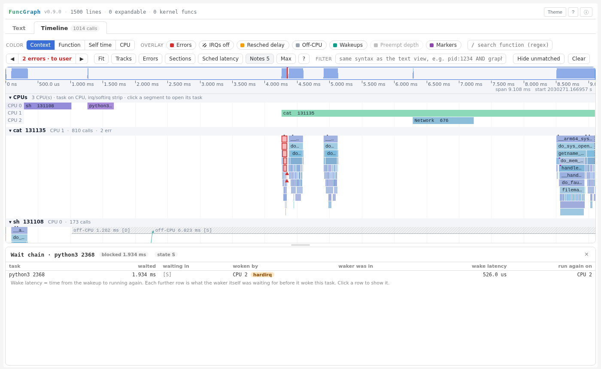

*Wait chain (tests/data/pi4_sched.txt): `python3` slept 1.934 ms, was woken by a hardirq on CPU 2 and ran again 526 us later.*

One row per wait, starting with the clicked off-CPU segment:

| Column | Meaning |
|---|---|
| task / waited | task and wait time |
| waiting in | function it waited in (first frame on the stack that is not scheduler code), state at switch-out in brackets |
| woken by | the waker, with a context tag if the wakeup came from an interrupt |
| waker was in | what the waker was doing: the first frame above `try_to_wake_up`, `__wake_up*` and similar, e.g. `anon_pipe_write` |
| wake latency | time from the wakeup until the task ran again; red above 1 ms |
| run again on | CPU it resumed on |
| link gap | for a temporal candidate: time from this row's resume to the wakeup in the preceding row; the selected wait has no link gap |

The selected row and its associated wakeup are recorded observations. Each further row is only a **temporal candidate**, not proof that its wait caused the preceding wait: it is the waker's latest completed off-CPU interval ending at or before the wakeup in the preceding row, with a gap of **at most 50 ms**. The notice above the table always shows this distinction; expand it for the detailed explanation. If several wakeup events are associated with one wait, the last recorded event is displayed. The footer explains why traversal stops: missing wakeup, idle/CPU-only waker, interrupt context, no prior completed wait, a gap above 50 ms, or a repeated interval. Without timestamps only the selected interval is shown; no temporal links are inferred.

**Load more waits** appends 100 rows without replacing the existing rows. **Export chain CSV** resolves and exports the entire chain, including rows not yet displayed, with original off-CPU/task indexes, raw timestamps or call-order units, link gaps, the 50 ms limit, and the terminal reason. Export does not expand the table. All tasks remain in scope regardless of the text filter; Overhead never changes recorded scheduling geometry or latency. Clicking a row, or pressing Enter/Space on its task button, reveals its task and waker and zooms to the interval without replacing the panel.

An interval still open at trace end shows **≥** before its duration; this is a lower bound. Its resume CPU and wake latency are not known, and CSV leaves the end/resume/latency fields empty with `end_status=trace_end_lower_bound`. Recorded waiting information remains available even without scheduler events; the panel then also explains how to capture them. Long task/function names cannot push the close/export controls outside compact windows; wide tables scroll inside the panel.

The waker is taken from `sched_waking` when available: it fires in the waker's context. `sched_wakeup` can fire in an IPI on the target CPU, and the waker would then look like idle. Enable `sched_waking` when capturing; `fgcapture.sh --sched` does.

### 7.6 Scheduling latency (Sched latency)

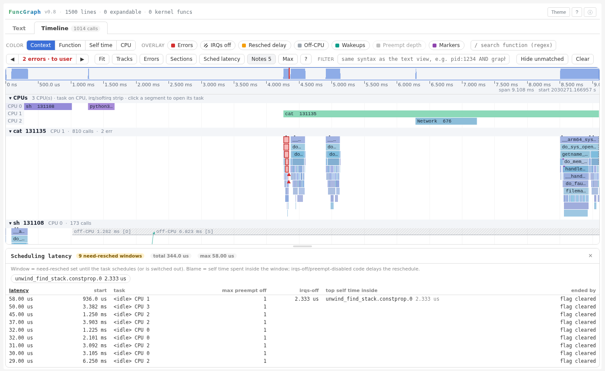

*Sched latency panel (tests/data/pi4_sched.txt): each need-resched window with its length, deepest preempt off, and self-time estimates for irqs-off calls and the leading functions.*

Each **need-resched window**, from setting the need-resched flag until the task is switched out or the flag is cleared:

- Tags: number of windows, total, longest. Below them, the top 8 functions by estimated self time across **all matching functions in every retained window**, not just each window's top three. These are investigation leads, not proof that a function caused the delay.
- Columns: latency (red above 100 us in timestamped modes), start, task, max preempt off (maximum preempt depth above the trace baseline), irqs-off self (est.) (proportional self estimate for matching calls whose entry has irqs disabled, **not an exact irqs-off interval length**), top self (est.) (the three leading functions and estimates), ended by (flag cleared / switched out / trace end). Every header sorts: start / task / ended by ascend, the others descend; ties keep original window-index order.
- Clicking a row selects the window in the timeline.
- Each page has at most 300 windows; **Previous / Next** replaces the page without accumulating rows. Reopening and Text round trips preserve the page; changing sort, the shared filter or Overhead returns to page one. **Export CSV** exports all windows in the current filter and sort order, not just the page. Fields include `window_index`, original coordinates and window duration, maximum preempt depth, whether irqs-off was observed, `irqoff_self_estimate_ns`, end reason, top-three self estimates and the same mode, estimation-basis and filter metadata as Sections. Count-mode duration fields use `_units` instead.
- As in Sections, filtering tests real-call overlap per window; count / total / max use retained windows' original lengths, while self estimates include matching calls only. Overhead changes only self estimates. A per-track, per-depth overlap index avoids full-track scans for every window; sorting and pagination reuse the prepared statistics.

Needs `latency-format` and timestamps.

### 7.7 Task navigator (Tasks)

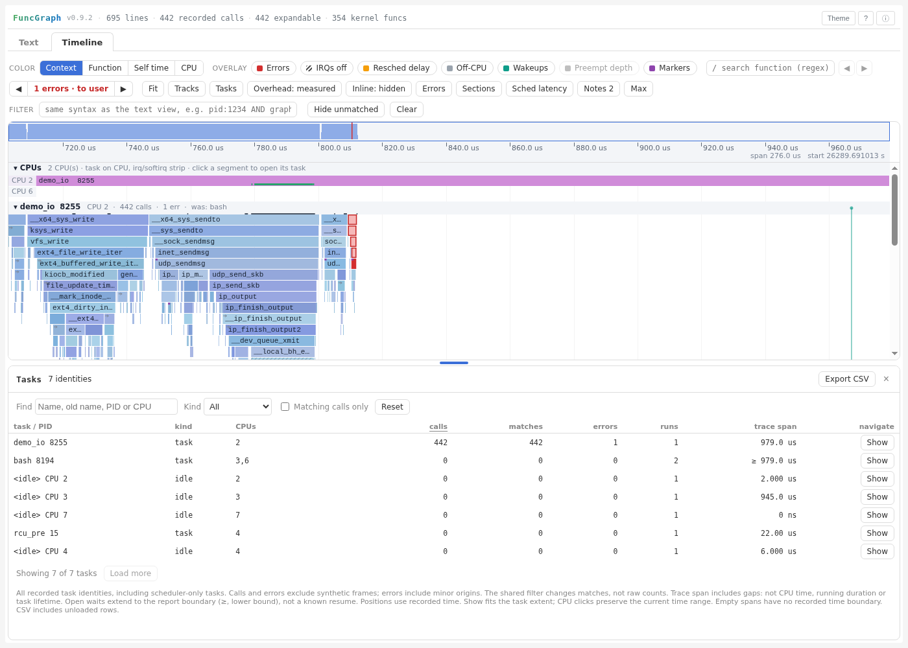

*Tasks in sample.html: all seven recorded identities are accessible, including six without traced calls. The time range includes the scheduling tail after the last call.*

- **Find** performs case-insensitive literal matching on current/old names, PID and CPU labels; characters such as `[` are not regular expressions. **Kind** distinguishes tasks, idle, CPU fallback and all-task fallback identities. **Reset** clears these controls and any single-task scope from a CPU click.
- Columns show task/PID, kind, observed CPUs, real calls, shared-filter matches, error origins **including minor chains**, recorded run-interval count, and trace span. Click sortable headers: task names sort ascending; numeric statistics sort descending; ties retain original task order. CPU 0 is retained. Synthetic inline/untraced frames never increase call/error counts.
- **Trace span** is the earliest-to-latest extent of this identity's call/run/wait/wakeup/window records, including gaps: **not CPU time, running duration or task lifetime**. Open waits extend to the report boundary and mark the span `≥` (lower bound), never a known resume. Identities without any boundary show `—` and disable Show. Count mode uses call-order units; compressed mode uses packed durations, not real elapsed time.
- **Show** reveals and expands the task's track and fits its extent, clearing stale slice selection while retaining Tasks. It does not populate the canvas with every scheduling-only task. The existing **Tracks** button still folds/unfolds tracks; Tasks does not add separate visibility controls.
- Pages contain at most 100 task identities; **Previous** / **Next** replace rows instead of accumulating them. Ordinary refreshes and reopening retain the page; new queries, kinds, sorts or match conditions start at the first page. The pager stays at the bottom of normal-height panels, but scrolls normally in very short panels to avoid covering controls. Touch paging, Show and export buttons are at least 44px tall. **Export CSV** includes every row in the current query/kind/matching/single-task scope and order, including unvisited pages. Exports carry original indexes, aliases/CPUs, counts, boundaries/span, open-wait and lower-bound flags, position/span bases and query/shared-filter metadata. Count-mode position columns use `_units`, other modes `_ns` with an explicit recorded/packed basis. See the [task paging performance record](performance-tasks.md) for measurements and limits.
- Compact touch layouts initially hide task search and filters behind **Filters** in the pager; **Filters · on** indicates an active query, kind or matching constraint. Collapsing controls or resizing preserves those conditions. Desktop shows the controls directly, leaving mobile's initial viewport room for task rows instead of only filters.
- The shared filter affects the matches column and optional **Matching calls only**, not raw counts or task bounds. Overhead/Inline do not change these facts. Statistics are prepared lazily once; sorting, querying and reopening reuse them. Narrow layouts keep controls horizontally reachable and long names to two lines (full value in tooltip/CSV).

### 7.8 Direct recorded children (Explore all children)

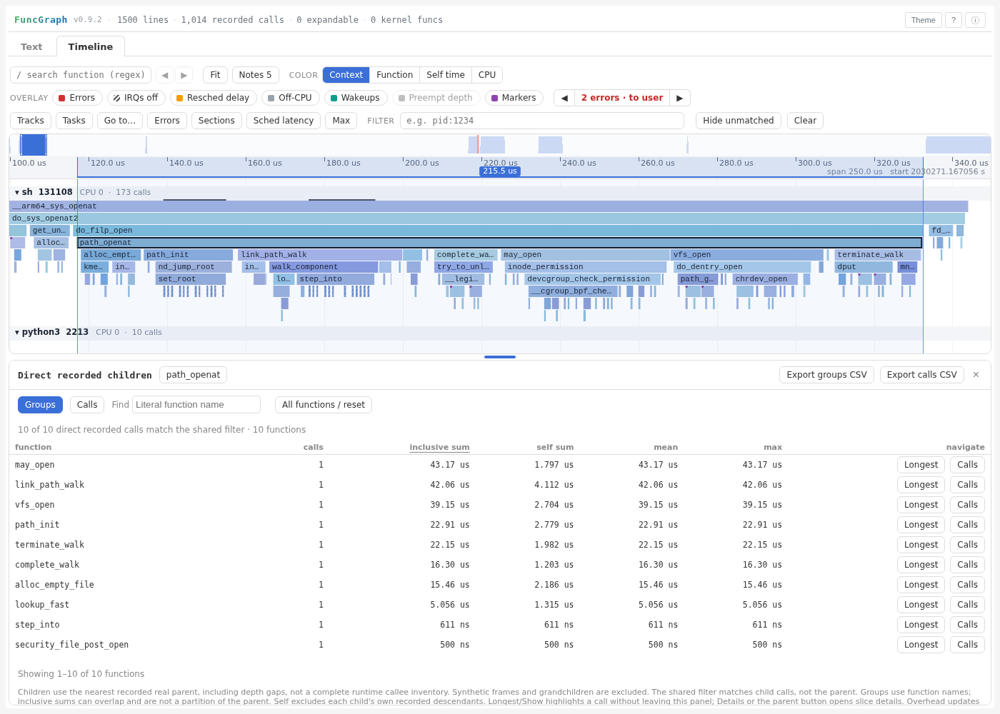

*All ten direct recorded functions of `path_openat` in tests/data/pi4_sched.txt, instead of just the eight preview entries.*

- Open a real call's details and choose **Explore all children**. **Groups** lists every function's count, inclusive sum, self sum, mean and maximum; **Calls** lists individual children with duration/self, original start, CPU and call site. Native sortable headers use ascending name/start or descending numeric values, with original slice-index ties.
- **Calls** in a group row scopes the call list to that function under this one parent; **All functions / reset** clears this scope and the literal, case-insensitive **Find** query. It does not clear the shared filter. Both CSV buttons export all current-query/function-scope/shared-filter rows in their respective sort order, even when that mode has not been opened or its pages are unloaded.
- **Longest** and **Show** select and zoom to the actual recorded call without replacing this panel; **Details** opens that call's full details. The parent-name button returns to the parent's details. The preview also chooses the actual longest occurrence; equal durations retain the first original slice index.
- The relationship is the **nearest recorded real parent**, not a complete runtime callee list. Depth gaps may hide intervening untraced/inline execution; synthetic frames and grandchildren are not counted as direct children. Groups use function names; individual exports retain module/call site/arguments/return value and original slice/trace/task/depth indexes, including the depth gap.
- Inclusive sums can overlap and are **not a partition of the parent**; self excludes each child's own recorded descendants. The shared filter matches children, not the parent's line. An empty child scope remains open with reachable reset controls. The compact preview remains unfiltered context, while this explorer shows matching children.
- **Previous 100 / Next 100** retains at most 100 rows per page, with the current interval and full total. Visited pages no longer accumulate in the DOM. Groups / Calls remember independent pages; single-page and empty scopes hide navigation. CSV always includes every matching row, not just the current page.
- Sorting resets only the active mode's page; Find, function scope and reset clear both pages. Shared-filter changes reset both when the actual child membership changes, not on equivalent-set notifications. Overhead can change estimates and ordering while preserving pages, selection and recorded positions; Inline adds no synthetic calls. Text round trips and inspecting a child then returning to the same parent retain pages; exploring a different parent resets the scope and mode.
- Membership and duration aggregates remain cached for the current parent, separately from filter/query/sort results. Paging bounds displayed DOM, not total data memory or first aggregation cost. Compact touch paging, export, sort and row-action buttons are at least 44px high; Find uses 16px text. See the [child paging measurements](performance-child-paging.md).
- CSVs retain parent identity, full group/call metrics, first/longest indexes, relationship/query/filter scope and explicit duration/position bases. Count-mode values use `_units`; compressed positions are packed durations, not elapsed time. CSV quoting/formula protection and safe long-name tooltips match the other panels. Wide tables keep the title/tools/footer horizontally reachable; compact titles scroll vertically.

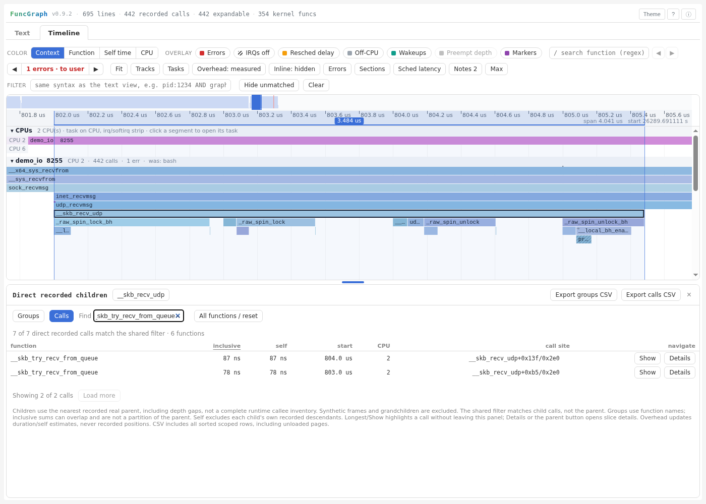

*The two `__skb_try_recv_from_queue` calls directly under this sample's `__skb_recv_udp`, scoped to this parent rather than every occurrence of the function in the report.*

## 8. Compare view

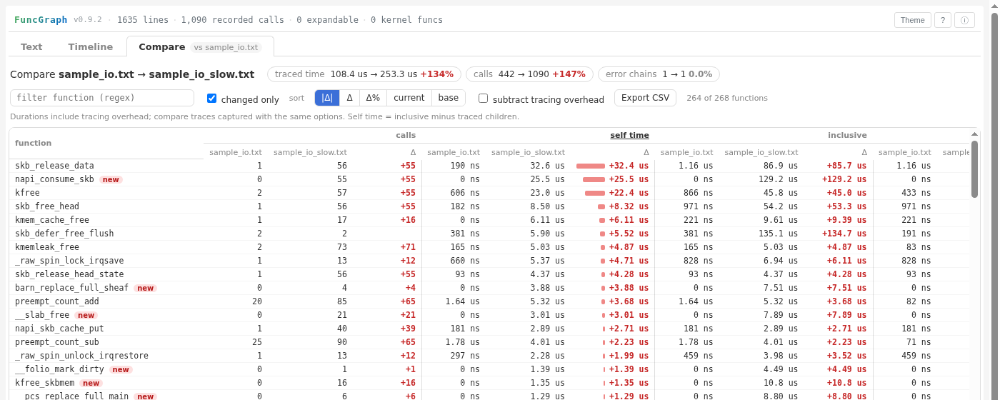

*Comparing the historical samples/sample_io_slow.txt (7.2.0+) with the current samples/sample_io.txt (7.4.0-rc2). This illustrates per-function differences between captures, not a controlled performance regression benchmark: kernel versions, tracing overhead and the work performed differ.*

```bash
python3 funcgraph.py --compare before.txt --output cmp.html after.txt
```

The current trace (`after.txt`) and the base (`before.txt`) are rebuilt the same way and summarized per function; pre-filters apply to both. `--timeline` is not needed: sorting controls and browser CSV export work independently.

**Return types and modules:** with `--vmlinux`, `--btf` and `--module-dirs`, each side selects types for its own recorded modules, including modules present only in the baseline. The current trace's module database is not imposed on the baseline. Parsed kernel and module BTF is reused within one report; a new report reads it afresh, even in the same Python process. These paths still apply to both sides: supply matching binaries, not two unrelated kernel builds expecting automatic version matching. Missing types remain unverified; a negative value alone does not prove an error.

- **Tags at the top**: changes of traced time (total of outermost calls), calls and error chains. Changes under 5% are grey, increases red, decreases green. A yellow warning appears when the two traces have different time modes (e.g. one without timestamps).
- **Table**: for every metric three columns: base, current, Δ.

| Metric | Meaning |
|---|---|
| calls | number of calls |
| self time | self time (inclusive minus the traced direct children) |
| inclusive | total time |
| mean incl | average total time per call |
| max | longest call |
| errors | error origins |

- **Δ colors**: **red** increase, **green** decrease, **grey** under 5%. The bar next to the sorted metric shows the size of the change. **new** after a name: only in the current trace; **gone**: only in the base.
- **Controls**: function regex filter; **changed only** retains changes in any of calls, inclusive time, self time, maximum duration, or errors; sort by `|Δ|`, `Δ`, `Δ%`, `current`, `base`; click a header to choose the metric. With overhead estimates for both traces, **subtract tracing overhead** appears. An empty result displays an explanation.
- **Narrow windows and scrolling**: table height adapts to the viewport and controls above it. Function names stay pinned when scrolling horizontally, and headers stay pinned vertically. Use Tab to focus the table region and arrow keys to scroll; hover over a truncated function name to see it in full.
- **Export CSV**: downloads every matching function in the current regex, changed-only, sort, and overhead-adjustment state, not just the loaded rows. No report regeneration is needed. Pending filter input is applied before export; invalid regexes show an explanation and disable export, as do empty results. Press Enter to apply a filter immediately.
- **CSV format**: `function` is followed by `base_`, `current_`, and `delta_` columns for each metric; deltas are current minus base. Duration column names end in `_ns` (nanoseconds); calls and errors are counts. Files use UTF-8 with a BOM and escape commas, quotes, and line breaks. Formula-like function names are prefixed with an apostrophe for spreadsheet safety. The filename distinguishes `raw` from `adjusted` durations; summary pills always retain measured values.
- **Large tables**: initially loads up to 400 rows; the bottom prompt appends up to 1000 at a time without replacing existing rows or sorting again. Filtering, sorting, and overhead changes recompute the result. Delta bars share a scale across all matching results, so loading more rows does not change earlier bars.

The traces should have similar tracing overhead (same options, same machine) for the differences to mean something.

## 9. Export and automation

`--export FILE.json` or `--export FILE.csv` writes the analyses next to the HTML; `--timeline` is not needed:

```bash
python3 funcgraph.py --export result.json --output report.html ftrace.txt
```

Durations in the JSON are in ns, times relative to the first event:

| Key | Content |
|---|---|
| `meta` | trace name, time mode, capabilities (caps), overhead estimate, number of calls |
| `functions` | per function `name, calls, total, self, max, p50, p90, p99, errors`, sorted by self |
| `errors` | per error chain `origin, top, entry, errno, name, fate` (user / handled / escaped) `, verified, frames, task, pid, start` |
| `sections` | critical sections `kind` (irqs_off / preempt_off / bh_off) `, duration, task, pid, start, started_in, ended_in, max_depth` |
| `sched_latency` | need-resched windows `task, pid, start, duration, max_preempt, irqs_off` |
| `atomic_sleep` | sleeping functions in atomic context `function, reasons, parent, task, pid, start` |
| `off_cpu` | off-CPU segments `task, pid, start, duration, waiting_in, state, preempted, woken_by` |

The CSV contains only the `functions` table.

A CI check:

```bash
python3 funcgraph.py --export r.json --no-text-view --timeline --output r.html ftrace.txt
python3 - <<'EOF'
import json, sys
d = json.load(open('r.json'))
f = {x['name']: x for x in d['functions']}
if f.get('vfs_read', {}).get('p99', 0) > 50_000:            # p99 above 50 us
    sys.exit('vfs_read p99 regression')
if any(s['kind'] == 'irqs_off' and s['duration'] > 200_000 for s in d['sections']):
    sys.exit('irqs off for more than 200 us')
if d['atomic_sleep']:
    sys.exit('sleeping function called in atomic context')
EOF
```

## 10. FAQ

**The report is too large; the browser is slow or does not open it**

The text view creates DOM for every line; above ~150k lines the console warns. Either narrow the trace with a pre-filter (`--pid`, `--comm`, `--graph`, `--time-range`) or build only the timeline with `--timeline --no-text-view` (measured: 362k lines → 15.7 MB, opens in about a second).

To keep source analysis without Text rows, use `--timeline --no-text-view --keep-source --vmlinux vmlinux --kernel-src /path/to/linux`. The ordinary lightweight `--no-text-view` behavior stays unchanged. The opt-in retains the complete resolved source pool, inline chains and original trace-line IDs, but not the per-line Text DOM; Text jumps still report that the view was omitted. The source panel has its own **Source: chain/flat** button, accessible by click, Enter or Space without collapsing the panel; it stays synchronized with the Text toolbar. Source resolution can increase generation time and report size. This remains an embedded, offline-compatible report, not asynchronous source chunk loading, Text virtualization or automatic sidecar output.

When keeping Text, leave the report on **Timeline** or **Compare** before reopening it. The saved tab is read early enough to suppress Text rendering before trace lines are parsed; the theme is restored then too, and initialization does not focus hidden text rows. Text and source content remain available for filtering, folding and navigation when switching back. A `#Lnumber` link takes precedence and opens Text; `--no-text-view` reports still default to Timeline.

When the embedded **Timeline JSON is at least 1 MiB**, the first opening also uses **staged preparation**. A status announces reading data, preparing columns, building inline/untraced frames, indexing tracks and drawing. This threshold concerns JSON characters, not the HTML file size or trace line count. Small reports and already initialized timelines keep their synchronous path.

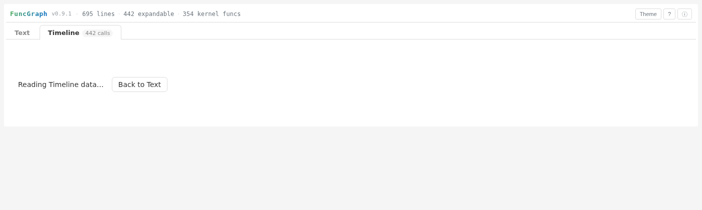

The screenshot pauses the real sample's first preparation stage; it does not depict an already usable Timeline. **Back to Text** or **Escape** returns to the previous Text scroll position and focuses its tab. Switching to Text or Compare also cancels pending preparation; reopening starts fresh rather than reusing an incomplete model. Alt-clicking a Text line waits for completion before selecting it, and a canceled request cannot later switch the view back. Preparation failures show a safe error message and the same return button. Native buttons support Enter/Space, including before Timeline shortcuts are installed.

Preparation stays on the **main thread**. New reports cooperatively batch inline/untraced-frame scans, deep expansion, column copies and filling, and track grouping/sorting. Rows already ordered by time/original identity are not resorted; long unordered rows use chunk sorting and merging. Batching does not drop calls, alter synthetic frames or publish a partial canvas; cancellation still rebuilds from complete original data. The cooperative 8 ms work budget is not a hard limit: JSON parsing, allocation, individual native operations, style/layout and garbage collection can still block. Painting the status and allowing cancellation do **not** mean the canvas is ready; finer batching can increase total preparation time. This is not a Worker, windowing or a memory bound. The full Text DOM is still present. For a large report without saved state, pre-filtering or `--no-text-view` remains recommended. Regenerate older reports to use this behavior; see the [Timeline preparation measurements](performance-timeline-preparation.md) for reproduction and comparisons.

Default single-file generation streams UTF-8 sections and atomically publishes after rendering; failures preserve the previous file. Its output must be a regular file (not `/dev/null`, a FIFO or a directory); the destination directory must be writable. Existing file permissions/output symlinks are preserved. The legacy `generate_html()` string API remains available. Explicit `--report-mode sidecar` instead publishes a dedicated directory with deferred-full Text delivery. Optional `--timeline --report-mode auto --sidecar-threshold BYTES --output DIRECTORY` selects sidecar only when the complete uncompressed UTF-8 HTML strictly exceeds the explicit byte threshold; otherwise that directory contains an offline `index.html`. No default threshold, line-count trigger or Text virtualization is provided. The CLI reports its decision; `fgview DIRECTORY` opens either result, and `fgreport --open` serves directory modes until Ctrl+C. See the [viewer guide](viewer.md) for configuration, safe updates and temporary disk requirements. Generation still resolves the complete trace; see the [generation measurements](design.md#83-分段写出的生成阶段内存2026-11-10), including near-unchanged peak RSS with kernel symbols.

**The timeline has no gaps and says compressed time**

The trace was captured without `funcgraph-abstime`.

**No interrupts, irqs-off or scheduling latency**

`latency-format` was off. Without the flags column the context is inferred from interrupt entry functions and marked `(inferred)`.

**Lots of bogus errors such as `do_raw_spin_unlock = -1`**

Leftover register values of void functions. Give a vmlinux with a `.BTF` section (`CONFIG_DEBUG_INFO_BTF=y`) or `--btf` with `/sys/kernel/btf/vmlinux` copied from the target, and return types filter them out. Kernels with BTF-aware retval do not print `ret=` for void functions at all.

**`funcgraph-args` is on but no arguments appear**

On 6.18 and similar kernels arguments are not printed while `funcgraph-retaddr` is on. Capture with `fgcapture.sh --args`, which handles this.

**Source lines do not match**

The source is a different version than the vmlinux. Check the Source line in the ⓘ info panel, or use `--source-rev` with the revision the vmlinux was built from.

**Some slices are blank in the overview and appear only when zooming in**

A drawing bug of older versions, fixed. Regenerate the report.

**The waker in a wait chain is `<idle>`**

The wakeup came from an interrupt, or the trace has `sched_wakeup` but no `sched_waking`. Capture with `--sched`, which enables `sched_waking` too.

**One trace file per CPU**

Pass them all to funcgraph.py; they are merged by timestamp.

**Source code on a machine without a kernel tree**

Use `--source-url` with `--source-rev`. Building the report needs network access (downloads are cached); the report itself is a single offline file.
