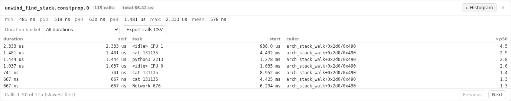

# Bounded duration-call browsing

November 12, 2026. This follow-up targets the **Slowest calls** list in Timeline's
**Duration distribution**, not report startup or the complete large-trace model.
Regenerate existing HTML to get the new controls.

## Behavior and evidence semantics

- **Previous / Next** replace pages of at most 50 calls. Attached call rows do
  not accumulate as the user visits more pages. The status reports the current
  range and full matching count, in descending duration / original-index order.
- Ordinary refreshes and reopening retain the page. A changed function, call
  site, shared-filter population, duration bucket or Overhead population starts
  at page one. Keyboard endpoints transfer focus to an enabled direction;
  unchanged-population refreshes restore the focused control.
- The pager stays within the call-browser section, not over the later call-site
  or Slow vs fast tables. Very short panels place it above the table in the
  normal scroll flow. Touch paging, bucket and export controls have 44px
  minimum heights. Temporary expansion remains available for cramped panes.
- Initial pages now contain up to 50 calls in both the whole-population and
  bucket views. Previously, the initial whole-population list had 15 calls and
  each **Load more** appended 50; bucket views started with 50.
- Full function/call-site percentiles, totals and histogram/cohort populations
  do not become page statistics. Selecting a duration bucket still changes the
  call list and export, not those overall statistics or Slow vs fast cohorts.
- CSV exports every call in the current function/shared-filter/site/bucket
  scope, not just the current page. Quoting, formula protection, numeric bucket
  bounds, raw/adjusted durations, recorded positions and time bases are unchanged.
  A row click still highlights its real call without closing the distribution.

## Reproduce the comparison

Use single-file Timeline templates generated with the same input and CLI
options, including `--timeline --no-text-view`: one from `7af143b3b6a4` and one
with this change. The benchmark substitutes identical non-overlapping synthetic
calls of one function from one call site into both templates. The original
template models match except for measured `stats.build_time`.

```bash
python3 tests/benchmark_distcalls.py before.html after.html \
    --calls 5000 --rounds 3 --output duration-call-benchmark.json

PYTHONPATH=tests:. python3 -m unittest test_dist_paging -v
```

The browser opens a fresh page per measurement, in one Chromium process, and
alternates before/after order between rounds. It opens the distribution and
traverses the complete call list, asserting that every original identity is
visited. Each paging action waits for two animation frames. Handler times and
two-rAF intervals are not complete paint/TTI measurements; programmatic clicks
do not model reading time or scrolling to an offscreen old control. The fixture
is not a new capture. Startup, CSV cost and peak memory are not measured.

## Measured result

The paging comparison committed as `a7ea8256f3b7` uses Chromium `145.0.7632.6`,
a 1500 × 900 viewport, 5,000 synthetic calls and three
alternating before/after rounds. Both templates have identical Timeline models
apart from generation time. These are medians, not latency guarantees.

| Metric | Before: append rows | After: replace pages |
| --- | ---: | ---: |
| Initial attached call rows | 15 | 50 |
| Maximum / final attached call rows | 5,000 | 50 |
| Distinct calls visited | 5,000 | 5,000 |
| Final elements inside the distribution panel | 35,075 | 429 |
| Initial open handler | 10.3 ms | 7.4 ms |
| All paging handlers, summed | 30.2 ms | 45.6 ms |
| All two-rAF paging intervals, summed | 3,208.2 ms | 3,285.2 ms |
| Paging actions after the initial list | 100 | 99 |

The verified gain is the retained call-DOM bound and reversible navigation,
**not faster complete traversal**: this run has higher summed paging-handler
cost and slightly longer frame intervals. The new handler also aligns the list
under its header. Initial rendering and action counts differ because the first
page grows from 15 to 50 calls. Opening times vary; the lower observed open time
does not establish a general latency improvement or an overall memory bound.

## Real-report verification

Regenerated reports from the existing `tests/data/pi4_sched.txt` (1,014 calls)
and `samples/sample_mixed.jsonl` (714 calls), before and after this change. Their
Timeline models match except for measured `stats.build_time`; no public capture
or sample HTML was replaced.

The representative distributions are `unwind_find_stack.constprop.0` (115 calls,
three pages) and `preempt_count_sub` (55 calls, two pages). Each was checked in
single-file and actual CLI-generated sidecar reports, both themes, and desktop
(1400 × 860), touch portrait (390 × 844) and touch landscape (844 × 390):
24 report configurations. Every call was reached using native Enter/Space
paging; returning to page one restored its original call identities. CSV bytes
before, during and after paging match the old report exactly, and all displayed
min/p50/p90/p99/max/mean values remain unchanged. No page errors or document-wide
horizontal overflow were observed. Touch controls meet the 44px minimum; short
landscape checks use the explicit temporary detail expansion.

`docs/img/an_dist.png` is refreshed from the real Pi4 report. The screenshot uses
a manually enlarged detail pane and collapsed notes, rather than claiming that
the default pane fits the histogram, every control and call rows simultaneously.
The pager is scoped to the call section and does not cover subsequent call-site
or comparison tables.

## Batch large distribution opens

The first open reads the function's indexed calls, sorts them by duration and
original slice index, and computes site totals and histogram buckets. It runs
with a short initial budget; large populations continue in batches with a
**Preparing duration distribution…** status and reachable Close control.
Switching views pauses the work. Closing or replacing the panel, changing the
function, shared filter, or Overhead basis discards stale work. The completed
population cache and exact statistical and export scopes are unchanged.

Five alternating Chromium 145 runs per variant at 4× CPU throttling (200,000
synthetic calls of one function) measured these medians:

| Metric | Before | After |
| --- | ---: | ---: |
| Open handler | 100.3 ms | 10.8 ms |
| Longest frame gap | 126.0 ms | 32.4 ms |
| First page ready | 101.1 ms | 177.5 ms |

The first page, statistics, bucket labels and full CSV had matching hashes.
The table measures interaction responsiveness, not faster completion or
reduced total memory. Reproduce using `tests/benchmark_dist_open.py`; the raw
run is in `build/benchmarks/20261120-dist-open/ab.json`.

## Batch large duration-call exports

Below 4,096 rows, export still downloads directly. Larger scoped exports use
the shared Timeline CSV queue and show progress and **Cancel CSV**. Changing
pages or hiding the histogram does not change the export scope. View changes
pause work; changing the population or bucket, or closing or replacing the
panel discards it. The download starts only after all rows have been written.

Five alternating Chromium 145 runs at 4× CPU throttling on 100,000 synthetic
calls measured these medians:

| Metric | Before | After |
| --- | ---: | ---: |
| Export handler | 440.4 ms | 1.2 ms |
| Longest frame gap | 441.8 ms | 31.0 ms |
| Download ready | 440.4 ms | 597.0 ms |

Views and full downloaded CSVs had identical hashes. Responsiveness improves
at the cost of file readiness time; buffering still grows with output size.
Reproduce with `tests/benchmark_dist_open.py --export-csv`; raw results are in
`build/benchmarks/20261120-dist-csv/ab.json`.

## Validation

The paging change (`a7ea8256f3b7`) was validated as follows:

- Ten dedicated browser tests cover 1/50/51/103-call boundaries, every identity
  in 5,207 calls, stable tie order without sorting during paging, native keyboard
  endpoint focus, bucket/site/shared filters, empty populations, refresh/reopen,
  Overhead, all four time bases, full CSV and touch sidecar/expansion behavior.
- The focused distribution, cohort, task-paging, detail-expansion and lifecycle
  selection passes all 80 tests. Exporting only this change over its parent,
  without the pending Text work, independently passes the ten new tests and all
  15 existing distribution/cohort regressions.
- The 24 real-report configurations above preserve complete CSV bytes and
  displayed distribution statistics, rather than only checking row counts.
- `FG_RAW_REQUIRED=1 FG_UFTRACE_REQUIRED=1 FG_SAMPLE_BROWSER_REQUIRED=1 tests/run.sh`
  runs 897 tests: 893 pass, three skip and one fails in the preserved, uncommitted
  Text work. The failing
  `test_textchunks.TextChunkBrowserTest.test_native_layout_skips_offscreen_blocks_without_dropping_complete_records`
  expects bare pixel lengths, while Chromium's computed
  `containIntrinsicBlockSize` includes the `auto` prefix. This is not an
  all-green full audit. That Text test and its associated source/index changes
  are neither modified nor included in this duration-call change.

## Compact histogram follow-up

The paging change exposed a cramped-layout limitation: the Pi4 distribution's
default 275px desktop and 270px touch-portrait panes showed no complete call
rows at scroll position zero. A header **Histogram** button now lets the user
collapse just the chart and arrange all six statistics compactly, rather than
automatically hiding evidence or changing the saved pane height. The chart is
still open by default. Its explicit `aria-expanded` / `aria-controls` state and
native Enter/Space behavior remain available in both themes and report modes.

The choice is held only by this Timeline instance: refreshing the analysis,
changing filters/function/call site/Overhead, closing/reopening or switching
views retains it; reloading the report resets it. Toggling does not replace call
rows, sort/aggregate again, change the current page or bucket, select a call,
alter the measured view range, export scope or stored `fgTl.detailFrac`.
Collapsing does not stop normal population preparation for filters; it only
avoids scheduling histogram painting. Reopening redraws at the current size,
theme and bucket. This is not an out-of-core or whole-trace performance claim.

The six statistics, full CSV bytes and model data were compared with the old
reports for the same 24 Pi4/mixed configurations. In the compact view, both
representative functions show at least six complete call rows on desktop and two in
portrait, without changing the default pane height. Short 844 × 390 landscape
uses the existing explicit detail expansion and then shows one complete call
row; that landscape result is **not** a same-height comparison with the old 67px
unexpanded pane. All matching calls remain reachable with the native pager.
No document-wide horizontal overflow or page errors were observed.



The compact screenshot is a native crop of the real Pi4 report at the default
275px pane height. The expanded `an_dist.png` remains a manually enlarged pane;
neither screenshot is a new capture or a reconstructed drawing.

### Expanded touch landscape (2026-11-20)

At 844 × 390, both the collapsed histogram layout and the original open
layout could leave no complete call row between the heading and pager, even
after explicitly expanding details. The short touch-landscape layout now
puts the histogram and statistics alongside the call table when open. The
graph is shorter only in this layout, with its bitmap resized to the CSS box
and tick labels spaced to avoid overlap. With Histogram closed, the statistics
remain compact and the table uses the full width.

Chromium touch emulation at 844 × 390 showed one complete call row with the
histogram closed and two with it open at the top of the expanded pane for the
distribution regression fixture. Tests cover light and dark themes, embedded
and HTTP sidecar reports, 44px controls, and unchanged statistics and CSV.
A 2× device-pixel-ratio test verifies that tapping a visible bucket selects it
and that portrait rotation restores the standard chart height without losing
the bucket. Even shorter or wider-content panes may still require scrolling.

Six follow-up tests extend the dedicated duration suite to 16 tests. They cover
native disclosure focus and retained DOM/navigation/CSV, report-local lifetime,
hidden-canvas paint avoidance and current-size redraw, compact touch layouts in
both delivery modes/themes, empty populations and 320px long-name/value layouts.
All 86 focused distribution/cohort/task/lifecycle/detail tests pass; an exported
parent-plus-change tree without the pending Text work independently passes all
16 duration tests and 15 existing distribution/cohort regressions. The 24 real
report checks also switch to Text and back, preserving the collapsed state,
call page, statistics and complete CSV.

The required-native full worktree audit now runs 903 tests: 899 pass, three skip
and the same preserved, uncommitted Text computed-style assertion described
above fails. This follow-up does not fix or include that unrelated Text work,
and the full audit is not described as all-green.

## Histogram bucket preparation

Each bucket references a contiguous range of the existing duration-sorted
population instead of retaining another array of call IDs. Binary searches
find the boundaries for nonempty buckets using the same logarithmic assignment
rule. Paging copies only the visible page; CSV iterates the entire selected
range in the same order. If the trace contains recorded errors, error shading
still checks for an origin within each occupied range.

On a 20,001-call synthetic distribution with ties, zero durations and values
around powers of ten, the synchronous open measured 20,003 calls to `Math.log10`
before and 117 after. The test traverses every occupied bucket and checks call
identities against the per-call assignment. This is a work count, not a
measurement of total open latency or peak memory.

For the active function, the overview histogram and up to four recently used
call-site histograms are retained. Switching scopes still resets the call page
and bucket selection; changing function, filter membership or Overhead metrics
replaces the population and its cache. On a 600-call fixture with five sites,
returning to the overview made 158 synchronous `Math.log10` calls before this
cache and none after. Revisiting a resident site also reuses its bucket ranges;
a site evicted by newer visits is rebuilt on demand.

## Reusing the Timeline search index

If Timeline Find already indexed the report, the distribution looks up the
exact recorded name ID in that index and copies only its matching calls for
duration sorting. It neither reads the full call-name column nor modifies the
index that Find uses for navigation. Opening a distribution without a prepared
index still makes one scan and does not allocate a new index.

In a 32,768-call test that opens the distribution after Find, the lookup uses
three recorded names and five postings for the target. A similarly named
compiler variant stays separate, filters still apply, and Find continues to
navigate in recorded order. These are work bounds, not timing measurements.

## Slow vs fast profile pages

Opening the comparison scrolls its toolbar into view, targeting the space
below the pinned detail header or the top of a short pane. Focus stays on the
expanded toggle. No horizontal scroll or Timeline movement is requested.

The profile now replaces pages of up to 100 rows. The pager is above the
table and stays reachable when the pane scrolls horizontally. A page change
brings it back into view rather than leaving focus below the replaced rows.
At the first and last pages, focus transfers to the enabled direction.
Collapsing and reopening retains the page; sorting or changing the function,
shared filter, call site, or Overhead population returns to the first page.
The duration bucket is independent. Both CSV exports retain their full scope.

In the 150,004-row synthetic profile, one forward action increased attached
rows from 100 to 200 before the change; afterward it replaced those rows and
kept exactly 100. A separate 229-row browser test traverses the complete order,
revisits prior pages, and matches the full profile CSV from the last page.
This is a DOM bound, not a measurement of cohort preparation or latency.

## Batch large Slow vs fast profiles

The comparison uses a short initial budget, then yields during the call-tree
index, descendant traversal, cohort aggregation and ordering. The ready view
and its export actions replace the status only after preparation completes.
Changing the profile sort also yields on wide results and restores keyboard
focus to the sort button if focus has not moved away. The work pauses in
another view and is discarded when the comparison is hidden or replaced.

Chromium 145 at 4× CPU throttling: five alternating pairs on 150,000 synthetic
descendants, and three pairs on the `handle_mm_fault` profile in `ping3`.
Times are medians in milliseconds.

| Profile | Click handler, before → after | Longest frame gap, before → after | First page ready, before → after |
| --- | ---: | ---: | ---: |
| Synthetic wide subtree | 252.5 → 9.5 | 265.3 → 36.7 | 252.5 → 336.0 |
| Real `handle_mm_fault` | 43.5 → 7.7 | 57.0 → 40.8 | 43.6 → 58.2 |

Page one and both complete CSVs match in both cases. The measurements show
improved responsiveness, not faster completion or bounded total memory.
Reproduce with `tests/benchmark_slowfast.py`; logs are in
`build/benchmarks/20261120-slowfast-preparation/`.

## Batch large Slow vs fast exports

The profile and cohort buttons use the shared Timeline CSV queue at 4,096
rows or more; smaller exports still download directly. Paging does not
change the export's captured scope. Switching views pauses it; changing the
comparison order, population or timing basis, or closing it, cancels it.
Only one of these two file exports runs at a time.

Five alternating Chromium 145 runs per variant at 4× CPU throttling:

| Export | Rows | Longest frame gap, before → after | Download ready, before → after |
| --- | ---: | ---: | ---: |
| Profile | 100,004 | 479.4 → 27.5 ms | 470.7 → 613.0 ms |
| Cohorts | 60,000 | 263.4 → 28.8 ms | 260.1 → 359.8 ms |

Profile and cohort files had matching hashes before and after; these are
responsiveness gains, not faster download completion or bounded buffering.
Reproduce using `tests/benchmark_slowfast.py --export`; results are in
`build/benchmarks/20261120-slowfast-csv/`.

## Off-CPU lookups in call breakdowns

The selected call and each Slow vs fast root reuse the task's scheduling
interval index instead of scanning all of its off-CPU records. Breakdown
still excludes intervals that merely touch the call, visits records in their
original order, and attributes blocked and preempted time using the recorded
depth. No additional index is built. A long call that intersects most of the
history can still require a scan through most records.

A Chromium regression with 65,536 off-CPU intervals checks the same four
breakdown values for sorted and unordered histories. Either baseline read all
65,536 records; both indexed cases read fewer than 320, including candidates
and binary-search reads.

In Chromium 145, a separate synthetic profile with 240 roots on one task and
65,536 off-CPU intervals measured the synchronous cost of the first
**Slow vs fast** activation (five alternating before/after pairs, fresh pages
without record-counting proxies). With sorted intervals, the median fell from
36.0 to 3.6 ms; with two intervals swapped, it fell from 36.7 to 4.0 ms.
Only the breakdown implementation differed, and both full CSV exports matched
byte for byte. This measures handling and synchronous layout, not trace
loading, browser paint, or end-to-end input latency.

## Single-pass breakdown and cohort traversal

Breakdown walks the recorded call tree once, accumulating self time and
counting descendants without saving them in an array. It counts an interrupt
at the first higher-context frame and stops classifying descendants as
interrupted when the walk leaves that frame's subtree. Slow vs fast visits
the same descendants in the same order, including interrupt descendants; a
cache hit reuses the timing totals while still visiting cohort members.

Seven alternating Chromium 145 pairs on the 58,539-call `ping3` report
(4× CPU throttling, fresh pages, only the breakdown and cohort code replaced)
returned identical breakdown fields and identical profiles covering 861
functions. With the call tree already built, median breakdown for the
11,224-descendant `__x64_sys_execve` fell from 2.0 to 1.6 ms. Median profile
construction over five large calls fell from 14.2 to 6.9 ms with uncached
totals and from 6.6 to 5.2 ms with cached totals. First synchronous selection
varied between runs (51.1 vs. 48.8 ms median); this does not establish an
end-to-end click latency or frame-rate improvement.

Independent regression tests cover depth gaps, nested IRQ/softirq boundaries,
blocked/preempted time, overhead and cached visit order. Synthetic fan-out,
chain and mixed-depth trees with 65,536 descendants each produced identical
breakdowns and cohort profiles. Local samples are in
`build/benchmarks/20261119-trace-jump/stream-breakdown-{ab,synthetic}.jsonl`.

## Call-site pages

The table attaches up to 12 sites, in the existing order by call count and
then name. Turning these pages replaces only the call-site rows; it does not
resort calls or sites, change the active site or bucket, or update the main
call page. Selecting a site moves focus to **All call sites**; clearing it
returns focus to **Histogram** and keeps the site page. After a new shared
filter, an active site that still exists is shown on its new ranked page.
An excluded site remains clearable from the empty calls state.

A 29-site regression visits 12, 12 and 5 rows, checks that the first page is
detached, and verifies that the call list and complete CSV stay unchanged
while paging. Separate browser cases exercise the pager at the horizontal
edge of a 60 px detail pane and tap both directions in a generated sidecar
report with 14 distinct recorded kernel call sites.

## Remaining limits

The main slowest-call list, Slow vs fast profile and call-site table have
separate attached-row bounds. Full Timeline arrays, sorted populations,
per-site groups, histogram ranges, prepared cohort profiles and complete CSV
remain in memory. Without a prepared search index, finding calls for a new
distribution still scans the recording; sorting scales with the matching
calls. These are not bounds on the whole panel's DOM or a measurement of
overall large-trace speed.

## Distribution section shortcuts (2026-11-19)

The header's **Jump to…** menu only lists available destinations. Going to
an analysis section scrolls the detail pane and assigns focus there; it does
not open a collapsed comparison or prepare its profile.

Chromium touch emulation at 320 × 700 with a short pane and a generated
sidecar containing 205 calls at 14 sites verifies the target is visible and
focused after each jump, even with horizontal scrolling at its right limit.
The call-site jump reaches content over 1,000 pixels below the top. The
current call and site pages, complete call CSV, and Timeline range match
before and after. The compact Histogram controls still leave a call row
visible at 390 × 844. These are layout and state checks, not timing claims.

## Consecutive paging in short panes

When the detail pane is under 140 CSS pixels, the call pager moves above the
table. A page turn reveals the first row when it fits without hiding the
controls. Expansion restores the footer placement without changing the page.

On the real `ping3` report at 320 × 700 with the histogram collapsed and a
124px detail pane, selecting **Jump to… → Slowest calls** used to leave the
Next button 893px of scrolling away. The new layout needs no additional
scrolling in that configuration, keeps Next reachable after a page turn,
and displays the same calls on page two. The touch regression also checks
horizontal overflow, keyboard endpoint focus, and expansion and restoration.
