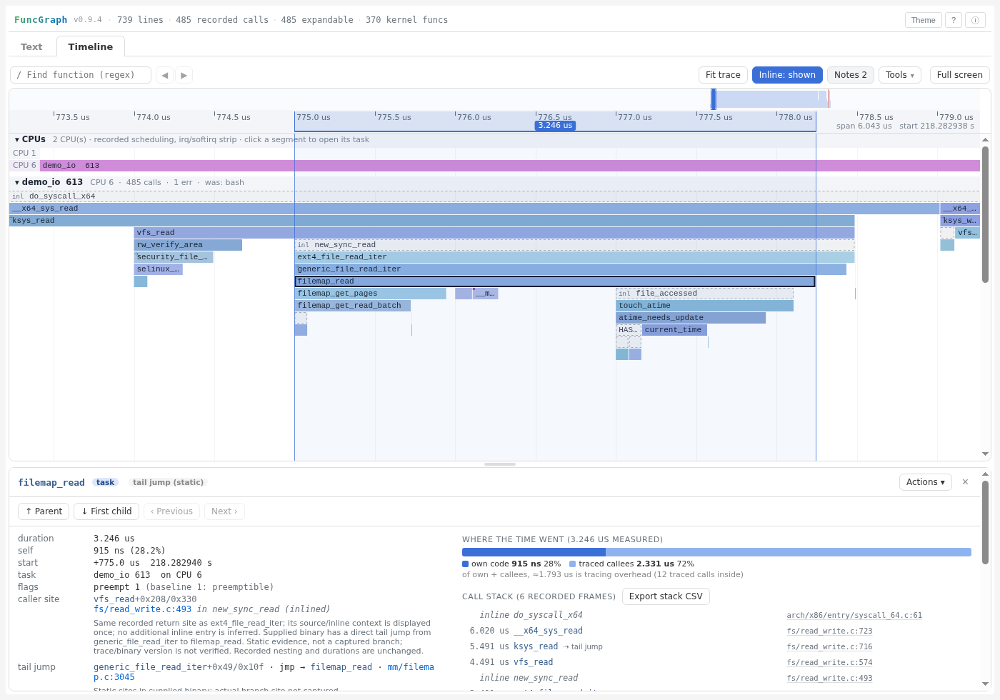

# Tail calls and shared inline context / 尾调用与共享内联上下文

## Reproduction / 问题复现

The read path in `sample.html`, `sample_mixed.html`, and the reported `write4.html`
contains these recorded calls:

| Recorded function | Recorded return site |
|---|---|
| `ext4_file_read_iter` | `vfs_read+0x208/0x330` |
| `generic_file_read_iter` | `vfs_read+0x208/0x330` |
| `filemap_read` | `vfs_read+0x208/0x330` |

Resolving that one return address gives the same DWARF chain every time:
`vfs_read → new_sync_read`. Previously the renderer inserted that chain above
**each** record, making `new_sync_read` look like three nested invocations.
Those are three references to the same source context, not three independent
pieces of inline execution evidence.

截图中的问题不是三次独立调用了 `new_sync_read`，而是同一个返回地址解析出的
内联链被重复插入。提供的二进制还有 `ext4_file_read_iter → generic_file_read_iter`
和 `generic_file_read_iter → filemap_read` 的直接尾跳转静态证据；报告没有执行分支
记录，仍不能把静态指令当成本次跳转的直接观测。

## Display / 展示方案



```text
vfs_read
  [inl] new_sync_read
    ext4_file_read_iter
      ⇢ generic_file_read_iter
        ⇢ filemap_read
```

- Insert the shared inline context once, above its first recorded call.
- Keep **every real call**, its recorded nesting, duration, self estimate, flags,
  arguments, return value, original return address and trace-line links.
- Show `⇢ tail jump` only when the existing `--tail-calls` analysis supplies
  supported direct-jump evidence. Equal return addresses alone are not proof of
  a tail call; without that evidence retain **caller mismatch**.
- A later call's source panel says **Shared return-site source**. The tooltip and
  detail explain which earlier record supplies that context. Its source excerpt
  and links remain available; no additional inline entry is inferred from the
  repeated address, and it is not labeled as
  the immediate parent's call instruction.
- Call-stack display and CSV list the inline chain once. CSV retains all real
  rows and adds `source_context_owner_slice_index` / `source_context_basis`.
  `shared_recorded_return_site` identifies reuse; the owner index is the first
  representative record, not proof of an instruction or physical stack owner.
- No new toolbar switch, bright color or extra synthetic tail-call slice.

只合并**重复的源码上下文**，不合并真实调用，不把尾调用改画成虚构的顺序时间段，
也不删除真正的内联层。图中的箭头有独立静态证据时才显示；没有开启 `--tail-calls`
也能避免重复插入同一个上下文，但不能据此宣称尾调用已经得到证明。

## Recognition / 识别边界

The frontend assigns one source-context owner per recorded call during its
existing forward inline-preparation pass. A child reuses its parent's owner
only when all of these checks pass:

1. The parent is an earlier valid record. A caller/parent mismatch is indicated
   either by existing diagnostic flags or by the resolved containing source
   function differing from that parent. This also handles uftrace kernel records
   without the native parser's mismatch flag; stored flags are not changed.
2. Their complete recorded caller identifiers match, including offset and module
   text. Matching function names or source lines alone is insufficient.
3. They belong to the same task, address space, execution context and module.
4. Their recorded depths are adjacent and the child's interval is contained in
   the parent's interval.
5. Neither record is orphaned or crosses a user/kernel boundary. A direct
   recursive call to the same recorded function starts its own context.

Each further adjacent tail-chain record reuses the already computed owner;
there is no repeated ancestor walk. This adds one `Int32Array` (4 bytes per real
call) and constant work per record. The existing preparation yield points remain
in place. No disassembly, source fetch or trace-wide scan runs on hover.

按完整地址、相邻父子关系、同任务/模块/执行上下文及时间包含关系保守识别。
深度缺口、缺失地址、不同调用点、递归中的正常调用、任务/用户内核/中断边界和
异常区间不会仅因函数名相同而被合并。兄弟调用保持独立来源；原有“同一父记录下
连续调用合成一个内联跨度”的规则不变。

The original Timeline JSON, source pool, compact position indexes and trace
records are unchanged. Existing reports need regeneration to use the new
frontend. Unsupported/indirect tail transfers remain unresolved by static
analysis; this change does not extend binary-analysis coverage. Source-context
reuse describes presentation of static address evidence, not an observation of
how many times an untraced wrapper or inline body was entered.

## Inline source / 内联源码

Clicking an inline slice now opens **Inline source context** directly and opens
the selected frame, including a middle frame in a longer chain. It reuses the
first recorded child's source block without changing selection. The excerpt is
that observed call-site context, not a complete inline body or a fabricated
function-entry location. Chain/flat mode, source links, lazy sidecar loading,
retry and cancellation retain their existing behavior. If excerpts were not
included, show that limitation explicitly and retain available source links.

## Tests / 验证

```bash
PYTHONPATH=tests:. python3 -m unittest \
    test_tail_inline_context test_inline_sources test_source_classification \
    test_inline test_tailcalls -v
```

The focused cases cover single/sidecar delivery, static evidence on/off,
multi-level inline selection, absent excerpts and compact metadata, source-mode
round trips, retries/cancellation, recursion, sibling calls, depth gaps, different
return sites/tasks/modules/contexts, user/kernel boundaries, orphaned records,
invalid intervals, and long tail chains with complete CSV export. Sample checks
compare every original record and source payload, and the Timeline model apart
from generation time.

Validation on **2026-11-17**: **238 tests passed** (153 focused/source/detail/
sample/layout tests, 47 existing source/inline/stack browser regressions, and 38
preparation/source-index/color regressions). This is targeted validation, not a
full-suite run. Public samples retain all 739 / 1,504 trace rows, 485 / 714 real
calls and 10 / 74 events, with identical source pools and position indexes.

The real `write4` report retains **29,586 real calls**, all original columns,
strings, inline evidence and source positions. In the selected read path, the
stack changes from three repeated `new_sync_read` contexts to one. Other source
contexts are retained rather than globally deduplicated by function name. The
regenerated local verification report also retains the original embedded source
excerpts with identical line mapping, while pinning browser URLs from `master`
to the matching `v7.4-rc2` revision. Clicking the retained inline frame opens its
source and expands `new_sync_read` directly.
