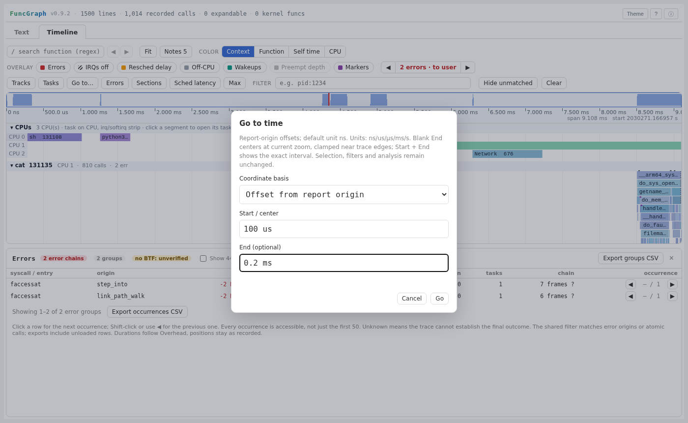

# Precise Timeline positioning

`Go to…` / `G` complements drag, overview and function search with explicit
coordinate navigation. It changes the viewport, not the recorded model,
selection, shared filter, track visibility or analysis scope. Compact layouts
keep the entry in More rather than adding a permanent narrow-screen toolbar.

## Coordinate contract

- Offset input defaults to nanoseconds; timestamps default to seconds. Decimal
  `ns`, `us`, `µs`, `μs`, `ms` and `s` are accepted case-insensitively.
- Recorded timestamps require measured mode and an exact origin. Prefer the
  decimal `uftrace.origin_ns` string; only safe nonnegative integer `t0` is
  eligible as a fallback. Unknown/rounded origins and unverified mixed clocks
  do not offer this basis. A recorded timestamp is not a calendar time.
- Parse decimals and subtract the origin with BigInt before Number conversion.
  This preserves individual nanoseconds above the absolute safe-integer range;
  it cannot repair precision already lost in an older report's origin.
- Duration-based and packed coordinates retain their own semantics, without
  fabricating timestamps or idle gaps. Call-order inputs use `u`, `unit` or
  `units`, default to `u`, and support exact thousandths. They are drawing
  coordinates, not ordinal call lookup.
- Reject hexadecimal, exponential notation, NaN/Infinity, fractional
  nanoseconds, negative offsets, positions after the recorded extent and
  unsafe relative integers. Bounded decimal input is at most 80 characters.
- Blank end pans to the coordinate at the current zoom, subject to existing
  trace-edge clamping. An explicit end must exceed start and sets that exact
  interval, including spans below the wheel zoom minimum. Opening and
  cancelling does not change the viewport.
- Basis changes convert both valid fields exactly. Invalid text retains the
  old basis, stays in place and gets a focused inline error. Enter submits;
  Escape/Cancel closes. Modal keys cannot trigger underlying shortcuts.

## Layout and lifecycle

The native dialog supplies modal semantics and an explicit Tab boundary loop.
Its colors follow the report theme; text fields remain 16px on touch devices,
compact controls are at least 44px high, and the dialog scrolls internally in
short landscape viewports. Closing restores a visible invoking control or the
Timeline focus helper. Leaving Timeline closes it without stealing Text focus.
Single-file, actual CLI sidecar, Timeline-only and event-only reports share the
same implementation. The normal draw path still runs: this feature does not
promise bounded drawing work or general large-trace performance improvement.

## Verification

From the project root:

```bash
(cd tests && python3 -m unittest -v test_position)
FG_RAW_REQUIRED=1 FG_UFTRACE_REQUIRED=1 FG_SAMPLE_BROWSER_REQUIRED=1 tests/run.sh
```

The focused suite covers exact units/ranges, invalid input and transactional
basis conversion, 64-bit recorded timestamps, zero-call lifecycle reports,
single/sidecar and no-Text delivery, mode/clock distinctions, modal keyboard and
focus behavior, and both themes at 320/390px portrait and 844px landscape.

### Results (2026-11-12)

- Final focused suite: **11 tests pass**, 12.997s. This also checks a range
  summary keeps its original scope after viewport navigation, trace-edge
  centering retains the span, duration-based mode is explicitly labelled, and
  dark-theme validation text/borders use the existing light-red error palette.
- Isolated parent-plus-feature source: **278 tests pass**, 373.624s, covering
  positioning, existing browser interactions, lifecycle/event-only reports and
  narrow detail expansion. The final focused run is repeated after the last
  hint/error-color and test-assertion refinements. Pending Text work is absent
  from this isolated source.
- Required-native full worktree audit: **945 tests**, 543.512s; **941 pass,
  3 skip, 1 fails**. The failure is the pre-existing pending Text assertion
  `test_textchunks.TextChunkBrowserTest.test_native_layout_skips_offscreen_blocks_without_dropping_complete_records`:
  Chromium returns `auto …px` for some computed `containIntrinsicBlockSize`
  values while that assertion expects bare `…px`. That work is not changed or
  included here. This is not an all-green full-suite claim.
- Generator-fragment JavaScript syntax checks, Python test compilation and
  `git diff --check` pass.

### Real-report matrix

Generate reports with the same options from parent `a70fa3f7632f` and this
change, using both `tests/data/pi4_sched.txt` and `samples/sample_mixed.jsonl`:

```bash
python3 funcgraph.py --no-config --timeline --enable-fold --filter \
  --report-mode single --output /tmp/position-pi4.html tests/data/pi4_sched.txt
python3 funcgraph.py --no-config --timeline --enable-fold --filter \
  --report-mode sidecar --output /tmp/position-mixed samples/sample_mixed.jsonl
```

The four before/after trace × delivery pairs retain identical Timeline JSON,
excluding the nondeterministic `stats.build_time`. With the final implementation,
**32 configurations / 96 scope checks pass**: both traces, single/sidecar,
light/dark, 1400×860, 390×844, 320×700 and 844×390, each unfiltered, filtered to
a recorded function and filtered to no matches. Use the actual shared filter
field, reaching it through More in compact layouts, and a fresh context per
independent scope to avoid browser download-rate state.

For each scope, exercise an exact 101–119ns offset interval, centering at the
same zoom, exact recorded-timestamp input and a cold Text round trip with the
dialog initially open. Selection, actual filter text, collapsed track state,
analysis text and all three available Errors CSV byte streams stay unchanged;
the interval survives the round trip and the modal closes on view exit.
No page errors, CSP violations or document-wide horizontal overflow occur.
Do not force-select a filtered-out call after applying an empty filter: that
creates artificial state which cold Text's legitimate filter notification
clears, independently of positioning.

These real captures have 1,014 / 714 calls, respectively. They validate UI and
model compatibility, not large-trace rendering performance; 64-bit-origin and
other time-mode checks are separately exercised by the focused fixtures.

## Documentation image



The image uses the complete single-file Pi4 report: 1,500 original Text lines
and 1,014 recorded calls, light theme, 1400×860. Notes is collapsed, Errors is
open and the split is manually placed at y=500 to keep chart and analysis
visible. The modal contains `100 us` / `0.2 ms`; it has not submitted them.
Additional dark and 320/390px portrait / 844px landscape captures were visually
inspected or exercised in browser checks. This is an arranged documentation
view, not a new default pane height or a regenerated public sample.

No dependency pin, native payload, public capture, public sample HTML, version,
push or release change is part of this iteration.
